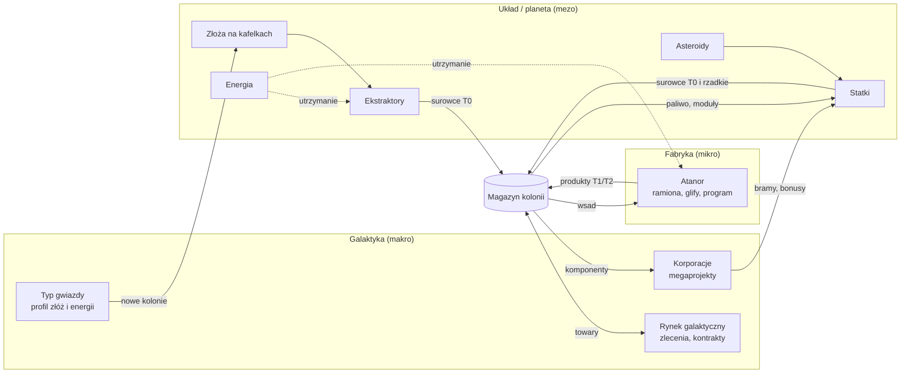

# Analiza mechanik z PoC i propozycja integracji

> **Status:** wersja robocza do dyskusji. Etap 1 stage-gate („Zasady gry i mechanika”) wg `init.md`.
> **Data:** 2026-11-07
> **Zakres:** `poc/space-3d-poc`, `poc/space-atanor`, `poc/space-galaxy-poc` oraz dokumenty w katalogu głównym (`1-game-description.md`, `init.md`)
> **Dokument powiązany:** [`game-design-questions.md`](game-design-questions.md) zawiera pytania do doprecyzowania (identyfikatory `WIZ-…`, `EKO-…`, `SOC-…`, `MP-…`, `MON-…`, `MVP-…`, `TECH-…`, `POC-…`)

## Jak czytać ten dokument

Dokument ma dwie części, rozdzielone celowo:

- **Część I — Stan faktyczny** (rozdziały 2–7): wyłącznie to, co wynika z kodu i plików w repozytorium. Istotne twierdzenia mają odnośnik `plik:linia` (ścieżki względem katalogu danego PoC, jeśli nie podano inaczej). Wyniki moich pomiarów (testy, symulacje headless) oznaczam **[pomiar]**; metoda jest opisana w Załączniku A. Wnioski wyciągnięte z faktów oznaczam **[wniosek]**, a szacunki **[szacunek]**.
- **Część II — Propozycje** (rozdziały 8–15): wizja, integracja, warianty, ryzyka. To są **propozycje**, nie fakty. Przyjęte przeze mnie założenia oznaczam **[założenie]**.

Tam, gdzie PoC jest niejednoznaczny, nie zgaduję, tylko odsyłam do pytania (np. → `POC-4`).

Kod w `poc/` nie był modyfikowany.

## 1. Streszczenie

1. Trzy PoC odpowiadają trzem **skalom** jednej gry: **planeta/układ** (`space-3d-poc`: budowa na kafelkach, energia, wydobycie, loty orbitalne), **fabryka** (`space-atanor`: programowalna produkcja w stylu *Opus Magnum*) i **galaktyka** (`space-galaxy-poc`: mapa gwiazd).
2. Dojrzałość jest bardzo nierówna. `space-3d-poc` to dobrze zaprojektowany prototyp: warstwy, czysta domena, zdarzenia domenowe, 81/81 testów. `space-atanor` ma działający, deterministyczny silnik, ale z błędami: 18/18 testów przechodzi, a mimo to domyślne rozwiązanie poziomu 2 kończy się kolizją, a licznik cykli jest błędny. `space-galaxy-poc` to wyłącznie wizualizacja, bez mechaniki rozgrywki i bez testów.
3. Żaden PoC nie ma serwera, persystencji, trybu wieloosobowego ani warstwy social. Cały stan żyje w przeglądarce.
4. Ekonomia w PoC ma **tylko źródła, bez ujść**: nie ma utrzymania, kosztu paliwa ani warunków porażki. Do tego globalny magazyn sprawia, że logistyka statkiem nic nie wnosi. To najważniejsza luka do zamknięcia przy integracji.
5. **Propozycja:** jako MVP wariant „własna kolonia + asynchroniczna wspólna galaktyka”, z architekturą (serwer autorytatywny, model zdarzeniowy) gotową na przejście w trwały wspólny świat. Atanor pełni rolę „inżynierii przewagi”: zaprojektowana maszyna staje się w ekonomii stałą przepustowością.

---

# Część I — Stan faktyczny

## 2. Inwentarz materiałów

| Element | Ścieżka | Zawartość | Uwagi |
|---|---|---|---|
| Opis wizji | `1-game-description.md` | core loop ekonomii, energia jako wąskie gardło, 3 poziomy infrastruktury, asynchroniczny rynek, korporacje, timery czasu rzeczywistego, 3 tryby kamery, modele serwera A/B, 4 pytania blokujące | dokument wizji, nie specyfikacja |
| Brief architekta | `init.md` | rola, preferencja Rust, proces stage-gate, budżety (pierwsze pobranie < 15–25 MB, 100–150 draw calls, 200–400 tys. trójkątów), „single-node first” | przewiduje późniejszy `docs/ARCHITECTURE-DISCOVERY.md` |
| `poc.md`, `architecture/` | katalog główny | pusty plik, pusty katalog | — |
| PoC 1 | `poc/space-3d-poc` | ekonomia planetarna i logistyka orbitalna (3D) | 59 plików TS + 14 plików testów; własne dokumenty: `CLAUDE.md`, `POC-PLAN.md`, `staff.md.txt` (spec), `planetary.md.txt`, `space-3d.md.txt` |
| PoC 2 | `poc/space-atanor` | programowalna produkcja (heksy, ramiona, glify) | 2D; `mechanics.md`, `task.md`; `prtscr.png` to zrzut z *Opus Magnum* (referencja) |
| PoC 3 | `poc/space-galaxy-poc/star-map` | mapa 41 gwiazd (3D) | 6 plików TS; `prtscr.png` pokazuje aplikację, która nie odpowiada kodowi (→ `POC-2`) |

## 3. PoC 1 — `space-3d-poc`: ekonomia planetarna i logistyka orbitalna

**Mechanika w jednym zdaniu:** budowa kolonii na kafelkach planety (złoża, moc), automatyczne wydobycie z kafelków oraz wydobycie statkiem z asteroidy, z lotami między ciałami poruszającymi się po orbitach.

### 3.1 Pętla rozgrywki (z kodu)

```
Start: magazyn Fe 40 / Kr 10 / Si 20; na planecie lądowisko + panel słoneczny (moc: 5 prod. / 2 zuż.)
  │
  ├─► BUDOWA na kafelku (natychmiastowa): koszt pobierany z magazynu; ekstraktor wymaga złoża;
  │     konsument mocy wymaga wolnej mocy na danym ciele
  │        └─► EKSTRAKTOR: +2 surowca/s do globalnego magazynu, aż złoże się wyczerpie
  │
  ├─► LOT STATKIEM (PPM na ciało): paliwo = dystans × 0,02, pobierane przy starcie;
  │     rozkaz odrzucany, gdy po locie zabraknie rezerwy na powrót
  │        └─► na asteroidzie automatycznie tryb MINING: +10/s do ładowni (maks. 50)
  │              └─► powrót do bazy: rozładunek do magazynu + darmowe tankowanie do 100
  │
  └─► ŁAZIK: jazda po kafelkach (BFS); poza ruchem nie ma innej funkcji
```

Źródła: `src/app/game/config/initial-world.ts:17`, `src/app/game/config/world.ts:29-35`, `src/app/game/systems/build-system.ts:35-47`, `src/app/game/systems/extraction-system.ts:9-25`, `src/app/game/systems/transfer-system.ts:35-44`, `src/app/state/command.service.ts:61-88`, `src/app/game/reducer.ts:33-43`, `src/app/game/systems/mining-system.ts:15-50`, `src/app/game/systems/docking-system.ts:8-14`, `src/app/game/systems/rover-system.ts:38-66`.

### 3.2 Zasoby

- Trzy surowce o wymyślonych nazwach: Ferryt (`FERRITE`), Kriol (`CRYOL`), Silicyt (`SILICITE`) (`src/app/game/models/resource.model.ts:1-2`).
- Moc liczona osobno dla każdego ciała jako statyczny bilans produkcji i zużycia (`src/app/game/economy/power.ts:12-22`).
- Statek: paliwo 100, ładownia 50 (limit dotyczy sumy wszystkich surowców) (`initial-world.ts:78-91`, `src/app/game/models/spacecraft.model.ts:13-14`).
- Kredyty: `credits = signal(1000)` jest zadeklarowane, ale nigdzie nieużywane (`src/app/state/game-state.service.ts:31`) → `POC-9`.

### 3.3 Akcje gracza

- LPM zaznacza statek, łazik lub kafelek. PPM na ciele wydaje rozkaz lotu. PPM na kafelku przy zaznaczonym łaziku wysyła go w to miejsce. Pasek budowy włącza tryb stawiania z zielonym lub czerwonym „duchem” budowli. Spacja to pauza, klawisze 1/2/3 przełączają tempo ×1/×3/×10 (`CLAUDE.md`, sekcja „Controls”).
- Budowa 8 typów budowli (tabela w 3.5).
- Nie ma rozbiórki, budowy statków, kolejki rozkazów ani automatyzacji tras.

### 3.4 Warunki sukcesu i porażki

- **Nie ma żadnych.** Gra nie ma celu, zwycięstwa ani porażki.
- Porażka jest wręcz wykluczona konstrukcyjnie. Moc nie może spaść poniżej zera, bo budowa konsumenta jest blokowana (`power.ts:7`, `build-system.ts:29-30`). Statek nie może utknąć, bo rozkaz bez rezerwy na powrót jest odrzucany (`command.service.ts:73-79`).
- Jedyne „niepowodzenia” to odrzucone rozkazy: 13 powodów (`src/app/game/models/domain-event.model.ts:7-20`).

### 3.5 Parametry

Ciała niebieskie (`initial-world.ts:19-76`):

| Ciało | Rodzic | Promień | Promień orbity | Okres | Siatka powierzchni | Zasoby |
|---|---|---|---|---|---|---|
| Słońce | — | 60 | 0 | — | — | — |
| Planeta Matka | Słońce | 50 | 900 | 240 s | GP(8,0): 642 kafelki | złoża (seed 11) |
| Księżyc | Planeta | 15 | 160 | 40 s | GP(3,0): 92 kafelki | złoża (seed 23) |
| Asteroida | Słońce | 12 | 1500 | 600 s | brak (bryła proceduralna) | 500 Ferrytu (dla statku) |

Stałe (`src/app/game/config/game-constants.ts:20-29`): prędkość przelotowa 150 j/s, paliwo 0,02 na jednostkę dystansu, wydobycie statkiem 10/s, przechwycenie przy 1,1 × promień celu, maksymalny krok symulacji 0,1 s, wysokość łuku Béziera 0,2 × dystans, łazik 12 j/s.

Budowle (`src/app/game/models/structure.model.ts:26-35`):

| Budowla | Koszt | Moc | Efekt |
|---|---|---|---|
| Kopalnia Ferrytu (`MINE`) | 15 Fe | −3 | 2 Fe/s ze złoża Ferrytu |
| Ekstraktor Kriolu | 15 Fe | −3 | 2 Kr/s ze złoża Kriolu |
| Wieża Silicytu | 15 Fe + 5 Kr | −3 | 2 Si/s ze złoża Silicytu |
| Panel słoneczny | 10 Si | +5 | — |
| Turbina wiatrowa | 15 Fe + 10 Si | +10 | — |
| Habitat | 20 Fe + 10 Si | −2 | **brak efektu w grze** |
| Magazyn | 15 Fe + 5 Kr | −1 | **brak efektu w grze** (magazyn nie ma limitu) |
| Lądowisko | 30 Fe + 10 Kr | −2 | przenosi punkt dokowania statku na kafelek |

Złoża (`src/app/game/math/deposit-generator.ts:12-36`): ok. 3,5% kafelków zostaje zarodkiem klastra, a każdy sąsiad zarodka dołącza z prawdopodobieństwem 0,5. Zarodek ma 200–500 jednostek, sąsiad 100–300 (krok 10). Surowiec klastra jest losowany równomiernie z trzech. **[pomiar]** Planeta ma 90 kafelków ze złożami: Kriol 39 (razem 9410 j.), Silicyt 32 (7470 j.), Ferryt 19 (4230 j.). Księżyc ma tylko 3 złoża Silicytu (700 j.).

### 3.6 Zależności

- **Moc ↔ budowa.** Produkcja mocy (panel 5, turbina 10) ogranicza liczbę konsumentów na danym ciele. Moc nie wpływa jednak na pracę budowli w czasie: działa wyłącznie jako bramka w chwili budowy.
- **Surowce ↔ budowle.** Silicyt idzie głównie na energię (panele), Ferryt na prawie wszystko, Kriol na Wieżę Silicytu, Magazyn i Lądowisko.
- **Start.** Wolna moc wynosi 3, więc mieści się dokładnie jedna kopalnia. Drugą odblokowuje dopiero turbina (test `src/app/game/full-loop.spec.ts:162-183`).
- **Orbity.** Odległości zależą od fazy orbit, więc koszt i czas lotu zmieniają się w czasie. **[pomiar]** Lot planeta → asteroida trwa 4,3–16,2 s i kosztuje 12–48 paliwa.
- **Rezerwa powrotu.** Lot w dowolne miejsce poza bazą wymaga, by po nim zostało paliwo na najgorszy przypadek powrotu. **[pomiar]** Dla asteroidy rezerwa to 49,6, dla Księżyca 40,8.

### 3.7 Stack i dojrzałość

- Angular 22 (standalone, zoneless, Signals), Three.js 0.187 z `logarithmicDepthBuffer`, Tailwind 4, vitest, TypeScript ~6.0 w trybie strict (`package.json`, `CLAUDE.md`).
- Architektura ma cztery warstwy z jednym kierunkiem zależności: `ui → state → game ← engine`. `game/` to czysty TypeScript bez Angulara i Three.js. Stan zmienia się wyłącznie przez `apply(events)` → reducer (`src/app/state/game-state.service.ts:92-102`, `reducer.ts:21-93`). Zdarzeń domenowych jest 12 typów (`domain-event.model.ts:22-34`).
- Fizyka jest analityczna: pozycja ciała to funkcja czasu, bez całkowania (`src/app/game/math/orbit-solver.ts:26-43`). Transfer leci po kwadratowej krzywej Béziera z wyprzedzeniem ruchomego celu (lead intercept), a punkt końcowy jest korygowany w każdej klatce (`transfer-system.ts:87-96`).
- Assety: KayKit Space Base Bits (CC0), 14 modeli glTF z plikami `.bin` i atlasem PNG, razem ok. 0,5 MB (`public/assets/kaykit/`). Wg `POC-PLAN.md` §11 scena ma 19 draw calls przy 60 fps (to deklaracja autorów, nie mój pomiar).
- Testy: **[pomiar]** 14 plików, 81/81 przechodzi, w tym headless test całej pętli (`full-loop.spec.ts`).
- Plan i status są w `POC-PLAN.md` §8–11 (fazy 0–6 oraz pakiety prac dla siatki Goldberga, modeli i ekonomii). Pakiety WP3–WP7 dla modeli „czekają na akceptację” (§10). Część planów leży w zewnętrznych dokumentach „Claude Docs”, których nie ma w repozytorium.
- **Ocena dojrzałości: 4/5.** Prototyp z przemyślaną architekturą i testami, ale z płytką mechaniką ekonomiczną.

### 3.8 Ograniczenia, luki, niejasności

1. **Brak ujść i napięcia.** Istnieją tylko źródła surowców. Nie ma utrzymania, zużycia ani kosztu paliwa: tankowanie jest darmowe (`docking-system.ts:12`, `reducer.ts:66-67`).
2. **Magazyn jest globalny.** Ekstraktory na Księżycu zasilają ten sam magazyn natychmiast (`extraction-system.ts:21`, `reducer.ts:76-81`), więc transport między ciałami nie jest potrzebny. **[wniosek]** Logistyka statkiem jest zdominowana przez kopalnie. **[pomiar]** Kurs z 50 Fe daje 1,35–3,69 Fe/s zależnie od fazy orbit (średnio ok. 2,0 Fe/s) i wymaga dwóch rozkazów na kurs. Jedna kopalnia za 15 Fe daje stałe 2 Fe/s bez żadnej interakcji. Asteroida (500 Fe) wystarcza na 10 kursów.
3. **Energia działa jako bramka, nie jako regulator.** W wizji deficyt mocy obniża wydajność kopalń do 20% (`1-game-description.md:28-29`). W kodzie moc ma znaczenie tylko w chwili budowy (`power.ts`, `build-system.ts:29`).
4. **Elementy bez funkcji.** Habitat i Magazyn nic nie robią (→ `POC-8`). Łazik poza ruchem nie ma roli (→ `POC-10`). Księżyc jest dla statku tylko punktem postoju (→ `POC-11`).
5. **Czas.** Wszystko dzieje się w sekundach, budowa jest natychmiastowa (pole `builtAt` jest zapisywane, ale nieużywane — `structure.model.ts:54-55`).
6. **Model czasu nie przenosi się wprost na serwer zdarzeniowy.** Czas lotu nie jest znany w chwili startu: postęp rośnie wg aktualnej długości krzywej, której koniec jest korygowany w każdej klatce (`transfer-system.ts:87-94`). Wydobycie i ekstrakcja korzystają z akumulatorów 1 Hz zależnych od `dt` klatki (`mining-system.ts:38-46`, `extraction-system.ts:9-12`). **[wniosek]** Serwer zdarzeniowy wymaga ETA wyliczanego w chwili rozkazu i produkcji liczonej jako tempo × czas.
7. Jest tylko jeden statek i jeden łazik. Nie ma stoczni, kolejki rozkazów ani automatyzacji tras.
8. **Pipeline assetów.** Projekt używa glTF + PNG, a `1-game-description.md:61-62` i `init.md:129-131` wymagają `.glb` z kompresją meshopt/Draco i tekstur KTX2.
9. **Rozbieżności spec ↔ kod** są udokumentowane w `POC-PLAN.md` §8: inny koszt paliwa, orbita asteroidy zmieniona z 1800 na 1500, kredyty z `staff.md.txt` niewdrożone (→ `POC-12`).

## 4. PoC 2 — `space-atanor`: programowalna produkcja (w stylu *Opus Magnum*)

**Mechanika w jednym zdaniu:** gracz rozstawia na planszy heksagonalnej ramiona i glify, programuje je na osi czasu i buduje w ten sposób maszynę, która z nieskończonych źródeł atomów składa cząsteczkę docelową.

### 4.1 Pętla rozgrywki (z kodu)

```
Wybór poziomu (4) → rozstawienie ramion i glifów (pasek BUDOWA) → program na osi czasu (16 slotów na ramię)
  → Play / Krok → tick: rozkazy → kinematyka → kolizje → glify, ujście, źródła
  → sukces: dostarczono N cząsteczek  |  awaria: kolizja (JAM) → reset i poprawki
```

Źródła: `src/core/engine/pipeline.ts:20-281`, `src/core/engine/simulation.ts:104-153`, `src/app/services/game-state.service.ts:79-194`.

### 4.2 Zasoby i elementy

- Typy atomów: `A, B, FIRE, WATER, SALT, EARTH, LEAD, GOLD, QUICKSILVER` (`src/core/graph/molecule.ts:3`). Poziomy używają A, B, WATER, SALT, LEAD i GOLD.
- Źródło (INPUT) generuje nowy atom, gdy jego pole jest puste, więc podaż jest nieograniczona (`pipeline.ts:256-269`).
- Ujście (OUTPUT) konsumuje cząsteczkę zgodną ze wzorcem (`pipeline.ts:229-252`).
- Koszt jest sumowany, ale **nie ma budżetu ani limitu** (`simulation.ts:185-204`).

### 4.3 Akcje gracza

- **Budowa:** ramię L1, ramię L2, tłok (startuje z długością 1, wysuwa się do 3), Bonder, Unbonder, usuwanie, obrót podglądu (`src/app/components/build-toolbar/build-toolbar.component.ts:152-160`). Edytor nie oferuje glifu transmutacji ani szyn (występują tylko w definicjach poziomów 3–4), ramienia L3 (jest w kosztach i API silnika) ani ramion wieloramiennych (nie ma ich nigdzie).
- **Program:** 11 rozkazów oraz pusty slot: GRAB, DROP, ROTATE_CW/CCW, PIVOT_CW/CCW, EXTEND/RETRACT, TRACK_POS/NEG, REPEAT, EMPTY (`src/core/engine/types.ts:4-16`). Rozkazy mają skróty klawiszowe (`src/app/components/command-palette/command-palette.component.ts:103-114`).
- **Sterowanie:** Play/Pauza, Krok, Reset, prędkość 0,5–4× (600 ms na tick przy 1×) (`control-bar.component.ts`, `game-state.service.ts:51`).

### 4.4 Sukces i porażka

- **Sukces:** `productsDelivered ≥ targetRequired`, gdzie cel wynosi 5–6 zależnie od poziomu (`pipeline.ts:276`).
- **Porażka:** dwa atomy na jednym polu po fazie ruchu dają JAM i zatrzymują symulację (`pipeline.ts:180-199`). Poziomu nie da się „przegrać” na stałe: można poprawiać maszynę do skutku.

### 4.5 Parametry i zasady

- **Tick ma 4 fazy** (`pipeline.ts`, panel dydaktyczny): (1) GRAB/DROP, (2) kinematyka obejmująca całą spójną składową grafu, (3) kolizje, (4) glify, potem ujście, potem źródła. Bonder tworzy wiązanie, zawsze rzędu 1 (`pipeline.ts:210`). Unbonder je zrywa. Transmute zmienia pierwiastek atomu i zachowuje jego wiązania.
- **Oś czasu** ma 16 slotów (`simulation.ts:12`, `timeline.component.ts:238`). REPEAT na dowolnym ramieniu zawija **wszystkie** ramiona do slotu 0 (`simulation.ts:109-124`).
- **Dopasowanie cząsteczki** sprawdza liczbę atomów i wiązań, typy pierwiastków, istnienie wiązań i odległości heksowe między wszystkimi parami atomów (`molecule.ts:246-299`). Akceptuje więc dowolny obrót i odbicie lustrzane. Nie sprawdza, który atom stoi na polu ujścia.
- **Koszty** (`src/core/engine/arm.ts:35-41`, `src/core/engine/glyph.ts:66-79`): ramię 20 (+10 za L2, +20 za L3, +10 za tłok); Bonder 10, Unbonder 10, Transmute 20; źródła i ujścia 0; szyny nie są liczone wcale.
- **Obszar** to liczba unikalnych pól odwiedzonych przez podstawy ramion, chwytaki i atomy, próbkowana na końcu każdego ticka (`simulation.ts:155-163`).
- **Poziomy** (`src/core/engine/levels.ts`): L1 dimer A–B (cel 6), L2 „Aqua Salis” SALT+WATER (6), L3 transmutacja Pb → Au (5), L4 szyna (5). Każdy poziom startuje z **gotowym domyślnym rozwiązaniem**.

### 4.6 Stack i dojrzałość

- Angular 22 + PixiJS 8.22 (renderer 2D, `src/renderer/pixiRenderer.ts`, ok. 26 KB), vitest + jsdom, skrypt Playwright do zrzutów ekranu (`run-check.mjs`).
- Silnik (`src/core/`) nie zależy od Angulara ani Pixi i jest w pełni deterministyczny: całkowite współrzędne osiowe, brak losowości, brak zależności od `dt`. **[wniosek]** Łatwo go przenieść na serwer i użyć do weryfikacji powtórek.
- Testy: **[pomiar]** 8 plików, 18/18 przechodzi (ostrzeżenia jsdom o `getContext` nie mają wpływu na wynik).
- Projekt ma panel dydaktyczny (stan grafu, fazy ticka), a `mechanics.md:1` wprost opisuje go jako PoC „w celach edukacyjnych” (→ `WIZ-5`).
- **Ocena dojrzałości: 3/5.** Działający silnik i edytor, ale z błędami w metrykach i treści poziomów.

### 4.7 Ograniczenia, luki, niejasności

1. **Domyślne rozwiązanie L2 nie działa.** **[pomiar]** Po 9 tickach następuje JAM (SALT–SALT na polu [1,−2]) przy 0/6 dostarczonych produktów. SALT nigdy nie trafia na glif wiązania, a żadne ramię nie sięga pola ujścia (0,−1). L2 nie ma testu (→ `POC-4`).
2. **Metryka „CYKLE” jest błędna.** UI pokazuje pozycję głowicy osi czasu, która po REPEAT wraca do 0 (`src/app/components/control-bar/control-bar.component.ts:72`, `simulation.ts:119-121` i `:195`). **[pomiar]** L1 ukończony po 50 tickach pokazuje „5”. Ocena wg trzech metryk, czyli rdzeń mechaniki według `mechanics.md` §4, jest przez to niewiarygodna (→ `POC-5`).
3. **Kolizje są uproszczone.** Silnik wykrywa tylko dwa atomy na tym samym polu po ruchu. Nie sprawdza trajektorii, czego wymaga `task.md:42`. Ramiona z niczym nie kolidują.
4. **Potencjalny błąd:** dwa ramiona trzymające różne atomy tej samej cząsteczki obrócą ją dwukrotnie, bo zabezpieczenie działa po ID trzymanego atomu, a nie cząsteczki (`pipeline.ts:63-75`). Nie zweryfikowałem tego testem.
5. **Brakujące elementy z dokumentacji.** Są tylko wiązania pojedyncze. Brakuje wiązań rzędu 2 i 3, ramion wieloramiennych, glifów kalcynacji i duplikacji (`mechanics.md:19-20`) oraz histogramów, rankingów i eksportu GIF (`mechanics.md:39-41`) (→ `POC-6`).
6. Nie da się zapisać ani udostępnić rozwiązania. Nie ma limitu kosztu ani obszaru. Plansza jest logicznie nieskończona, ale rysowana tylko w promieniu 7 (`pixiRenderer.ts:214`).
7. **Tematyka alchemiczna** (ołów → złoto, sól, woda) nie łączy się z surowcami kosmicznymi z 3D PoC (→ `POC-7`).

## 5. PoC 3 — `space-galaxy-poc`: mapa gwiazd

**Mechanika w jednym zdaniu:** interaktywna wizualizacja 41 rzeczywistych gwiazd w 3D z kartą danych astrofizycznych, **bez mechaniki rozgrywki**.

### 5.1 Co jest w kodzie

- **Dane 41 gwiazd** (`star-map/src/app/data/stars.data.ts:21-596`): nazwa, współrzędne x, y, z w parsekach, jasność obserwowana i absolutna, klasa widmowa, kolor, dystans w latach świetlnych, gwiazdozbiór, opis, temperatura, masa, promień, jasność w L☉, liczba znanych planet.
- **Widok:** kula i poświata (sprite) dla każdej gwiazdy; etykiety dla gwiazd bliższych niż 50 ly i 6 wybranych jasnych (`star-canvas.component.ts:267`); siatka płaszczyzny z liniami pionowymi do gwiazd w promieniu 100 ly; 8000 losowych gwiazd tła (`:119`).
- **Interakcje:** obrót przeciąganiem, zoom w zakresie 0,3–8 (`:370`), gesty dotykowe, pulsowanie gwiazdy pod kursorem, karta gwiazdy po kliknięciu (`star-dialog.component.ts`).

### 5.2 Zasoby, akcje, sukces i porażka

- Nie ma zasobów, akcji zmieniających stan gry, celu ani warunków sukcesu lub porażki. Jedyny stan aplikacji to wybrana gwiazda (`star-map/src/app/app.ts:15`).
- **[wniosek]** Te dane mogą zasilić mechanikę: klasa widmowa, temperatura i jasność (np. efektywność paneli słonecznych, profil surowców), liczba planet (liczba ciał do kolonizacji), współrzędne (odległości i czasy lotów międzygwiezdnych). Nie wiadomo jednak, którą mechanikę ten PoC miał sprawdzać (→ `POC-1`).

### 5.3 Stack i dojrzałość

- Angular 22 + Three.js 0.187, SCSS. 6 plików TS, brak testów. Znaczniki czasu plików wskazują na jedną krótką sesję pracy.
- **Renderowanie:** każda gwiazda to osobny mesh, osobny sprite poświaty i często osobna etykieta. **[szacunek]** Daje to ok. 185 draw calls dla 41 gwiazd, czyli więcej niż budżet 100–150 z `init.md:134`. Podejście nie skaluje się na setki czy tysiące układów (potrzebne `Points` lub `InstancedMesh`).
- **Ocena dojrzałości: 1/5.** Szkic wizualizacji.

### 5.4 Ograniczenia, luki, niejasności

1. Nie ma żadnej mechaniki; trzeba ją zaprojektować od zera (→ `WIZ-3`, `POC-1`).
2. `prtscr.png` pokazuje inną aplikację: przycisk „Take a tour”, suwak skali, kąty 90°/120°, ikonę dźwięku i gwiazdy spoza zbioru 41 (np. „Sigma Sagittarii”). To raczej referencja wizualna niż stan PoC (→ `POC-2`).
3. **Niespójności danych.** Komentarz mówi o skali 8, a kod mnoży przez 16 (`star-canvas.component.ts:212-213`). Współrzędne części gwiazd nie zgadzają się z polem `distance`: dla Vegi z x, y, z wychodzi ok. 41 ly, a w danych jest 25,04 ly; dla Deneba ok. 1650 ly wobec 2615 ly (→ `POC-3`).
4. **Deneb jest niewidoczny.** Po przeskalowaniu leży ok. 8100 jednostek od środka sceny, a kamera ma `far = 5000` (`star-canvas.component.ts:97`).
5. Licznik „41 stars mapped” jest wpisany na sztywno (`app.html:45`). Sygnał `showHelp` nie jest używany (`app.ts:16`). Tło losuje `Math.random`, więc nie jest deterministyczne.

## 6. Rozbieżności: wizja (`1-game-description.md`) ↔ PoC

| Temat | Wizja | PoC | Konsekwencja **[wniosek]** |
|---|---|---|---|
| Energia | każdy budynek ma koszt utrzymania; deficyt → kopalnie 20%, tarcze wyłączone (l. 27–29) | bramka przy budowie, bez wpływu na pracę w czasie (3D) | energię jako regulator trzeba zaprojektować i przetestować → `EKO-2` |
| Tempo | timery czasu rzeczywistego: ekspedycja 20 min, kolonizacja 3 h (l. 41) | sekundy: lot 4–16 s, wydobycie 5 s, budowa natychmiastowa | potrzebna decyzja o skali czasu → `EKO-1` |
| Surowce | T1 (żelazo, krzem, woda) → rzadkie (tytan, platyna) → egzotyczne (kryształy, antymateria) | 3 surowce poziomu T1 (Ferryt ≈ żelazo, Kriol ≈ lód, Silicyt ≈ krzem); w Atanorze pierwiastki alchemiczne | brak drabiny technologicznej → `EKO-4` |
| Infrastruktura | 3 poziomy: powierzchnia, orbita, głęboki kosmos | tylko powierzchnia (plus statek) | orbita i głęboki kosmos nie mają prototypu |
| Kamera | 3 odrębne tryby (planeta / układ / pas asteroid) | 1 ciągła scena (kafelki planety w widoku układu) przy 60 fps | PoC podważa potrzebę rozdzielenia widoku planety i układu → `TECH-6` |
| Ruch flot | otwarte pytanie: wariant A (zdarzenia) vs B (fizyka w czasie rzeczywistym) | kinematyczny Bézier z wyprzedzeniem celu, bez fizyki (bliżej A), ale z korektą w każdej klatce | blisko A; potrzebne stałe ETA → `TECH-1` |
| Social / MP | asynchroniczny rynek, korporacje, megastruktury | brak we wszystkich PoC | całość do zaprojektowania |
| Assety | `.glb` z meshopt/Draco, KTX2, wspólny atlas | glTF + `.bin` + PNG | pipeline do zbudowania → `TECH-7` |

## 7. Porównanie przekrojowe

| Aspekt | `space-3d-poc` | `space-atanor` | `space-galaxy-poc` |
|---|---|---|---|
| Skala | planeta / układ | fabryka | galaktyka |
| Model czasu | ciągły (`requestAnimationFrame`, krok ≤ 0,1 s, tempo ×0/1/3/10) | dyskretne ticki (600 ms przy 1×) | brak |
| Determinizm | orbity i złoża tak; zdarzenia zależne od klatek | pełny | brak mechaniki (tło losowe) |
| Przestrzeń | siatka Goldberga na sferze (sześciokąty + 12 pięciokątów) | płaska siatka heksagonalna (współrzędne osiowe) | punkty 3D w parsekach |
| Zasoby | 3 surowce, moc, paliwo, ładownia | atomy (9 typów), cząsteczki | brak |
| Renderer | Three.js | PixiJS | Three.js |
| Stan | Signals + reducer + zdarzenia domenowe | serwis z Signals + mutowalny silnik | jeden sygnał (wybrana gwiazda) |
| Testy | 81 ✓ | 18 ✓ | 0 |
| Gotowość pod serwer | wysoka (czysta domena, reducer), wymaga zmiany modelu czasu | wysoka (deterministyczny silnik, mały stan) | nie dotyczy (dane statyczne) |
| Dojrzałość | 4/5 | 3/5 | 1/5 |

**[wniosek]** Wspólny mianownik: Angular 22 + TypeScript we wszystkich PoC, vitest w dwóch, Three.js w dwóch. Motyw heksów łączy siatkę planety i planszę Atanora, więc kafelek planety może naturalnie prowadzić do planszy fabryki.

---

# Część II — Propozycje

> Wszystko poniżej to **propozycje i założenia**, nie fakty. Decyzje, od których zależą, są zebrane w `game-design-questions.md`.

## 8. Wstępna wizja gry

**Pitch:** ekonomiczna strategia kosmiczna w przeglądarce, osadzona w rzeczywistym sąsiedztwie Słońca, w której przewagę daje inżynieria, a nie liczba kliknięć. Gracz prowadzi korporację kolonialną. Wydobywa surowce na planetach i asteroidach, projektuje programowalne rafinerie (**atanory**), które zamieniają je w produkty, i handluje z innymi graczami na asynchronicznym rynku galaktycznym.

**Filary:**

1. **Inżynieria jako przewaga.** Lepiej zaprojektowany atanor produkuje szybciej, taniej i na mniejszej powierzchni. Projekt jest artefaktem: można go porównać w rankingu, udostępnić albo sprzedać.
2. **Logistyka w ruchu.** Orbity są deterministyczne i ruchome, więc odległość, koszt paliwa i czas lotu zmieniają się 3–4-krotnie zależnie od fazy (pomiar z PoC: 12–48 paliwa, 4–16 s). Okna transferowe są naturalną mechaniką planowania.
3. **Różne gwiazdy, różne gospodarki.** Typ gwiazdy (dane są już w `stars.data.ts`) wyznacza efektywność energii słonecznej i profil złóż. To prowadzi do specjalizacji regionów, a specjalizacja daje powód do handlu.
4. **Asynchroniczna współpraca i rywalizacja.** Rynek, kontrakty, korporacje, megaprojekty i rankingi projektów. Gra toczy się dalej, gdy gracza nie ma.

**Fantazja gracza [założenie]:** inżynier-przedsiębiorca, nie dowódca floty (→ `WIZ-7`).

## 9. Wspólny core loop

### 9.1 Trzy skale, jedna gospodarka

| Skala | Źródło (PoC) | Decyzje gracza | Rytm **[założenie]** | Co oddaje pozostałym skalom |
|---|---|---|---|---|
| Galaktyka (makro) | `space-galaxy-poc` | gdzie się rozwijać, z kim handlować, do jakiej korporacji należeć | dni–tygodnie | nowe układy (złoża, energia), popyt i ceny, receptury z kontraktów |
| Układ / planeta (mezo) | `space-3d-poc` | co i gdzie zbudować, bilans energii, trasy statków, okna transferowe | minuty–godziny | surowce T0, energia, transport |
| Fabryka (mikro) | `space-atanor` | jak zaprojektować linię produkcyjną (koszt / cykle / obszar) | sesja projektowania (minuty), potem praca ciągła | produkty T1/T2 i ich przepustowość |

### 9.2 Przepływ zasobów



### 9.3 Jak mechaniki się zasilają

1. **Galaktyka → układ.** Układ dziedziczy po swojej gwieździe parametry ekonomiczne: jasność daje mnożnik paneli słonecznych (wizja: „panele efektywne blisko gwiazdy”), klasa widmowa wyznacza rozkład złóż (seed układu + profil klasy), liczba planet określa liczbę ciał do kolonizacji.
2. **Układ → fabryka.** Wejściami (INPUT) atanora są surowce z magazynu kolonii. Atanor jest budowlą zajmującą kafelek lub kilka kafelków i zużywa energię.
3. **Fabryka → układ.** Produkty odblokowują budowle T2 (reaktor, stocznia, rafineria paliwa), moduły statków i paliwo. Paliwo przestaje być darmowe.
4. **Układ → galaktyka.** Nadwyżki trafiają na rynek. Statki międzygwiezdne (wymagają produktów T2) dają ekspansję i transport między hubami handlowymi.
5. **Galaktyka → fabryka.** Kontrakty rynkowe i NPC określają docelowe „cząsteczki” (receptury) i ich ceny. Rzadkie wejścia są dostępne tylko w niektórych układach, więc trzeba nimi handlować.

### 9.4 Atanor w ekonomii: projekt raz, produkcja stale

Kluczowa zasada integracji: maszynę projektuje się i waliduje raz (deterministyczna symulacja u klienta), a w ekonomii działa ona jako stała przepustowość. Serwer nie symuluje ramion tick po ticku. Weryfikuje rozwiązanie (odtwarza powtórkę) i liczy produkcję z tempa.

| Metryka Atanora | Znaczenie w ekonomii |
|---|---|
| Cykle na sztukę (w stanie ustalonym) | przepustowość: produkty na godzinę |
| Koszt | jednorazowy koszt budowy maszyny w surowcach |
| Obszar | liczba zajętych kafelków i/lub stały pobór energii |
| Kolizja (JAM) | występuje tylko przy projektowaniu; do produkcji trafia wyłącznie zwalidowane rozwiązanie |

Gracze, którzy nie chcą projektować, korzystają z prefabrykatów: działających, ale przeciętnych maszyn (→ `WIZ-2`). Przed integracją trzeba w PoC poprawić metrykę cykli, doliczyć koszt szyn i dodać kolizje trajektorii (→ `POC-5`, `POC-6`).

### 9.5 Pętle czasowe [założenie]

- **Sesja (5–15 min):** odebranie raportów, korekta bilansu energii, budowa, wysłanie statków w dobrym oknie transferowym, zlecenia na rynku, ewentualnie ulepszenie atanora.
- **Godziny:** loty międzygwiezdne, partie produkcji, realizacja zleceń.
- **Dni i tygodnie:** nowe kolonie, kolejne poziomy technologii, megaprojekty korporacji, sezon.

### 9.6 Napięcie i ujścia (sinks)

Obecny PoC nie ma napięcia (rozdz. 3.8). Propozycje:

- utrzymanie energii z karą wydajności przy deficycie, zgodnie z wizją;
- paliwo jako produkt (np. Kriol → paliwo w atanorze);
- limit magazynu (nadaje sens Magazynowi) i siła robocza (nadaje sens Habitatowi);
- opłaty rynkowe i transportowe, koszty kolonizacji i megaprojektów;
- wyczerpywanie złóż (już jest w PoC) jako presja na ekspansję;
- „miękka porażka”: przestoje, zerwane kontrakty, utrata reputacji, ale bez utraty kolonii (→ `EKO-10`).

## 10. Warstwa social

| Element | Propozycja | Na czym bazuje | Pytania |
|---|---|---|---|
| Handel | asynchroniczna księga zleceń w hubach (stacje w wybranych układach); czas dostawy zależy od odległości; kontrakty gracz–gracz i NPC (płynność na start) | mapa galaktyki (odległości), magazyn z 3D PoC | `SOC-1`, `EKO-7` |
| Projekty atanorów | udostępnianie, rankingi dla każdej receptury (histogramy koszt / cykle / obszar), później sprzedaż licencji; eksport GIF lub powtórki | `mechanics.md` §4, deterministyczny silnik | `SOC-4` |
| Sojusze / korporacje | wspólny skarbiec, podział ról (górnik, inżynier, kupiec), megaprojekty z wizji: brama skracająca loty, stacja badawcza z bonusem pasywnym | `1-game-description.md:40` | `SOC-2` |
| Frakcje | frakcje NPC w rzeczywistych układach jako źródło kontraktów, reputacji i ceł | dane gwiazd | `SOC-3` |
| Rywalizacja | rankingi projektów, sezonowe rankingi ekonomiczne (wartość netto), wyścig o megaprojekty; PvP to otwarta decyzja | — | `SOC-5`, `WIZ-6` |
| Komunikacja | czat korporacji i hubu, tablica kontraktów, powiadomienia asynchroniczne (koniec produkcji, wykonane zlecenie) | — | `SOC-6` |

## 11. Tryb wieloosobowy

### 11.1 Synchroniczny vs asynchroniczny

| Element | Tryb [propozycja] | Uzasadnienie |
|---|---|---|
| Produkcja, ekstrakcja, loty, rynek | asynchroniczny, zdarzeniowy | gra toczy się, gdy gracz jest offline; serwer budzi się tylko na zdarzenia (kolejka priorytetowa, wariant A z wizji) |
| Widok układu (orbity, statki) | liczony lokalnie z czasu serwera | pozycje są funkcją `t` (`orbit-solver.ts`), więc nie trzeba przesyłać strumienia pozycji; serwer wysyła tylko plan lotu (start, czas trwania) |
| Projektowanie atanora | lokalnie, z walidacją na serwerze | silnik jest deterministyczny; serwer odtwarza rozwiązanie i liczy metryki |
| Czat, notowania, powiadomienia | push w czasie zbliżonym do rzeczywistego (WebSocket) | daje poczucie obecności innych |
| Ewentualna walka | asynchroniczne rozstrzyganie | bez netcode czasu rzeczywistego |

### 11.2 Skala [założenie]

Cel: 1–5 tys. aktywnych graczy na świat (shard), obsługiwanych w MVP przez jeden węzeł serwera, zgodnie z zasadą „single-node first” z `init.md`. Dalsza skala przez kolejne shardy lub sezony (→ `MP-3`, `MP-4`).

### 11.3 Współdzielony świat vs instancje

| Warstwa | MVP [propozycja] | Docelowo |
|---|---|---|
| Galaktyka (mapa, huby, rynek, korporacje) | wspólna | wspólna |
| Układ gwiezdny (orbity, asteroidy) | instancja gracza | wspólny dla kilku graczy (konkurencja o asteroidy, handel lokalny) |
| Powierzchnia planety (kafelki) | własność gracza | własność gracza lub korporacji |
| Atanor | prywatny | prywatny + publikowane projekty |

### 11.4 Konsekwencje architektoniczne

- Serwer musi być autorytatywny od pierwszego dnia, bo wszystkie PoC liczą stan wyłącznie u klienta.
- Domena 3D PoC (czysty TS, reducer, zdarzenia) przekłada się wprost na serwer zdarzeniowy i event sourcing. Trzeba jednak zmienić model czasu: ETA ustalane w chwili rozkazu, produkcja liczona leniwie jako tempo × czas przy odczycie (→ `TECH-1`).
- Silnik Atanora (liczby całkowite, brak losowości) nadaje się do weryfikacji powtórek na serwerze. Przy serwerze w Rust trzeba albo utrzymać identyczną semantykę w TS i w Rust, albo skompilować rdzeń w Rust do WASM dla klienta (→ `TECH-2`, `TECH-3`).
- Model zdarzeniowy pasuje do preferencji Rust z `init.md` (pętla zdarzeń, mały ślad pamięci). Stały tick 10–20 Hz byłby potrzebny tylko w wariancie B (sesje w czasie rzeczywistym).

## 12. Warianty integracji

### Wariant A — „Wspólna galaktyka” (trwały, asynchroniczny świat MMO-lite)

- **Opis:** jeden trwały świat (shard), w którym czas płynie bez przerwy, a kolonie produkują także offline. Układy gwiezdne są współdzielone przez wielu graczy; rynek działa w hubach; są korporacje i megaprojekty. Atanor służy do projektowania linii produkcyjnych, a mapa galaktyki to wspólna przestrzeń ekspansji.
- **Wykorzystanie PoC:** 3D jako widok układu (zamiast bezpośredniego sterowania w stylu RTS — rozkazy z timerami); Atanor jako edytor i weryfikator; galaktyka jako mapa strategiczna.
- **Zalety:** najpełniej realizuje wizję z `1-game-description.md` (asynchroniczny rynek, korporacje, megastruktury, timery czasu rzeczywistego); najsilniejsza warstwa social i retencja; model zdarzeniowy jest tani w utrzymaniu (Rust, jeden węzeł).
- **Wady:** największy zakres (persystencja, długoterminowy balans, inflacja, moderacja, boty, multikonta); przewaga graczy, którzy zaczęli wcześniej; w dniu startu potrzebna masa krytyczna graczy; najdłuższa droga do pierwszej grywalnej wersji wieloosobowej.
- **Ryzyko:** wysokie.

### Wariant B — „Sesje ekonomiczne” (instancjonowane mecze)

- **Opis:** mecze 2–8 graczy po 45–90 min we wspólnym układzie gwiezdnym (rozwinięty 3D PoC), z przyspieszonym czasem i meczowym rynkiem o dynamicznych cenach. Wygrywa najwyższa wartość netto albo wykup konkurentów, w duchu *Offworld Trading Company* (inspiracja wymieniona w `staff.md.txt:10`). Atanory gracz przygotowuje przed meczem jako „loadout”. Galaktyka służy jako meta-mapa: kampania, rankingi, wybór mapy.
- **Wykorzystanie PoC:** 3D niemal wprost (sekundy, tempo ×1/3/10, sterowanie RTS); Atanor poza meczem; galaktyka marginalnie.
- **Zalety:** balans zamknięty w meczu (reset po każdym), jasne warunki zwycięstwa, krótki cykl testowania fun factoru, brak inflacji, najbliżej obecnego tempa 3D PoC.
- **Wady:** wymaga jednoczesnej obecności graczy (matchmaking, problem zimnego startu); serwer pokojów z tickiem 10–20 Hz i netcode; słabsze powody do powrotu między sesjami; powolne projektowanie atanora kłóci się z presją czasu w meczu; galaktyka traci rolę.
- **Ryzyko:** średnio-wysokie (netcode, matchmaking, populacja graczy).

### Wariant C — „Własna kolonia + asynchroniczna galaktyka” (najpierw single-player)

- **Opis:** każdy gracz ma własny układ gwiezdny (instancję) z trwałym czasem i postępem offline. Wspólna jest warstwa galaktyczna: rynek z opóźnioną dostawą, kontrakty, rankingi projektów atanorów, korporacje (wkład w megaprojekty), podgląd kolonii innych graczy. Brak bezpośredniego PvP.
- **Wykorzystanie PoC:** 3D jako kolonia gracza; Atanor jako rdzeń przewagi i treść social (rankingi, udostępnianie); galaktyka jako mapa hubów, rynku i ekspansji (kolejne układy to kolejne instancje).
- **Zalety:** da się grać z jednym graczem, więc nie ma problemu zimnego startu; najprostszy serwer (API + kolejka zdarzeń + WebSocket); najbliżej obecnych PoC, które wszystkie są jednoosobowe; naturalna droga do wariantu A (te same kontrakty domenowe); łatwa ochrona przed oszustwami w Atanorze (powtórki).
- **Wady:** słabsze poczucie wspólnego świata; rynek bez geografii może być „płaski”; ryzyko, że social będzie doklejony; mniej rozgrywki emergentnej.
- **Ryzyko:** niskie-średnie.

### Porównanie

| Kryterium | A | B | C |
|---|---|---|---|
| Zgodność z wizją | wysoka | niska | średnia-wysoka |
| Zakres MVP | duży | średni | mały-średni |
| Złożoność serwera | średnia (zdarzenia, persystencja, skala) | wysoka (pokoje RT, matchmaking) | niska-średnia |
| Problem zimnego startu | duży | duży | mały |
| Wykorzystanie 3D PoC | widok i logika (po zmianie tempa) | prawie wprost | widok i logika (po zmianie tempa) |
| Wykorzystanie Atanora | rdzeń | dodatek | rdzeń + social |
| Wykorzystanie galaktyki | rdzeń | marginalne | rdzeń social i ekspansji |
| Retencja | wysoka | średnia | średnia-wysoka |
| Ryzyko ogółem | wysokie | średnio-wysokie | niskie-średnie |

### Rekomendacja

**C jako MVP, zaprojektowane pod przejście w A („C → A”).** Od początku serwer autorytatywny i zdarzeniowy, model danych z własnością układów i rynek z geografią (huby, czasy dostaw). Po walidacji fun factoru można otworzyć współdzielone układy (asteroidy, stacje orbitalne) jako krok w stronę A.

Wariantu B nie polecam na start: wymaga netcode czasu rzeczywistego i kłóci się z tempem Atanora. Warto z niego przejąć sezonowe wydarzenia rywalizacyjne, ale w formie asynchronicznej.

## 13. Ryzyka

Skala: N — niskie, Ś — średnie, W — wysokie.

| ID | Ryzyko | Kategoria | Prawd. | Wpływ | Mitygacja | Pytania |
|---|---|---|---|---|---|---|
| R1 | Trzy gatunki (builder 3D, puzzle programistyczne, mapa strategiczna) nie złożą się w spójną całość; wysoki próg wejścia | produkt | W | W | stopniowe odblokowanie (najpierw kolonia, potem atanor), prefabrykaty, wczesny test vertical slice | `WIZ-2`, `MVP-1` |
| R2 | Atanor trafia w niszę (fani gier Zachtronics), która nie pokrywa się z odbiorcami strategii ekonomicznych | produkt | Ś | W | atanor jako optymalizacja, nie obowiązek; biblioteka projektów społeczności | `WIZ-2`, `SOC-4` |
| R3 | Brak napięcia ekonomicznego (same źródła, brak porażki) → nuda w średnim okresie | design | W | W | ujścia (rozdz. 9.6), miękka porażka, model ekonomii w arkuszu lub symulacji headless przed kodem | `EKO-5`, `EKO-10` |
| R4 | Niezgodne tempa: PoC w sekundach, wizja w godzinach, atanor w tickach | design | W | Ś | jedna decyzja o skali czasu, wszystkie czasy jako parametry danych | `EKO-1` |
| R5 | Logika 3D PoC zależna od klatki (ETA, akumulatory) nie przenosi się na serwer zdarzeniowy | technologia | W | Ś | ETA w chwili rozkazu, produkcja liczona leniwie, test zgodności klient–serwer | `TECH-1` |
| R6 | Dwa języki (TS w kliencie, Rust na serwerze) → rozjazd logiki, np. przy weryfikacji atanora | technologia | Ś | W | rdzeń w Rust skompilowany do WASM albo wspólne wektory testowe (złote powtórki) | `TECH-2`, `TECH-3` |
| R7 | Ekonomia wieloosobowa: inflacja, manipulacje rynkiem, boty, multikonta, handel za prawdziwe pieniądze | ekonomia | W | W | ujścia, opłaty, NPC jako animatorzy rynku, limity, sezony, telemetria ekonomii | `EKO-5`, `MP-4`, `MON-2` |
| R8 | Zimny start: rynek i social są puste bez graczy | produkt | W | Ś | wariant C, handlarze i kontrakty NPC | `WIZ-1`, `SOC-1` |
| R9 | Budżet renderingu: dwa renderery (Three + Pixi), assety bez kompresji, galaktyka ok. 185 draw calls przy 41 gwiazdach | technologia | Ś | Ś | jeden kontekst WebGL naraz (moduły ładowane leniwie), `Points` / `InstancedMesh`, pipeline `.glb` + KTX2 | `TECH-5`, `TECH-7` |
| R10 | Dane gwiazd: niespójne, za mało układów na skalę MMO, licencje zewnętrznych katalogów | treść | Ś | Ś | hybryda: rzeczywiste gwiazdy jako huby + proceduralne układy; weryfikacja licencji katalogu | `WIZ-4`, `POC-3` |
| R11 | Oszustwa: PoC liczą wszystko po stronie klienta | technologia | W | W | serwer autorytatywny; atanor weryfikowany powtórką | `MP-6` |
| R12 | Monetyzacja w grze z rynkiem → wrażenie pay-to-win, handel za prawdziwe pieniądze | biznes | Ś | W | wyłącznie kosmetyka lub wygoda, bez przyspieszaczy | `MON-1`, `MON-2` |
| R13 | Cel edukacyjny (Atanor, karta gwiazdy) kontra rozrywkowy → rozmyta grupa docelowa | produkt | Ś | Ś | jedna decyzja; edukacja jako warstwa „smaczków” | `WIZ-5` |
| R14 | Zakres prac (3D + 2D + serwer + projekt ekonomii + live ops) przerasta zespół | organizacja | W | W | wąski vertical slice, twarde cięcie zakresu MVP | `MVP-1` … `MVP-6` |

## 14. Otwarte decyzje projektowe

Priorytety: **P0** blokuje dalsze prace; **P1** jest potrzebne przed szczegółowym projektem ekonomii; **P2** może poczekać.

| # | Decyzja | Priorytet | Pytania |
|---|---|---|---|
| D1 | Wariant integracji i model świata (A / B / C) | P0 | `WIZ-1`, `MP-1`, `MP-2` |
| D2 | Rola Atanora w ekonomii | P0 | `WIZ-2` |
| D3 | Skala czasu i tempo rozgrywki | P0 | `EKO-1`, `TECH-1` |
| D4 | Charakter interakcji: PvP czy ekonomia i kooperacja | P0 | `WIZ-6` |
| D5 | Rola mapy galaktyki; gwiazdy rzeczywiste czy proceduralne | P0 | `WIZ-3`, `WIZ-4`, `POC-1` |
| D6 | Magazyn i logistyka (globalne czy lokalne) | P1 | `EKO-3`, `EKO-8`, `POC-13` |
| D7 | Energia jako regulator, ujścia, miękka porażka | P1 | `EKO-2`, `EKO-5`, `EKO-10` |
| D8 | Model rynku i waluty | P1 | `SOC-1`, `EKO-7` |
| D9 | Współdzielenie logiki klient–serwer (TS / Rust / WASM) | P1 | `TECH-2`, `TECH-3` |
| D10 | Monetyzacja i granice pay-to-win | P1 | `MON-1`, `MON-2` |
| D11 | Zakres i cel MVP | P1 | `MVP-1` … `MVP-6` |

## 15. Proponowane następne kroki

1. Warsztat decyzyjny nad P0 (D1–D5) na podstawie `game-design-questions.md`.
2. Po decyzjach: dokument zasad gry (GDD v0.1) z ekonomią w liczbach, zweryfikowaną w arkuszu albo w symulacji headless zbudowanej na warstwie `game/` z 3D PoC.
3. Po akceptacji: małe poprawki w PoC jako spike'i, czyli metryka cykli i poziom L2 w Atanorze, ETA ustalane przy rozkazie w 3D oraz prototyp „atanor jako budowla na kafelku”.
4. Spike integracyjny do oceny fun factoru: jedna kolonia, 2–3 receptury atanora, 3–5 układów na mapie z rynkiem NPC.
5. Dopiero potem `docs/ARCHITECTURE-DISCOVERY.md` (wg `init.md`) z rozstrzygnięciem Rust vs Java i pipeline'em assetów.

---

## Załącznik A — Pomiary

**Metoda.** Testy uruchomiłem poleceniem `npx ng test --watch=false` w `space-3d-poc` i `space-atanor`. Sondy to skrypty TypeScript w katalogu tymczasowym (poza repozytorium), importujące niezmieniony kod PoC. Zbundlowałem je esbuildem z `node_modules` danego PoC i uruchomiłem w Node 22 z krokiem 1/60 s, tak jak w `full-loop.spec.ts`. Kod w `poc/` nie był zmieniany. Uruchomienie testów mogło jedynie odświeżyć cache narzędzi Angulara w katalogach `.angular/`.

### A.1 Testy jednostkowe

| PoC | Pliki testów | Wynik |
|---|---|---|
| `space-3d-poc` | 14 | 81/81 ✓ |
| `space-atanor` | 8 | 18/18 ✓ (ostrzeżenia jsdom: brak `canvas.getContext`) |
| `space-galaxy-poc` | 0 | brak testów |

### A.2 Atanor — domyślne rozwiązania poziomów

| Poziom | Wykonane ticki | Dostarczono / cel | Wynik | „CYKLE” w UI na końcu | Koszt | Obszar |
|---|---|---|---|---|---|---|
| L1 dimer A–B | 50 | 6/6 | ukończony | 5 | 50 | 11 |
| L2 Aqua Salis | 9 | 0/6 | JAM: SALT–SALT na [1,−2] | 3 | 50 | 9 |
| L3 Pb → Au | 45 | 5/5 | ukończony | 5 | 40 | 6 |
| L4 szyna | 45 | 5/5 | ukończony | 5 | 20 | 6 |

Koszt w L4 (20) to samo ramię, co potwierdza, że szyny nie są wliczane do kosztu.

### A.3 3D — kurs planeta → asteroida (wydobycie) → planeta wg chwili startu

Rozkazy wydawane natychmiast, bez czasu reakcji gracza.

| Start t₀ [s] | Lot tam [s] | Wydobycie [s] | Lot z powrotem [s] | Razem [s] | Paliwo tam / z powrotem | Fe/s |
|---|---|---|---|---|---|---|
| 0 | 9,6 | 5,0 | 6,5 | 21,1 | 26,2 / 22,1 | 2,37 |
| 60 | 4,3 | 5,0 | 4,3 | 13,6 | 12,3 / 12,1 | 3,69 |
| 120 | 7,2 | 5,0 | 10,5 | 22,7 | 22,4 / 25,9 | 2,21 |
| 180 | 12,4 | 5,0 | 15,5 | 32,9 | 38,1 / 41,5 | 1,52 |
| 240 | 15,8 | 5,0 | 16,2 | 37,0 | 47,0 / 48,0 | 1,35 |
| 300 | 16,2 | 5,0 | 13,7 | 34,9 | 46,5 / 44,0 | 1,43 |
| 360 | 13,2 | 5,0 | 9,5 | 27,7 | 36,6 / 32,1 | 1,81 |
| 420 | 7,5 | 5,0 | 5,2 | 17,7 | 20,5 / 17,2 | 2,83 |
| 480 | 4,3 | 5,0 | 5,7 | 15,0 | 13,0 / 14,6 | 3,33 |
| 540 | 9,0 | 5,0 | 12,6 | 26,6 | 28,0 / 31,8 | 1,88 |

- Średnia ważona czasem: 500 Fe w 249,2 s, czyli ok. 2,0 Fe/s. To dokładnie tyle, ile daje jedna kopalnia za 15 Fe.
- Kurs przez Księżyc (t₀ = 0): odcinek planeta → Księżyc trwa 1,3 s i kosztuje 3,3 paliwa; cały kurs zajmuje 21,1 s, jak bez postoju.
- Rezerwa powrotu: asteroida 49,6, Księżyc 40,8 (bak 100).

### A.4 3D — złoża (seedy z `initial-world.ts`)

| Ciało | Kafelki | Ferryt | Kriol | Silicyt |
|---|---|---|---|---|
| Planeta Matka | 642 | 19 kafelków / 4230 j. | 39 / 9410 | 32 / 7470 |
| Księżyc | 92 | — | — | 3 / 700 |

## Załącznik B — Słowniczek

- **Atanor** (athanor) — piec alchemiczny; tu: programowalna maszyna przetwórcza z `space-atanor`.
- **Siatka Goldberga GP(n,0)** — podział sfery na sześciokąty i dokładnie 12 pięciokątów; liczba kafelków = 10·n² + 2.
- **Lead intercept** — celowanie w punkt, w którym ruchomy cel znajdzie się w chwili przylotu.
- **Ujście (sink)** — mechanizm usuwający surowce lub walutę z gospodarki (utrzymanie, opłaty, zużycie).
- **Shard** — niezależna instancja świata gry z własną populacją graczy.
- **Vertical slice** — mała, ale kompletna wersja gry obejmująca wszystkie kluczowe warstwy.
- **Event sourcing** — zapis stanu jako sekwencji zdarzeń domenowych, z której odtwarza się stan.
