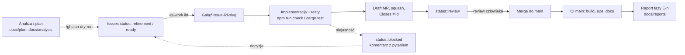

# Workflow projektu: budowanie, rozwijanie, dokumentowanie, śledzenie

> **Status:** PROPOZYCJA do akceptacji. Po akceptacji powstaje paczka issues E0 (`/gl-plan`).
> **Data:** 2026-11-07
> **Punkt wyjścia (FAKT):** jedno lokalne repo git bez zdalnego (`UNIFICATION.md` P4), 9 commitów, jeden commit na fazę F0–F6; skrypty `npm run check` (typy, testy, build, e2e) i `npm run perf` w `web-game/`; `npm run build` w `design-system/`; rejestr decyzji `web-game/docs/UNIFICATION.md`; skille `/gl-*` z konwencjami w `~/.claude/gitlab-flow/conventions.md`; Rust 1.96, Docker 29, Node 22, Git LFS 3.7 i Blender 5.2 na tej maszynie.

## 1. Zasady workflow w jednym miejscu

1. **Plan → issue → gałąź → MR → raport.** Nic nie wchodzi do `main` poza MR z `Closes #<iid>`. Issue ma kryteria akceptacji jako checklistę.
2. **Stage-gate zostaje.** Etapy E0–E5 to milestone'y GitLab. Przejście do następnego wymaga raportu fazy i akceptacji użytkownika (jak F0–F6 w `UNIFICATION.md` §3).
3. **Decyzje są danymi.** Każda decyzja ma ID, datę, źródło i trafia do `docs/DECISIONS.md`. Decyzje architektoniczne mają dodatkowo ADR.
4. **Źródło prawdy to kod i generowane dokumenty.** Liczby ekonomii tylko przez model; rejestr modeli 3D tylko z manifestu; typy protokołu tylko z Rust.
5. **Budżety i determinizm są testami w CI.** Czerwony pipeline blokuje MR.
6. **Agent pracuje w tym samym workflow co człowiek.** `/gl-work` bierze issue z `status::ready`, człowiek robi review i merge.

## 2. Układ repozytorium (monorepo)

PROPOZYCJA. Istniejące katalogi bez zmian; nowe oznaczone **(nowy)**.

```
space-game/
├─ CLAUDE.md                     (nowy) zasady dla agenta, sekcja „GitLab flow”
├─ .gitlab-ci.yml                (nowy) pipeline (§6)
├─ .gitlab/issue_templates/      (nowy) feature, bug, docs, analysis, design (+ asset, decision)
├─ .gitattributes                LF; (nowy) LFS dla *.blend i podglądów w assets/
├─ .claude/skills/               (nowy) skille projektu (§8)
├─ init.md, 1-game-description.md, poc.md     archiwum (bez zmian)
├─ docs/
│  ├─ plan/                      ten katalog
│  ├─ adr/                       (nowy) ADR-NNNN-slug.md
│  ├─ analysis/                  (nowy) YYYY-MM-DD-slug.md (type::analysis)
│  ├─ design/                    (nowy) notatki z kanw Claude Design (type::design)
│  ├─ reports/                   (nowy) raporty faz E<n>
│  ├─ DECISIONS.md               (nowy) rejestr decyzji całego projektu
│  ├─ ARCHITECTURE.md            (nowy, E1) docelowa architektura
│  └─ game-*.md, economy-*.md    jak dziś
├─ design-system/                jak dziś
├─ web-game/                     jak dziś (klient, mock, domena TS, render, narzędzia)
├─ server/                       (nowy) workspace Cargo (02-BACKEND-RUST.md §3)
│  ├─ Cargo.toml
│  ├─ crates/game-core, game-protocol, game-server, game-wasm
│  └─ conformance/               złote powtórki + porównywarka
├─ assets/                       (nowy) źródła 3D (03-PIPELINE-3D.md §5)
│  ├─ src/*.blend (LFS), kaykit/ (CC0, kopia paczki)
│  ├─ export/*.glb               wynik pipeline'u, kopiowany do web-game/apps/game/public/assets
│  └─ manifest.json              rejestr: id, rodzaj, budżety, węzły, licencja
├─ deploy/                       (nowy) docker-compose.yml (single-box), Caddyfile, .env.example
└─ poc/                          tylko do odczytu
```

**Dlaczego monorepo (W-1):** kontrakt `GameApi`, protokół Rust i złote powtórki zmieniają się razem; jeden MR pokazuje klienta i serwer naraz. Koszt: dłuższy pipeline (łagodzony regułami `changes:` w CI, §6). Alternatywa (osobne repo serwera) ma sens dopiero przy osobnym zespole backendu.

## 3. Śledzenie pracy: GitLab

Zgodnie z konwencjami `/gl-*` (FAKT: `conventions.md`). Nic z tego nie trzeba wymyślać; trzeba to podłączyć.

| Element | Ustalenie |
|---|---|
| Hosting | gitlab.com, nowa grupa dla projektu (nazwa do podania: **P4**), projekt `space-game` |
| Labels | grupowe `status::*`, `type::*`, `priority::*`, `by-claude`, `epic::*` (tworzy `/gl-setup`) |
| Dodatkowe labels projektu (CLAUDE.md) | `area::client`, `area::server`, `area::domain`, `area::assets`, `area::docs`, `area::design-system`, `area::infra`; `type::asset` dla modeli 3D |
| Board | `Development`, kolumny Open → refinement → ready → in-progress → blocked → review → Closed |
| Milestones | `E0 – Fundamenty workflow`, `E1 – Zgodność i Rust-core`, `E2 – Serwer czasu rzeczywistego`, `E3 – Treść 3D`, `E4 – Social MVP`, `E5 – Beta zamknięta` |
| Epiki (labels) | `epic::rust-core`, `epic::server`, `epic::pipeline-3d`, `epic::social`, `epic::user-panel`, `epic::docs-site`, `epic::perf` |
| Szablony issue | bazowe z `~/.claude/gitlab-flow/templates/` + dwa nowe: `asset.md` (model 3D: rodzaj z katalogu, poziomy, budżet trójkątów, węzły ruchome, podgląd) i `decision.md` (pytanie, opcje, rekomendacja, termin) |

**Przepływ issue:**



**Granulacja:** jedno issue = jeden MR = praca do jednego dnia. Większe przedsięwzięcia (port domeny do Rust, pipeline 3D) to epiki z 5–15 issues. Decyzje projektowe (SOC-1…6, U-1…3) to issues `type::analysis` z szablonem `decision.md`; odpowiedź użytkownika w komentarzu, `/gl-update` przenosi ją do opisu, a MR dopisuje wiersz do `DECISIONS.md`.

## 4. Gałęzie, commity, MR

| Temat | Zasada |
|---|---|
| Model gałęzi | trunk-based: `main` chroniony (tylko MR, pipeline zielony); `issue-<iid>-<slug>` od `origin/main`; bez gałęzi długowiecznych |
| Commity | jak dotąd po polsku: `<obszar>: <co zmieniono> (#<iid>)`, np. `domena: ETA lotu ustalane przy rozkazie (#42)`; stopka `Co-Authored-By` dla commitów agenta |
| MR | draft do czasu zielonego pipeline'u; squash; `remove_source_branch`; opis: cel, co zrobiono (FAKT), decyzje (ID), co wymaga uwagi, zrzuty dla UI |
| Review | człowiek (użytkownik) zatwierdza i merguje. Agent może dodać review własnym `/code-review` przed oznaczeniem `status::review`. Przy jednoosobowym zespole: self-merge dozwolony po zielonym CI i przeczytaniu diffu (**W-3** do potwierdzenia) |
| Wersjonowanie | tagi `v0.<E>.<n>` po bramie etapu (np. `v0.1.0` po E1); changelog generowany z tytułów MR |
| Pliki generowane | commitowane (dokument ekonomii, `tokens.generated.css`, rejestr modeli z manifestu, typy TS z Rust); CI sprawdza, że regeneracja nie zmienia niczego (`git diff --exit-code`) |

## 5. Definicja „done” (per typ issue)

| Typ | Done, gdy |
|---|---|
| `type::feature` (klient) | testy jednostkowe i e2e dla nowej ścieżki; `npm run check` zielone; teksty w słowniku `pl.ts`; zmiana kontraktu `GameApi` odnotowana w `DECISIONS.md`; zrzut 1440×900 w MR dla zmian UI; budżety perf bez pogorszenia (`npm run perf` przy zmianach w `render`) |
| `type::feature` (serwer) | `cargo fmt --check`, `cargo clippy -D warnings`, `cargo test`; złote powtórki zgodne; migracja bazy z `down`; endpoint lub wiadomość opisana w `game-protocol` i wygenerowanych typach TS |
| `type::asset` | plik `.blend` w LFS, GLB w `assets/export`, wpis w `manifest.json`, test budżetu trójkątów i węzłów zielony, podgląd PNG w przeglądarce assetów, licencja wpisana |
| `type::docs` | dokument w ustalonym katalogu; generowane części zgodne (`econ:check`, `assets:check`); linki działają (`docs:links`) |
| `type::analysis` | dokument `docs/analysis/YYYY-MM-DD-slug.md` z rekomendacją; pytania jako PYTANIE z opcjami; bez tworzenia issues wynikowych |
| `type::design` | kanwa Claude Design + notatka w `docs/design/`; akceptację odhacza człowiek |
| `type::bug` | test odtwarzający błąd przed poprawką; wpis w `UNIFICATION.md` §4 lub `DECISIONS.md`, jeśli zmienia wynik |
| Decyzja (`decision.md`) | wiersz w `DECISIONS.md`; przy architekturze ADR; powiązane issues odblokowane |

## 6. CI: GitLab CI

PROPOZYCJA. Pipeline na MR i na `main`; etapy wykonują się tylko dla zmienionych obszarów (`rules: changes:`).

| Etap | Job | Co uruchamia | Obraz | Kiedy |
|---|---|---|---|---|
| `check` | `ds:build` | `npm ci && npm run build` w `design-system/` | node:22 | zmiany w `design-system/` lub `web-game/packages/ui` |
| `check` | `web:typecheck+unit` | `npm run typecheck && npm run test` | node:22 | zmiany w `web-game/`, `design-system/` |
| `check` | `rust:fmt+clippy+test` | `cargo fmt --check`, `cargo clippy -- -D warnings`, `cargo test --workspace` | rust:1.96 | zmiany w `server/` |
| `check` | `docs:generated` | `npm run econ:check`, `npm run assets:check`, generator typów TS z `game-protocol` i `git diff --exit-code` | node:22 + rust | zawsze |
| `build` | `web:build` | `npm run build` (artefakt `dist/game`, 7 dni) | node:22 | zmiany w `web-game/` |
| `build` | `wasm:build` | `wasm-pack build crates/game-wasm` + limit rozmiaru (wartość do pomiaru w B0; punkt wyjścia ≤ 1,5 MB gzip) | rust + wasm-pack | zmiany w `game-core`, `game-wasm` |
| `test` | `web:e2e` | `npm run e2e` (Playwright, Chromium + SwiftShader, 2 workery jak D28) | mcr.microsoft.com/playwright:v1.64 | zmiany w `web-game/` |
| `test` | `conformance` | `cargo run -p conformance -- replays/` porównuje świat i zdarzenia TS ↔ Rust | rust + node | zmiany w `domain`, `game-core` |
| `test` | `server:integration` | `cargo test -p game-server --features it` z usługą `postgres:17` | rust | zmiany w `server/` |
| `perf` | `web:perf` | `npm run perf` → `PERF-REPORT.md` jako artefakt; porównanie z budżetami | **własny runner** z tagiem `gpu` (ten komputer, P6) | ręcznie lub nightly na `main` (**W-2**) |
| `deploy` | `single-box` | `docker compose -f deploy/docker-compose.yml up -d` na serwerze testowym | docker | ręcznie z `main` (E2+) |

Uwagi:
- Runnery współdzielone gitlab.com wystarczą dla wszystkiego poza `perf` (SwiftShader daje stabilne liczniki draw calls i trójkątów, ale FPS mierzy się tylko na GPU; `PERF-REPORT.md` już to rozróżnia).
- Cache: `node_modules` po `package-lock.json`, `~/.cargo` i `target/` po `Cargo.lock`.
- Czas pipeline'u MR: cel ≤ 15 min. Jeśli e2e przekroczy, dzielimy na `e2e:smoke` (MR) i `e2e:full` (main).

## 7. Dokumentowanie w workflow

Szczegóły w `04-DOKUMENTACJA-I-PODGLAD.md`. Tutaj tylko miejsce w procesie:

| Dokument | Kiedy powstaje lub rośnie | Format |
|---|---|---|
| `docs/DECISIONS.md` | przy każdej decyzji (issue `decision.md`, MR) | tabela: ID · data · pytanie · opcje · wybór · źródło (issue, rozmowa) · status (obowiązuje, zmieniona przez …) |
| `docs/adr/ADR-NNNN-slug.md` | decyzje architektoniczne (język, protokół, persystencja, model czasu, pipeline) | MADR-lite: kontekst, opcje, decyzja, konsekwencje, powiązania |
| `docs/reports/E<n>-raport.md` | brama etapu | jak `UNIFICATION.md` §3: FAKT co zrobiono, pomiary, zmiany wyników, decyzje, otwarte |
| `docs/analysis/` | issue `type::analysis` | rekomendacja + pytania |
| README pakietów (`web-game/packages/*/README.md`, `server/crates/*/README.md`) | przy zmianie publicznego API pakietu | jak dziś w `render/src/system/README.md` |
| Dokument ekonomii, rejestr modeli, typy protokołu | generowane w MR, sprawdzane w CI | — |

`UNIFICATION.md` zostaje rejestrem web-game (historia F0–F6); od E0 nowe decyzje idą do `docs/DECISIONS.md`, a `UNIFICATION.md` §6 dostaje odsyłacz.

## 8. Skille Claude Code dla projektu (`.claude/skills/`)

PROPOZYCJA: pięć małych skilli, każdy w jednym pliku `SKILL.md`, uruchamianych ręcznie. Skille `/gl-*` zostają globalne.

| Skill | Co robi |
|---|---|
| `/sg-check [obszar]` | uruchamia właściwe sprawdzenia dla zmienionych katalogów (jak CI lokalnie) i streszcza wynik; bez naprawiania |
| `/sg-decision <ID> <treść>` | dopisuje wiersz do `docs/DECISIONS.md`, a przy fladze `--adr` tworzy szkic ADR; sprawdza kolizję ID |
| `/sg-report E<n>` | składa raport fazy z opisów zamkniętych issues milestone'u, pomiarów (`PERF-REPORT.md`, conformance) i rejestru decyzji; zapisuje do `docs/reports/` |
| `/sg-replay [plik]` | nagrywa złotą powtórkę z mocka (lub bierze zapis z panelu projektanta) i uruchamia porównanie TS ↔ Rust |
| `/sg-asset <rodzaj> [L<n>]` | prowadzi model przez pipeline 3D: brief z katalogu, Blender MCP, eksport, walidacja, wpis w manifeście, podgląd (03 §6) |

Hooki w `.claude/settings.json` (opcjonalnie, po E0): `PreToolUse` na `git commit` sprawdzający, że gałąź to nie `main`; `PostToolUse` po edycji w `packages/domain/src/economy` przypominający o `econ:docs`.

## 9. Rytm pracy

| Rytm | Co |
|---|---|
| Codziennie | `/gl-board`: co w `ready`, co w `blocked`; agent bierze kolejne z `ready` |
| Na koniec MR | komentarz w issue: co zrobiono, co wymaga uwagi; link do MR |
| Brama etapu | raport fazy, przegląd pytań otwartych, decyzje na następny etap, `/gl-plan` następnego milestone'u |
| Co 2 tygodnie (od E3) | pomiar perf na runnerze GPU; przegląd budżetów i długu (`UNIFICATION.md` §5a, zadania z `PERF-REPORT.md`) |

## 10. Role

| Rola | Kto | Odpowiada za |
|---|---|---|
| Właściciel produktu | użytkownik | decyzje (P0–P2), akceptacja planów i raportów, review i merge |
| Architekt i wykonawca | agent (Claude Code) | analizy, implementacja w issues, dokumenty, raporty; rekomendacje przy każdym pytaniu |
| Grafik 3D | użytkownik lub agent przez Blender MCP | modele wg briefów z katalogu (03) |
| Projektant ekonomii | użytkownik z panelem projektanta (F6) i symulacją headless (04 §4) | parametry Załącznika A, receptury Atanora |

## 11. Ryzyka workflow

| Ryzyko | Skutek | Mitygacja |
|---|---|---|
| Pipeline monorepo za długi | wolne MR | reguły `changes:`, e2e smoke/full, cache |
| Dwa rejestry decyzji (UNIFICATION, DECISIONS) | rozjazd | od E0 tylko `DECISIONS.md`; UNIFICATION zamrożony z odsyłaczem |
| LFS na gitlab.com (limit 10 GB) | blokada pushy | tylko `.blend` i podglądy w LFS; GLB bez LFS (małe); czyszczenie historii podglądów |
| Jednoosobowy zespół: review „sam sobie” | błędy przechodzą | `/code-review` agenta przed `status::review`; checklista MR; e2e i conformance jako druga para oczu |
| Agent tworzy za dużo issues | szum na boardzie | `/gl-plan` tylko po akceptacji planu; limit 15 issues na epik; `status::refinement` dla niejasnych |

## 12. Pytania (PYTANIE)

| ID | Pytanie | Opcje | Rekomendacja |
|---|---|---|---|
| P4 | Adres zdalnego repo | gitlab.com nowa grupa; istniejąca grupa; inny host | nowa grupa na gitlab.com (skille `/gl-*` tego oczekują) |
| W-1 | Monorepo z `server/` | monorepo; osobne repo serwera | monorepo (§2) |
| W-2 | Runner dla `perf` | własny runner na tym komputerze (tag `gpu`); brak CI dla perf (ręcznie) | własny runner, uruchamiany ręcznie z GitLaba; nightly później |
| W-3 | Merge przy jednoosobowym zespole | self-merge po zielonym CI; zawsze druga osoba | self-merge, z `/code-review` agenta przed review |
| W-4 | Widoczność repozytorium | prywatne; publiczne później | prywatne do E5 |

## 13. Paczka E0 (kandydaci do `/gl-plan` po akceptacji)

1. Zdalne repo i grupa GitLab; `git remote add origin`; `/gl-setup` (labels, board, szablony) — `type::feature`, `area::infra`.
2. `CLAUDE.md` projektu z sekcją „GitLab flow”, komendami i definicją „done” — `type::docs`.
3. `docs/DECISIONS.md` z przeniesionymi decyzjami W01–W18, Z1–Z6 i rozstrzygnięciami §5 jako wpisami historycznymi — `type::docs`.
4. ADR-0001…0004 (Rust; model czasu; WASM; protokół) — `type::docs`, po akceptacji 02.
5. `.gitlab-ci.yml` z etapami `check` i `build` dla `web-game` i `design-system` — `type::feature`, `area::infra`.
6. `.gitattributes` LFS i katalog `assets/` z kopią paczki KayKit i `manifest.json` dla 14 używanych modeli — `type::feature`, `area::assets`.
7. Szablony `asset.md` i `decision.md` — `type::docs`.
8. Skille `/sg-check` i `/sg-decision` — `type::feature`, `area::infra`.
9. Spike B0 (02 §11): port `OrbitSolver` i `goldberg-grid` do Rust, jedna powtórka, rozmiar WASM — `type::analysis`, `epic::rust-core`.
10. Spike M-1 (03 §3): Blender 5.2 + MCP, import jednego modelu KayKit, eksport GLB, porównanie z plikiem z `public/assets` — `type::analysis`, `epic::pipeline-3d`.
