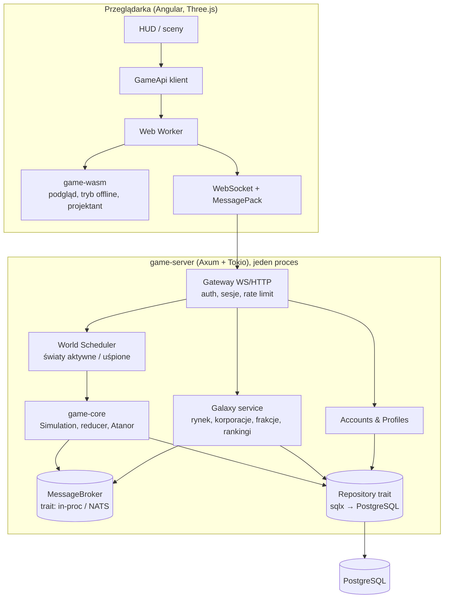

# Backend w Rust dla gry czasu rzeczywistego

> **Status:** PROPOZYCJA do akceptacji; po akceptacji staje się podstawą `docs/ARCHITECTURE.md` i ADR-0001…0004.
> **Data:** 2026-11-07
> **Rozstrzygnięcie:** użytkownik wybrał Rust (2026-11-07). `init.md` wymaga uzasadnienia i wskazania ryzyk; są w §2.

## 1. Co serwer musi umieć (FAKT z `web-game`)

Kontrakt i zachowanie, które serwer ma odtworzyć, już istnieją w mocku. To największa oszczędność: nie projektujemy API od zera, tylko realizujemy je po stronie serwera.

| Wymaganie | Gdzie dziś | Co to znaczy dla serwera |
|---|---|---|
| Kontrakt `GameApi`: `start`, `command`, `setTempo`, `pause`, `stepOnce`, `save`, `load`, `replay`, `snapshot`, `catalog`, `availability`, `previewBuild`, `suggestTile`, `tileInfo`, `economyReport`, `nominalFlows`; strumienie `onSnapshot` (~10 Hz), `onEvents`, `onFrame` | `web-game/packages/api/src/contract.ts` | te same operacje jako wiadomości protokołu; część (`setTempo`, `stepOnce`, `replay`, `economyReport`) tylko w trybie deweloperskim i lokalnym WASM |
| Symulacja stałym krokiem: `stepMinutes = stepSeconds × tempo / 60`; rozkazy stosowane między krokami i logowane z numerem kroku; powtórka daje identyczny świat | `mock-server/src/server.ts:92-140`, `simulation.ts` | serwer jest deterministyczną maszyną stanów: `(scenariusz, parametry, rozkazy z krokami, harmonogram kroków) ⇒ świat`; persystencja = dziennik rozkazów + migawki |
| Cały stan gry to dane (`WorldState`), tylko pozycje w klatce poza nim (`FrameSnapshot`) | `domain/src/sim/reducer.ts:18-40` | serializacja stanu bez specjalnych przypadków; pozycje liczy klient z czasu |
| Zapis: `SaveFile { scenarioId, economy, stepSeconds, tempos[], step, world, commands[], meta }` | `contract.ts:92-110` | ten sam format to **złota powtórka** do porównania TS ↔ Rust (§5) |
| 13 rodzajów rozkazów (`MOVE_SHIP`, `BUILD`, `UPGRADE`, …, `CALL_SHUTTLE`), 32 typy zdarzeń, 31 kodów odmowy | `simulation.ts:26-41`, `domain-event.model.ts` | protokół dziedziczy te typy; generujemy TS z Rust (§6) |
| Tempo ×1 = czas rzeczywisty, jednostka modelu 1 min; ×60 i ×600 to tryby testowe | Z6, D12 | serwer produkcyjny tickuje w ×1; inne tempa tylko lokalnie |
| Krok symulacji L (1500 budowli, 200 statków): 0,5 ms śr., 3,3 ms maks. w JS | `PERF-REPORT.md` | punkt odniesienia dla Rust: cel ≤ 1 ms śr. na świat L |
| Model C: układ gracza instancjonowany; wspólne rynek, korporacje, rankingi; symulowani gracze i huby w mocku | Z5, W11 B, `galaxy-sim.ts` | dwa rodzaje stanu: **światy** (per gracz, deterministyczne) i **galaktyka** (wspólna, transakcyjna) |
| Serwer autorytatywny od pierwszego dnia; Atanor weryfikowany powtórką | analiza §11.4, MP-6 C | klient wysyła rozkazy i projekty, nigdy stan |

**Czas rzeczywisty** w tej grze oznacza: świat gracza płynie 24/7 w tempie ×1, rozkazy są przyjmowane natychmiast, a klient animuje ciągły ruch (orbity, loty, łaziki) z czasu serwera. Nie oznacza symulacji fizyki 30–60 Hz; o tym rozstrzyga TECH-1 (rekomendacja A, zdarzeniowo-trajektoryjna) i tak już działa domena (ETA przy rozkazie, W09).

## 2. Dlaczego Rust i jakie są ryzyka

### 2.1 Uzasadnienie (w kolejności wagi dla tego projektu)

1. **Jeden węzeł na start („single-node first”, `init.md`).** Serwer gry, API social, PostgreSQL i Caddy na jednym VPS 4–8 GB. Proces w Rust zajmuje dziesiątki MB; JVM setki. To decyduje, czy zmieścimy wszystko na jednej tanią maszynie.
2. **Tysiące małych, niezależnych światów.** Model C daje jeden świat na gracza. Cel MP-3 B (1–5 tys. aktywnych) to tysiące instancji `WorldState` w pamięci. Brak GC i kontrola układu pamięci (`Vec`, `struct`) utrzymują przewidywalny czas kroku; w JVM presja alokacji z tysięcy światów oznacza strojenie GC i więcej RAM.
3. **Determinizm i powtórki.** Logika już jest czysto funkcyjna (reducer, zdarzenia). Rust dobrze to wyraża (`enum` zdarzeń, `match`, brak null) i pozwala skompilować **ten sam kod do WASM** dla klienta, co likwiduje ryzyko dwóch implementacji (R6 z analizy).
4. **Weryfikacja Atanora.** Silnik na liczbach całkowitych, bez losowości; serwer odtwarza rozwiązanie gracza. Ten sam crate liczy to w kliencie (podgląd) i na serwerze (prawda).
5. **Koszt skalowania.** Małe kontenery (< 30 MB), start w milisekundach, wysoka gęstość połączeń WebSocket na rdzeń. Przy sukcesie rachunek za chmurę jest niższy niż dla JVM.

Argument „brak pauz GC w pętli 60 Hz” z `init.md` **nie dotyczy** tej gry (brak pętli fizyki); nie opieramy na nim decyzji.

### 2.2 Ryzyka i mitygacje

| ID | Ryzyko | Prawd. | Wpływ | Mitygacja |
|---|---|---|---|---|
| RR1 | Wolniejsze tempo developmentu niż w TS (borrow checker, kompilacja, mniej gotowych bibliotek gier) | W | Ś | modularny monolit zamiast mikroserwisów; `game-core` jako port istniejącego kodu z testami 1:1 (jak F1); tryb deweloperski z `cargo watch`; klient i mock TS działają bez serwera, więc front nie czeka |
| RR2 | Dwie implementacje domeny (TS i Rust) rozjadą się | W | W | złote powtórki w CI (§5); docelowo klient używa WASM z `game-core`, a TS `sim/` zostaje tylko do czasu parytetu |
| RR3 | Różnice zmiennoprzecinkowe TS (V8) ↔ Rust (`libm`): `sin`, `cos`, `pow`, `atan2` mogą różnić się o 1 ulp | W | Ś | porównanie: pola dyskretne (magazyny, poziomy, zdarzenia, kolejność) bitowo; pola ciągłe (czas, paliwo, pozycje) z tolerancją 1e-9; po przejściu klienta na WASM problem znika (jeden kod) |
| RR4 | Rozmiar WASM i czas startu w workerze | Ś | Ś | budżet rozmiaru w CI (B0 mierzy); `wasm-opt -Oz`; leniwe ładowanie wraz z ekranem gry, jak Three.js |
| RR5 | Ekosystem: WebTransport w Rust i przeglądarkach niedojrzały | Ś | N | WebSocket + MessagePack na start (R-3); WebTransport jako adapter później |
| RR6 | Zespół jednoosobowy z agentem; Rust wymaga dyscypliny API | Ś | Ś | `clippy -D warnings`, `cargo doc` z przykładami, README per crate, porty i adaptery (traity) z `init.md` |
| RR7 | Konsekwencje modelu „zawsze żywy świat”: koszt CPU dla nieaktywnych graczy, nadrabianie po powrocie | Ś | Ś | model czasu z §4: światy aktywne tickują co 1 s, nieaktywne są uśpione i nadrabiane krokami 1 min, z limitem postępu offline (MP-5 B) |
| RR8 | Katalog ekonomii i generator dokumentu dziś w TS; przeniesienie do Rust zmienia narzędzia (`econ:docs`) | Ś | N | katalog jako dane (TOML/JSON) czytane przez oba języki w okresie przejściowym; po parytecie generator woła WASM |

## 3. Architektura: modularny monolit (R-1 A)



### 3.1 Crate'y (`server/`)

| Crate | Zawartość | Zależności | Odpowiednik dziś |
|---|---|---|---|
| `game-core` | `WorldState`, zdarzenia, rozkazy, reducer, systemy (build, construction, extraction, production, transfer, rover, docking, colony, mining), reguły, katalog ekonomii i `compute_economy`, Atanor, gwiazdy, matematyka (orbity, siatka Goldberga, Bézier, przechwycenie); bez I/O, bez async, `#![forbid(unsafe_code)]` | `serde`, `thiserror`; **brak** `tokio`, `sqlx` | `packages/domain` |
| `game-protocol` | wiadomości klient ↔ serwer (żądanie, odpowiedź, push), wersja protokołu, `GameSnapshot`, `FrameData`-pochodne; generator typów TS (`ts-rs`) do `web-game/packages/api/src/generated/` | `game-core`, `serde`, `rmp-serde`, `ts-rs` | `packages/api` (`contract.ts`, `protocol.ts`) |
| `game-server` | Axum: HTTP (konta, profil, katalog, zdrowie), WebSocket (gra), scheduler światów, repozytoria (`sqlx`), galaxy service, konfiguracja env, metryki (`metrics` + Prometheus) | `game-core`, `game-protocol`, `tokio`, `axum`, `sqlx`, `argon2`, `jsonwebtoken` lub sesje w cookie | `packages/mock-server` + nowe |
| `game-wasm` | `wasm-bindgen` nad `game-core`: lokalny „serwer” w workerze realizujący `GameApi` (jak dziś mock), tryb projektanta i powtórek | `game-core`, `wasm-bindgen`, `serde-wasm-bindgen` | `mock-server` w workerze |
| `conformance` (bin) | czyta `SaveFile` (złote powtórki), odtwarza w `game-core`, porównuje z wynikiem TS (`world`, zdarzenia, `replayStats`) wg reguł RR3 | `game-core`, `serde_json` | test `replay` w `server.spec.ts` |

### 3.2 Porty i adaptery (z `init.md`)

| Port (trait) | Single-node | Scale-out |
|---|---|---|
| `MessageBroker` (zdarzenia świata → subskrybenci: gateway, galaxy, telemetria) | `tokio::sync::broadcast` w procesie | NATS JetStream lub Redis Streams |
| `WorldRepository` (migawki, dziennik rozkazów) | `sqlx` do lokalnego PostgreSQL; zapis asynchroniczny poza krokiem | ten sam kod, zewnętrzny PostgreSQL |
| `GalaxyRepository` (zlecenia, transakcje, korporacje, kontrakty) | PostgreSQL, transakcje SQL | ten sam kod |
| `SessionStore` | w pamięci procesu (jeden węzeł) | Redis |
| `Clock` | `std::time` | to samo; testy używają zegara ręcznego |

Zasada z `init.md`: pętla kroku **nigdy nie czeka na bazę**. Krok produkuje zdarzenia i rozkazy do dziennika; zapis idzie przez kanał do zadania I/O.

## 4. Model czasu (R-4)

**FAKT:** mock liczy `stepMinutes = stepSeconds × tempo / 60` i stosuje rozkazy między krokami. Powtórka odtwarza harmonogram kroków z `SaveFile.tempos`.

**PROPOZYCJA:**

| Tryb | Gdzie | Krok | Tempo | Uwagi |
|---|---|---|---|---|
| Świat **aktywny** (gracz połączony lub ≤ 5 min od rozłączenia) | serwer | 1 s realna = 1/60 min modelu | ×1 | rozkaz czeka najwyżej do następnej granicy kroku (≤ 1 s); UI pokazuje podgląd natychmiast (duch, rezerwacja), a potwierdzenie i zdarzenia przychodzą po kroku |
| Świat **uśpiony** | serwer | brak kroków; zapisany `step` i czas uśpienia | — | zero CPU |
| **Wybudzenie** | serwer | nadrabianie krokami 60 s realnych = 1 min modelu, aż do „teraz”, potem tryb aktywny | ×1 | 8 h offline = 480 kroków; przy koszcie ≤ 1 ms to < 0,5 s; harmonogram kroków trafia do dziennika (`tempos`-podobny wpis `stepSeconds`), więc powtórka jest dokładna |
| Limit postępu offline (MP-5 B) | reguła domeny | — | — | magazyn pełny zatrzymuje wydobycie i produkcję (już działa: Z3, „pełna klasa zatrzymuje”), więc świat uśpiony osiąga stan ustalony; dodatkowy limit czasu (np. 12 h) jako parametr ekonomii |
| **Deweloperski / projektant** | WASM w workerze, serwer z flagą `dev` | jak mock: 1/60 s × tempo | ×1, ×60, ×600, pauza, `stepOnce` | bez zmian względem dziś |

Konsekwencje:
- Klient dalej animuje 60 FPS: pozycje ciał to funkcja czasu (`OrbitSolver`), lot to funkcja planu i czasu (TECH-1), łaziki to interpolacja po ścieżce. Serwer nie wysyła pozycji; wysyła **czas serwera** (synchronizacja offsetu jak NTP: ping co 10 s, mediana z 5 próbek).
- Krok 1 s w trybie aktywnym a 1/60 s w mocku dają inne zaokrąglenia w systemach „co pełna minuta”. To **nie** psuje determinizmu (harmonogram jest w dzienniku), ale gra na serwerze i w mocku może różnić się o ułamek minuty w chwili ukończenia budowy. Złote powtórki porównują identyczne harmonogramy, więc test jest uczciwy. Do sprawdzenia w B0: czy jakikolwiek system zależy od rozmiaru kroku w sposób inny niż kwantyzacja czasu (kandydat: `ExtractionSystem` „każda pełna minuta kroku”, poprawiony w W09).
- Pauza w świecie produkcyjnym nie istnieje (24/7). Pauza zostaje w trybie deweloperskim.

## 5. Zgodność logiki TS ↔ Rust (R-2)

### 5.1 Złote powtórki

Format: dzisiejszy `SaveFile` (JSON) plus oczekiwany wynik: `world` po powtórce, lista zdarzeń z numerami kroków, `replayStats`. Źródła powtórek:

1. istniejące testy przepływu (kanwa: przylot → skan → port → prom → budynki → wydobycie; `UNIFICATION.md` §3a),
2. scenariusze obciążenia S/M/L (`load.ts`, deterministyczne z ziarna),
3. zapisy z panelu projektanta (F6, zakładka Plik), nagrywane ręcznie przy ciekawych sytuacjach (odmowy, deficyt mocy, pełny magazyn, anulowanie),
4. receptury Atanora A_NAD, A_KAT z rozwiązaniami wzorcowymi (metryki: cykle, obszar, ramiona).

Katalog `server/conformance/replays/<nazwa>/{save.json, expected.json}`. Skrypt w `web-game` (`npm run replay:record`) generuje `expected.json` z TS; `cargo run -p conformance` porównuje z Rust. Reguły porównania jak RR3. Brama E1: **wszystkie powtórki zgodne**.

### 5.2 Kolejność portu (powtórka metody F1: najpierw 1:1, potem porządki)

| Krok | Zakres | Test parytetu |
|---|---|---|
| B0 | `vec3`, `geodesic`, `goldberg-grid`, `orbit-solver`, `bezier-path`, `lead-intercept`, `seeded-noise`, `asteroid-shape`, `deposit-generator` | wektory liczbowe z TS (siatka GP(8,0): 642 kafelki, sąsiedzi, normalne; pozycje ciał w t; punkty przechwycenia) |
| B1 | modele, `WorldState`, reducer, `Rules`, scenariusze `tau-ceti` i `planeta-matka`, systemy | powtórki 1–2 |
| B2 | katalog ekonomii i `compute_economy` (Załącznik A), `economy_tables`, `nominal_flows`; Atanor (silnik, receptury, pomiar rozwiązań) | tabele dokumentu bajt w bajt (przez `econ:check` z WASM); powtórki 4 |
| B3 | `GalaxySim` (symulowani gracze i rynek) jako **dane testowe** w `game-server` (tryb `dev`), nie w `game-core` | porównanie notowań po N aktualizacjach |
| B4 | `game-wasm` realizuje `GameApi` w workerze; przełącznik w aplikacji: `mock-ts` / `wasm` / `remote` | e2e web-game przechodzi na `wasm` identycznie jak na mocku |

Po B4 TS `packages/domain/src/sim` i `atanor/engine` są **zamrożone** (bez nowych funkcji) i służą tylko porównaniom; usunięcie po dwóch etapach bez rozjazdu (decyzja w E3). `packages/domain` zachowuje typy i geometrię dla `render` (odczyt z WASM byłby droższy niż liczenie siatki w TS; siatka jest deterministyczna i objęta testem parytetu B0).

### 5.3 Katalog ekonomii

Dziś `catalog-data.ts` (dane) + `economy-model.ts` (obliczenia). PROPOZYCJA: dane do pliku `catalog.toml` w `server/crates/game-core/data/`, czytanego przez Rust (`include_str!`) i przez TS w okresie przejściowym (generowany `catalog-data.ts` z TOML, sprawdzany w CI). Obliczenia docelowo tylko w Rust; `econ:docs` woła WASM. Zasada „liczby zmienia się tylko przez model” zostaje.

## 6. Protokół (R-3)

**PROPOZYCJA:** WebSocket, ramki binarne MessagePack (`rmp-serde`), jedno połączenie na sesję gry. Struktura jak dziś w `protocol.ts`: żądanie z `id` → odpowiedź z tym samym `id`; push bez `id`. HTTP (JSON) tylko dla kont, profilu, katalogu statycznego i zdrowia.

```text
klient → serwer
  Hello { protocol_version, session_token, world_id? }
  Command { id, command: Command }                       // 13 rodzajów z game-core
  Query   { id, query: Availability | PreviewBuild | SuggestTile | TileInfo | Catalog | Snapshot }
  Subscribe { world_id, detail: Full | Events }          // widok gracza; obserwacja cudzej kolonii = Events + migawka 1 Hz
  Galaxy  { id, op: PlaceOrder | CancelOrder | Quotes | Contracts | Corporation... }  // 05-SOCIAL
  Ping { t_client }

serwer → klient
  Welcome { server_time, step, step_seconds, world_id, catalog_hash }
  Reply   { id, ok, value | error }
  Events  { step, events: [DomainEvent] }                // autorytatywne, po każdym kroku z zmianami
  Snapshot { step, world, colonies, objectives }         // pełna co 30 s lub na żądanie; hash stanu co 5 s
  StateHash { step, hash }                               // klient porównuje swój stan po zdarzeniach
  GalaxyPush { quotes | contract_update | chat | notification }
  Pong { t_client, t_server }
```

- **Reconciliation:** klient trzyma `WorldState` w WASM i stosuje `Events` tym samym reducerem co serwer. `StateHash` co 5 s; przy różnicy klient prosi o `Snapshot`. To daje spójność bez wysyłania pełnej migawki 10 Hz (L: setki KB).
- **Nie przesyłamy pozycji.** `FrameData` liczy klient z `server_time` (jak dziś `onFrame` z workera).
- **Wersjonowanie:** `protocol_version` w `Hello`; niezgodność to błąd z czytelnym komunikatem; typy TS generowane z Rust (`ts-rs`) w `packages/api/src/generated/` i sprawdzane w CI.
- **Limity:** rozmiar ramki ≤ 1 MB, ≤ 20 rozkazów/s na sesję, ≤ 5 zapytań `PreviewBuild`/s (duch i tak ogranicza hover do 30 Hz po stronie klienta; serwer odpowiada na ostatnie).
- **WebTransport** (HTTP/3) jako drugi adapter gatewaya, gdy Firefox i Safari ustabilizują wsparcie; brak wpływu na `game-core`.

## 7. Persystencja (TECH-9 A)

PostgreSQL 17, `sqlx` z migracjami w repo.

| Tabela | Treść | Uwagi |
|---|---|---|
| `accounts` | id, e-mail, hash hasła (argon2id), utworzono, status | 06-PANEL |
| `profiles` | account_id, callsign, korporacja (FK), kolor, awatar (ziarno), flaga (definicja), ustawienia UI | 06-PANEL |
| `worlds` | id, owner, scenario_id, economy_params (jsonb), created, status (active/suspended), `last_step`, `last_step_at`, `step_seconds` | jeden świat na układ gracza (po gwiazdolocie kolejny) |
| `world_snapshots` | world_id, step, `world` (bytea MessagePack, skompresowany zstd), `meta` | co 1000 kroków lub przy uśpieniu; 3 ostatnie |
| `world_commands` | world_id, step, seq, command (jsonb), accepted (bool), reject_reason | dziennik = event sourcing na rozkazach; odtworzenie = ostatnia migawka + rozkazy po niej |
| `world_schedule` | world_id, from_step, step_seconds | zmiany harmonogramu (uśpienie, wybudzenie); odpowiednik `tempos` |
| `market_orders`, `trades`, `shipments` | rynek w hubach, dostawy z czasem | 05-SOCIAL |
| `corporations`, `corp_members`, `corp_treasury`, `alliances`, `contracts`, `factions`, `reputation` | warstwa social | 05-SOCIAL |
| `atanor_designs` | owner, recipe, solution, metrics (zweryfikowane), public | AT6, SOC-4 |
| `telemetry_events` (opcjonalnie, partycjonowane) | agregaty ekonomii dla projektanta | 04 §4 |

Odtworzenie świata = migawka + powtórka rozkazów od jej kroku; to ten sam kod co złote powtórki, więc jest testowany codziennie.

## 8. Bezpieczeństwo i uczciwość gry

- Klient nie przesyła stanu; każdy rozkaz przechodzi `Simulation.dispatch` na serwerze (31 kodów odmowy już istnieje).
- Projekty Atanora: klient wysyła rozwiązanie, serwer odtwarza i liczy metryki (`measureAtanorSolution`), zapisuje wynik serwera.
- Rynek: transakcje w SQL z blokadą wiersza; ceny liczy serwer (wzór z dok. 4.6).
- Konta: argon2id, sesje w cookie `HttpOnly` + token WS jednorazowy; limity logowań; brak e-maili w logach.
- Rate limity (§6) i rozmiar ramek; walidacja `serde` odrzuca nieznane pola.
- Dziennik rozkazów to też audyt: podejrzany świat da się odtworzyć krok po kroku.

## 9. Wdrożenie: single-box → scale-out

| Tryb | Skład | Uwagi |
|---|---|---|
| Single-box (E2) | `deploy/docker-compose.yml`: Caddy (TLS, statyczny klient z `dist/game`), `game-server`, PostgreSQL 17, wolumeny, kopie zapasowe `pg_dump` co noc | jeden VPS 4 GB; obraz serwera `FROM scratch`/`distroless`, < 30 MB |
| Scale-out (po E5, gdy potrzebne) | gateway + N węzłów światów (podział po `world_id`), osobny proces galaxy, NATS, zewnętrzny PostgreSQL, Redis dla sesji | zmiana adapterów przez env, bez zmian w `game-core` |

Zmienne env: `DATABASE_URL`, `BROKER=inproc|nats://…`, `SESSION_STORE=memory|redis://…`, `DEV_MODE=true` (tempa testowe, scenariusze obciążenia, symulowani gracze), `WORLD_STEP_SECONDS=1`.

## 10. Wydajność: cele i jak je mierzymy

| Metryka | Cel | Pomiar |
|---|---|---|
| Krok świata L (1500 budowli, 200 statków) | ≤ 1 ms śr., ≤ 3 ms p99 (JS: 0,5 / 3,3) | `criterion` benchmark w `game-core` na scenariuszu `load-l`; w CI jako test z progiem ×2 (runnery współdzielone są wolniejsze) |
| Pamięć świata L | ≤ 2 MB (do zmierzenia w B1) | `conformance --mem` |
| Światy aktywne na rdzeń | ≥ 500 przy kroku 1 s (500 × 1 ms = 0,5 s CPU/s) | test obciążenia `game-server` z 500 botami WS |
| Opóźnienie rozkazu (rozkaz → zdarzenia) | ≤ 1 s + RTT | metryka histogramu w serwerze |
| Nadrabianie 12 h offline | ≤ 1 s | test jednostkowy schedulera |
| Rozmiar WASM | do pomiaru w B0; limit w CI | `wasm:build` |

## 11. Fazy (epic::rust-core, epic::server)

| Faza | Zakres | Brama |
|---|---|---|
| **B0 spike** (E0) | workspace `server/`, `game-core` z matematyką z §5.2 B0, `conformance` na jednej powtórce (sam świat startowy), `game-wasm` „hello” z pomiarem rozmiaru | liczby B0 zgodne; raport: rozmiar WASM, czas kompilacji, wnioski o RR3 |
| **B1** (E1) | port symulacji i scenariuszy; powtórki kanwy i S/M/L zgodne | 100% powtórek; benchmark kroku L |
| **B2** (E1) | ekonomia, tabele, Atanor; `econ:check` z WASM | dokument ekonomii bajt w bajt |
| **B3** (E1) | `game-wasm` jako `GameApi` w workerze; przełącznik `mock-ts` / `wasm`; e2e na `wasm` | e2e zielone na obu |
| **B4** (E2) | `game-server`: konta, sesje, światy, scheduler, WS, persystencja, Docker Compose | gra z kanwy od logowania do wydobycia przez serwer; e2e `remote`; odtworzenie świata z bazy = powtórka |
| **B5** (E2) | tryb `dev` serwera: symulowani gracze, scenariusze obciążenia, panel projektanta przez serwer (`economyReport`, `nominalFlows`) | panel F6 działa na `remote` |
| **B6** (E4) | galaxy service: rynek w hubach, korporacje, kontrakty, frakcje (05-SOCIAL) | dwóch graczy handluje przez hub |

## 12. Pytania (PYTANIE)

| ID | Pytanie | Opcje | Rekomendacja |
|---|---|---|---|
| R-1 | Zakres Rust | A: całość serwera (modularny monolit); B: Rust core + Node/Java dla API social | **A**. Jeden język, jeden proces na start; API social to CRUD, który w Axum + sqlx pisze się równie szybko; brak drugiego runtime'u na jednym VPS |
| R-2 | Współdzielenie logiki | A: dwie implementacje + złote powtórki; B: `game-core` → WASM w kliencie | **B** z A jako siatką do czasu parytetu; TS `sim/` zamrożony po B3 |
| R-3 | Protokół | A: WebSocket + MessagePack; B: WebTransport; C: WebSocket + JSON | **A**; C tylko w trybie `dev` dla czytelności logów (przełącznik) |
| R-4 | Krok serwera w ×1 | 1 s; 0,5 s; 1/60 s (jak mock) | **1 s**: opóźnienie rozkazu ≤ 1 s wystarcza w grze ekonomicznej, a koszt CPU spada 60× względem 60 Hz |
| R-5 | Limit postępu offline | brak; pojemność magazynu; magazyn + 12 h | magazyn + parametr czasu w ekonomii (domyślnie 12 h) |
| R-6 | Katalog ekonomii jako TOML współdzielony | TOML; zostaje TS i Rust czyta JSON generowany z TS | TOML w `game-core/data` (jedno źródło po stronie serwera) |
| R-7 | Czy `GalaxySim` (symulowani gracze) ma istnieć na serwerze produkcyjnym jako „boty rynku” (frakcje NPC, SOC-3)? | tylko `dev`; produkcja jako NPC | produkcja jako NPC frakcji (05 §3), ten sam kod, inne parametry |
