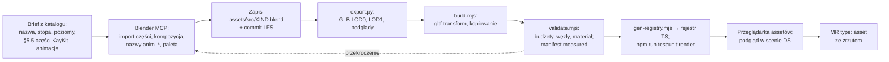

# Praca nad modelami 3D: Blender 5.2, MCP i pipeline assetów

> **Status:** PROPOZYCJA do akceptacji.
> **Data:** 2026-11-07
> **Dokumenty źródłowe:** `docs/economy-expansion-design.md` §5.5 (mapa budynków na modele i poziomy), §10 (zasady i techniki animacji); `web-game/packages/render/src/system/README.md` (znane luki, pytania 3 i 8); `web-game/docs/PERF-REPORT.md` (budżety, zadania LOD i odcinanie).

## 1. Stan zastany (FAKT)

| Element | Stan | Źródło |
|---|---|---|
| Paczka źródłowa | KayKit Space Base Bits 1.0 EXTRA: 69 modeli glTF (+ FBX, OBJ), 2 tekstury palety, licencja CC0 | `poc/space-3d-poc/assets/KayKit_Space_Base_Bits_1.0_EXTRA/` |
| W grze | 14 modeli skopiowanych jako `.gltf` + `.bin` + `spacebits_texture.png` (0,5 MB; 0,2 MB gzip) | `web-game/apps/game/public/assets/kaykit/` |
| Ładowanie | `ModelLibrary` pakuje glTF do GLB w pamięci, **usuwa tekstury**, każdemu wierzchołkowi nadaje odcień palety DS według pola atlasu 8×4 pod jego UV (`atlasTone`), spłaszcza model do jednej geometrii; jeden materiał Lambert z `flatShading` | `model-library.ts:94-103`, W14 C |
| Rejestr | `MODELS` z wymiarami, `baseOffset`, `yaw`, `fill`, liczbą trójkątów (30–1198); test `model-library.spec.ts` sprawdza liczby względem plików | `model-registry.ts` |
| Mapowanie rodzaj → model | 16 rodzajów z katalogu; brak modelu ⇒ `structure_tall`; HQ = wieża + lądowisko na 3 kafelkach | `model-registry.ts:80-100`, S3 |
| Poziomy | L1–L5 mają ten sam model („znane luki”) | `render/src/system/README.md` |
| Animacje | brak; 10 modeli KayKit ma ruchome części jako osobne węzły (`windturbine_tall_fan`, `drill_module`, `basemodule_garage_door`, …), ale spłaszczanie je gubi | ekonomia §10 |
| Budżety | 100–150 draw calls, 200–400 tys. trójkątów na klatkę, pierwsze pobranie 15–25 MB; propozycja budżetów per model: budynek 300–2000, pojazd 500–1500, statek 1500–4000, obiekt orbitalny 3000–6000, gwiazdolot ≤ 20 tys. z LOD | `init.md`, ekonomia §10 |
| Zadania otwarte z pomiarów | odcinanie budynków niewidocznej półkuli; LOD modeli przy oddaleniu; BatchedMesh zamiast InstancedMesh per (ciało × model) | `PERF-REPORT.md` „Zadania naprawcze”, D19, P8 |
| Potrzeby treści | ok. 45 nowych budynków i elementów logistyki, 10 statków i pojazdów, ok. 15 modułów poziomów; MVP: ok. 20 budynków E0–E3 | ekonomia §10, §11 |
| Narzędzia na maszynie | Blender 5.2 (`C:\Program Files\Blender Foundation\Blender 5.2\blender.exe`, poza PATH), Git LFS 3.7; **brak** `gltf-transform`, brak serwera MCP dla Blendera (skonfigurowane MCP: `godot-ai`, `comfy-mcp`) | pomiar 2026-11-07 |
| Nowy katalog `resources/kaykit` | KayKit **Medieval Hexagon Pack**: 30 obiektów (zamek, młyn, kopalnia…), 640 plików kafelków hex, 340 kwadratowych; GLB, FBX, DAE, OBJ; bez pliku licencji w kopii | `resources/`, nieśledzony w git (**PYTANIE M-5**) |

## 2. Cele pipeline'u

1. Nowe modele i warianty poziomów w stylu KayKit (low-poly, paleta, siatka 2 j.), produkowane w Blenderze z pomocą MCP, bez ręcznych kroków „z pamięci”.
2. Deterministyczna droga od `.blend` do `web-game/apps/game/public/assets/` z walidacją budżetów, nazewnictwa i węzłów ruchomych w CI.
3. Rejestr modeli (`model-registry.ts`) **generowany z manifestu**, nie pisany ręcznie.
4. Każdy model widoczny w przeglądarce assetów (04 §3) z podglądem, liczbami i mapowaniem na rodzaje z katalogu.
5. Animacje tanie w draw callach: węzły ruchome jako osobne instancje, stany przez atrybut instancji.

## 3. Blender 5.2 + MCP (M-1)

### 3.1 Co MCP ma dawać

Agent (Claude Code) steruje Blenderem jak grafik juniorski pod nadzorem: importuje części KayKit, składa je według briefu, nazywa węzły, przypisuje materiały palety, eksportuje GLB, renderuje podgląd. Człowiek poprawia w Blenderze to, czego agent nie trafi (proporcje, kompozycja), a pipeline resztę sprawdza.

### 3.2 Opcje

| Opcja | Opis | Za | Przeciw |
|---|---|---|---|
| A. `blender-mcp` (projekt społeczności: dodatek Blendera z serwerem na gnieździe + serwer MCP w Pythonie) | gotowe narzędzia: wykonanie kodu `bpy`, odczyt sceny, zrzut widoku, import | szybki start, znany w ekosystemie Claude | zgodność z Blenderem **5.2** niepewna (sprawdzić w spike'u); narzędzie „wykonaj dowolny kod” wymaga zaufania do agenta |
| B. Własny mały serwer MCP (Python, `bpy` w trybie `--background`) z kilkoma narzędziami o wąskim zakresie: `import_kit_part`, `compose`, `set_palette`, `export_glb`, `render_preview`, `inspect` | narzędzia zgodne z naszymi konwencjami; działa headless w CI | 1–2 dni pracy; utrzymanie |
| C. Bez MCP: agent pisze skrypty `bpy`, uruchamiane `blender --background --python` | zero zależności; działa w CI | brak podglądu na żywo; wolniejsza iteracja |

**Rekomendacja:** **A na start** (spike M-1 w E0), **C jako warstwa CI** (eksport i walidacja muszą działać bez GUI). Jeśli A nie działa z 5.2, przechodzimy do B z narzędziami zbudowanymi na skryptach z C. Niezależnie od opcji, skrypty eksportu i walidacji są w repo (`assets/tools/`), bo to one są źródłem prawdy, nie sesja MCP.

### 3.3 Konfiguracja (do wykonania w spike'u)

1. Instalacja dodatku w Blenderze 5.2, uruchomienie serwera gniazda w panelu N.
2. Rejestracja serwera MCP w Claude Code (konfiguracja projektu, nie użytkownika, żeby trafiła do repo jako instrukcja): `claude mcp add blender -- uvx blender-mcp` (lub ścieżka lokalna).
3. Test: import `windturbine_tall.gltf` z paczki, odczyt węzłów (`windturbine_tall_fan`), eksport GLB, porównanie geometrii z plikiem w `public/assets` (liczba trójkątów 632 z rejestru).
4. Zapis wyników w `docs/analysis/2026-MM-DD-blender-mcp-spike.md`.

Bezpieczeństwo: narzędzie wykonujące dowolny `bpy` działa na pliku z repo, w katalogu `assets/`; agent nie otwiera plików spoza repo i nie zapisuje poza `assets/`. Zapisy `.blend` tylko przez `/sg-asset` (jeden krok „zapisz” z nazwą z manifestu).

## 4. Konwencje modeli

| Temat | Zasada | Uzasadnienie |
|---|---|---|
| Jednostki i osie | siatka 2 j. jak KayKit; Y w górę; pivot u podstawy (środek stopy); pojazdy: przód +Z | zgodne z rejestrem (`baseOffset`, `yaw`) i z osadzaniem na kafelku |
| Skala względem kafelka | model mieści się w `fill` szerokości stopy (1 kafelek ≈ 6–8 j. w świecie; 3 kafelki ≈ 1,8 szer.; 7 ≈ 2,7) | `footprintSpan`, `fitScale` |
| Nazwy | plik `<rodzaj>_L<poziom>[_<wariant>].glb`, np. `MIN_L1.glb`, `HAB_L3.glb`; węzły ruchome `anim_<nazwa>` (np. `anim_fan`, `anim_drill`, `anim_door_L`); część statyczna `body` | pipeline wykrywa `anim_*` i nie spłaszcza ich |
| Kolor | **M-3:** zostaje W14 C (bez tekstur). Nowe modele dostają kolor w wierzchołkach (`COLOR_0`) z palety projektu (lista barw = odcienie z `palette.ts` `ATLAS_TONES` + tinty materiałów); `ModelLibrary` używa `COLOR_0`, gdy jest, a UV atlasu dla starych plików | jeden materiał dla wszystkich modeli ⇒ instancing; brak tekstur ⇒ brak KTX2 w budżecie |
| Paleta | plik `assets/palette.json` generowany z DS i `palette.ts` (nazwa → hex); w Blenderze materiał na slot = nazwa z palety | zmiana palety w DS przechodzi przez pipeline |
| Budżety trójkątów | wg ekonomii §10 (budynek 300–2000 itd.); LOD1 ≤ 25% LOD0; LOD2 = bryła z rejestru (pudełko) | zadania LOD z `PERF-REPORT.md` |
| Poziomy | L2+ przez składanie modułów na bazie L1 (dachy, piętra, zbiorniki, cewki) jak w §5.5; od L4 akcenty „alt” (druga barwa akcentu z palety) | ogranicza liczbę unikatowych modeli |
| Stany | brak osobnych modeli dla budowy i braku mocy; stany robi renderer (obrys, rośnięcie, przygaszenie przez atrybut instancji) | jak dziś |
| Licencje | KayKit CC0; modele własne: licencja projektu (do decyzji M-6); każdy wpis manifestu ma pole `license` | `LICENSE-KayKit.txt` już w assets |

### 4.1 Węzły ruchome a instancing

Dziś: jedna `InstancedMesh` na (ciało × model). Z węzłami `anim_*`: model = `body` + k części; każda część to osobna `InstancedMesh` na (ciało × model × część) z własnymi macierzami (obrót śmigła = macierz instancji). Koszt: +1 draw call na część i ciało. Ograniczamy animacje do ciała w kadrze (ekonomia §10). Budżet: ≤ 3 części ruchome na model, ≤ 10 rodzajów animowanych na ciało ⇒ ≤ 30 dodatkowych draw calls, w budżecie 150.

### 4.2 LOD i odcinanie (zadania z PERF-REPORT, P8)

| Dystans kamery | Co rysować | Źródło |
|---|---|---|
| planeta z bliska (fokus) | LOD0 + `anim_*` | pipeline |
| planeta z daleka, układ dla ciała w fokusie | LOD1 (≤ 25% trójkątów), bez animacji | pipeline (decymacja w Blenderze, krok skryptu) |
| pozostałe ciała w układzie | LOD2: bryły z rejestru albo nic poniżej 24 px (jak dziś) | renderer |
| niewidoczna półkula | nic (odcinanie po normalnej kafelka względem kamery) | renderer |

Decyzja, czy LOD1 jest potrzebny przed betą, zależy od P8 (docelowa liczba budowli na ciało). Pipeline generuje LOD1 od początku (tanio), renderer włącza go w E3 po pomiarze.

## 5. Repozytorium assetów

```
assets/
├─ README.md                 konwencje (ten rozdział w skrócie), jak uruchomić pipeline
├─ palette.json              generowane z DS + palette.ts
├─ manifest.json             rejestr (schemat niżej)
├─ kaykit/                   kopia paczki Space Base Bits (glTF + licencja), CC0, bez LFS (ok. 10 MB)
├─ src/                      pliki .blend (LFS): jeden plik na rodzaj, sceny = poziomy
│  ├─ MIN.blend, HAB.blend, …
│  └─ _kit.blend             biblioteka części KayKit z nazwanymi kolekcjami
├─ export/                   GLB po pipeline'u (bez LFS; małe), LOD0 i LOD1
├─ previews/                 PNG 512×512 ×3 ujęcia (LFS)
└─ tools/
   ├─ export.py              Blender --background: eksport GLB wg manifestu, LOD1, podglądy
   ├─ build.mjs              gltf-transform: dedup, prune, weld, quantize, meshopt; kopiowanie do public/assets
   ├─ validate.mjs           budżety, nazwy, węzły anim_*, jeden materiał, bounds; aktualizuje manifest.measured
   └─ gen-registry.mjs       manifest → packages/render/src/system/model-registry.generated.ts
```

Schemat wpisu `manifest.json` (PROPOZYCJA):

```json
{
  "id": "MIN_L1",
  "kind": "MIN", "level": 1,
  "source": "src/MIN.blend#L1",
  "parts": ["body", "anim_drill"],
  "budget": { "triangles": 2000, "lod1": 500 },
  "measured": { "triangles": 1198, "lod1": 412, "footprint": 1.75, "height": 2.0, "baseOffset": 0 },
  "fit": { "fill": 0.7, "yaw": 0 },
  "license": "CC0-1.0 (KayKit) + CC-BY-4.0 (modyfikacje)",
  "preview": "previews/MIN_L1.png"
}
```

`gen-registry.mjs` tworzy z tego `MODELS`, `KIND_MODELS` (z `kind` i `level`) i listę części; test `model-library.spec.ts` dalej sprawdza liczby względem plików, ale źródłem liczb jest `measured` z walidacji.

Przejście do `web-game/apps/game/public/assets/`: `build.mjs` kopiuje GLB; `ModelLibrary` ładuje `.glb` bezpośrednio (dziś składa `.gltf` + `.bin` w pamięci; `packGlb` zostaje dla starych plików).

**Git LFS (M-2):** `*.blend` i `assets/previews/*.png` w LFS (`.gitattributes`); limit gitlab.com 10 GB wystarcza na setki plików; GLB (dziesiątki KB) w zwykłym git.

## 6. Przepływ pracy nad jednym modelem (`/sg-asset <rodzaj> [L<n>]`)



Kroki 4–7 to `npm run assets:build && npm run assets:check` w `web-game/` (skrypty wołają `assets/tools/*`). CI uruchamia `assets:check` zawsze, `assets:build` tylko przy zmianach w `assets/`. Blender w CI: obraz z Blenderem (np. `linuxserver/blender` lub własny) tylko dla jobu `assets:export` przy zmianie `.blend`; można zacząć od eksportu lokalnego i commitowania GLB, a CI tylko waliduje.

## 7. Kolejność produkcji (epic::pipeline-3d, E3)

Najpierw rodzaje grywalne w E0–E1 (`PLAYABLE_ERA = 1`, FAKT z `rules.ts`), bo tylko one są dziś widoczne w grze:

| Priorytet | Rodzaje | Dziś | Do zrobienia |
|---|---|---|---|
| 1 | HQ (Centrum dowodzenia, 3 kafelki), LAND, HAB, DEP, SOL, WND, MIN, ICE, SIT | modele KayKit L1 | L2–L3 przez składanie (§5.5); `anim_fan` (WND), `anim_drill` (MIN); HQ L2+ |
| 2 | FARM, GAR, SKL, TNK, MLT, REGX | zastępcze (`basemodule_A`, `cargodepot_A`, `water_storage`, `drill_structure`) | L1 własne z części KayKit (`space_farm_*`, `basemodule_garage`, `containers_*`), koparka regolitu nowa |
| 3 | SMT (Huta, 3 kafelki), SIR (Rafineria krzemu, 3), CON, LST | `structure_tall` | nowe modele (ekonomia §5.5) |
| 4 | Pojazdy: ROV (łazik), TRK, AST (statek transportowy), Arka-1 (statek-matka), prom | `spacetruck`, `dropship`; Arka = dropship ×1,8; prom nie rysowany | Arka i prom nowe; `anim_door_L/R` dropship |
| 5 | Złoża, pas: `rocks_A`, `rock_A/B` | KayKit | warianty kolorów według materiału (dziś tint w wierzchołkach, OK) |
| 6 | E2–E3 (ATN Fabryka atanorowa, stacja orbitalna, elektrolizer…) | brak | po AT1–AT4 i decyzji o zakresie MVP (MVP-4) |

Szacunek: priorytet 1–2 to ok. 25 plików GLB (z poziomami), w większości składanie istniejących części; priorytet 3–4 to ok. 10 nowych modeli.

## 8. Animacje: kolejność

| Krok | Technika | Modele | Wymaga |
|---|---|---|---|
| A1 | węzły `anim_*` jako osobne instancje, obrót w czasie | WND (śmigło), MIN (wiertło), GAR (brama przy wyjeździe) | zmiana `ModelLibrary` (nie spłaszczać `anim_*`), `StructureLayer` (części) |
| A2 | stany przez atrybut instancji w shaderze: praca / bezczynność / brak mocy / budowa | wszystkie | materiał z `onBeforeCompile` lub `ShaderMaterial`; dane ze zdarzeń (`BATCH_*`, moc) |
| A3 | cząsteczki z pulą (para, pył) | MIN, ICE, MLT | budżet 2–5 tys. cząsteczek na scenę |
| A4 | klipy glTF | montownia, wyrzutnia, gwiazdolot | `AnimationMixer`, tylko kilka naraz |

## 9. Narzędzia do zainstalowania

| Narzędzie | Po co | Jak |
|---|---|---|
| `@gltf-transform/cli` (devDependency w `web-game`) | optymalizacja GLB, meshopt | `npm i -D @gltf-transform/cli @gltf-transform/functions meshoptimizer` |
| Blender 5.2 w PATH lub zmienna `BLENDER_BIN` | `export.py` w pipeline'ie | `setx BLENDER_BIN "C:\Program Files\Blender Foundation\Blender 5.2\blender.exe"` |
| dodatek `blender-mcp` + serwer MCP | praca agenta w Blenderze | spike M-1 |
| `git lfs install` w repo + `.gitattributes` | `.blend`, podglądy | E0 |

## 10. Ryzyka

| Ryzyko | Skutek | Mitygacja |
|---|---|---|
| Dodatek MCP niezgodny z Blenderem 5.2 | brak podglądu na żywo | opcja C (skrypty `bpy`) działa zawsze; opcja B jako plan B |
| Agent modeluje „brzydko” (proporcje, styl) | modele do poprawy ręcznie | składanie z gotowych części KayKit zamiast modelowania od zera; podglądy w MR; człowiek akceptuje `type::asset` |
| Kolor w wierzchołkach a stare pliki z UV atlasu | dwa ścieżki kolorów w `ModelLibrary` | obie wspierane; po przeprowadzeniu wszystkich 14 modeli przez pipeline ścieżka UV znika |
| Wzrost trójkątów na planecie (M: 256 tys., L: 1,1 mln) | przekroczenie budżetu | LOD1 z pipeline'u, odcinanie półkuli, decyzja P8 |
| LFS: koszt i limity gitlab.com | blokada | tylko `.blend` i podglądy; podglądy regenerowane, więc można czyścić |
| Medieval Hexagon Pack w `resources/` nie pasuje tematycznie | pokusa użycia niespójnych modeli | M-5: traktować jako odniesienie techniczne (kafelki hex, pivoty), nie treść |

## 11. Pytania (PYTANIE)

| ID | Pytanie | Opcje | Rekomendacja |
|---|---|---|---|
| M-1 | Serwer MCP dla Blendera | A `blender-mcp`; B własny; C bez MCP | A na start, C w CI; B, jeśli A nie działa z 5.2 |
| M-2 | Gdzie `.blend` | LFS w monorepo; osobne repo | LFS w monorepo |
| M-3 | Tekstury | zostaje bez tekstur (W14 C), kolor w `COLOR_0`; powrót do atlasu PNG + KTX2 | bez tekstur; KTX2 tylko dla flag i awatarów (06) |
| M-4 | LOD1 od razu w pipeline'ie | tak; po decyzji P8 | tak (tanio), włączenie w rendererze po pomiarze |
| M-5 | Przeznaczenie `resources/kaykit` (Medieval Hexagon Pack) | odniesienie techniczne; treść (nie pasuje do kosmosu); usunąć z repo | odniesienie techniczne; do `.gitignore` albo `assets/reference/` bez LFS, z licencją |
| M-6 | Licencja własnych modeli i repo assetów | CC-BY-4.0; zastrzeżona | zastrzeżona do decyzji o publikacji; pole `license` w manifeście od początku |
| M-7 | Kto akceptuje model (`type::asset`) | człowiek po podglądzie; agent na podstawie walidacji | człowiek; walidacja to warunek konieczny |
