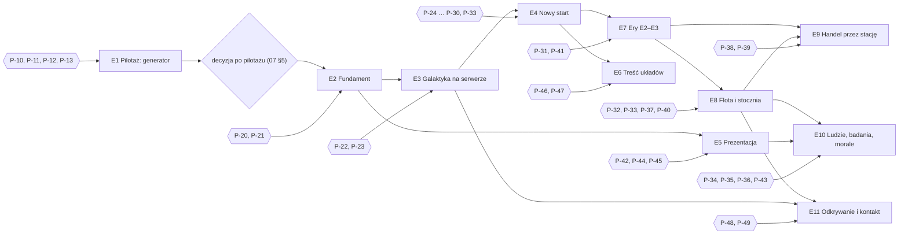
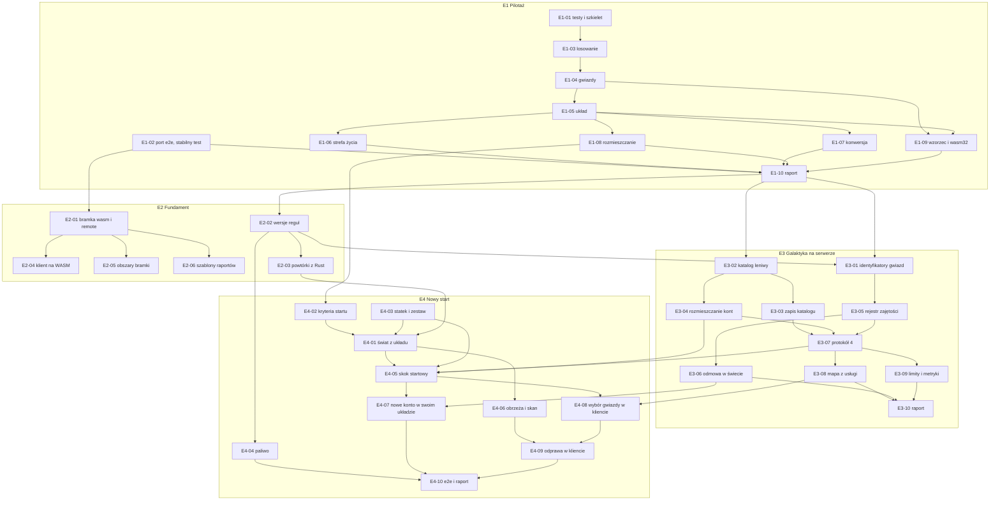
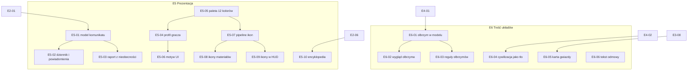

# Mapa drogowa autonomicznej implementacji

> **Status:** PROPOZYCJA do akceptacji (krok 1 z `07-AUTONOMIA.md` §4). Po akceptacji i odpowiedziach na pytania blokujące pilotaż wybrane propozycje trafiają do `docs/DECISIONS.md` poleceniem człowieka.
> **Data:** 2026-11-11 · **Stan repozytorium (FAKT):** `main` = `1659aa1`, drzewo czyste, wszystkie gałęzie scalone do `main`.
> **Dokumenty towarzyszące:** `docs/analysis/propozycje-decyzji.md` (zadanie B), `docs/analysis/kolejka-pytan.md` (zadanie D, pytania P-10…P-52).
> **Oznaczenia:** USTALENIE (decyzja użytkownika z dziennika), FAKT (kod lub dokument, z odnośnikiem), PROPOZYCJA (projekt koordynatora), PYTANIE (czeka na człowieka).

## 1. Podstawa

### 1.1 Co przeczytano (FAKT)

`CLAUDE.md`, `docs/plan/00`–`07` i `README.md`, `docs/DECISIONS.md`, `web-game/docs/UNIFICATION.md`, `docs/analysis/2026-11-11-ustalenia-sesji.md`, cały `docs/analysis/2026-11-11-dziennik-pomyslow.md` (pomysły #1–#33, rejestr pytań A–D, kolejka W1–W112), `server/README.md`. Punktowo: `server/crates/*` (modele, scenariusze, systemy lotu, dokowania i hubu, katalog, gwiazdy, rynek, świat serwera, testy WebSocket), `web-game/packages/*` i `apps/game` (tryb API, testy, e2e), `docs/economy-expansion-design.md` (§3.1, §5.1, Terminal handlowy), `poc/space-interior-poc` (limity edytora).

### 1.2 Stan bramki (FAKT, 2026-11-11)

| Przebieg | Wynik | Szczegóły |
|---|---|---|
| `node tools/gate.mjs` przed pracą | **zielona** | typecheck 4,4 s · wasm-build 0,7 s · vitest 9,0 s · fmt 0,4 s · clippy 0,4 s · `cargo test` 24,1 s · `econ:check` 1,0 s |
| ostatni `--full` (zapis z 16:25 UTC, sprzed tej sesji) | **czerwona** | e2e: 20 przeszło, 1 pominięty, 1 nie przeszedł mimo jednego ponowienia: `e2e/planet.spec.ts:89` („PoC world: the selected ship gets its own card…”), panel nie pokazał celu lotu |
| ten sam test osobno (`--workers=1 --repeat-each=2`, port 4441) | 2 z 2 | wniosek: test zależny od obciążenia, nie stały błąd |

Skutek: granica etapu wymaga `--full` (07 §2), a `--full` jest dziś niestabilna. Zadanie E1-02.

### 1.3 Słownik oznaczeń w tym dokumencie

- **Etap E1…E11** to etapy tej mapy. Nie mylić z etapami E0–E5 z `docs/plan/README.md` (stan w §2.4) ani z **erami** E0–E5 ekonomii; w tekście piszę „etap” albo „era” (pytanie P-15).
- **Zadanie** ma ID `E<etap>-<nr>`, np. E3-05. **Pytanie** `P-nn` jest w `kolejka-pytan.md`. **AU-nn** to wiersz audytu ustaleń, **RZ-nn** to rozbieżność znaleziona w kodzie lub dokumentach.
- **Rozmiar:** S do pół dnia, M do jednego dnia, L do dwóch dni pracy wykonawcy (większe zadania są podzielone).
- **Obszar:** client (`web-game/apps`, `packages/ui`, `render`), server (`server/`), domain (`web-game/packages/domain`, `api`, `wasm-host`), assets, docs (`docs/`, `tools/`).

## 2. Audyt rozbieżności (zadanie A)

Ocena: **zgodne** (nic do zmiany poza wpisem w rejestrze), **do zmiany** (brak mechaniki albo dokument do aktualizacji, bez sprzeczności z obowiązującą decyzją), **konflikt** (sprzeczność z decyzją, kodem objętym testami wzorcowymi albo liczbami ekonomii).

### 2.1 Konflikty z tabeli ustaleń sesji, uzupełnione o kod

| Nr | USTALENIE | Stan w planie, decyzjach i kodzie (FAKT) | Ocena | Skutek w pracy |
|---|---|---|---|---|
| AU-1 | Start to jeden statek międzygwiezdny najniższej klasy: 75% paliwa, materiały, załoga, morale 75%; Arka-1 odpada (Q5) | W06 A, D8, D9, D33 w `UNIFICATION.md`; `sim/scenarios/tau_ceti.rs:251-276` (Arka-1: rola `Mothership`, ładownia 2000 j., bak 100/100, 2 łaziki, prom, sonda); `sim/scenario.rs:46-55` (port L1: STA 120 · BET 80 · UKL 10, 12 min); `game-server/src/world.rs:246` (każde nowe konto dostaje scenariusz domyślny Tau Ceti); powtórka `kanwa-pierwsza-sesja`, e2e `flow.spec.ts` | **konflikt** z W06 A; scenariusz jest objęty złotymi powtórkami | E4-01, E4-03, E4-07; Tau Ceti jako preset testowy (P-30); brak klasy i liczb statku oraz zestawu (P-24, P-25) |
| AU-2 | Handel NPC dopiero po wielkiej stacji handlowej na obrzeżach układu (Q6 b) | R-21, R-22 w `DECISIONS.md`; `sim/systems/hub.rs:24` (`SHIP_TO_HUB` wymaga tylko działającego portu); przesyłka 0,5 h + 2 h/ly (`game-session/src/exchange.rs`); Terminal handlowy (TRD) jest w erze E3, a `PLAYABLE_ERA = 1`; na przesyłkach stoją S0–S3 i e2e `hub.spec.ts`, `corp.spec.ts`, `social.spec.ts`; założenie korporacji wymaga STA w hubie (R-24) | **konflikt** z R-21, R-22 i planem 05 §3.2 | etap E9; do odpowiedzi na P-38 przesyłki zostają bez zmian (natychmiastowy wymóg stacji wyłączyłby handel i korporacje) |
| AU-3 | Materiały stoczni z puli planety (Q17 b); stacje budowane na orbicie planety, przenoszalne (Q32 c) | dokument ekonomii, wiersze 407 i 458: moduły orbitalne montują drony stacji z magazynu stacji; w kodzie budowle orbitalne są tylko w katalogu (`fp: orbita`) i nie da się ich zbudować (`sim/rules.rs:209` wymaga `footprint > 0`); produkcji statków nie ma | **do zmiany** (dokument); w kodzie brak mechaniki | zmiana tekstu w `web-game/tools/economy-model/template.md` w E7-04; model stacji otwarty (P-41) |
| AU-4 | Morale jako trudny cel: poniżej 50% słabo, 70% ok, 85% super, 95–100% odblokowuje technologie (Q30 b, K3) | dokument ekonomii §3.1 (wiersze 105–107): kolonia referencyjna przy pełnej wydajności, 60% mocy na produkcję; w `server/crates` nie ma morale (0 wystąpień); wydajność zależy tylko od mocy | **konflikt** z kalibracją ekonomii | E10-03, E10-04; wzory i punkt odniesienia: P-34, P-35; liczby tylko przez model |
| AU-5 | Wyłączność planety, nie układu; kilku graczy w układzie (Q19 b, K2) | WIZ-1 = C zostaje; w kodzie nie ma rejestru zajętości; usługa galaktyki zna tylko nazwę gwiazdy konta (`game-server/src/galaxy.rs:49`); każde konto ma własną instancję całego Tau Ceti | **zgodne** z WIZ-1 = C; **do zmiany** w kodzie | E3-05, E4-07; wymuszanie dopiero z nowym startem (na obecnych światach wszyscy osiedlają się na Tau Ceti e); semantyka: P-22 |
| AU-6 | Brak PvP w MVP, PvP w następnym etapie (Q27 c, K1) | zasada twarda w `CLAUDE.md`; plan 05 S-8 (rekomendacja); brak wpisu w `DECISIONS.md`; w kodzie nie ma walki | **zgodne** | wpis S-8; PvP poza mapą (§7) |
| AU-7 | Komunikaty z dialogami i wyborami (Q38 c) | zdarzenia domeny (`game-core/src/models/event.rs`) czyta tylko panel projektanta; brak interfejsu komunikatów i brak zdarzeń z wyborem w Rust | **do zmiany** (nowy system) | E5-01 … E5-03 (warstwa informacyjna w kliencie), E10-06 (wybory w Rust); treść: P-43 |

### 2.2 Pozostałe ustalenia

| Nr | USTALENIE | Stan (FAKT) | Ocena | Skutek w pracy |
|---|---|---|---|---|
| AU-8 | Wybór gwiazdy na mapie; skok z tej samej puli paliwa co loty lokalne; zasięg 3–5 gwiazd (Q1 a, Q4′ a) | statek ma jedno pole `fuel` (`models/ship.rs:39-40`); loty tylko w układzie; mapa galaktyki pokazuje 41 gwiazd bez trybu wyboru | do zmiany | E4-05, E4-08; P-26, P-28 |
| AU-9 | Generator: funkcja (ziarno, współrzędne), leniwie, zapis po odkryciu; gracze o „kilka gwiazd” od siebie (Q40 a, #33, #11) | katalog to 41 gwiazd z pliku (`galaxy/stars.rs:62-68`); huby w 4 gwiazdach rzeczywistych (`exchange.rs:41-46`) | do zmiany | E1 (pilotaż), E3-01 … E3-04; P-17, P-18 |
| AU-10 | Skan tranzytowy jako szacunek z niepewnością; teleskopy na statkach i jako satelity (Q35 b, #13) | w katalogu (45 budowli) nie ma teleskopu; odkrywanie to skan po przylocie | do zmiany | etap E11; P-49 |
| AU-11 | Przylot na obrzeża, odprawa, skan potwierdzający (#31) | statek startuje zadokowany przy gwieździe (`tau_ceti.rs:271`); skan 15 min ustawia `revealed` | do zmiany | E4-06, E4-09; P-27 |
| AU-12 | Cztery klasy statków; większa klasa to więcej pokładów i powierzchni (Q7) | `ShipRole` = `Ship` albo `Mothership` (`ship.rs:20-23`), brak klasy i poziomu; w katalogu 10 pojazdów wewnątrzukładowych i gwiazdolot z modułów Doku (`starshipModules`) | do zmiany; **konflikt** z dokumentem ekonomii §9 | E8-01, E8-02; P-33, P-52 |
| AU-13 | Napęd daje maksymalny warp, gracz wybiera niższy (Q21 c) | katalog: napędy Mk I–IV i `fuelPerLy` = 40 kapsuł; czas przesyłek stały (7200 s/ly) | do zmiany | E8-05; brak tabeli poziomów (P-33) |
| AU-14 | Plan to schemat w bibliotece gracza i projekt wnętrza z edytora (Q8 b, Q34 c) | pojęcia planu nie ma w kodzie; edytor wnętrz istnieje tylko jako PoC (`poc/space-interior-poc`, `MAX_DECK = 3`), a `poc/` jest tylko do odczytu | do zmiany (duże) | E8-04 w wersji z planami domyślnymi (P-37); edytor w grze poza mapą (§7) |
| AU-15 | Jedna pula ludzi per planeta, statek, stacja; załoga to pojemność; typy kosmetyczne (Q9 a, Q12 a, Q13 a) | `crew_balance` per ciało (`sim/colony.rs:145-163`), D5; statek nie ma pola załogi | **zgodne** dla planet; do zmiany dla statków i stacji | E8-02, E10-01 |
| AU-16 | Badania z ogólnej puli ludzi i laboratoriów (Q24 a, K4) | brak systemu badań i laboratorium w kodzie, katalogu i dokumentach | do zmiany | E10-02; P-36 |
| AU-17 | Statki buduje Stocznia orbitalna (Q16 a) | YRD w katalogu (era E3), bez mechaniki | do zmiany | E7-04, E8-03 |
| AU-18 | Pule materiałów mają planety, statki i stacje; trzy typy magazynów (Q17) | katalog ma 7 klas składowania (`data/catalog.json`, `storageClasses`); statek ma jeden limit ładowni | **konflikt** do wyjaśnienia | P-32 przed E8 |
| AU-19 | Gazowe olbrzymy tylko w niektórych typach układów, bez lądowania (Q23 c) | `BodyKind` nie ma olbrzyma (`models/body.rs:12-18`); Platforma czerpalna tylko w katalogu | do zmiany | E6-01 … E6-03; P-47 |
| AU-20 | Kilka kluczowych rzadkich materiałów wymaga wymiany między układami (Q28 c, Q29 c) | złoża to wagi per ciało (`SurfaceGrid.deposit_weights`); dokument ekonomii zakłada układ samowystarczalny | do zmiany (generator) | parametry generatora w E1-05; lista materiałów nieustalona (P-19) |
| AU-21 | Frakcje graczy to korporacje i sojusze (Q26 c) | w kodzie „frakcje” to NPC (`HUB_FACTIONS`, `NPC_FACTIONS`; R-7, R-23); korporacje i sojusze działają (R-24, R-27) | **zgodne** | bez zmian w kodzie; słownik pojęć w E5-10 |
| AU-22 | Wiadomości do odkrytych graczy; odbiorca może odpowiedzieć i zablokować (Q20 c) | brak wiadomości prywatnych; jest tablica korporacji; plan 05 §7: „prywatne później” | do zmiany | E11-04; P-48 |
| AU-23 | Ikony treści w pixel-art 12×12 na obrysowym kafelku (Q25) | DS ma 10 ikon obrysowych; surowce w HUD to kody trzyliterowe | do zmiany | E5-07 … E5-09; P-42 |
| AU-24 | Kolor cywilizacji: świat i mapa, opcjonalnie motyw UI (Q37 c) | plan 06 U-3 rekomendował „tylko świat i mapa”; w kliencie nie ma profilu, palety ani awatara | do zmiany | E5-04 … E5-06; P-44 |
| AU-25 | Cywilizacja tubylcza w ok. 1% układów jako tło (Q36 a) | biom `medieval` i osada istnieją (Tau Ceti c jako ruiny) | do zmiany (małe) | E6-04; P-46 |
| AU-26 | Parametry gwiazd i strefa życia na razie opisowe (Q39 a) | jasność wyznacza nasłonecznienie (`body.rs:100-105`); temperatura i woda planety to teksty; `stars.json` ma masę, promień, temperaturę | **zgodne** | E1-06 (czyste obliczenie), E6-05 (karta gwiazdy) |
| AU-27 | Lot ku gwieździe niemożliwy, załoga odmawia (Q10 d) | `sim/simulation.rs:269` odrzuca cel kodem `NotLandable`; D30 | **zgodne** | tylko tekst odmowy: E6-06 |
| AU-28 | Każdy statek potrzebuje paliwa; koniec darmowego tankowania (#3, założenie A3) | po przylocie do bazy bak wraca do pełna za darmo (`sim/systems/docking.rs:19-21`); paliwo jako materiał powstaje w budowlach ery E2, niegrywalnej | **konflikt** z kodem i powtórkami z TS | E4-04 albo E7; P-20, P-26 |
| AU-29 | Paliwo międzygwiezdne z Atanora (#5) | receptura kapsuły jest w silniku Atanora (AT5); Fabryka atanorowa (era E3) działa tylko w scenariuszu `fabryka` | **zgodne** w danych; lotów brak | E8-05, E8-06 |
| AU-30 | Encyklopedia: etap 1 dla zespołu (Q14) | plan 04 D-1 (`#/katalog`) niewykonany | zgodne z planem; do zrobienia | E5-10; P-45 |
| AU-31 | Odroczone: PoC pasa asteroid (Q22 b); model stacji otwarty (Q31) | — | zgodne | poza mapą (§7); P-41 |

### 2.3 Rozbieżności znalezione w kodzie i dokumentach, poza listą ustaleń

| Nr | FAKT | Dlaczego ważne | Skutek w pracy |
|---|---|---|---|
| RZ-1 | `PLAYABLE_ERA = 1` (`sim/rules.rs:14`, `domain/src/sim/rules.ts:15`): grywalne są tylko budowle er E0–E1 (W07 B) | ustalenia o stoczniach, stacjach, flocie, paliwie i stacji handlowej dotyczą er E2–E4 | etap E7 przed E8 i E9; kolejność: P-31 |
| RZ-2 | domyślny tryb klienta to `mock-ts` (`apps/game/src/app/game/game-api.ts:28`); bramka `--full` uruchamia e2e tylko na mocku (`npm run e2e` = projekt `chromium`) | mechaniki pisane tylko w Rust są niewidoczne dla domyślnego klienta i domyślnej bramki | E2-01, E2-04; P-21 |
| RZ-3 | złote powtórki i wektory są nagrane z TS (`server/conformance/tests/golden.rs`); zamrożenie TS `sim/` jest w `CLAUDE.md`, ale nie w `DECISIONS.md` | każda zmiana istniejącej reguły w Rust łamie wzorce; nie ma ustalonego sposobu testowania nowych reguł | E2-02, E2-03; P-20; propozycja R-28 |
| RZ-4 | `tools/gate.mjs` nie ustawia `E2E_PORT`, więc e2e używa portu 4420 i wziąłby istniejący serwer (`playwright.config.ts:4`, `reuseExistingServer`); ostatnia `--full` czerwona (§1.2) | 07 §3 zakazuje portów 4420 i 4430; niestabilna `--full` blokuje granice etapów | E1-02 |
| RZ-5 | wykrywanie obszarów w bramce (`--base`) szuka `web-game/packages/economy`, a ekonomia leży w `packages/domain/src/economy` i `tools/economy-model`; `CLAUDE.md` podaje ścieżkę `web-game/packages/economy-model` | zmiana liczb ekonomii nie włącza kroku `docs` przy `--base` | E2-05 |
| RZ-6 | odległość między gwiazdami liczona po nazwie; nieznana nazwa jest po cichu traktowana jak Tau Ceti (`exchange.rs:115-125`) | gwiazda wygenerowana dostałaby błędne czasy dostaw | E3-01; propozycja R-30 |
| RZ-7 | zapis gry identyfikuje świat przez `scenario_id` (`game-session/src/contract.rs:96`), a odtworzenie zaczyna od scenariusza | świat z układu wygenerowanego musi dać się odtworzyć z samego identyfikatora (ziarno, gwiazda, wersja zestawu) | wymaganie w E4-01 |
| RZ-8 | katalog ekonomii powstaje w TS i jest eksportowany do Rust (`npm run conformance:catalog`, R-6) | każda nowa pozycja katalogu przechodzi przez `catalog-data.ts`, `catalog.json` i generowany dokument ekonomii; to pliki współdzielone | jeden właściciel katalogu na etap (§3.3) |
| RZ-9 | typy protokołu w `packages/api/src/galaxy.ts` są pisane ręcznie; plan 02 §6 zakładał generator z Rust | zmiana protokołu to zawsze dwa pliki po dwóch stronach | właściciel protokołu na etap (§3.3) |
| RZ-10 | `origin` to GitHub; nie ma CI, `.gitlab-ci.yml`, `.claude/skills`, `docs/adr` | plan 01 (GitLab, skille `/gl-*`) nie opisuje stanu faktycznego; jedyną bramką jest `tools/gate.mjs` | P-14; weryfikator zawsze uruchamia bramkę sam |
| RZ-11 | kolizje ID: „R-20” (rejestr: usługa galaktyki; plan terenu: zamrożenie TS), „M-1” (rejestr: skala widoku; plan 03: serwer MCP) | ryzyko błędnych odwołań w raportach agentów | P-51 |
| RZ-12 | zamknięcie sezonu restartuje każdy świat ze scenariusza domyślnego (R-27) | po nowym starcie trzeba wiedzieć, co dzieje się z gwiazdą startową i rejestrem | P-23 |
| RZ-13 | Z1 („cel gry w układzie: gwiazdolot”) ma status „potwierdzone” | start statkiem międzygwiezdnym i rodzina klas zmieniają sens celu | P-52 |
| RZ-14 | `docs/reports/gate-last.json` jest poza gitem i nadpisywany przy każdym przebiegu | wynik bramki nie jest dowodem bez wklejenia do raportu zadania | wymóg w szablonie raportu (E2-06) |

### 2.4 Stan dawnej mapy E0–E5 z `docs/plan/README.md` (FAKT)

| Dawny etap | Stan | Co zostało |
|---|---|---|
| E0 Fundamenty workflow | częściowo: są `CLAUDE.md`, `DECISIONS.md`, bramka lokalna | zdalne CI, ADR-y, skille projektu, spike Blender MCP |
| E1 Zgodność i Rust-core | wykonane (B0–B3, AT1–AT6) | U0 (profil w mocku) → E5-04 tej mapy |
| E2 Serwer czasu rzeczywistego | wykonane (B4, konta, PostgreSQL, `deploy/`) | — |
| E3 Treść 3D | poza planem wykonano teren T0–T8; pipeline modeli niewykonany | plan 03 w całości (poza tą mapą) |
| E4 Social MVP | wykonane (S1, S2, B6) | U2 (flagi, paleta) → częściowo E5 |
| E5 Beta zamknięta | S3 wykonane | U3, telemetria, beta (poza tą mapą) |

PROPOZYCJA: ta mapa zastępuje tabelę „Mapa drogowa” w `docs/plan/README.md` dla prac od 2026-11-11; dopisek w tamtym pliku robi człowiek albo zadanie E2-06.

## 3. Zasady mapy

### 3.1 Etap i zadanie

- Etap ma gałąź `auto/E<n>` od gałęzi bazowej (P-12), zadanie gałąź `auto/E<n>/<id>` we własnym worktree (`CLAUDE.md`, sekcja Git).
- Pętla zadania, role i limity: 07 §1–§3. Zadanie jest gotowe, gdy testy z pola „Testy” przechodzą, bramka dla zmienionych obszarów jest zielona i jest raport `docs/reports/tasks/<id>.md`.
- Granica etapu: `node tools/gate.mjs --full` zielona na gałęzi etapu, raport `docs/reports/E<n>.md`, akceptacja człowieka.
- Zadanie z polem „Zablokowane: P-nn” nie startuje bez odpowiedzi. Koordynator bierze następne niezależne (07 §3).

### 3.2 Kryteria akceptacji jako testy

- Każde zadanie wskazuje pliki testów i asercje. Nazwy testów są wiążące; wykonawca może dodać własne testy, nie może usuwać ani osłabiać wskazanych.
- **Testy akceptacyjne pisane przed implementacją** (pilotaż, P-13) trafiają do gałęzi etapu z atrybutem `#[ignore = "<id zadania>"]` (Rust) albo `test.skip` (TS). Zadanie zdejmuje atrybut ze swoich testów i nie zmienia ich treści; weryfikator porównuje plik testów z wersją bazową.
- Zmiana istniejącego testu wymaga uzasadnienia w raporcie zadania (`CLAUDE.md`). Złote powtórki i wektory z TS (`server/conformance/replays`, `vectors/vectors.json`) nie zmieniają się w żadnym zadaniu tej mapy, chyba że zadanie mówi o tym wprost.
- Testy statystyczne używają stałego ziarna i progów zapisanych w zadaniu; zmiana progu to zmiana testu.
- Nowe reguły w Rust dostają powtórki nagrane z Rust (`server/conformance/replays-rs/`, zadanie E2-03) oraz testy własności; to testy regresji, nie parytetu z TS.

### 3.3 Pliki współdzielone i ich właściciele

Jeden właściciel pliku na etap (07 §3). Inne zadania etapu zgłaszają potrzebę zmiany właścicielowi przez koordynatora. Kolumna „Właściciel” przy etapach wskazuje zadanie.

| Grupa | Pliki |
|---|---|
| G1 protokół i kontrakt | `server/crates/game-server/src/lib.rs` (`PROTOCOL_VERSION`), `game-server/src/galaxy.rs` (operacje), `game-session/src/contract.rs`, `game-session/src/host.rs`, `web-game/packages/api/src/{contract,galaxy,protocol,remote}.ts`, `packages/wasm-host/src/replica.ts`, `server/crates/game-wasm/src/lib.rs` |
| G2 katalog ekonomii | `web-game/packages/domain/src/economy/catalog-data.ts`, `server/crates/game-core/data/catalog.json`, `web-game/tools/economy-model/*`, `docs/economy-expansion-design.md` (generowany) |
| G3 rdzeń modelu świata | `server/crates/game-core/src/models/{event,command,body,ship}.rs`, `sim/{simulation,reducer,rules,scenario}.rs`, `sim/scenarios/mod.rs` |
| G4 rynek | `server/crates/game-session/src/exchange.rs` i `exchange/*` |
| G5 świat serwera | `server/crates/game-server/src/{world,ws,config}.rs`, `tests/ws.rs` |
| G6 słownik UI | `web-game/apps/game/src/app/i18n/pl.ts`, `packages/ui/src/lib/*` (`HUD_TEXT`) |
| G7 infrastruktura | `tools/gate.mjs`, `web-game/playwright.config.ts`, `web-game/package.json`, `server/Cargo.toml`, `server/Cargo.lock`, `CLAUDE.md` |
| G8 wzorce | `server/conformance/**` |
| tylko człowiek | `docs/DECISIONS.md` |

`Cargo.lock`: bez `cargo update`; nowa zależność wymaga zgody w raporcie zadania (toolchain `windows-gnu`, R-17).

## 4. Etapy i zadania

Przegląd:

| Etap | Nazwa | Zadań | Stan wejścia |
|---|---|---|---|
| E1 | Pilotaż: generator galaktyki w `game-core` | 10 | po P-10 … P-13 (P-16 dla E1-09) |
| E2 | Fundament: bramka dla trybów Rust, wersje reguł, powtórki Rust | 6 | po E1 i decyzji o autonomii; P-20, P-21 |
| E3 | Galaktyka na serwerze | 10 | po E2; P-22, P-23 (wartości: P-17, P-18) |
| E4 | Nowy start gry | 10 | po E3; P-24 … P-30, P-33 |
| E5 | Prezentacja niezależna od symulacji | 10 | po E2, równolegle z E3–E4; P-42, P-44, P-45 |
| E6 | Treść układów | 6 | po E4; P-46, P-47 |
| E7 | Ery E2–E3 grywalne w Rust | 7 | zarys; P-31, P-41 |
| E8 | Flota i stocznia | 8 | zarys; P-32, P-33, P-37, P-40 |
| E9 | Handel przez stację handlową | 5 | zarys; P-38, P-39 |
| E10 | Ludzie, badania, morale | 6 | zarys; P-34, P-35, P-36, P-43 |
| E11 | Odkrywanie i kontakt | 5 | zarys; P-48, P-49 |

Razem 83 zadania. E1–E6 są rozpisane do poziomu wykonania. E7–E11 to zarys: zadania mają wszystkie pola, ale koordynator rozbija je ponownie przed startem etapu, po odpowiedziach na pytania.

### E1 — Pilotaż: generator galaktyki w `game-core`

**Cel:** czysta, deterministyczna funkcja generująca gwiazdy i układy (G-12), rozmieszczanie kont (G-13) i strefa życia jako obliczenie (G-22). Zakres i miary porównania: 07 §5. **Poza zakresem:** `game-session`, `game-server`, protokół, UI, zmiana istniejących światów.

Szkic kontraktu (PROPOZYCJA; wiążącą wersję ustala E1-01, taką samą dla obu zespołów):

```rust
// server/crates/game-core/src/galaxy/gen/
pub struct GalaxyParams { pub seed: u64, pub cell_ly: f64, pub stars_per_cell: f64, pub min_real_separation_ly: f64, /* rozkłady */ }
pub struct CellCoord { pub x: i32, pub y: i32, pub z: i32 }
pub struct StarKey { pub cell: CellCoord, pub index: u16 }
pub fn stars_in_cell(p: &GalaxyParams, cell: CellCoord) -> Vec<StarSpec>;
pub fn generate_system(p: &GalaxyParams, star: &StarKey) -> SystemSpec;   // 07 §5: generate_system(ziarno, współrzędne)
pub fn habitable_zone(luminosity: f64) -> HabitableZone;
pub fn system_bodies(spec: &SystemSpec) -> Vec<CelestialBody>;
pub fn place_account(p: &GalaxyParams, occupied: &[StarKey], rules: &PlacementParams) -> Option<StarKey>;
```

Testy akceptacyjne: `server/crates/game-core/tests/galaxy_gen.rs` (nowy plik, czarna skrzynka).

| Pliki współdzielone w E1 | Właściciel |
|---|---|
| `game-core/src/galaxy/mod.rs`, `game-core/src/lib.rs` (eksport modułu) | E1-01 |
| G7 (`tools/gate.mjs`, `playwright.config.ts`) | E1-02 |
| `game-wasm/src/lib.rs` (G1), `server/conformance/**` (G8) | E1-09 |

#### E1-01 · Testy akceptacyjne i szkielet API · S · przygotowanie (poza porównaniem modeli)
- **Opis:** plik testów z testami wymienionymi w E1-03 … E1-09, wszystkie z `#[ignore = "<id>"]`; szkielet modułu `galaxy::gen` z sygnaturami i `unimplemented!()`; parametry domyślne jako stałe oznaczone „do potwierdzenia” (P-17, P-18, P-19).
- **Testy:** `cargo test -p game-core --test galaxy_gen` kompiluje się i nie uruchamia żadnego testu; `cargo test -p game-core --test galaxy_gen -- --ignored --list` wypisuje dokładnie nazwy z tej mapy (lista w raporcie); bramka `--area=rust` zielona; `conformance/tests/golden.rs` bez zmian.
- **Zależy od:** P-13 · **Obszar:** server · **Ryzyko:** kontrakt ustalony przed implementacją może być niewygodny; dopuszczalna jedna poprawka sygnatur przed startem porównania, wspólna dla obu zespołów.

#### E1-02 · Bramka: port e2e z puli agentów i stabilny test `planet.spec.ts:89` · S · przygotowanie
- **Opis:** `tools/gate.mjs` wybiera wolny `E2E_PORT` z puli 4441–4449, gdy zmienna nie jest ustawiona, i odmawia portów 4420 oraz 4430 (RZ-4); test e2e czeka na stan sceny zamiast stałych 900 ms.
- **Testy:** `tools/gate.test.mjs` (nowy, `node --test`): `pickPort` pomija zajęte porty i nigdy nie zwraca 4420 ani 4430; `npx playwright test e2e/planet.spec.ts --repeat-each=5 --workers=2` bez porażki; `node tools/gate.mjs --full` zielona trzy razy z rzędu (wyniki wklejone do raportu).
- **Zależy od:** — · **Obszar:** docs (narzędzia), client (e2e) · **Ryzyko:** zmiana istniejącego testu e2e wymaga uzasadnienia: znika tylko stałe opóźnienie, asercje zostają.

#### E1-03 · Deterministyczne losowanie z klucza · S
- **Opis:** `galaxy/gen/rng.rs`: skrót (ziarno, komórka, strumień) daje stan generatora całkowitoliczbowego (Mulberry32 z `sim/scenarios/load.rs` albo SplitMix64); bez stanu globalnego; liczby zmiennoprzecinkowe tylko z dzielenia liczb całkowitych.
- **Testy** (`tests/galaxy_gen.rs`): `rng_is_a_pure_function_of_its_key` (ten sam klucz daje ten sam ciąg 1000 liczb, inny strumień inny ciąg); `rng_matches_recorded_values` (10 wartości wpisanych w teście); `neighbouring_cells_are_uncorrelated` (korelacja pierwszych wartości 10 000 sąsiednich komórek w przedziale ±0,05).
- **Zależy od:** E1-01 · **Obszar:** server · **Ryzyko:** różna szerokość `usize` natywnie i na `wasm32`; tylko typy o stałej szerokości.

#### E1-04 · Gwiazdy w komórce i zgodność z rejestrem 41 gwiazd · M
- **Opis:** `stars_in_cell`: liczba gwiazd z gęstości, pozycje, typ widmowy, jasność, promień, masa i temperatura z rozkładów w parametrach; gwiazdy z `STARS` zostają bez zmian; żadna gwiazda generowana nie leży bliżej gwiazdy rzeczywistej niż `min_real_separation_ly` (P-17).
- **Testy:** `same_cell_same_stars_bytes` (dwa wywołania dają identyczny JSON); `order_of_cells_does_not_matter` (komórki A, B, C w 6 kolejnościach); `real_stars_are_kept` (41 gwiazd: nazwa, pozycja, jasność; brak gwiazd generowanych w zakazanym promieniu); `star_parameters_are_positive` (10 000 gwiazd); `spectral_distribution_within_bounds` (10 000 komórek, stałe ziarno: udział każdej klasy = parametr ± 2 punkty procentowe); `density_matches_the_parameter` (średnia na komórkę = parametr ± 3%).
- **Zależy od:** E1-03 · **Obszar:** server · **Ryzyko:** funkcje przestępne dają różne bity na różnych platformach; tylko crate `libm` (wzór: R-10) albo tablice.

#### E1-05 · Układ planetarny gwiazdy · M
- **Opis:** `generate_system`: planety o rosnących orbitach, nasłonecznienie z jasności, rozmiar i częstotliwość siatki, atmosfera, wagi złóż, profil opisowy, pas; według parametrów także olbrzymy z księżycami i flaga cywilizacji jako dane (P-19).
- **Testy:** `same_star_same_system_bytes`; `systems_do_not_depend_on_generation_order` (układy A, B, C w 6 kolejnościach); `orbits_strictly_increase`; `insolation_follows_luminosity` (dla każdej planety |ins − L·(900/r)²| ≤ 1e-9·ins); `no_zero_or_negative_parameters` (10 000 układów: promień, promień orbity, prędkość kątowa; częstotliwość siatki w zakresie obsługiwanym przez `build_goldberg_grid`); `system_type_distribution_within_bounds` (10 000 układów: udział układów bez planet, z olbrzymem i z cywilizacją w granicach z parametrów; cywilizacja 1% ± 0,3 punktu); `deposit_weights_use_catalog_materials`.
- **Zależy od:** E1-04 · **Obszar:** server · **Ryzyko:** zakres treści i rozkłady są tymczasowe (P-19).

#### E1-06 · Strefa życia jako czyste obliczenie · S
- **Opis:** `habitable_zone(L)` zwraca granice r = 900·√(L/S) dla granicznych nasłonecznień z parametrów; `SystemSpec` oznacza planety etykietą strefy; bez wpływu na biomy i reguły (G-22).
- **Testy:** `habitable_zone_scales_with_sqrt_luminosity` (L = 4 daje granice dwa razy dalej niż L = 1, tolerancja 1e-12); `zone_labels_match_orbits`; `cargo test -p conformance` bez zmian (istniejące światy nietknięte).
- **Zależy od:** E1-05 · **Obszar:** server · **Ryzyko:** niskie.

#### E1-07 · Konwersja do `CelestialBody` · S
- **Opis:** `system_bodies(spec)`; typy nieobsługiwane przez `BodyKind` są pomijane do etapu E6.
- **Testy:** `generated_bodies_feed_the_orbit_solver` (1000 układów: pozycje w t = 0 i t = 10 000 bez NaN); `default_insolation_equals_the_spec` (reguła domyślna z `models/body.rs` daje wartość ze specyfikacji); `grids_build_for_every_landable_body` (`build_world_grids`, liczba kafelków 10·n² + 2).
- **Zależy od:** E1-05 · **Obszar:** server · **Ryzyko:** niskie; pliki G3 tylko do odczytu.

#### E1-08 · Rozmieszczanie kont · M
- **Opis:** `place_account(params, occupied, rules)` wybiera gwiazdę startową nowego konta.
- **Testy:** `placement_is_deterministic`; `placement_never_returns_an_occupied_system` (500 kont po kolei); `nearest_neighbour_distance_within_bounds` (500 kont: odległość do najbliższego gracza w przedziale [`min_ly`, `max_ly`] z `PlacementParams`); `placement_only_offers_systems_with_a_landable_planet`.
- **Zależy od:** E1-05 · **Obszar:** server · **Ryzyko:** wartości `min_ly` i `max_ly` nieustalone (P-18); test podaje je jawnie.

#### E1-09 · Plik wzorcowy i zgodność na `wasm32` · M · zablokowane: P-16
- **Opis:** wzorce generatora nagrane natywnie (`server/conformance/vectors/galaxy-gen.json`: 50 komórek i 200 układów jako tekst JSON); moduł WASM udostępnia wywołanie testowe poza `GameApi`; test w `wasm-host` porównuje wynik bajt w bajt.
- **Testy:** `conformance/tests/golden.rs::galaxy_generator_matches_its_recorded_vectors`; `web-game/packages/wasm-host/src/galaxy-gen.spec.ts` (nowy): tekst z WASM równy plikowi wzorcowemu; `git diff --stat <baza> -- server/conformance/replays server/conformance/vectors/vectors.json` puste.
- **Zależy od:** E1-04, E1-05 · **Obszar:** server, domain · **Ryzyko:** ręczne ABI `game-wasm` (R-13); eksport tylko do testu.

#### E1-10 · Dokumentacja i raport pilotażu · S
- **Opis:** sekcja „Generator galaktyki” w `server/README.md` (API, parametry, co jest tymczasowe); raport `docs/reports/E1.md` z tabelą miar z 07 §5 dla każdego zespołu.
- **Testy:** `node tools/gate.mjs --area=rust,docs` zielona; `--full` zielona na `auto/E1`; raport zawiera pięć miar (poprawność, zakres, jakość, samodzielność, koszt i czas) oraz listę pytań.
- **Zależy od:** E1-03 … E1-09 · **Obszar:** docs · **Ryzyko:** niskie.

### E2 — Fundament: bramka dla trybów Rust, wersje reguł, powtórki Rust

**Cel:** zanim powstaną mechaniki pisane tylko w Rust, bramka musi je widzieć (RZ-2), a reguły muszą dać się zmieniać bez łamania wzorców z TS (RZ-3).

| Pliki współdzielone w E2 | Właściciel |
|---|---|
| G7 (`tools/gate.mjs`, `playwright.config.ts`, `package.json`, `CLAUDE.md`) | E2-01; E2-05 i E2-06 po nim |
| G3 (`sim/rules.rs`, `sim/scenario.rs`), G1 (`contract.rs`: format zapisu) | E2-02 |
| G8 (`server/conformance/**`) | E2-03 |

#### E2-01 · Bramka `--full` z e2e na `wasm` i `remote` · M
- **Opis:** kroki `web:e2e-wasm` i `web:e2e-remote` po `web:e2e`, kolejno, nigdy równolegle z `cargo`; serwer e2e na porcie z puli agentów.
- **Testy:** `tools/gate.test.mjs`: lista kroków dla `--full` zawiera trzy kroki e2e w ustalonej kolejności; `node tools/gate.mjs --full` zielona, a `gate-last.json` ma oba nowe kroki z `ok: true`; czas całości w raporcie (cel: do 15 min).
- **Zależy od:** E1-02 · **Obszar:** docs (narzędzia) · **Ryzyko:** czas bramki; e2e `remote` jest wrażliwe na obciążenie maszyny.

#### E2-02 · Wersje reguł na poziomie scenariusza · M · zablokowane: P-20
- **Opis:** scenariusz niesie numer zestawu reguł; reguły czytają flagi zestawu; zestaw 1 to zachowanie dzisiejsze; numer trafia do zapisu i skrótu stanu. Zadanie nie dodaje żadnej nowej reguły.
- **Testy:** `sim::rules::tests::ruleset_1_is_todays_behaviour`; `cargo test -p conformance` (9 powtórek i wektory bez zmian); `sync::tests::checkpoint_keeps_the_ruleset` (zapis, odtworzenie, ten sam zestaw i skrót); `session::tests::a_save_without_ruleset_loads_as_ruleset_1`.
- **Zależy od:** akceptacja E1 · **Obszar:** server · **Ryzyko:** dotyka formatu zapisu (część kontraktu `GameApi`); pole opcjonalne, stare zapisy muszą się wczytać.

#### E2-03 · Powtórki wzorcowe nagrywane z Rust · M · zablokowane: P-20
- **Opis:** `cargo run -p conformance -- record <skrypt>` nagrywa powtórkę z `game-core` do `server/conformance/replays-rs/`; test porównuje świat, zdarzenia i odrzucenia jak przy powtórkach z TS; pierwsza powtórka obejmuje `SHIP_TO_HUB` i `HUB_DELIVERY`.
- **Testy:** `conformance/tests/golden.rs::rust_replays_are_stable`; powtórka `replays-rs/hub/` przechodzi; próba w gałęzi roboczej: zmiana jednej stałej daje czerwony test (opis w raporcie).
- **Zależy od:** E2-02 · **Obszar:** server · **Ryzyko:** powtórka z Rust nie wykryje błędu obecnego od początku; uzupełniają ją testy własności.

#### E2-04 · Klient domyślnie na WASM · M · zablokowane: P-21
- **Opis:** `apiMode()` bez ustawień zwraca `wasm`; `npm run build` i `npm start` budują moduł; projekt e2e `chromium` zostaje na mocku przez jawne `sg.api = mock-ts`.
- **Testy:** `apps/game/src/app/game/game-api.spec.ts` (nowy): wartość domyślna, `?api=` i `localStorage`; `e2e/flow.spec.ts` przechodzi w projektach `chromium` i `chromium-wasm`; rozmiar pierwszego pobrania w raporcie (budżet 15 MB).
- **Zależy od:** E2-01 · **Obszar:** client · **Ryzyko:** build klienta wymaga odtąd `cargo`.

#### E2-05 · Poprawne obszary bramki przy `--base` · S
- **Opis:** zmiany w `packages/domain/src/economy`, `tools/economy-model` i `server/crates/game-core/data` włączają obszar `docs` (RZ-5); poprawka ścieżki modelu ekonomii w `CLAUDE.md`.
- **Testy:** `tools/gate.test.mjs`: `areasFor(pliki)` dla 10 list plików z tabeli w zadaniu (np. `catalog-data.ts` daje web i docs, `catalog.json` daje rust i docs).
- **Zależy od:** E2-01 (ten sam plik) · **Obszar:** docs · **Ryzyko:** niskie.

#### E2-06 · Szablony raportów, lista weryfikatora, dopiski w planach · S
- **Opis:** `docs/reports/tasks/_szablon.md` i `docs/reports/_szablon-etapu.md` z wklejonym wynikiem bramki (RZ-14); lista kontrolna weryfikatora (zakres, osłabione testy, sprzeczność z rejestrem, pliki współdzielone); skrypt `tools/check-reports.mjs`; dopisek w `docs/plan/README.md`, że tabelę etapów zastępuje mapa 08.
- **Testy:** `tools/check-reports.test.mjs`: raport bez sekcji „Wynik bramki” nie przechodzi, poprawny przechodzi; krok `docs` bramki uruchamia `check-reports` na `docs/reports/tasks/`.
- **Zależy od:** E2-01 · **Obszar:** docs · **Ryzyko:** niskie.

### E3 — Galaktyka na serwerze

**Cel:** generator działa w usłudze galaktyki: układy odkrywane leniwie i zapisywane (G-12), konta rozmieszczane w sąsiedztwie (G-13), rejestr zajętości planet (G-14), mapa w kliencie z danych serwera. Światy nadal startują w Tau Ceti; zmienia to dopiero E4.

| Pliki współdzielone w E3 | Właściciel |
|---|---|
| G4 (`exchange.rs`, `exchange/*`) | E3-01, potem E3-05 |
| G5 (`game-server/src/{world,config}.rs`, `tests/ws.rs`) | E3-04; E3-03 i E3-06 w kolejności ustalonej przez koordynatora |
| G1 (protokół, `galaxy.ts`, `replica.ts`) | E3-07 |
| G3 (`models/event.rs`), G6 (`pl.ts`) | E3-06 |

#### E3-01 · Identyfikatory gwiazd i odległości z pozycji · M
- **Opis:** rynek i świat serwera używają identyfikatora gwiazdy (gwiazda rzeczywista albo `StarKey`) i pozycji; nieznana gwiazda jest błędem, nie Tau Ceti (RZ-6); stary stan rynku z nazwami gwiazd nadal się wczytuje.
- **Testy:** `exchange::tests::unknown_star_is_an_error`; `exchange::tests::distance_between_a_generated_and_a_real_star`; `exchange::tests::state_with_star_names_still_loads`; dotychczasowe testy `exchange` i `tests/ws.rs` bez zmian treści.
- **Zależy od:** E1, E2 · **Obszar:** server · **Ryzyko:** migracja zapisanego stanu rynku.

#### E3-02 · Katalog galaktyki: leniwie i trwale · M
- **Opis:** `game-session/src/galaxy_catalog.rs`: wynik generatora zapamiętany przy pierwszym odkryciu; odkryty układ nie zmienia się po zmianie parametrów generatora; stan serializowalny.
- **Testy:** `galaxy_catalog::tests::discovery_order_does_not_matter`; `json_roundtrip_is_exact`; `discovered_systems_survive_a_parameter_change`; `undiscovered_systems_are_not_stored`.
- **Zależy od:** E1 · **Obszar:** server · **Ryzyko:** rozmiar stanu w jednym wierszu `galaxy_state` (R-26); pomiar w raporcie.

#### E3-03 · Zapis katalogu w usłudze galaktyki · S
- **Opis:** katalog w `galaxy.json` i w PostgreSQL, zapis po odkryciu.
- **Testy:** `tests/ws.rs::discovered_systems_survive_a_restart`; wariant PostgreSQL przy `TEST_DATABASE_URL`.
- **Zależy od:** E3-02 · **Obszar:** server · **Ryzyko:** niskie.

#### E3-04 · Rozmieszczanie nowego konta w usłudze · M
- **Opis:** przy pierwszym połączeniu konta usługa wyznacza kandydatów startu (`place_account`) i ich zapisuje; parametry w konfiguracji (`GALAXY_SEED`, `START_MIN_LY`, `START_MAX_LY`, `START_CANDIDATES`).
- **Testy:** `tests/ws.rs::new_accounts_get_start_candidates_a_few_stars_apart` (20 kont: 3–5 kandydatów na konto, odległości w przedziale z konfiguracji, żaden kandydat nie jest zajęty); `config::tests` dla nowych zmiennych; opis w `server/README.md`.
- **Zależy od:** E3-02 · **Obszar:** server · **Ryzyko:** wartości produkcyjne nieustalone (P-17, P-18); testy używają wartości jawnych.

#### E3-05 · Rejestr zajętości planet · M · zablokowane: P-22, P-23
- **Opis:** moduł `exchange/claims.rs`: (gwiazda, ciało) → konto; zajęcie, odmowa, zwolnienie, widok. Wymuszanie w światach za flagą `PLANET_CLAIMS`, wyłączoną do E4-07.
- **Testy:** `claims::tests::a_planet_has_one_owner`; `two_accounts_share_a_system_on_different_planets`; `claims_survive_json`; `a_season_close_follows_the_reset_rule`.
- **Zależy od:** E3-01 · **Obszar:** server · **Ryzyko:** flaga włączona na światach Tau Ceti zablokowałaby graczy (AU-5).

#### E3-06 · Odmowa „planeta zajęta” w świecie · M
- **Opis:** nowy kod odmowy `PLANET_TAKEN`; serwer sprawdza rejestr, zanim wpisze `PLACE_SPACEPORT` do dziennika (wzorzec `can_deliver`); kopia klienta pozostaje zgodna.
- **Testy:** `world::tests::a_spaceport_on_a_taken_planet_is_refused_before_the_log` (dziennik bez rozkazu, skrót kopii równy skrótowi świata); `tests/ws.rs::two_players_cannot_settle_the_same_planet` (flaga włączona w teście); tekst odmowy obecny w `pl.ts` (test słownika).
- **Zależy od:** E3-05 · **Obszar:** server, client (słownik) · **Ryzyko:** kod odmowy istnieje tylko w Rust, mock TS go nie zna (P-20).

#### E3-07 · Protokół 4: mapa gwiazd konta i rejestr w widoku · M
- **Opis:** najpierw opis kontraktu w `server/README.md`; potem `PROTOCOL_VERSION = 4`, operacje `starMap` i kandydaci startu, zajętość w widoku galaktyki, typy w `packages/api/src/galaxy.ts`, przekazanie danych do migawki w kopii klienta.
- **Testy:** `tests/ws.rs::protocol_3_is_refused`; `tests/ws.rs::the_star_map_holds_real_and_discovered_stars`; `packages/wasm-host/src/replica.spec.ts` (migawka zawiera gwiazdy z usługi); `packages/api/src/galaxy.spec.ts` (nowy: przykładowe ramki serwera zgodne z typami).
- **Zależy od:** E3-03, E3-04, E3-05 · **Obszar:** server, domain · **Ryzyko:** zmiana kontraktu; wpis R-32 w rejestrze robi człowiek.

#### E3-08 · Mapa galaktyki z danych usługi · M
- **Opis:** widok galaktyki rysuje gwiazdy z migawki (rzeczywiste i odkryte), nadal jako jedno `THREE.Points`.
- **Testy:** `packages/render/src/galaxy/galaxy-model.spec.ts` (model z 5000 gwiazd, liczba wywołań rysowania bez zmian); `e2e/galaxy.spec.ts` (nowy, projekt `chromium-remote`: liczba gwiazd na mapie równa liczbie w widoku usługi, karta gwiazdy wygenerowanej); `e2e/views.spec.ts` bez zmian.
- **Zależy od:** E3-07 · **Obszar:** client · **Ryzyko:** budżet wydajności (liczniki w nakładce).

#### E3-09 · Limity i metryki generatora · S
- **Opis:** limit żądań odkrycia na konto; liczniki w `/metrics`.
- **Testy:** `metrics::tests` (liczniki `galaxy_systems_discovered_total`, `galaxy_placements_total`); `tests/ws.rs::discovery_requests_are_rate_limited`.
- **Zależy od:** E3-07 · **Obszar:** server · **Ryzyko:** wartości limitów tylko w konfiguracji (W111).

#### E3-10 · Raport etapu i dokumentacja · S
- **Opis:** sekcja „Galaktyka” w `server/README.md`, raport `docs/reports/E3.md`.
- **Testy:** `node tools/gate.mjs --full` zielona z e2e `remote`; raport z pomiarem rozmiaru stanu galaktyki.
- **Zależy od:** E3-01 … E3-09 · **Obszar:** docs · **Ryzyko:** niskie.

### E4 — Nowy start gry

**Cel:** nowe konto wybiera gwiazdę startową spośród kilku w zasięgu, skacze, trafia na obrzeża, potwierdza dane skanem i zakłada kolonię (G-9, G-10, G-11, G-15, G-17). Większość zadań czeka na liczby i definicje (P-24 … P-30, P-33).

| Pliki współdzielone w E4 | Właściciel |
|---|---|
| G3 (`sim/scenario.rs`, `sim/scenarios/mod.rs`, `models/ship.rs`, `sim/systems/docking.rs`) | E4-01; E4-04 i E4-06 po nim |
| G2 (katalog ekonomii i dokument) | E4-03 |
| G1, G5 (operacja `chooseStart`, `world.rs`, `tests/ws.rs`) | E4-05; E4-07 po nim |
| G6 (`pl.ts`) | E4-08; E4-09 po nim |

#### E4-01 · Świat z układu wygenerowanego · M · zablokowane: P-25, P-29
- **Opis:** `sim/scenarios/generated.rs`: scenariusz z `SystemSpec` i zestawu startowego, w zestawie reguł 2; identyfikator scenariusza koduje ziarno, gwiazdę i wersję zestawu, więc zapis i powtórka odtwarzają świat (RZ-7).
- **Testy:** `generated::tests::same_id_same_world_json`; `generated::tests::a_save_restores_from_its_scenario_id`; test własności `no_soft_lock_on_start_systems` (500 układów startowych, stałe ziarno: skrypt skan → wybór miejsca → port → 5 budowli → wydobycie FER, SIL, KRI kończy się w limicie czasu modelu); powtórka `replays-rs/start-generated/`.
- **Zależy od:** E2-02, E2-03, E4-02, E4-03 · **Obszar:** server · **Ryzyko:** miękka blokada na ubogich układach; test własności jest warunkiem.

#### E4-02 · Kryteria układu startowego · S · zablokowane: P-29
- **Opis:** `is_start_eligible(spec)` w generatorze; rozmieszczanie używa tylko takich układów.
- **Testy** (`tests/galaxy_gen.rs`): `eligible_systems_meet_every_criterion`; `share_of_eligible_systems_is_sufficient` (10 000 układów: udział nie mniejszy niż próg z parametrów); `placement_only_offers_eligible_systems`.
- **Zależy od:** E1 · **Obszar:** server · **Ryzyko:** zbyt ostre kryteria zostawią za mało startów.

#### E4-03 · Statek i zestaw startowy w katalogu · M · zablokowane: P-24, P-25, P-33
- **Opis:** pozycje katalogu przez model ekonomii, eksport do Rust, wygenerowany dokument ekonomii; liczby jako wariant do akceptacji człowieka w raporcie.
- **Testy:** `packages/domain/src/economy/economy-model.spec.ts` (zestaw pokrywa port L1 i budowle z listy; wartość zestawu w tabeli); `npm run econ:check`; `economy::catalog::tests` w `game-core` (nowe pozycje czytelne); w `vectors.json` zmienia się tylko sekcja katalogu (diff w raporcie).
- **Zależy od:** akceptacja liczb · **Obszar:** domain, server, docs · **Ryzyko:** zmiana liczb ekonomii; wolno ją zrobić tylko w tym zadaniu.

#### E4-04 · Paliwo w zestawie reguł 2 · M · zablokowane: P-20, P-26
- **Opis:** według odpowiedzi na P-26: darmowe tankowanie zostaje do E7 albo tankowanie z magazynu bazy.
- **Testy:** `docking::tests::ruleset_1_refuels_for_free`; `docking::tests::ruleset_2_follows_the_decided_rule`; powtórki z TS bez zmian; powtórka `replays-rs/paliwo/`.
- **Zależy od:** E2-02 · **Obszar:** server · **Ryzyko:** miękka blokada bez produkcji paliwa (era E2 niegrywalna).

#### E4-05 · Skok startowy · L · zablokowane: P-26, P-28
- **Opis:** operacja galaktyki `chooseStart`: walidacja kandydata, zasięgu i paliwa; utworzenie świata z układu; bak po skoku = 75% pojemności minus koszt skoku.
- **Testy:** `tests/ws.rs::a_new_account_picks_a_start_in_range_and_jumps` (lista 3–5 gwiazd; gwiazda spoza listy i spoza zasięgu odrzucona; paliwo po skoku zgodne ze wzorem; świat ma ciała wybranego układu); `tests/ws.rs::the_chosen_start_survives_a_restart`; test `exchange`: drugi wybór startu odrzucony.
- **Zależy od:** E3-04, E3-07, E4-01, E4-03 · **Obszar:** server · **Ryzyko:** operacja łączy usługę galaktyki z tworzeniem świata; awaria między krokami musi dać się powtórzyć (wzór: przesyłki odporne na awarię).

#### E4-06 · Obrzeża, odprawa i skan potwierdzający w regułach · M · zablokowane: P-27
- **Opis:** statek zaczyna na obrzeżach; migawka niesie dane znane przed skanem i dane potwierdzone; skan odsłania ciała.
- **Testy:** `generated::tests::the_ship_starts_at_the_edge`; `colony::tests::scan_confirms_and_reveals_every_body`; `the_briefing_lists_estimate_and_confirmed` (struktura w migawce); powtórka `replays-rs/start-skan/`.
- **Zależy od:** E4-01 · **Obszar:** server · **Ryzyko:** model obrzeży (P-27) wpływa na planowanie lotu i paliwo.

#### E4-07 · Serwer: nowe konto zaczyna w swoim układzie · M · zablokowane: P-22, P-30
- **Opis:** po `chooseStart` świat powstaje ze scenariusza wygenerowanego; rejestr zajętości włączony dla takich światów; zapisane światy Tau Ceti działają dalej.
- **Testy:** `tests/ws.rs::two_accounts_in_one_system_settle_different_planets`; `world::tests::a_stored_tau_ceti_world_still_loads_and_plays`; `tests/ws.rs::a_season_close_follows_the_start_rule`.
- **Zależy od:** E3-06, E4-05 · **Obszar:** server · **Ryzyko:** zgodność ze starymi zapisami i sezonami (P-23).

#### E4-08 · Klient: wybór gwiazdy startowej · L
- **Opis:** mapa galaktyki w trybie celu: kandydaci, pierścień zasięgu, koszt paliwa, karta z danymi szacunkowymi; komponenty DS; teksty w `pl.ts`.
- **Testy:** test aplikacji `start-select.spec.ts` (kandydat poza zasięgiem ma `aria-disabled` i powód); `e2e/start.spec.ts` (nowy, `chromium-remote`: rejestracja, 3–5 kandydatów, wybór, ekran gry na obrzeżach); zrzut 1440×900 w raporcie.
- **Zależy od:** E3-08, E4-05 · **Obszar:** client · **Ryzyko:** pierwszy ekran gry; wymaga przeglądu człowieka na zrzucie.

#### E4-09 · Klient: odprawa i skan z obrzeży · M
- **Opis:** panel odprawy „oczekiwano i potwierdzono”, przepływ skanu i wyboru planety.
- **Testy:** `e2e/start.spec.ts` (odprawa pokazuje obie kolumny po skanie; wybór planety; port); test aplikacji panelu odprawy.
- **Zależy od:** E4-06, E4-08 · **Obszar:** client · **Ryzyko:** średnie (nowy przepływ w HUD).

#### E4-10 · e2e całości, presety, raport · M
- **Opis:** adresy `#/scenariusz-*` zostają na Tau Ceti (P-30); pełny przepływ nowego konta w e2e `remote`; raport `docs/reports/E4.md`.
- **Testy:** `node tools/gate.mjs --full` zielona; `e2e/flow.spec.ts` bez zmian; `e2e/start.spec.ts` z `--repeat-each=5` bez porażki.
- **Zależy od:** E4-01 … E4-09 · **Obszar:** client, docs · **Ryzyko:** niestabilność e2e `remote` pod obciążeniem.

### E5 — Prezentacja niezależna od symulacji

**Cel:** prace klienckie, które nie zmieniają reguł ani protokołu, więc mogą iść równolegle z E3–E4 u innych wykonawców: komunikaty pokładowe w warstwie informacyjnej (U-10), tożsamość cywilizacji (U-3, plan 06 U0), ikony pixel-art (U-9), encyklopedia dla zespołu (D-6).

| Pliki współdzielone w E5 | Właściciel |
|---|---|
| G6 (`pl.ts`, `packages/ui/src/lib/*`) | E5-02; pozostałe zadania E5 zgłaszają klucze tekstów przez koordynatora (równolegle z E4-08: kolejność scalania ustala koordynator) |
| tokeny barw danych w `web-game` (`--wg-player-*`) i wspólny walidator barw | E5-05, potem E5-07 |
| G7 (`web-game/package.json`: nowe skrypty) | E5-07, potem E5-10 |

#### E5-01 · Model komunikatu i mapowanie zdarzeń · M
- **Opis:** `apps/game/src/app/game/messages.ts`: komunikat = nadawca (kategoria), ważność, klucz tekstu, źródło, akcja; tabela mapowania typów zdarzeń domeny na komunikaty jako dane; grupowanie i limity częstotliwości. Bez zmian w symulacji. Tabela mapowania jest treścią do akceptacji człowieka (P-43).
- **Testy:** tabela mapowania ma typ wyczerpujący po typach zdarzeń domeny (brak wpisu to błąd `npm run typecheck`), z jawnym „bez komunikatu”; `apps/game/src/app/game/messages.spec.ts`: 50 jednakowych zdarzeń w minucie daje jeden komunikat zbiorczy; każdy klucz tekstu istnieje w `pl.ts`.
- **Zależy od:** E2-01 · **Obszar:** client · **Ryzyko:** treść (kto co mówi) nie pochodzi od użytkownika; do przeglądu w raporcie.

#### E5-02 · Dziennik pokładowy, powiadomienia, okno komunikatu · M
- **Opis:** komponenty z DS: lista z filtrami nadawcy i ważności, powiadomienia ulotne z `aria-live`, okno z nadawcą dla ważnych zdarzeń.
- **Testy:** testy aplikacji komponentów (filtr, oznaczenie przeczytanych); `e2e/messages.spec.ts` (nowy): odrzucony rozkaz daje powiadomienie z powodem, ukończona budowa wpis w dzienniku, filtr nadawcy zawęża listę.
- **Zależy od:** E5-01 · **Obszar:** client · **Ryzyko:** miejsce w HUD (dok 240 px); zrzut do akceptacji.

#### E5-03 · Raport z nieobecności · S
- **Opis:** po nadrobieniu czasu offline (R-5) jeden komunikat zbiorczy zamiast serii.
- **Testy:** `messages.spec.ts`: paczka zdarzeń z nadrabiania (znacznik z kopii klienta) daje jeden raport z licznikami; `packages/wasm-host/src/replica.spec.ts`: zdarzenia nadrabiania są oznaczone.
- **Zależy od:** E5-01 · **Obszar:** client, domain · **Ryzyko:** oznaczenie nadrabiania wymaga pola w danych kopii (bez zmiany protokołu sieciowego).

#### E5-04 · Profil gracza w kliencie (U0) · M · zablokowane: P-44
- **Opis:** profil w `localStorage`: znak wywoławczy, nazwa cywilizacji (założenie A13), kolor, ziarno awatara; karta gracza; kolor na mapie galaktyki; komponent `HudAvatar`.
- **Testy:** `packages/ui/src/lib/hud-avatar.spec.ts` (to samo ziarno daje ten sam SVG, migawka tekstowa); test aplikacji profilu (zapis i odczyt); `e2e/profile.spec.ts` (nowy): zmiana koloru widoczna na znaczniku kolonii na mapie.
- **Zależy od:** E5-05 · **Obszar:** client · **Ryzyko:** rozjazd z przyszłym profilem serwerowym (plan 06 U1); format zapisu opisany w raporcie.

#### E5-05 · Paleta 12 kolorów graczy z walidatorem · S · zablokowane: P-44
- **Opis:** tokeny `--wg-player-1…12` i skrypt walidatora (plan 06 §4.1).
- **Testy:** `packages/render/src/system/palette.spec.ts` (rozszerzenie): kontrast każdej barwy na tle `hull` co najmniej 3:1; odległość barwna od #FFB000, #4FFFB0 i #FF5A4A powyżej progu; pary barw rozróżnialne przy symulacji zaburzeń widzenia barw.
- **Zależy od:** — · **Obszar:** client · **Ryzyko:** niskie.

#### E5-06 · Opcjonalny motyw interfejsu w kolorze cywilizacji · M · zablokowane: P-44
- **Opis:** przełącznik w ustawieniach; motyw zmienia akcent HUD na kolor gracza; kolory ostrzeżeń, błędów i sukcesu bez zmian; domyślnie bursztyn (U-3).
- **Testy:** test jednostkowy tokenów: dla każdego z 12 motywów kontrast tekstu i akcentu spełnia progi DS, a tokeny semantyczne są identyczne z domyślnymi; `e2e/profile.spec.ts`: włączenie motywu zmienia zmienną CSS akcentu, wyłączenie przywraca bursztyn.
- **Zależy od:** E5-04 · **Obszar:** client · **Ryzyko:** zasada DS „jeden kolor sygnałowy”; zrzuty 12 motywów do akceptacji.

#### E5-07 · Pipeline ikon pixel-art · M
- **Opis:** format źródłowy (siatka 12×12, paleta indeksowana), budowa atlasu PNG z mapą JSON i skrótem w nazwie, komponent `HudPixelIcon` (obrysowy kafelek, `image-rendering: pixelated`, skalowanie całkowite), skrypt `npm run icons:build` i `icons:check`.
- **Testy:** `web-game/tools/icons/build.spec.ts` (nowy): każda ikona ma 12×12 pikseli i barwy z dozwolonej palety; żadna barwa nie leży bliżej #FFB000 i #FF5A4A niż próg; atlas rdzenia do 100 kB; `packages/ui/src/lib/hud-pixel-icon.spec.ts`: etykieta dostępności z katalogu, skala tylko całkowita.
- **Zależy od:** E5-05 (wspólny walidator barw) · **Obszar:** client, assets · **Ryzyko:** niskie; styl zatwierdzony (U-9).

#### E5-08 · Zestaw ikon: 37 materiałów · M · zablokowane: P-42
- **Opis:** ikony wszystkich materiałów katalogu; stykówka PNG w raporcie do akceptacji człowieka.
- **Testy:** `web-game/tools/icons/coverage.spec.ts` (nowy): każdy materiał z katalogu ma ikonę o nazwie równej kodowi; `icons:check` w kroku `docs` bramki.
- **Zależy od:** E5-07 · **Obszar:** assets · **Ryzyko:** jakość i czytelność w 12×12; akceptuje człowiek, nie agent.

#### E5-09 · Ikony materiałów w HUD · S
- **Opis:** `ResourcePanel`, karty kosztów i hub pokazują ikonę obok kodu; nigdy samą ikonę.
- **Testy:** `packages/ui/src/lib/resource-panel.spec.ts` (rozszerzenie): przy każdym odczycie jest kod i tekst alternatywny; `e2e/flow.spec.ts` bez zmian asercji.
- **Zależy od:** E5-07 (zestaw z E5-08 może dojść później; do tego czasu kafelek zastępczy) · **Obszar:** client · **Ryzyko:** szerokość paska górnego przy 1440 px.

#### E5-10 · Encyklopedia etap 1 · M · zablokowane: P-45
- **Opis:** generator haseł Markdown z katalogu (materiały, budowle, pojazdy, gwiazdy), szablon hasła mechaniki z ID, słownik pojęć (m.in. „frakcja” a „frakcja NPC”, AU-21), sprawdzanie pokrycia.
- **Testy:** `npm run ency:check` w kroku `docs` bramki: każdy identyfikator katalogu ma hasło, pliki generowane są aktualne (regeneracja nie zmienia niczego), odsyłacze między hasłami istnieją; test generatora na katalogu próbnym.
- **Zależy od:** E2-06 · **Obszar:** docs · **Ryzyko:** rozjazd z dokumentem ekonomii; źródłem liczb jest ten sam model.

### E6 — Treść układów

**Cel:** to, co generator już opisuje, staje się widoczne w grze: gazowe olbrzymy (G-19), cywilizacja tubylcza jako tło (G-21), parametry gwiazd w opisie (G-22).

| Pliki współdzielone w E6 | Właściciel |
|---|---|
| G3 (`models/body.rs`, `sim/simulation.rs`) i typ ciała w `packages/domain/src/sim/models/celestial-body.model.ts` | E6-01 |
| G6 (`pl.ts`) | E6-05, potem E6-06 |

#### E6-01 · Gazowy olbrzym w modelu i regułach · M · zablokowane: P-20 (typ w zamrożonym TS), P-47
- **Opis:** nowy rodzaj ciała bez siatki; lot z lądowaniem odrzucany jak dla gwiazdy (założenie A7); księżyce z rodzicem-olbrzymem; konwersja z generatora przestaje pomijać olbrzymy (tylko w zestawie reguł 2).
- **Testy:** `simulation::tests::a_flight_to_a_gas_giant_is_refused`; `tests/galaxy_gen.rs::giants_and_their_moons_become_bodies`; `generated::tests` (świat z olbrzymem buduje się i kroczy 1000 minut); powtórki z TS bez zmian; typ TS rozszerzony bez zmiany reguł (test typów w `packages/api`).
- **Zależy od:** E4-01 · **Obszar:** server, domain · **Ryzyko:** zagnieżdżone orbity księżyców w `OrbitSolver`.

#### E6-02 · Wygląd olbrzyma w widoku układu · M · zablokowane: P-47
- **Opis:** kula z pasami w palecie sceny, bez kafelków, etykieta; zrzuty do akceptacji.
- **Testy:** `packages/render/src/system/system-view.spec.ts` (rozszerzenie): olbrzym to jedna siatka bez warstwy kafelków, najwyżej 2 dodatkowe wywołania rysowania; `e2e/system-view.spec.ts`: kliknięcie olbrzyma zaznacza ciało i nie przełącza na widok planety.
- **Zależy od:** E6-01 · **Obszar:** client · **Ryzyko:** styl (W14 C: bez tekstur i poświat).

#### E6-03 · Reguły występowania olbrzymów i księżyców · S · zablokowane: P-47
- **Opis:** parametry generatora według odpowiedzi; aktualizacja pliku wzorcowego generatora.
- **Testy:** `tests/galaxy_gen.rs::giants_follow_the_system_type_rule`; `moon_counts_within_bounds`; zmiana `galaxy-gen.json` opisana w raporcie (jedyne dozwolone ponowne nagranie w etapie).
- **Zależy od:** E6-01 · **Obszar:** server · **Ryzyko:** zmiana parametrów nie może zmienić układów już odkrytych (E3-02).

#### E6-04 · Cywilizacja tubylcza jako tło · M · zablokowane: P-46
- **Opis:** układ z flagą dostaje planetę z biomem `medieval`, osadą i bogatszymi wagami złóż; bez interakcji; wykluczony ze startu.
- **Testy:** `tests/galaxy_gen.rs::civilisation_share_is_about_one_percent` (100 000 układów: 0,7–1,3%); `civilised_systems_are_not_start_eligible`; `generated::tests` (świat buduje teren z osadą).
- **Zależy od:** E4-02 · **Obszar:** server · **Ryzyko:** skórka `medieval` dla budowli gracza (T-22, T-23 nadal otwarte).

#### E6-05 · Karta gwiazdy i etykieta strefy życia · M
- **Opis:** karta gwiazdy pokazuje jasność, promień, masę, temperaturę i typ; planety mają etykietę strefy; tylko opis.
- **Testy:** test aplikacji karty gwiazdy (pola dla gwiazdy rzeczywistej i wygenerowanej); `e2e/galaxy.spec.ts`: karta zawiera pięć parametrów; każdy klucz tekstu w `pl.ts`.
- **Zależy od:** E3-08 · **Obszar:** client · **Ryzyko:** niskie.

#### E6-06 · Tekst odmowy „załoga odmawia” · S
- **Opis:** odmowa `NOT_LANDABLE` dla gwiazdy i olbrzyma dostaje tekst zgodny z G-23; reguła bez zmian.
- **Testy:** test słownika odmów w aplikacji; `e2e/planet.spec.ts` lub `system-view.spec.ts`: rozkaz lotu do gwiazdy pokazuje nowy tekst.
- **Zależy od:** — · **Obszar:** client · **Ryzyko:** niskie (ustalenie oznaczone jako odroczone; zadanie można przesunąć).

### E7–E11 — zarys dalszych etapów

FAKT: zakres tych etapów zależy od pytań z kolumny „Blokada”. Koordynator rozbija je na zadania do jednego dnia przed startem etapu. Testy wskazują pliki i główne asercje; nazwy testów ustali rozbicie.

#### E7 — Ery E2–E3 grywalne w Rust

| ID | Zadanie | Testy (pliki, główne asercje) | Zależy od · Blokada | Obszar | Rozm. | Ryzyko | Pliki współdzielone → właściciel |
|---|---|---|---|---|---|---|---|
| E7-01 | Analiza braków er E2–E3: lista budowli i systemów z katalogu ze stanem „reguła jest / brak”, w tym D4 (taśmy, rury), D5 (potrzeby, przyrost), D6 (bufory); pytania do człowieka | skrypt `tools/era-coverage.mjs` z testem: tabela w `docs/analysis/` generowana z katalogu i listy systemów, zgodna po regeneracji | E4 · P-31 | docs | M | zakres może się okazać wielokrotnie większy od szacunku | — |
| E7-02 | `PLAYABLE_ERA` jako parametr zestawu reguł | `sim::rules::tests`: zestaw 1 daje erę 1, nowy zestaw wyższą; powtórki z TS bez zmian | E2-02 · P-31 | server | S | niskie | G3 → E7-02 |
| E7-03 | Budowle przetwórcze i magazyny ery E2 (Elektrolizer, Skraplacz, Zakład chemiczny, Montownia, Fabryka elektroniki, zbiorniki) | powtórka `replays-rs/industrializacja/` (łańcuch woda → paliwo); `flows` równe `nominal_flows`; testy `production` dla nowych klas składowania | E7-02 · P-31 | server | L | wydajność kroku (cel 1 ms dla świata L) | G3 → E7-02 |
| E7-04 | Stacja orbitalna i Stocznia jako budowle orbitalne z puli planety (C-4, C-5); tekst §5.1 w `template.md` | testy `build`: budowla orbitalna płaci z puli ciała, bez kafelka i łazika; `econ:check`; powtórka `replays-rs/orbita/` | E7-03 · P-41 | server, docs | M | model stacji otwarty (C-11) | G2 → E7-04 |
| E7-05 | Koniec darmowego tankowania razem z produkcją paliwa (jeśli tak wypadnie P-26) | `docking::tests` dla nowego zestawu; test własności „brak miękkiej blokady paliwowej” na 500 układach | E7-03 · P-26 | server | M | miękka blokada | G3 → E7-02 |
| E7-06 | Klient: katalog budowy er E2–E3, bryły zastępcze modeli, panele produkcji | `model-registry.spec.ts` (każdy grywalny rodzaj ma model lub bryłę); e2e `remote`: budowa Elektrolizera i produkcja paliwa | E7-03, E2-04 | client | L | budżet trójkątów i wywołań rysowania | G6 → E7-06 |
| E7-07 | Symulacja bez UI: czas dojścia do ery E2 i E3 (plan 04 §4.2, na Rust) | `cargo run -p conformance -- sim <skrypt>` z testem: raport czasu do celów powtarzalny dla stałego skryptu | E7-03 | server, docs | M | brak wzorca oczekiwanych czasów (kalibracja §3.1 w E10-04) | G8 → E7-07 |

#### E8 — Flota i stocznia

| ID | Zadanie | Testy (pliki, główne asercje) | Zależy od · Blokada | Obszar | Rozm. | Ryzyko | Pliki współdzielone → właściciel |
|---|---|---|---|---|---|---|---|
| E8-01 | Cztery klasy statków i poziomy w katalogu (C-1): liczby jako wariant do akceptacji | `economy-model.spec.ts` (koszty i czasy klas w tabelach); `econ:check`; test katalogu w `game-core` | E7 · P-32, P-33 | domain, server, docs | M | liczby ekonomii | G2 → E8-01 |
| E8-02 | Statek z klasą, poziomem i załogą jako pojemnością (C-7) | `models::ship` (zapis i odczyt, stare zapisy bez klasy czytelne); `simulation::tests`: lot odrzucony bez obsady; skrót stanu obejmuje nowe pola | E8-01 | server | M | format zapisu i kopia klienta | G3 → E8-02 |
| E8-03 | Produkcja statków w Stoczni orbitalnej z puli planety (C-4, C-5) | testy systemu stoczni: rozkaz, sloty, czas, zdarzenie ukończenia, odmowy; powtórka `replays-rs/stocznia/` | E7-04, E8-02 · P-37 | server | L | nowy rozkaz w protokole świata | G3 → E8-02; G1 → E8-06 |
| E8-04 | Plany domyślne na klasę i struktura biblioteki planów (C-3, pierwsza wersja) | testy katalogu planów: każdy plan mieści się w kopercie klasy, powierzchnia ładunku daje ładowność; budowa wymaga planu | E8-01 · P-37 | server, domain | M | pełna biblioteka i edytor są poza mapą | G2 → E8-01 |
| E8-05 | Poziomy warp i wybór przy locie (C-2) | testy czasu i paliwa: niższy warp to dłuższy lot i mniejsze zużycie; warp ponad maksimum odrzucony; lot najkrótszy i najdłuższy w przedziale „godziny do dni” z tabeli | E8-01 · P-33 | server | M | brak tabeli poziomów | G3 → E8-02 |
| E8-06 | Lot międzygwiezdny w usłudze galaktyki: odlot i przylot jako rozkazy systemowe świata, trwałość po restarcie | `tests/ws.rs`: lot przeżywa restart serwera; przylot budzi świat; statek nie znika ani się nie dubluje po awarii | E8-03, E8-05, E3 · P-40 | server | L | spójność świat–galaktyka (wzór: przesyłki) | G1, G5 → E8-06 |
| E8-07 | Klient: lista floty, karta statku, planista lotu z wyborem warp, ETA na mapie | testy aplikacji planisty; `e2e/fleet.spec.ts` (`remote`): budowa, lot, przylot | E8-06 | client | L | złożoność HUD | G6 → E8-07 |
| E8-08 | Raport etapu i przegląd balansu | `--full` zielona; raport z symulacji kosztu i czasu pierwszego statku | E8-01 … E8-07 | docs | S | — | — |

#### E9 — Handel przez stację handlową

| ID | Zadanie | Testy (pliki, główne asercje) | Zależy od · Blokada | Obszar | Rozm. | Ryzyko | Pliki współdzielone → właściciel |
|---|---|---|---|---|---|---|---|
| E9-01 | Wielka stacja handlowa w katalogu i w świecie (S-13) | `economy-model.spec.ts`; test budowy stacji; `econ:check` | E7-04 · P-38, P-41, P-33 | domain, server, docs | M | definicja stacji | G2 → E9-01 |
| E9-02 | Przesyłki do hubów wymagają stacji w nowym zestawie reguł (zmiana R-21, R-22) | `hub::tests`: zestaw 1 wymaga portu, nowy zestaw stacji; `tests/ws.rs::two_players_trade_through_a_hub` przechodzi w obu zestawach | E9-01 · P-38 | server | M | odcięcie handlu i korporacji w starych światach | G3 → E9-02; G4 → E9-03 |
| E9-03 | Oferty kupna i sprzedaży stacji, przewoźnik NPC widoczny w widoku | testy `exchange`: oferta stacji, realizacja przez przewoźnika po czasie dostawy | E9-02 · P-39 | server | L | zakres mechaniki handlowców | G4 → E9-03 |
| E9-04 | Cumowanie statków innych graczy przy stacji | `tests/ws.rs`: gracz B cumuje u gracza A i handluje; odmowa bez wolnego miejsca | E8-06, E9-03 · P-39 | server | L | pierwszy kontakt między instancjami światów | G1, G5 → E9-04 |
| E9-05 | Klient i e2e: panel stacji; `hub.spec.ts`, `corp.spec.ts`, `social.spec.ts` na światach ze stacją | e2e `remote` zielone; zmiany istniejących testów e2e uzasadnione w raporcie | E9-02 | client | M | zmiana trzech istniejących plików e2e | G6 → E9-05 |

#### E10 — Ludzie, badania, morale

| ID | Zadanie | Testy (pliki, główne asercje) | Zależy od · Blokada | Obszar | Rozm. | Ryzyko | Pliki współdzielone → właściciel |
|---|---|---|---|---|---|---|---|
| E10-01 | Pule ludzi statków i stacji jako pojemność (C-7) | testy `colony`: bilans per lokalizacja; budowa i lot odrzucane przy braku obsady | E8-02 · P-41 | server | M | stacje bez modelu | G3 → E10-01 |
| E10-02 | Laboratorium, punkty badań z puli ludzi, lista badań jako dane (C-8) | testy systemu badań: tempo z wolnej puli i laboratoriów, odblokowanie po zakończeniu; `econ:check` | E7 · P-36, P-33 | server, domain, docs | L | nowa oś progresji obok poziomów HQ | G2 → E10-02 |
| E10-03 | Morale: stan per lokalizacja, cel z czynników, mnożnik wydajności, progi (C-9) | testy `colony`: morale dąży do celu deterministycznie; wydajność według wzoru z P-34; próg 95% odblokowuje flagę technologii; powtórka `replays-rs/morale/` | E10-01 · P-34, P-35 | server | L | spirala spadku wydajności; skrót stanu | G3 → E10-01 |
| E10-04 | Przeliczenie kalibracji ekonomii (K3) | `economy-model.spec.ts` (kamienie milowe przy morale odniesienia); `econ:check`; liczby do akceptacji w raporcie | E10-03 · P-34 | domain, docs | M | liczby ekonomii | G2 → E10-02 |
| E10-05 | Klient: wskaźnik morale z rozbiciem czynników, panel badań | testy aplikacji; e2e `remote`: spadek morale widoczny z przyczyną | E10-03, E10-02 | client | L | czytelność modelu dla gracza | G6 → E10-05 |
| E10-06 | Zdarzenia z wyborami w Rust i pierwsze zdarzenia (U-10) | testy silnika: wybór jest rozkazem w dzienniku, powtórka dokładna; e2e: okno z wyborem i skutkiem | E5-02, E10-03 · P-43 | server, client | L | treść dialogów | G3 → E10-01; G1 → E10-06 |

#### E11 — Odkrywanie i kontakt

| ID | Zadanie | Testy (pliki, główne asercje) | Zależy od · Blokada | Obszar | Rozm. | Ryzyko | Pliki współdzielone → właściciel |
|---|---|---|---|---|---|---|---|
| E11-01 | Teleskopy na statku i jako satelity: dane i stan (G-18) | test katalogu; test promienia odkrycia z poziomu teleskopu | E8-02 · P-49, P-33 | domain, server | M | liczby | G2 → E11-01 |
| E11-02 | Skan tranzytowy jako zadanie w usłudze galaktyki: szacunek z niepewnością z ziarna (G-16) | testy `galaxy_catalog`: wynik skanu deterministyczny, może pominąć planety, nigdy nie pokazuje księżyców i pasów; serwer nie wysyła pełnego układu przed skanem potwierdzającym | E3, E11-01 · P-49 | server | L | wyciek pełnych danych układu do klienta | G4 → E11-02 |
| E11-03 | Wykrywanie zajętości planet w zasięgu teleskopów | `tests/ws.rs`: zajętość widoczna dopiero po analizie | E11-02, E3-05 · P-49 | server | M | prywatność graczy | G4 → E11-02 |
| E11-04 | Wiadomości do odkrytych graczy (S-14): skrzynka, odpowiedź, blokada, limity, retencja | testy modułu wiadomości (limit pierwszej wiadomości, blokada, retencja); `tests/ws.rs`: wiadomość, odpowiedź, blokada | E11-03 · P-48 | server | L | moderacja i RODO | G1 → E11-04 |
| E11-05 | Klient: mgła wojny na mapie, wykres jasności, skrzynka | testy aplikacji; e2e `remote` | E11-02, E11-04 | client | L | wydajność mapy przy tysiącach gwiazd | G6 → E11-05 |

## 5. Graf zależności

### 5.1 Etapy i pytania blokujące



### 5.2 Zadania E1–E4



### 5.3 Zadania E5–E6



## 6. Rekomendacja pierwszego etapu i ryzyko pilotażu (zadanie E)

### 6.1 Rekomendacja

PROPOZYCJA: pierwszym etapem jest **E1 (pilotaż: generator galaktyki)**, zgodnie z 07 §5, z dwiema poprawkami względem tamtego opisu:

1. **Dwa zadania przygotowawcze przed startem porównania** (E1-01 i E1-02). Bez E1-01 nie ma testów „napisanych przed startem”, a bez E1-02 granica etapu wisi na niestabilnej `--full` (§1.2).
2. **Parametry bez decyzji użytkownika jako konfiguracja z wartościami jawnie tymczasowymi** (gęstość, odstęp od gwiazd rzeczywistych, sąsiedztwo, rozkłady typów): P-17, P-18, P-19 nie blokują pilotażu, ale jego wynik nie rozstrzyga tych wartości.

Uzasadnienie wyboru (FAKT): generator dotyka tylko nowych plików w `game-core/src/galaxy/gen/`, eksportu modułu i jednego pliku wzorców; nie zmienia protokołu, zapisu, katalogu ekonomii ani powtórek; `libm` jest już zależnością `game-core`; jest warunkiem etapów E3 i E4. Żadne inne zadanie mapy nie jest jednocześnie tak odcięte od plików współdzielonych i tak potrzebne dalej.

Warunki startu: odpowiedzi na P-10, P-11, P-12, P-13 (oraz P-16 przed E1-09) i akceptacja tej mapy.

### 6.2 Ocena ryzyka pilotażu

| Nr | Ryzyko | Prawd. | Wpływ | Mitygacja |
|---|---|---|---|---|
| 1 | Różne bity liczb zmiennoprzecinkowych natywnie i na `wasm32` (funkcje przestępne, kolejność działań) | średnie | wysoki: pada kryterium 1 | losowanie całkowitoliczbowe, tylko działania podstawowe i `sqrt`, reszta przez `libm` (wzór R-10); plik wzorcowy porównywany jako tekst (E1-09) |
| 2 | Testy akceptacyjne z góry ustalają API, które okaże się złe | średnie | średni | jedna uzgodniona poprawka sygnatur przed startem porównania; potem treść testów zamrożona |
| 3 | Wykonawca „naprawia” test statystyczny, zmieniając próg albo ziarno | średnie | wysoki: fałszywa zieleń | progi i ziarna zapisane w tej mapie; weryfikator porównuje plik testów z wersją bazową |
| 4 | Parametry tymczasowe zostaną potraktowane jak ustalenia | średnie | średni | stałe oznaczone w kodzie i README jako „do potwierdzenia (P-17, P-18, P-19)”; wpis w raporcie E1 |
| 5 | Niestabilna `--full` na granicy etapu | wysokie bez E1-02 | średni | E1-02 przed startem; trzy zielone przebiegi z rzędu |
| 6 | Nierzetelne porównanie modeli: wspólny katalog `server/target`, obciążenie maszyny, wgląd w cudzą gałąź | średnie | wysoki dla wniosków | P-11 wariant kolejny; osobne worktree i gałęzie; ten sam commit bazowy i te same testy |
| 7 | Rozrost zakresu (wejście w `game-session`, protokół, UI) | niskie | średni | lista plików dozwolonych w zadaniach; weryfikator sprawdza diff pod kątem zakresu |
| 8 | Brak danych o koszcie (tokeny, czas) | średnie | średni | sposób pomiaru ustalić w odpowiedzi na P-10; koordynator zapisuje czasy zadań w raporcie |
| 9 | Zmiana złotych powtórek lub wektorów TS | niskie | wysoki | test `golden.rs` w bramce; `git diff` na katalogach wzorców w E1-09 i w weryfikacji |
| 10 | Pilotaż nie jest reprezentatywny: nie sprawdza pracy na plikach współdzielonych, klienta, e2e ani zmian protokołu | pewne | średni dla decyzji o autonomii | po pilotażu traktować E2 jako drugi stopień próby: akceptacja człowieka po każdym zadaniu E2, dopiero potem pełna autonomia etapowa w E3 |
| 11 | Zmiana parametrów po pilotażu unieważni plik wzorcowy generatora | pewne | niski | ponowne nagranie jest jawnym zadaniem (E6-03 albo przy P-17); układy odkryte są chronione przez E3-02 |

Ocena łączna (PROPOZYCJA): ryzyko pilotażu jest **niskie dla repozytorium** (praca w nowych plikach, bez danych produkcyjnych i bez zmian kontraktów) i **średnie dla trafności wniosków** (pozycje 6, 8, 10). Pilotaż odpowie na pytanie „czy zespół agentów dowozi zadanie algorytmiczne z testami”, nie odpowie na pytanie „czy autonomia działa przy zmianach przekrojowych”.

## 7. Poza mapą

| Temat | Powód | Co dalej |
|---|---|---|
| PvP | S-8: projekt w następnym etapie; zasada twarda „brak PvP w MVP” | osobna sesja projektowa człowieka |
| Model stacji z modułami | C-11 otwarte | P-41 |
| Edytor wnętrz w grze, biblioteka planów z wymianą i sprzedażą | zależy od P-35, P-37; `poc/` jest tylko do odczytu | osobny etap po E8 albo E10 |
| PoC wydobycia z pasa asteroid | C-12: zapisany na później | nowy katalog w `poc/` na polecenie człowieka |
| Audio | założenie A12, bez ustalenia | P-50 |
| Pipeline modeli 3D (plan 03), przeglądarka assetów (plan 04 §3), GitLab i CI (plan 01), beta zamknięta | dawne etapy E0, E3, E5; nie wynikają z ustaleń z listopada | decyzja człowieka (P-14) |
| Otwarte decyzje terenu T-15, T-22, T-23, T-7, T-8 oraz P7, P8, P9 | czekają na użytkownika od wcześniej | bez zmian |

## 8. Podsumowanie

- **Zadania:** 83 w 11 etapach; 52 rozpisane do poziomu wykonania (E1–E6), 31 jako zarys (E7–E11). Bez bezpośredniej blokady pytaniem jest 31 zadań (E1: 9, E2: 3, E3: 9, E4: 3, E5: 5, E6: 2); start E1 wymaga wcześniej odpowiedzi na P-10 … P-13.
- **Pytania:** 43 w `kolejka-pytan.md`; 38 blokuje co najmniej jedno zadanie, 5 dotyczy pilotażu (P-10 … P-13 start, P-16 jedno kryterium).
- **Propozycje wpisów do rejestru:** 36 ustaleń użytkownika i 7 propozycji technicznych w `propozycje-decyzji.md`.
- **Największe ryzyka:** (1) ustalenia o flocie, stacjach i handlu dotyczą er, których symulacja nie obsługuje (`PLAYABLE_ERA = 1`); (2) nowe reguły w Rust nie mają ustalonego sposobu testowania przy wzorcach nagranych z zamrożonego TS, a domyślny klient i bramka ich nie widzą; (3) brak liczb dla nowych bytów (statek startowy, klasy, warp, stacja handlowa, morale) przy zasadzie „liczby tylko przez model”; (4) zmiana handlu (S-13) wprowadzona bez okresu przejściowego wyłączyłaby działający social S0–S3; (5) niestabilna bramka `--full` na granicach etapów.

