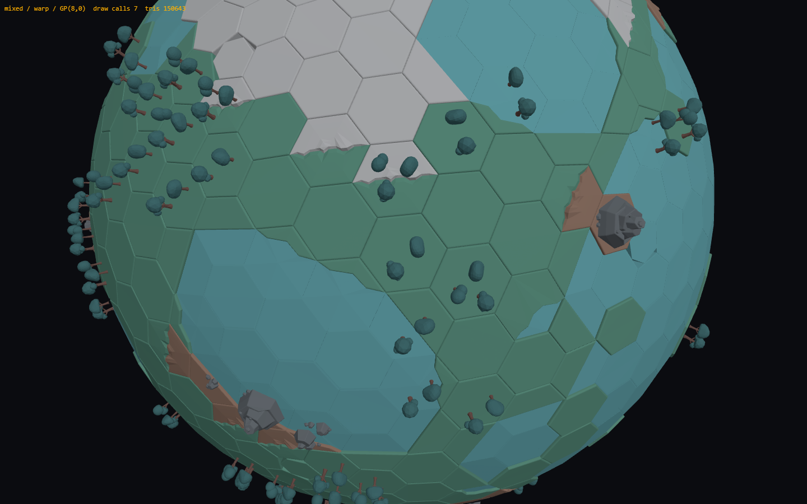
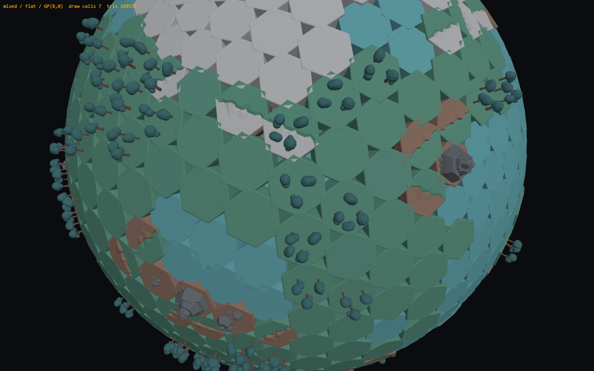
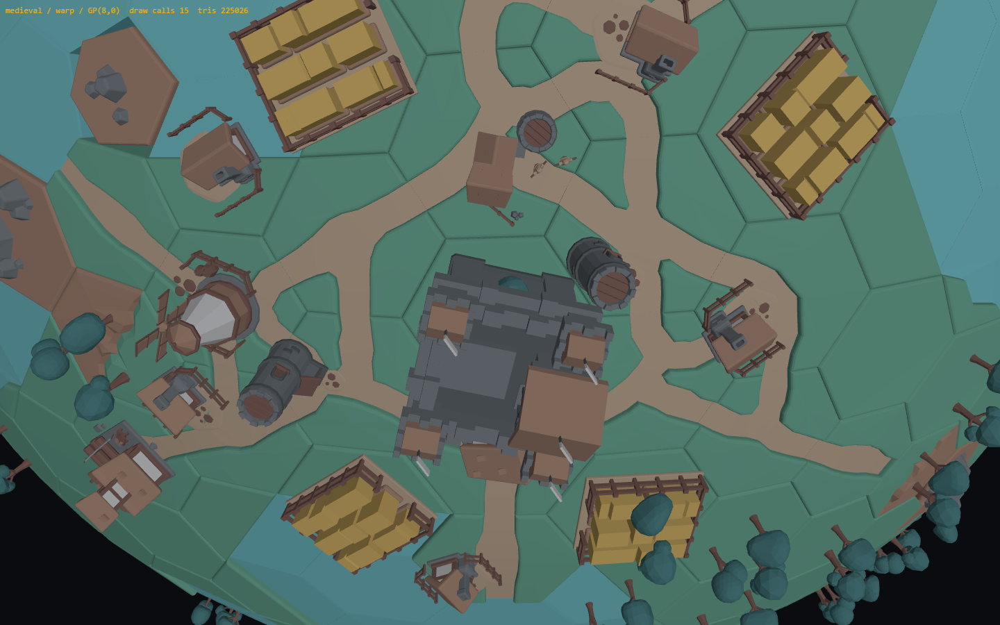
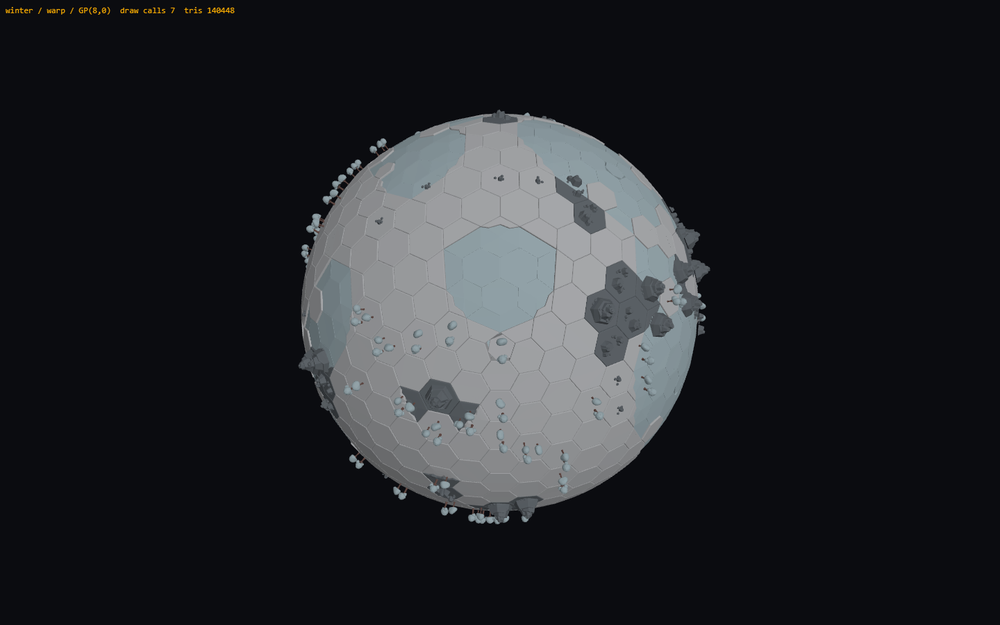

# Teren planet z kafelków KayKit Medieval Hexagon — analiza i plan

Stan: propozycja do decyzji (2026-11-07). Dotyczy paczki w `resources/kaykit` (kopia KayKit Medieval Hexagon Pack, https://kaylousberg.itch.io/kaykit-medieval-hexagon), widoku planety w `web-game/packages/render/src/system` i danych ciał w `web-game/packages/domain`. Polecenie użytkownika: przeanalizować zasoby (przede wszystkim `Models/tiles/hex`, z obiektów głównie skały), zaplanować ich użycie do urozmaicenia planet, zaplanować planety w stylu zimowym, suchym i mieszanym oraz zamienić jedną z planet na `medieval` z budynkami.

## Jak czytać

- **Fakt** wynika z plików paczki, z kodu albo z pomiaru. Podaję plik i linię; ścieżki web-game są względem `web-game/`, ścieżki paczki względem `resources/kaykit/Models/`.
- **[P]** oznacza moją propozycję lub założenie.
- **Pytanie** to rzecz do decyzji; każde ma opcje i rekomendację (rozdz. 8).
- Pomiary i zrzuty pochodzą ze spike'u w `docs/analysis/planet-terrain-spike/` (README opisuje uruchomienie). Zrzuty są w `docs/img/planet-terrain/`.

## 1. Streszczenie

- **Paczka nadaje się na teren planet.** 128 kafelków hex to w istocie **32 kształty w 4 kolorach**: geometria rodzin forest, rock i sand jest identyczna (ten sam hash pozycji wierzchołków), różni się tylko kolor materiału. Skoro i tak kolorujemy modele z palety (W14 C), wystarczy jedna rodzina plus kafelek wody: **21 plików, 233 KB (125 KB gzip)**.
- **Regularny heks nie leży płasko na siatce Goldberga.** Kafelki GP(8,0) mają krawędzie od 3,45 do 4,74 j. (stosunek 1,37), narożniki odbiegają od okręgu do 10 %, a sąsiednie kafelki są nachylone do siebie do 9,4°. Położone płasko zostawiają klinowe szczeliny (zrzut `mixed-flat.png`). **[P] Rozwiązanie: odkształcenie (warp) każdego kafelka do kształtu jego pola** w współrzędnych biegunowych i rzutowanie radialne na sferę. Działa też dla 12 pięciokątów (6 sektorów heksa mapuje się na 5). Spike potwierdza: brak szwów, pięciokąty wyglądają naturalnie (`mixed-warp.png`).
- **Koszt mieści się w budżecie, jeśli pilnujemy dekoru.** Teren GP(8,0) to 36–49 tys. trójkątów w jednym draw callu (dziś siatka ma 3,8 tys.). Drzewa, skały i budynki kosztują 100–176 tys. w 5–15 draw callach. Osada medieval z 320 drzewami dała 225 tys. trójkątów, czyli powyżej progu „uwaga” (200 tys.), więc dekor dostaje budżet i LOD.
- **[P] Cztery presety stylu:** `winter`, `dry`, `mixed`, `medieval`. Różnią się klasami terenu (śnieg, lód, piasek, skała, trawa, las, woda), barwami z palety stonowanej jak `muteBodyColor` i zestawem dekoru. W Tau Ceti: f → zimowa, b → sucha piaskowa, d → sucha skalna, e → mieszana, **c → medieval** (ruiny lub osada; rozdz. 4.5).
- **[P] Plan ma 6 kroków (T0–T5).** T0–T1 dają teren z kafelków zamiast płaskich ścian, T2 biomy i dekor, T3 planetę medieval, T4 pomiar i LOD, T5 paletę w DS i dokumentację. Prace czekają na zakończenie AT1–AT3 (ta sama scena i `view.ts`), więc najwcześniejszy termin to etap E3 z `docs/plan/README.md`.
- **Konflikt z planem 03.** `docs/plan/03-PIPELINE-3D.md` §11 M-5 rekomenduje traktować tę paczkę tylko jako odniesienie techniczne. Polecenie użytkownika z 2026-11-07 to zmienia: paczka jest treścią (teren i obiekty planet). Proponuję zapisać to jako decyzję M-5 → „treść” (rozdz. 9).

## 2. Stan obecny (fakty)

### 2.1 Paczka `resources/kaykit`

| Element | Co jest | Źródło |
|---|---|---|
| Zawartość | `Models/tiles/hex` 128 kafelków, `Models/tiles/square` 68, `Models/objects` 30; każdy model w 4 formatach: `.gltf.glb`, `.fbx`, `.dae`, `.obj`+`.mtl`; `Overview.png`, `Overview_variations.png`, `Samples/sampleA–E.png`; **brak pliku licencji** w kopii (paczki KayKit są CC0, jak `LICENSE-KayKit.txt` Space Base Bits) | listing katalogu; `apps/game/public/assets/kaykit/LICENSE-KayKit.txt` |
| Tekstury | brak. Kolor to `baseColorFactor` materiału; kafelki używają 6 materiałów (Green, Brown, Beige, Water, BrownDark, White), obiekty 14 (dodatkowo Stone, StoneDark, GreenDark, Metal, Yellow, Red, Black, WoodDark). Woda ma `alphaMode: BLEND` | `glb-info.js` na wszystkich plikach |
| Atrybuty | POSITION, NORMAL, TEXCOORD_0 (UV bez tekstury, nieprzydatne do kolorowania); brak COLOR_0 | j.w. |
| Eksporter | Khronos glTF Blender I/O 0.9.36 (Blender 2.8x) | nagłówek GLB |
| Kafelek hex | 2 × 1 × 2,309 j.: apotema 1,0 (ściany płaskie na ±X), promień 1,1547 (narożniki na ±Z), pivot u podstawy, góra na y = 1. Górna krawędź fazowana: pierścienie y 0,95 / 0,975 / 0,993 / 1,0 o promieniach 1,155 / 1,147 / 1,126 / 1,097. Podstawowy kafelek: 56 trójkątów, 68 wierzchołków | `edges.mjs`, `glb-info.js` |
| Rodziny | forest (Green), rock (Brown), sand (Beige) mają **identyczną geometrię** każdego z 32 wariantów (hash pozycji); water to osobne 2 pliki | `geo.mjs` w spike'u (hash md5 pozycji) |
| Warianty (na rodzinę) | `<rodz>` 56 tris; `_detail` 92 (dolna połowa y 0–0,5 w BrownDark, „pas gleby”); `roadA–M` 202–628 (droga Beige na y = 0,9, czyli 0,1 poniżej góry); `roadX_detail` +36; `transitionA` 206 (prawa połowa x ≥ −0,1 podniesiona do 1,069 w Brown = skała), `transitionB` 206 (to samo w White = śnieg); `waterA–D` 54–178 (ląd + tafla Water na y 0,9 pod całym heksem), `waterX_detail`, `waterX_empty` (sam ląd, 1 × 1 × 1,732) | `glb-info.js`, `edges.mjs`, zrzut `catalog.png` |
| Drogi: wyjścia | e_k = ściana pod kątem k·60° od +X. B 0,3 (prosta) · C 0,1 (ostry zakręt) · D 0,2 (łagodny) · E 0,1,3 (T) · F 0,3,5 (Y) · G 0,2,4 (Y symetryczny) · H 0,1,2 · I 0,1,2,4 · J 0,1,3,4 · K 0,1,2,3 · L 1–5 · M wszystkie. A: w katalogu prosta jak B, wykrywacz znalazł tylko wyjście 0; do sprawdzenia | `edges.mjs` (rzut wierzchołków Beige na apotemy ≥ 0,9) |
| Brzegi | waterA: woda na 2 sąsiednich ścianach (0,1), ląd na 4; waterB i waterC: woda na 1 ścianie (3), C z głębszą zatoką; waterD: staw w środku, ląd na wszystkich ścianach | j.w. |
| Obiekty | 30 plików, 1,78 MB; budynki 1252–2271 tris, skały 552–1102, góra 986, drzewa 287–579, `forest` 2328, `detail_forestA/B` 2900/1878, mury 350–996. Wszystkie z pivotem u podstawy, stopa ≤ 2 j. (mieszczą się na heksie). `mill_blades`, `watermill_wheel`, `farm_wheat` to osobne węzły (ruchome części) | tabela w rozdz. 2.4 |

### 2.2 Jak dziś rysujemy planetę

- **Siatka:** Goldberg GP(n,0) z domeny; Tau Ceti b, c: n = 5 (252 pól), d, f: n = 6 (362), e: n = 8 (642); preset PoC: Planeta Matka n = 8, Księżyc n = 3 (92). Promień ciała = 50·n/8, więc kafelek ma zawsze ok. 7,5 j. szerokości (`scenarios/tau-ceti.ts:31`, `config/initial-world.ts:49`, `:64`).
- **Powierzchnia:** jedna nieindeksowana siatka wachlarzy trójkątów na pole, kolor w wierzchołkach (stonowana barwa ciała, odcień złoża, przygaszenie wyczerpanych, hover i zaznaczenie przez zmianę koloru zakresu wierzchołków), plus `LineSegments` krawędzi pól. `faceIndex` trafienia → pole (`planet-grid-view.ts:14-20`, `:195-203`). 642 pól = 3 840 trójkątów.
- **Złoża:** instancjonowane `rocks_A` na wolnych polach ze złożem; znikają pod budowlą i po wyczerpaniu (`structure-layer.ts:244-261`).
- **Modele:** `ModelLibrary` składa `.gltf` + `.bin` w GLB w pamięci, usuwa tekstury i koloruje wierzchołki **z pola atlasu UV** (`colorFromAtlas`, `model-library.ts:94-109`); bez UV każdy wierzchołek dostałby ton pola 0 (`ATLAS_TONES[0]` = `dark`). Kafelki KayKit Medieval nie mają atlasu, więc potrzebna jest druga ścieżka koloru: **nazwa materiału → ton palety**. Plan 03 §4 przewiduje trzecią (COLOR_0) dla nowych modeli z Blendera.
- **Budżety:** uwaga > 100 draw calls i > 200 tys. trójkątów, przekroczenie > 150 i > 400 tys.; pierwsze pobranie < 15–25 MB. Dziś planeta e z portem: 20 draw calls, 27,6 tys. trójkątów; scenariusz M: 69 / 256 tys. (uwaga), L: 136 / 1,1 mln (przekroczenie) z powodu budynków bez odcinania i LOD (`docs/PERF-REPORT.md`).
- **Styl:** W14 C: modele KayKit w ograniczonej palecie DS, płaskie cieniowanie, wektorowe nakładki, bez tekstur i poświat. Barwa ciała przechodzi przez `muteBodyColor`: 55 % do szarości, 25 % do `metal` (`palette.ts:110-114`).

### 2.3 Dopasowanie regularnego heksa do pól Goldberga (pomiar)

`fit.mjs` na siatkach z domeny (promień 50·n/8):

| GP(n,0) | Pól | Krawędź heksa min / śr. / maks. [j.] | Odchylenie promienia narożnika od średniej pola | Odchylenie kąta narożnika od 60° | Kąt między normalnymi sąsiadów | Szczelina klinowa u góry ściany kafelka (wys. 1·s) |
|---|---|---|---|---|---|---|
| 3 | 92 | 4,11 / 4,37 / 4,59 | 3,5 % | 3,3° | 23,8° | 42 % wysokości |
| 5 | 252 | 3,72 / 4,36 / 4,68 | 8,1 % | 5,8° | 15,0° | 26 % |
| 6 | 362 | 3,60 / 4,35 / 4,70 | 9,3 % | 6,6° | 12,4° | 22 % |
| 8 | 642 | 3,45 / 4,35 / 4,74 | 10,3 % | 7,6° | 9,4° | 16,5 % |

Wnioski (fakty z pomiaru): (1) jedna skala kafelka na ciało jest w porządku (średni promień narożnika ≈ 4,35 j. ⇒ skala s = 3,77 przy promieniu heksa 1,1547), ale (2) kształt każdego pola trzeba dopasować indywidualnie, a (3) płaskie kafelki na sferze zostawiają szczeliny rzędu 1/6 wysokości ściany przy n = 8 i prawie połowy przy n = 3. Pięciokąty mają krawędź 3,79 j. i promień 3,23 j. przy n = 8, czyli są o 26 % mniejsze od heksów.

### 2.4 Tabele zasobów

Kafelki jednej rodziny (geometria wspólna dla forest, rock, sand):

| Grupa | Plików | Trójkąty | Co to jest |
|---|---|---|---|
| `hex_forest` | 1 | 56 | pełny heks, góra fazowana |
| `hex_forest_detail` | 1 | 92 | jak wyżej z pasem gleby (BrownDark) w dolnej połowie |
| `hex_forest_roadA…M` | 13 | 202–628 | droga (Beige) wpuszczona 0,1 j.; wyjścia wg 2.1 |
| `hex_forest_roadX_detail` | 13 | 238–664 | droga + pas gleby |
| `hex_forest_transitionA/B` | 2 | 206 | połowa podniesiona do 1,069: A skała (Brown), B śnieg (White) |
| `hex_forest_waterA…D` | 4 | 54–178 | brzeg: ląd + tafla wody na 0,9 |
| `hex_forest_waterX_detail` | 4 | 96–228 | brzeg + pas gleby |
| `hex_forest_waterX_empty` | 4 | 44–138 | sam ląd brzegu (pół heksa) |
| `hex_water`, `hex_water_detail` | 2 | 56 / 62 | pełna tafla wody |

Obiekty (wymiary x × y × z w jednostkach paczki, stopa ≤ 2 j.):

| Plik | Trójkąty | KB | Wymiary | Materiały | [P] Użycie |
|---|---|---|---|---|---|
| detail_rocks | 1102 | 35,7 | 1,89 × 0,56 × 1,33 | Stone | skały na polach `rock` |
| detail_rocks_small | 552 | 18,6 | 0,65 × 0,21 × 0,53 | Stone | drobne skały na piasku, śniegu, polach `rock` |
| mountain | 986 | 36,9 | 1,79 × 1,22 × 1,91 | Stone | góra na części pól `rock` |
| detail_hill | 1677 | 58,1 | 1,82 × 1,10 × 1,59 | Green, BrownDark, GreenDark, Stone | wzgórze (mixed, medieval); opcjonalnie |
| detail_treeA / B / C | 287 / 579 / 337 | 11–18 | ~0,5 × 0,75 × 0,4 | BrownDark, GreenDark | drzewa (2–3 na pole `forest`); w zimie korony w tonie lodu |
| forest, detail_forestA / B | 2328 / 2900 / 1878 | 63–103 | ~1,9 × 0,7–1,4 × 1,2–1,9 | GreenDark, BrownDark, (Stone) | gęsty las; za drogie na pole, tylko jako LOD0 w fokusie albo wcale |
| castle | 2231 | 138,6 | 1,80 × 2,53 × 1,85 | Stone, StoneDark, BrownDark, Brown, White | centrum osady medieval |
| watchtower | 1871 | 77,7 | 0,97 × 1,98 × 1,71 | Stone, BrownDark, StoneDark, Beige | wieże przy drogach |
| house | 1666 | 71,6 | 1,69 × 0,91 × 1,66 | Beige, Stone, White, BrownDark, Brown | domy (pierścień 2) |
| market | 1924 | 99,9 | 1,47 × 0,86 × 1,67 | j.w. | rynek przy zamku |
| barracks | 1960 | 112,0 | 1,99 × 1,30 × 1,61 | Brown, Stone, White, BrownDark, Beige, StoneDark | koszary |
| mill | 2270 | 109,7 | 1,69 × 1,98 × 1,67 | Brown, BrownDark, Beige, White, Stone | wiatrak (węzeł `mill_blades`) |
| farm_plot | 906 | 51,9 | 1,47 × 0,46 × 1,28 | Yellow, Brown, Beige, BrownDark | pola uprawne (węzeł `farm_wheat`) |
| well | 1252 | 58,0 | 1,02 × 0,74 × 1,02 | Stone, StoneDark, BrownDark, Brown, Water, Beige | studnia |
| lumbermill | 1698 | 80,8 | 1,82 × 1,47 × 1,66 | Brown, Stone, White, BrownDark, Metal | tartak przy lesie |
| mine | 1735 | 80,3 | 1,61 × 0,83 × 1,88 | Stone, BrownDark, Black, Metal, WoodDark, Beige | kopalnia przy skałach |
| archeryrange | 1668 | 86,2 | 1,80 × 1,54 × 1,55 | …, Red | opcjonalnie (Red poza paletą) |
| watermill | 1605 | 85,9 | 1,53 × 1,60 × 1,42 | BrownDark, Stone, White, Brown | tylko przy wodzie (węzeł `watermill_wheel`) |
| bridge, bridge_roofed | 252 / 480 | 13,6 / 24,8 | 2,0 × 0,8–1,3 × 0,74 | Stone, (Brown, BrownDark) | most między polami przez wodę; opcjonalnie |
| wall_straight, wall_corner, wall_gate(_closed), wall_hexCornerA / B | 350–996 | 25–62 | 2,0 × 1,15 × 0,53 (prosty) | Stone, (StoneDark, BrownDark) | mur wzdłuż krawędzi pól (długość 2 = szerokość heksa); opcjonalnie |

## 3. Spike (co sprawdzono)

Strona Three.js w headless Chromium (SwiftShader, 1440 × 900) z siatką GP(8,0) z domeny (bez zmian w domenie: bundel esbuild), klasami terenu z `fbm` na normalnej pola, wyborem wariantu kafelka (brzegi, drogi, przejścia według masek z 2.1), odkształceniem kafelków i dekorem w `InstancedMesh`. Stonowane barwy z `palette.mjs`. Wyniki (`stats.json`):

| Ujęcie | Teren [tris] | Dekor [tris] | Draw calls | Razem [tris] | Dekor (sztuk) |
|---|---|---|---|---|---|
| `mixed-warp` | 42 668 | 107 975 | 7 | 150 643 | 221 drzew, 35 skał i gór |
| `winter-warp` | 38 380 | 102 068 | 7 | 140 448 | 132 drzewa, 65 skał i gór |
| `dry-warp` | 35 952 | 118 830 | 5 | 154 782 | 147 skał i gór, 8 krzewów |
| `medieval-warp` | 49 036 | 175 990 | 15 | 225 026 | 17 pól dróg, 17 budynków, 323 drzewa, 38 skał |
| `mixed-flat` (kontrola) | 42 668 | 107 975 | 7 | 150 643 | — |

Zrzuty: `catalog.png` (44 kafelki), `mixed-warp.png` i `mixed-flat.png` (warp kontra płasko), `winter-warp.png`, `winter-warp-far.png`, `dry-warp.png`, `medieval-warp.png`, `medieval-warp-zoom.png`, `medieval-warp-far.png`.

Co spike potwierdza (fakty): odkształcenie usuwa szczeliny i poprawnie obsługuje pięciokąty; maski dróg dają ciągłą sieć (po poprawce wykrywania: droga leży na y = 0,9, więc trzeba mierzyć rzut na apotemę, nie odległość od środka); brzegi z wariantów A–D pasują do sąsiadów po obrocie; przejścia (skała, śnieg) obracają się ku właściwemu sąsiadowi; tafla wody 0,1·s poniżej lądu daje czytelny klif brzegowy bez przezroczystości. Czego spike nie sprawdza: hover, zaznaczenia, pickingu, budowli na terenie, odcinania półkuli, działania w scenie gry.

## 4. Propozycja

### 4.1 Zasady [P]

1. **Bez tekstur, kolor z palety** (W14 C): kafelki i obiekty kolorujemy po **nazwie materiału** (`Green`, `Beige`, `Water`, `Stone`…) na tony z rozdz. 4.7. Ta sama nazwa dostaje inny ton zależnie od biomu i klasy pola (np. `Green` to trawa, piasek albo śnieg). Ścieżka UV atlasu zostaje dla Space Base Bits, ścieżka COLOR_0 dojdzie z planu 03.
2. **Jedna rodzina geometrii** (forest + water, 21 plików). Rodzin rock i sand nie kopiujemy.
3. **Odkształcenie radialne na pole** zamiast instancjonowania kafelków: teren ciała to **jedna statyczna geometria** (jak dziś), więc hover, zaznaczenie i picking działają tak samo (zakresy wierzchołków na pole, `faceIndex` → pole). Pięciokąty obsługuje ten sam algorytm.
4. **Góra kafelka leży na sferze o promieniu ciała** (y = 1 → R), kafelki wchodzą w głąb ciała. Budowle, łaziki i lądowiska stoją na R jak dziś. Woda jest 0,1·s niżej, podniesione połowy przejść 0,07·s wyżej (budowla na takim polu wejdzie 0,26 j. w teren; rozdz. 7).
5. **Dekor to osobna warstwa** (drzewa, skały, góry, budynki osady): `InstancedMesh` na (ciało × model), jak budowle. Znika pod budowlą jak skały złóż. Rysowany tylko dla ciała w fokusie i powyżej progu pozornego promienia (jak dziś krawędzie od `EDGES_MIN_PX`).
6. **Dzisiejsza siatka wachlarzy zostaje jako daleki LOD**: ciała poza fokusem i małe na ekranie rysują się jak dziś (3,8 tys. trójkątów, 1 draw call, bez dekoru). Krawędzie `LineSegments` znikają dla terenu z kafelków, bo fazowanie robi to samo lepiej.
7. **Deterministycznie**: klasy terenu, warianty, dekor i osada liczą się z ziarna ciała (`depositSeed`) i indeksu pola, jak złoża (`deposit-generator.ts`). Ten sam świat ⇒ ten sam obraz, także po porcie do Rust.

### 4.2 Dane: biom i teren w domenie [P]

- `CelestialBody.surfaceGrid` dostaje `biome: 'mixed' | 'winter' | 'dry' | 'medieval'` i opcjonalne `terrainSeed` (domyślnie `depositSeed + 1`).
- `Tile` dostaje `terrain: TerrainKind` z `'grass' | 'forest' | 'rock' | 'sand' | 'dune' | 'snow' | 'water'`. Generator `generateTerrain(tiles, seed, biome)` w `sim/math/` używa `fbm` na normalnej pola i szerokości geograficznej (|n.y|), z progami na biom (rozdz. 4.4). Na polach ze złożem teren nie może być `water` (złoże wygrywa; **[P]**, bo inaczej skały złoża stałyby w jeziorze).
- Dla `medieval` domena liczy też `settlement: { center, roads: number[], buildings: Array<{ tile, kind, yaw }> }` (rozdz. 4.5). To dane, nie logika gry; w pierwszym kroku nie wpływają na reguły budowy (Pytanie T-3).
- Migawka dla klienta: `Tile.terrain` idzie w `PlanetGrid`, który klient i tak buduje sam z ciała (`scenario.ts:52-53`), więc protokół się nie zmienia; zmienia się tylko `CelestialBody` (nowe pola danych).

Dlaczego domena, a nie renderer: teren będzie kiedyś wpływał na rozgrywkę (woda, drogi, koszt budowy), serwer w Rust musi znać te same dane, a generator jest czystą funkcją jak złoża. Koszt: ~150 linii TS i kilka testów.

### 4.3 Renderer: `TerrainLayer` [P]

Zastępuje `mesh` i `edges` z `PlanetGridView` dla ciał z terenem; API zostaje (`tileAtFace`, `setHover`, `setSelected`, `setExhausted`, `writeOutline`, `colorOf`), żeby `system-scene.ts:533-537` i testy zmieniły się minimalnie.

Algorytm odkształcenia (zweryfikowany w `main.js`):

1. Dla pola o środku C, normalnej Y i wierzchołkach V (CCW od zewnątrz) buduj bazę: X = rzut (V₀ − C) na płaszczyznę styczną, Z = X × Y. Posortuj wierzchołki po kącie φ = atan2((V−C)·Z, (V−C)·X) → S₀…S_{m−1} (m = 5 lub 6). Sąsiad przez krawędź (S_j, S_{j+1}) to ten, którego środek jest najbliżej środka krawędzi.
2. Skala ciała s = (średni promień narożnika heksów) / 1,1547 (≈ 3,77 przy n = 8).
3. Dla każdego wierzchołka kafelka (x, y, z): θ = atan2(z, x), r = √(x² + z²), δ = odległość kątowa θ od najbliższej ściany (k·60°), **f = r·cos δ** (ułamek apotemy: 0 w środku, 1 na krawędzi). Sektor między narożnikami: s₆ = ((θ − 30°) mod 360°)/60°, **s_m = s₆·m/6**, j = ⌊s_m⌋, g = s_m − j. Punkt na brzegu pola: B = lerp(S_{(k₀+j) mod m}, S_{(k₀+j+1) mod m}, g). Punkt w polu: P = C + f·(B − C). Wynik: **P̂ · (R + (y − 1)·s)**.
4. Obrót k₀ dobiera się dla dróg (dopasowanie maski wyjść do sąsiadów-dróg), brzegów (maska wody) i przejść (podniesiona połowa ku sąsiadowi). Dla m = 5 drogi i przejścia są wyłączone (pięciokąt dostaje kafelek podstawowy).
5. Geometria nieindeksowana, normalne liczone po odkształceniu; materiał `MeshLambertMaterial({ vertexColors, flatShading })` wspólny z `ModelKit`.

Wybór wariantu na pole (kolejność): woda → `hex_water` (wszystkie wierzchołki Water obniżone do 0,9); droga → `roadB…M` po masce (A pomijana do wyjaśnienia); ląd przy 1–2 polach wody → `waterA/B/C` po masce; trawa bez wody z prawdopodobieństwem 4 % → `waterD` (staw); ląd przy skale → `transitionA` (45 %), ląd przy śniegu → `transitionB` (70 %); reszta → `hex_forest`. `_detail` (pas gleby) tylko wtedy, gdy ściany kafelka są widoczne, czyli nigdy na pełnej sferze: pomijamy.

Kolory: `tileTone(materiał, klasa, biom)` jak w `main.js`; hover ×1,35, zaznaczenie 35 % do `signal`, złoże 55 % do `depositTint`, wyczerpane 18 % (dzisiejsze stałe). Odcień złoża nakładamy tylko na materiał górnej powierzchni, nie na wodę ani drogę.

Picking: `faceIndex` → pole przez tablicę jak dziś (`faceToTile`), bo trójkąty każdego pola są ciągłym zakresem.

Ładowanie: `ModelLibrary.fetchModel` rozpoznaje `.glb` (plan 03 §5 już to zakłada) i funkcja `colorFromMaterials(scene, toneOf)` koloruje po nazwie materiału przed spłaszczeniem. Rejestr: osobna mapa `TERRAIN_MODELS` (kafelki, bez `fill`) i wpisy dekoru w `MODELS` z liczbami z rozdz. 2.4, sprawdzane testem jak dziś.

### 4.4 Presety stylu [P]

Progi są z `main.js` (działają na `fbm(seed, 2,6·n)`, `fbm(seed+11, 3,4·n)`, `fbm(seed+23, 4,2·n)` i |n.y|); do strojenia w T2.

| Preset | Klasy pól (udział przy n = 8 w spike'u) | Barwa „Green” | Woda | Dekor | Ciała [P] |
|---|---|---|---|---|---|
| `winter` | śnieg 58 %, lód (woda) 26 %, skała 7 %, las 9 % (tylko |lat| < 0,7) | `snow` | `ice`, tafla jak woda | drzewa z koronami w `ice`, skały i góry w `stone`, drobne skały na śniegu | Tau Ceti f; Glacja |
| `dry` | piasek 76 %, wydmy 7 % (`dune`), skała 15 %, krzewy 1 % | `sand` (wariant `regolith`: `stone`) | brak | góry, skały, drobne skały; pojedyncze krzewy (drzewo ×0,7, korona oliwkowa) | Tau Ceti b (piasek), d i Księżyc (regolit, szary), Pyros (skała, `rock`) |
| `mixed` | trawa 37 %, woda 32 %, las 14 %, śnieg 11 % (czapy |lat| > 0,84), skała 5 % | `grass` | `water`, brzegi A–D, stawy | 2–3 drzewa na pole lasu, skały i góry na skale | Tau Ceti e; Planeta Matka (preset PoC) |
| `medieval` | jak `mixed` z mniejszą wodą (20 %) i większym lasem (21 %); osada | `grass` | j.w. | jak `mixed` + osada (4.5) | Tau Ceti c |

Czapy polarne robią `transitionB` (postrzępiona biała krawędź), skały `transitionA`. W `dry` przejść nie ma (wariant podnosi połowę pola, a skała na pustyni ma być płaska z górami). Preset `dry` ma parametr barwy podłoża, bo „suchy” w Tau Ceti to trzy różne ciała: gorący piasek (b), chłodny regolit (d), czerwona skała (Pyros).

### 4.5 Planeta medieval [P]

**Które ciało:** rekomenduję **Tau Ceti c** („skalista, śladowa atmosfera, umiarkowana, brak wody, druga kolonia przemysłowa”, `tau-ceti.ts:53-58`). Powody: ma klimat umiarkowany (jedyne obok e), gracz tam dotrze (druga kolonia), a nie jest planetą startową, więc osada nie przeszkadza w pierwszych godzinach gry i nie zajmuje pól kolonii z kanwy. Alternatywy w Pytaniu T-1.

**Fikcja:** profil skanu dostaje dopisek, np. „Ruiny osady sprzed utraty atmosfery; zabudowa kamienna, drogi, pola uprawne” (`profile.note`). W pierwszym kroku osada jest **dekorem**: znika pod budowlą gracza jak skały złóż. Wersja „żywa cywilizacja NPC” (handel, kontrakty) to hak dla `docs/plan/05-SOCIAL.md` (frakcje NPC) i osobna decyzja (Pytanie T-2). Konsekwencja dla fikcji: planeta ma „śladową atmosferę” i „brak wody”, więc osada to ruiny, a jeziora z presetu są wyschnięte (klasa `water` renderowana jako `dune` w tonie `soil`) albo profil c zmienia się na „woda: słone jeziora”. Rekomendacja: ruiny i wyschnięte jeziora, bo nie rusza bilansu surowców (Kriol z c nadal brak).

**Generator osady** (deterministyczny, z `main.js`): środek = heks o normalnej najbliższej kierunkowi ziarna; pierścienie sąsiadów R1 (6 pól), R2 (12), R3 (18). Pola środka, R1 i R2 bez wody i skał. Zamek na środku (`castle`, 95 % szerokości pola). R1: drogi na wszystkich 6 polach, 2 wieże, rynek, koszary. R2: co trzecie pole droga + dom, co trzecie pole uprawne, wiatrak, studnia, reszta domy. R3: tartak na polu lasu, kopalnia na polu skały; 4 drogi promieniste z R3 do R1 (najkrótsza ścieżka po lądzie). Łącznie w spike'u: 17 pól dróg, 17 budynków, 5,5 tys. trójkątów na budynki i 24 tys. na całą osadę bez drzew. Mury (`wall_*`) i mosty (`bridge*`) odkładam: wymagają osadzania wzdłuż krawędzi pól i nad wodą (osobny mechanizm), a bez nich osada już czyta się dobrze (`medieval-warp-far.png`).

**Dopasowanie do gry:** budowle gracza (Space Base Bits) i ruiny (Medieval) stoją obok siebie w tej samej palecie: oba zestawy przechodzą przez te same tony `stone`, `metal`, `wood`, więc różnica jest w kształcie, nie w kolorze. To celowe: ruiny mają być tłem, a budowle gracza pierwszym planem.

### 4.6 Zasoby do skopiowania [P]

Do `web-game/apps/game/public/assets/kaykit-hex/` (osobny katalog, bo Space Base Bits ładuje się ścieżką `.gltf` + `.bin`, a te pliki to GLB), razem z `LICENSE-KayKit-Medieval.txt` (CC0, tekst jak w `LICENSE-KayKit.txt`; Pytanie T-8):

| Zestaw | Pliki | Raw | gzip |
|---|---|---|---|
| Kafelki (rodzina forest + water) | `hex_forest`, `hex_water`, `hex_forest_transitionA/B`, `hex_forest_waterA–D`, `hex_forest_roadA–M` (21) | 233 KB | 125 KB |
| Skały | `detail_rocks`, `detail_rocks_small`, `mountain` (3) | 91 KB | 61 KB |
| Drzewa | `detail_treeA/B/C` (3) | 43 KB | 27 KB |
| Osada | `castle`, `watchtower`, `house`, `market`, `mill`, `farm_plot`, `well`, `lumbermill`, `mine`, `barracks`, `wall_straight`, `wall_corner`, `wall_gate`, `wall_hexCornerA/B` (15) | 1 052 KB | 468 KB |
| **Razem** | 42 | **1,42 MB** | **0,68 MB** |

Dziś modele to 0,5 MB (0,2 MB gzip); po zmianie ok. 1,9 MB (0,9 MB gzip) wobec budżetu 15–25 MB. Osadę (0,47 MB gzip) można ładować leniwie przy pierwszym fokusie na planecie medieval. Pozostałe pliki paczki (rodziny rock i sand, `_detail`, `_empty`, kafelki kwadratowe, FBX, DAE, OBJ) nie trafiają do `public/`. Co zrobić z `resources/` jako całością: Pytanie T-8.

### 4.7 Paleta terenu [P]

Tony z `palette.mjs`: barwa KayKit (sRGB z `baseColorFactor`) przeciągnięta 40 % do szarości o tej samej luminancji i 20 % do `metal` (słabiej niż `muteBodyColor`, które ma 55 % i 25 %, bo teren musi odróżniać klasy pól). Do decyzji, czy wchodzą do design systemu (P9, Pytanie T-7).

| Ton | KayKit | Stonowany | Użycie |
|---|---|---|---|
| grass | #4aba8c | **#629a88** | trawa (mixed, medieval) |
| forest | #2c8a8c | **#47767a** | korony drzew |
| sand | #d9ad7d | **#ad9a87** | piasek, droga w mixed i medieval, tynk |
| dune | — | **#8f7d6c** | wydmy, wyschnięte jeziora |
| rock | #c7845f | **#997c6d** | skała (pole), dachy |
| soil | #995a46 | **#765a54** | pas gleby, drewno, droga w dry i winter |
| snow | #e6e6e6 | **#c4c6c9** | śnieg, tynk biały |
| ice | #bfe3ea | **#aec1c8** | lód (tafla w winter), korony drzew w winter |
| water | #4ad5e0 | **#6aafb8** | tafla wody |
| stone | #788287 | **#6e757b** | kamień, góry, skały |
| stoneDark | #5a6164 | **#555c60** | kamień ciemny |
| thatch | #ffbb29 | **#c3a562** | zboże, strzechy; zastępuje też Red (czerwień jest tylko dla `alert`) |
| metal | #a8b6bd | **#969fa5** | metal |
| dark | #2b3539 | **#31383d** | wnętrza, czerń |

Zasada DS „jeden kolor sygnałowy” jest zachowana: żaden ton nie zbliża się do `#FFB000` ani `#FF5A4A` (najcieplejszy to `thatch` o luminancji 0,65 i nasyceniu ok. 0,45).

### 4.8 Budżety i LOD [P]

| Co | Koszt (n = 8) | Zasada |
|---|---|---|
| Teren ciała w fokusie | 36–49 tys. tris, 1 draw call | zawsze, gdy pozorny promień ≥ `EDGES_MIN_PX` |
| Teren pozostałych ciał | 3,8 tys., 1 draw call (dzisiejsza siatka) | bez dekoru |
| Drzewa | 287–579 tris/szt.; limit **2 na pole lasu**, maks. **200 na ciało** (≤ 90 tys.) | tylko ciało w fokusie; powyżej limitu wybór po `hash3` |
| Skały i góry | 552–1102 tris/szt.; maks. **60 na ciało** (≤ 50 tys.) | j.w. |
| Osada | ok. 30 tys. (budynki) + drogi w terenie | j.w.; budynki poza polem widzenia półkuli pomijane (zadanie z PERF-REPORT dotyczy także dekoru) |
| Razem planeta w fokusie | teren 49 + dekor ≤ 170 = **≤ 220 tys.** przy pełnych limitach; cel ≤ 150 tys., żeby zostawić miejsce budowlom (M: 256 tys. już dziś) | limity to parametry w jednym pliku, mierzone w `npm run perf` |

Odcinanie półkuli dla `InstancedMesh` (budowle i dekor) to już zadanie z `PERF-REPORT.md`; teren z kafelków go nie potrzebuje (jedna geometria, odrzucanie tylnych ścian robi GPU).

## 5. Plan prac [P]

Numeracja T, żeby nie kolidować z F (web-game), AT (Atanor), B/S/U (plany 02/05/06). Każdy krok kończy się raportem jak F0–F6 w `UNIFICATION.md` §3 i wpisami w rejestrze decyzji.

| Krok | Zakres | Brama |
|---|---|---|
| **T0** Zasoby i ładowanie | kopia 42 GLB + licencja do `public/assets/kaykit-hex/`; `ModelLibrary` czyta `.glb` wprost; `colorFromMaterials`; `TERRAIN_MODELS` i wpisy dekoru w rejestrze; manifest wg planu 03 §5 (pole `license`) | test rejestru zielony (trójkąty, wymiary z 2.4); pobranie ≤ 2 MB raw |
| **T1** Teren | domena: `biome`, `Tile.terrain`, `generateTerrain` (+ testy determinizmu i braku wody na złożach); render: `TerrainLayer` (warp, warianty, kolory, hover, zaznaczenie, picking), daleki LOD = dzisiejsza siatka; harness `?terrain` | testy `render/system` zielone (63 + nowe: góra kafelka na R ± 1e-3, wspólne krawędzie sąsiadów pokrywają się ± 1e-2, pięciokąty bez dróg); e2e widoków bez zmian; zrzuty harnessu jak w rozdz. 3 |
| **T2** Biomy i dekor | presety `winter`, `dry`, `mixed` z parametrami; `DecorLayer` (drzewa, skały, góry) z limitami z 4.8, znikanie pod budowlą; Tau Ceti f/b/d/e i preset PoC dostają `biome` | `npm run perf`: S i M bez „PRZEKROCZONY” w widoku planety; dekor ≤ limitów |
| **T3** Medieval | generator osady w domenie, dekor budynków, Tau Ceti c = `medieval` z dopiskiem w profilu, leniwe ładowanie osady | zrzut harnessu Tau Ceti c jak `medieval-warp-far.png`; test: osada nie zajmuje pól ze złożem ani pięciokątów; determinizm |
| **T4** Pomiar i LOD | aktualizacja `PERF-REPORT.md` (S/M/L z terenem), odcinanie półkuli dla dekoru i budowli (zadanie F5), decyzja P8 | brak „PRZEKROCZONY” w M; L tylko pomiar |
| **T5** DS i dokumentacja | tony terenu w `design-tokens.ts` (P9), `palette.json` dla pipeline'u 03, README `render/system`, rejestr decyzji, przeglądarka assetów (plan 04) pokazuje kafelki i dekor | `npm run check` zielone; `tokens:check` zielone |

Zależności: T0–T1 dotykają `system-scene.ts`, `view.ts` i `ModelLibrary`, które zmienia równolegle praca AT1–AT3 (Atanor), więc T0 zaczyna się po scaleniu AT3. W mapie drogowej `docs/plan/README.md` to etap **E3 „Treść 3D”**, obok pipeline'u Blendera; kafelki i obiekty medieval nie potrzebują Blendera, więc T0–T3 mogą iść przed spike'iem M-1. Szacunek: T0 1 dzień, T1 2–3 dni, T2 2 dni, T3 2 dni, T4 1–2 dni, T5 1 dzień.

## 6. Testy [P]

- **Domena:** `generateTerrain` deterministyczny (ten sam seed ⇒ te same klasy), udziały klas w przedziałach na biom, brak `water` na polach ze złożem, osada bez pięciokątów i złóż, drogi spójne (każde pole drogi ma ≥ 1 sąsiada-drogę poza końcówkami).
- **Render (node, pliki z dysku):** każdy wpis `TERRAIN_MODELS` i dekoru zgodny z plikiem (trójkąty, wymiary, materiały); maski dróg i brzegów z `edges.mjs` zgodne z plikami (test chroni przed podmianą paczki); `warpTile` zachowuje liczbę trójkątów, kładzie górę na R, a wspólne krawędzie sąsiadów na tych samych punktach.
- **Render (jsdom):** `TerrainLayer` zachowuje kontrakt `PlanetGridView` (pick pola, hover, zaznaczenie, wyczerpane złoże, dispose bez wycieków: 20 cykli).
- **Harness i perf:** ujęcia z rozdz. 3 dla czterech presetów; `npm run perf` z progami.

## 7. Ryzyka

| Ryzyko | Skutek | Mitygacja |
|---|---|---|
| Budowle na podniesionych połowach przejść (1,069) wchodzą 0,26 j. w teren | drobny artefakt | przejścia tylko na polach bez złoża; opcjonalnie `baseLift` z wysokości pola |
| Dekor + budowle przekraczają 200 tys. w M | „uwaga” w perf | limity z 4.8, odcinanie półkuli (T4), LOD drzew (`detail_treeA` ma 287 tris, `forest` 2328: nie używać `forest`) |
| Teren w domenie to więcej danych do portu Rust (plan 02) | dodatkowa praca w B1 | generator to ~150 linii czystych funkcji z `hash3`/`fbm`, które i tak są portowane dla złóż |
| Paleta terenu kłóci się z „planety jak część HUD” (W14 C, `muteBodyColor`) | planety zbyt barwne | tony z 4.7 są o 10–15 % mniej wytłumione niż ciała dziś; parametr `mute` w jednym miejscu, decyzja T-7 po zrzutach w scenie gry |
| Jedna geometria terenu na ciało = brak instancjonowania między ciałami | 5 ciał × 49 tys. wierzchołków w pamięci GPU (~6 MB) | akceptowalne; daleki LOD dla ciał poza fokusem i tak nie używa kafelków |
| Osada koliduje z miejscem kolonii gracza na c (port, place) | gracz buduje w ruinach | dekor znika pod budowlą; środek osady z dala od strony oświetlonej, w którą celuje kamera startowa (`system-scene` „strona oświetlona”) |
| Plik roadA: maska niepewna | zła droga | A pominięta do czasu sprawdzenia w harnessie; B daje prostą |

## 8. Pytania

| ID | Pytanie | Opcje | Rekomendacja |
|---|---|---|---|
| T-1 | Która planeta jest `medieval`? | A Tau Ceti c · B Tau Ceti e (start) · C Planeta Matka (preset PoC) · D nowe ciało | **A**: umiarkowany klimat, gracz tam dotrze, nie zaśmieca startu (4.5) |
| T-2 | Czym jest osada w fikcji i mechanice? | A ruiny-dekor (znikają pod budowlą) · B żywa cywilizacja NPC: frakcja, handel, kontrakty (plan 05) · C tylko styl testowy, bez fikcji | **A** teraz, **B** jako hak dla 05-SOCIAL (SOC-3 frakcje) |
| T-3 | Czy teren wpływa na rozgrywkę? | A nie (tylko obraz) · B woda i lód niebudowalne, łazik wolniej przez las i skały, drogi szybciej · C jak B plus surowce z terenu (drewno) | **A** w T1–T3; **B** jako osobne pytanie do GDD (zmienia `build-system.ts` i `rover-system.ts`); dane w domenie od razu (4.2), żeby B nie wymagało migracji |
| T-4 | Gdzie liczyć teren i osadę? | A domena (dane jak złoża) · B renderer | **A** (4.2) |
| T-5 | Skały złóż | A zostaje `rocks_A` (Space Base Bits) · B `detail_rocks_small` (Medieval) | **A**: złoże musi odróżniać się od dekoru terenu; dekor skalny używa Medieval |
| T-6 | Krawędzie pól | A linie jak dziś · B tylko fazowanie kafelków, linie w dalekim LOD | **B** |
| T-7 | Tony terenu do design systemu (P9)? | A tak, grupa `terrain` w `design-tokens.ts` · B zostają w `palette.ts` | **A** w T5, po akceptacji zrzutów w scenie gry |
| T-8 | Los `resources/kaykit` i licencja | A tylko 42 GLB do `public/assets/kaykit-hex/` + plik licencji; `resources/` do `.gitignore` · B `resources/` jako `assets/reference/` w repo (plan 03 M-5) · C cała paczka w `public/` | **A**; licencję (CC0) potwierdzić na stronie itch.io i zapisać w manifeście |
| T-9 | Kiedy | A po AT3, w E3 · B równolegle z AT1–AT3 na gałęzi · C przed AT | **A** (wspólne pliki `system-scene.ts`, `view.ts`) |
| T-10 | Jeden preset `dry` z parametrem podłoża czy trzy presety (piasek, regolit, skała)? | A jeden z parametrem · B trzy | **A** (mniej kodu, te same reguły dekoru) |
| T-11 | Drzewa: pojedyncze (`detail_tree*`) czy kępy (`forest`, `detail_forest*`)? | A pojedyncze 2–3 na pole · B kępy na polu lasu · C kępy tylko w fokusie z bliska (LOD0) | **A**; B kosztuje 1,9–2,9 tys. tris na pole |

## 9. Powiązania z innymi dokumentami

- **`docs/plan/03-PIPELINE-3D.md`:** §1 wiersz „Nowy katalog `resources/kaykit`” i §11 M-5 → do zmiany na „treść: kafelki terenu i obiekty planet (`docs/planet-terrain-design.md`)”; §4 konwencje kolorów → dochodzi ścieżka „nazwa materiału → ton”; §5 manifest → wpisy kafelków (`kind: 'terrain'`) i dekoru (`kind: 'decor'`); §7 kolejność produkcji → wiersz 5 „Złoża, pas” rozszerza się o teren i dekor.
- **`web-game/docs/UNIFICATION.md`:** W14 C bez zmian (dalej bez tekstur, płaskie cieniowanie); P8 (liczba budowli) i P9 (kolory do DS) dostają kontekst z 4.8 i 4.7; nowe decyzje T-1…T-11 do §5 po rozstrzygnięciu.
- **`docs/economy-expansion-design.md` §4:** tabela ciał (Pyros, Glacja, Księżyc) dostaje kolumnę `biome` (4.4).
- **`docs/plan/05-SOCIAL.md`:** frakcje NPC: osada na Tau Ceti c jako kandydat na pierwszą frakcję (T-2 B).
- **`docs/game-design-questions.md` TECH-8:** siatka Goldberga zostaje; ten dokument odpowiada na „jak wygląda”, nie „jak działa”.
