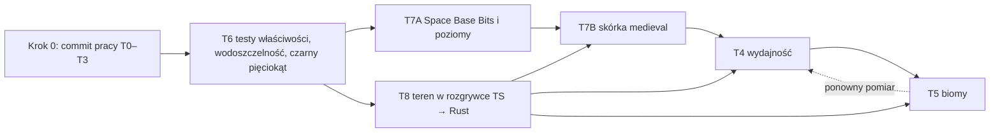

# Teren z kafelków hex: wdrożenie w PoC, wnioski i plan dla web-game

Stan: 2026-11-09. Uzupełnia `docs/planet-terrain-design.md` (analiza i spike z 2026-11-07), którego założenia sprawdziłem w działającym kodzie `poc/space-3d-poc`. Następny krok to port do `web-game` (rozdz. 4).

## 1. Co powstało w PoC

Jedna planeta **„Średniowiecze”** (`medieval`, na orbicie kolonii A/B/C, w przełączniku „Porównanie stylów” jako ostatnia pozycja) z terenem z kafelków KayKit Medieval Hexagon i ruinami osady. Pozostałe planety bez zmian.

| Warstwa | Pliki w `poc/space-3d-poc/src/app` | Rola |
|---|---|---|
| Dane (czysty TS, bez Three.js) | `game/terrain/terrain-types.ts`, `tile-frame.ts`, `tile-warp.ts`, `tile-variant.ts`, `terrain-generator.ts` | klasy pól z szumu, kafelek i obrót na każdy heks, osada, drogi, drzewa, skały; wszystko deterministyczne z ziarna |
| Konfiguracja | `game/config/initial-world.ts` (`MEDIEVAL_ID`, `surfaceGrid.terrain`), `game/config/world.ts` (`WORLD_TERRAIN`) | ciało dostaje `terrain: { biome, seed }`, plan liczony raz na proces |
| Silnik | `engine/hex-kit.ts`, `terrain-tones.ts`, `terrain-view.ts`, `terrain-decor.ts`, `surface-view.ts` | ładowanie GLB, kolor z nazwy materiału, jedna siatka terenu, dekor instancjowany, wspólny interfejs powierzchni |
| Integracja | `engine/scene-manager.ts` (`loadTerrain`), `entity-view-registry.ts`, `ui/colony-switcher.ts` | planeta działa na płaskich wachlarzach, dopóki pliki się ładują; dekor znika pod prawdziwą budowlą |
| Zasoby | `public/assets/kaykit-hex/` (37 plików GLB, 1,3 MB, README ze źródłem) | 21 kafelków (rodzina forest + woda) i 16 obiektów |
| Testy | `game/terrain/terrain.spec.ts` (11), `engine/terrain-view.spec.ts` (9) | cały pakiet: 118 testów zielonych, `npm run build` przechodzi (bundle 933 kB, bez zmiany rzędu wielkości) |

**Pięciokąty nie dostają kafelków** (polecenie). Każdy z 12 dostaje płaską płytę ze skośnym obrzeżem (15 trójkątów), której obrys i faza pokrywają się z obrzeżem sąsiednich kafelków.

### Pomiary (n = 8, 642 pola, ziarno 2)

| Wielkość | Wynik |
|---|---|
| Teren | 47 296 trójkątów, 1 draw call (630 heksów z kafelkiem + 12 płyt) |
| Dekor | 118 324 trójkątów, 232 instancje, 16 draw calls |
| Razem | **165 620 trójkątów**, cel z design doc ≤ 150 tys. przekroczony o 10 %, limit „uwaga” 200 tys. zachowany |
| Plik kafelków i dekoru | 1,3 MB surowo, wszystkie pliki ładowane jednorazowo przy starcie sceny |
| Picking | raycast na ukrytej siatce wachlarzy (3 840 trójkątów) zamiast na 47 tys. |

Zrzuty z Chromium (SwiftShader): `docs/img/planet-terrain/poc-medieval-orbit.png`, `poc-medieval-settlement.png`, `poc-medieval-closeup.png`, `poc-medieval-pentagon.png` (wybrane pole 52, pięciokąt, podświetlone).

### Czego nie zmierzyłem

- **Wydajność na GPU.** SwiftShader dał 7–15 fps, co mówi o procesorze, nie o grze. Liczby trójkątów i draw calli są wiarygodne, czas klatki nie.
- **Koszt hover pickingu** po zmianie na proxy. Zakładam, że jest taki jak dziś (ta sama siatka 3,8 tys.), bez pomiaru.
- **Jeden artefakt:** na maksymalnym zbliżeniu (6 kroków kółka) widziałem czarny pięciokąt na środku widoku. Nie odtworzyłem go na normalnych zbliżeniach (płyta pięciokąta renderuje się poprawnie, `poc-medieval-pentagon.png`), a geometria płyty ma poprawne normalne w teście. Do sprawdzenia przy teście wizualnym w `web-game`.

## 2. Wnioski i zmiany względem design doc

| # | Wniosek | Skutek dla planu |
|---|---|---|
| W1 | **Warp działa i jest sprawdzalny testami jednostkowymi** bez GPU: góra kafelka leży na promieniu ciała, sześć narożników kafelka trafia dokładnie w narożniki pola dla każdej rotacji `k0`, punkty obrysu sąsiadów się pokrywają. | Te testy przenieść 1:1 (są w `terrain.spec.ts`). Raportu ze spike'u nie trzeba powtarzać. |
| W2 | **Pięciokąty jako płyta, nie kafelek.** Płyta z fazą (inset 0,95, obrzeże niżej o 0,05·s) zamyka szew z sąsiadami bez widocznego klina. | Zastępuje §4.3 pkt 1 i `m = 5` w design doc. Warp dla `m = 5` zostaje w kodzie, ale nieużywany. |
| W3 | **Picking idzie przez ukrytą siatkę wachlarzy.** Teren ma 47 tys. trójkątów, raycast Three.js nie ma BVH. Proxy ma te same obrysy pól, więc wynik jest identyczny. | `SurfaceView.mesh` to pickowalna powierzchnia, `extras` to rzeczy do dodania obok. Ten sam interfejs obsługuje stary `PlanetGridView`, więc scena i `PickingService` zmieniły się minimalnie. |
| W4 | **Generator terenu jest czystą funkcją na `PlanetGrid` i ziarnie.** Używa tylko `hash3`, `fbm` i sąsiedztwa; nic z Three.js. | Idzie do `packages/domain` i do portu Rust bez przeróbek (plan 02, §5.2). Do dodania wektory zgodności (klasy, warianty, dekor). |
| W5 | **Teren musi znać gameplay w trzech miejscach:** brak wody na polach ze złożem i pięciokątach, brak dróg i budynków na polach ze złożem, brak podniesionej połowy przejścia pod złożem (budowla weszłaby 0,26 j. w teren). Osada wybiera środek z karą za złoża w promieniu 2 i bez pięciokątów w promieniu 3. | Reguły są w generatorze i w testach. Warto zapisać je w `UNIFICATION.md` jako zasady, nie szczegół renderu. |
| W6 | **Kolor z nazwy materiału działa dla całej rodziny.** Rodziny rock i sand nie są potrzebne (identyczna geometria, inny kolor). Pole klasy `rock` to `hex_forest` pomalowany tonem skały. | Zostaje 21 plików kafelków, jak w design doc. |
| W7 | **Zaznaczenie pola przez 50 % domieszki cyjanu** zamiast pełnej podmiany koloru: płaski cyjan gubi relief drogi i krawędzi. Hover ×1,35 jest czytelny. | Stała w `terrain-view.ts`, do ustawienia po przeglądzie wizualnym w grze. |
| W8 | **Dekor pod budowlą:** ukrycie przez wyzerowanie macierzy instancji (`remove(tile)`), bez przebudowy siatki. Budowle postawione przed końcem ładowania są uwzględniane po ładowaniu (`builtTiles`). | Wzór dla `structure-layer.ts` w `web-game`. |
| W9 | **Pivot modeli nie leży idealnie na 0** (zamek ma `min.y = −0,026`). Pozycję liczę z `box.min.y` modelu. | Nie ufać „pivot u podstawy” z design doc; liczyć z pudełka. |
| W10 | **Budżet 150 tys. jest za ciasny** dla planety z osadą: 232 instancje dekoru dają 118 tys. Największy koszt to budynki (zamek 2 231, koszary 1 960, wiatrak 2 270 trójkątów). | Odcinanie półkuli i LOD dekoru (krok T4) są potrzebne, zanim planeta pojawi się w scenie z budowlami gracza. Alternatywa: tylko ruiny w promieniu 2 z pełnym modelem, dalej uproszczone. |

## 3. Decyzje z design doc, które PoC rozstrzygnął lub zmienił

| ID | Było | Jest |
|---|---|---|
| T-1 planeta | Tau Ceti c | PoC: osobne ciało obok kolonii. Dla `web-game` nadal rekomendacja c (rozdz. 4, krok T3). |
| T-2 fikcja | ruiny-dekor | potwierdzone: nic w grze nie zależy od osady, znika pod budowlą |
| T-3 gameplay | nie | potwierdzone (teren to dane i obraz). Reguły W5 są wyjątkiem koniecznym |
| T-4 gdzie liczyć | domena | potwierdzone (W4) |
| T-6 krawędzie | tylko faza | potwierdzone: terenu bez `LineSegments`, faza kafelka rysuje obrys |
| T-8 licencja | 42 pliki | w PoC 37 plików, bez ścian i mostów. Licencja CC0 nadal do potwierdzenia na stronie paczki (kopia lokalna nie ma pliku licencji) |
| T-11 drzewa | pojedyncze | potwierdzone, limit 200 na ciało zachowany |

## 4. Plan wdrożenia w `web-game` (następny krok)

Kolejność i bramy jak w `planet-terrain-design.md` §5, poprawione o wnioski. Numeracja T bez zmian.

| Krok | Zakres | Brama | Szac. |
|---|---|---|---|
| **T0** Zasoby | Skopiować 37 GLB z `poc/space-3d-poc/public/assets/kaykit-hex/` do `web-game/apps/game/public/assets/kaykit-hex/` z README i plikiem licencji CC0. Dodać wpisy do manifestu (plan 03 §5, `kind: 'terrain'`/`'decor'`). | pobranie ≤ 2 MB; test odczytu GLB (trójkąty, rozmiary jak `terrain-view.spec.ts`) | 0,5 d |
| **T1** Domena | `packages/domain/src/sim/terrain/` = `game/terrain/*` z PoC bez zmian logiki. `CelestialBody.surfaceGrid.terrain`. Testy z `terrain.spec.ts`. Generator ma zostać zgodny z `server/` (plan 02): dopisać do `tools/conformance` sekcję wektorów (klasy, warianty, dekor) i port do `game-core` w osobnym kroku B. | testy domeny zielone; wektory zgodności zapisane | 1 d |
| **T2** Render | `packages/render/src/system/`: `hex-kit.ts` (albo rozszerzenie `model-kit.ts`, jeśli ten sam loader obsłuży GLB bez atlasu), `terrain-view.ts`, `terrain-decor.ts`, `terrain-tones.ts`. `PlanetGridView` zostaje jako **daleki LOD i proxy pickingu**. Interfejs `SurfaceView` do `system-scene.ts`. Tony do `palette.ts`. | `planet-grid-view.spec.ts` i testy `system-view` bez zmian; nowe testy z `terrain-view.spec.ts` | 1,5 d |
| **T3** Planeta medieval | Tau Ceti c: `terrain: { biome: 'medieval', seed }`, dopisek w profilu skanu, `aim` z `initialAngle` jak w `world.ts` PoC. Leniwe ładowanie osady przy pierwszym fokusie na ciele. | zrzut ujęcia jak `poc-medieval-orbit.png`; osada bez pól ze złożem | 1 d |
| **T4** Budżet i LOD | Odcinanie półkuli dla dekoru i budowli (zadanie z `PERF-REPORT.md`), kafelki tylko dla ciała w fokusie i powyżej `EDGES_MIN_PX`, ewentualnie uproszczenie dalekich budynków (W10). Pomiar `npm run perf` S i M. | brak „PRZEKROCZONY” w M, planeta w fokusie ≤ 200 tys. trójkątów | 1,5 d |
| **T5** Presety `winter`, `dry`, `mixed` i DS | Rozszerzyć `generateTerrain` o biomy (progi z design doc §4.4), tony do `design-tokens.ts` (P9), przeglądarka assetów (plan 04). | `npm run check`, `tokens:check` zielone | 2 d |

Zależności: T0–T2 dotykają `system-scene.ts`, `view.ts` i `ModelLibrary`, które zmienia praca AT1–AT3, więc start po ich scaleniu (etap E3 z `docs/plan/README.md`). Do czasu T4 planeta medieval nie powinna być planetą startową.

### Ryzyka wdrożenia

| Ryzyko | Mitygacja |
|---|---|
| `web-game` ma inny model ładowania (`ModelLibrary` z `FetchBytes`, jeden materiał z atlasu UV) | `HexKit` jest niezależny od `ModelLibrary` (własny `GLTFLoader`), więc wchodzi obok; ujednolicenie później |
| Teren zmienia semantykę „pola”, a serwer w Rust nie zna reguł W5 | reguły w generatorze, wektory zgodności w T1, port do `game-core` jako osobny krok |
| Budżet trójkątów (W10) | T4 przed T3 na planecie startowej; w razie potrzeby limit dekoru osady w jednym parametrze (`MAX_TREES`, `MAX_ROCKS`, lista budynków) |
| Czarny pięciokąt przy maksymalnym zbliżeniu | test wizualny w T2 na `web-game` ze zrzutami z kilku odległości kamery |
| Licencja paczki | potwierdzić CC0 na stronie autora przed T0 i dołączyć tekst |

### Pytania

| ID | Pytanie | Rekomendacja |
|---|---|---|
| T-12 | Czy w `web-game` pięciokąty zostają płytami, czy po akceptacji wizualnej dostaną kafelki z warpem? | płyty; kafelek na pięciokącie wymaga dopracowania kształtu, a płyta już wygląda spójnie |
| T-13 | Czy budżet 150 tys. zostaje celem dla planety z osadą? | podnieść do 200 tys. dla ciała w fokusie, pod warunkiem T4 |
| T-14 | Czy osada na Tau Ceti c ma mieć mury i mosty (są w paczce, nie użyte)? | nie w T3; osobna decyzja po ocenie wyglądu |

## 5. Status portu do `web-game` (2026-11-09)

Wykonane kroki T0–T3 dla Tau Ceti c (zrzut: `docs/img/planet-terrain/webgame-tau-ceti-c.png`). `npm run typecheck`, `vitest` (371 testów) i `ng test` (16) są zielone, `npm run build` przechodzi. Nie uruchamiałem `npm run e2e`.

| Krok | Co | Gdzie |
|---|---|---|
| T0 | 37 GLB + README | `web-game/apps/game/public/assets/kaykit-hex/` |
| T1 | generator, warp, warianty, osada (11 testów na Tau Ceti c) | `packages/domain/src/sim/terrain/`, eksport w `index.ts` |
| T2 | `HexKit`, `TerrainView`, `TerrainDecor`, tony; integracja w `SystemScene` (LOD, hover, zaznaczenie, wyczerpane złoża, ukrywanie dekoru pod budowlami) | `packages/render/src/system/` (+ 9 testów jednostkowych i 1 integracyjny w `system-view.spec.ts`) |
| T3 | Tau Ceti c = `medieval` | `TERRAIN_CONFIG` w `world-terrain.ts` |

Odstępstwa od planu z rozdz. 4:

- **Konfiguracja terenu nie jest polem `CelestialBody`**, tylko osobną mapą `TERRAIN_CONFIG` (id ciała → biom i ziarno). Dzięki temu JSON świata, który porównują powtórki zgodności i serwer w Rust, się nie zmienia. Do przeniesienia na ciało razem z portem generatora do `game-core`.
- **Środek osady wymaga braku pięciokątów w dwóch pierścieniach, nie trzech.** Tau Ceti c ma siatkę n = 5 (252 pola) i przy trzech pierścieniach nie znalazł się żaden środek. Zewnętrzny pierścień pomija pięciokąty. Zmiana jest też w PoC.
- **`PlanetGridView` zostaje proxy pickingu i dalekim LOD** (w PoC `TerrainView` miał własną kopię). Terrain tylko rysuje.
- **Dekor pod budowlą** jest ukrywany przez `setHidden(tileOwner)` i wraca po rozbiórce (w PoC tylko ukrywanie).

Pomiar w grze (SwiftShader, Tau Ceti c, widok planety): 107 443 trójkąty, 25 draw calls, bez błędów w konsoli. Czasu klatki nie oceniam: zrzut robił Chromium na SwiftShader, a pomiar na GPU daje dopiero `npm run perf` (rozdz. 10).

Zostaje: T4 (odcinanie półkuli i LOD dekoru, `npm run perf`), T5 (pozostałe biomy, tony w design systemie) oraz test wizualny przy kilku odległościach kamery pod kątem czarnego pięciokąta z rozdz. 1. Plan tych prac razem z nowymi krokami T6–T8 jest w rozdz. 6–13.

## 6. Plan kontynuacji

Plan pięciu kolejnych zadań jako jeden ciąg (2026-11-09): testy i wodoszczelność terenu (T6), budowle gracza z modeli KayKit (T7), teren w rozgrywce w TS i Rust (T8), wydajność (T4) i kolejne biomy (T5). Nic z tego nie jest jeszcze zaimplementowane. Oznaczenie **[P]** to moja propozycja do akceptacji; decyzje otwarte są w rozdz. 12.

### 6.1 Decyzje użytkownika (2026-11-09)

| ID | Pytanie | Wybór |
|---|---|---|
| T-30 | Kierunek zadania „budowle z kitu” | **oba etapy**: najpierw pełna paczka Space Base Bits i wygląd poziomów, potem skórka medieval na planetach `medieval` |
| T-3 (zmiana) | Czy teren wpływa na rozgrywkę | **tak, v1 = zakazy + koszt/czas budowy**: woda niebudowalna, las/skała/śnieg droższe i wolniejsze, drogi ruin tańsze; bez zmian w łazikach i wydajności |
| R-20 | Kolejność TS ↔ Rust | **TS najpierw, potem Rust** (przepływ z `server/README.md`); zamrożenie TS `sim/` przesuwa się na „po T8” |
| T-31 | Zasoby biomów | **KayKit (przekolorowanie) + Kenney Space Kit (CC0)** na dekor: kratery, kryształy, skały |

### 6.2 Fakty, które zmieniły plan

- **Budowle gracza już są modelami KayKit** (Space Base Bits, `model-registry.ts`). Połowa typów (SMT, SIR, CON, LST, ATN, FIS, ELY…) używa domyślnego `structure_tall`, a L1–L5 wyglądają tak samo. Pełna paczka (69 modeli) leży w `poc/space-3d-poc/assets/KayKit_Space_Base_Bits_1.0_EXTRA/Assets/gltf/`.
- **Kopia świata w WASM (R-18)** liczy zapytania UI (duch budowy, karta pola) i co 5 s porównuje skrót FNV stanu z serwerem. Reguły terenu muszą więc być identyczne w kopii i na serwerze (oba to Rust), a nowe pola `Structure` wchodzą do skrótu.
- **Siatki nie są w JSON świata.** Sim buduje je ze `scenario.bodies` (`simulation.ts:94`, `simulation.rs:80`), render z `world.bodies` migawki (`system-scene.ts:485`).
- **Generator czyta `tile.deposit`**, więc teren zależy od ziarna złóż; `fbm`/`hash3` są już w Rust (`math/noise.rs`, oktawy jawne, w TS domyślnie 3).
- **Kamera:** PoC ma `minDistance = 20` bezwzględnie (`camera-controller.ts:34`) przy promieniu planety 50; web-game ma `r × 1,3` (`system-scene.ts:896`). To pierwsza hipoteza czarnego pięciokąta.
- **Na tym komputerze jest GPU** (RTX 4060 Ti; `tools/perf/run.mjs` uruchamia Chromium z ANGLE D3D11). Zrzuty z SwiftShader służą do e2e, pomiar czasu klatki robi `npm run perf`.
- **Paczki zasobów:** KayKit Medieval ma tylko rodziny forest/rock/sand (ta sama geometria) i wodę, bez licencji w kopii; Kenney Space Kit 2.0 ma `License.txt` (CC0) i modele `crater*`, `rock_crystals*`, `rock_large*`, `rocks_small*`, `meteor*`.

### 6.3 Kolejność i zależności

- **Krok 0** (warunek wszystkiego): commit obecnej pracy T0–T3 (za zgodą użytkownika), bo nagrywanie wzorców zgodności wymaga zacommitowanej rewizji (R-9).
- T6 jest siatką bezpieczeństwa dla T7, T8 i T5 (te zmieniają generator albo geometrię).
- T7A i T8 nie dotykają tych samych plików (render rejestru modeli vs domena/Rust), więc mogą iść równolegle na osobnych gałęziach. T7B czyta biom z ciała, czyli po T8.
- T4 mierzy dopiero, gdy są nowe modele (T7) i reguły (T8, filtr `load.ts` zmienia `load-m`). Po T5 pomiar powtarzam.
- T5 dokłada rodzaje terenu, więc potrzebuje reguł jako danych z T8 i portu klasyfikacji w Rust.

---

## 7. T6: testy właściwości generatora, wodoszczelność, czarny pięciokąt (zadanie 4)

**Cel.** Zanim T7/T8/T5 ruszą generator i geometrię: dowód, że teren nie ma dziur ani odwróconych ścian dla każdej siatki i ziarna, że reguły generatora trzymają się na wielu planetach, i wyjaśniony czarny pięciokąt.

**Zakres.**
1. `packages/domain/src/sim/terrain/terrain-properties.spec.ts` (nowy). Siatki n ∈ {3, 4, 5, 6, 8} × ziarna {1, 2, 7, 11, 23, 102} × biomy {mixed, medieval}, z prawdziwymi wagami złóż. Niezmienniki:
   - determinizm (dwa przebiegi równe);
   - `variants[i] === null` ⇔ pięciokąt; `k0` ∈ 0..5; id tylko z plików w `kaykit-hex`;
   - brak wody, drogi, budynku osady i podniesionego przejścia na polu ze złożem; brak wody i drogi na pięciokącie;
   - maska wyjść wybranego wariantu drogi pokrywa się z sąsiadami-drogami (poza końcówkami szprych); maska brzegu wskazuje sąsiadów-wodę; `transitionA/B` zwrócone ku skale/śniegowi;
   - limity dekoru (`MAX_TREES`, `MAX_ROCKS`), każdy element na istniejącym polu;
   - `medieval` na n = 3 i 4: `settlementCenter === null` bez wyjątku (render to znosi);
   - **margines progów**: min |f − próg| po wszystkich polach i konfiguracjach > 1e-12. To przygotowanie do T8: klasy muszą wyjść bitowo te same w Rust.
2. `packages/render/src/system/terrain-watertight.spec.ts` (nowy, node, kit czytany z dysku jak `model-library.spec.ts`). Dla Tau Ceti b–f i Planety Matki z konfiguracjami z pkt 1:
   - **obrys**: każdy wierzchołek kafelka z f = 1 leży na krawędzi wielokąta pola (odległość od odcinka < 1e-6);
   - **promienie**: 20 000 kierunków (sfera Fibonacciego) z zewnątrz do środka; kandydaci = trójkąty pola najbliższego kierunkowi i jego sąsiadów (`rangeOf`); Möller–Trumbore. Każdy promień trafia, punkt trafienia ma promień ≥ R − 0,11·s (woda leży na 0,9), trafiony trójkąt jest zwrócony na zewnątrz (n·d < 0). Raport podaje indeksy pól z dziurą albo odwróconą ścianą;
   - płyty 12 pięciokątów wchodzą w ten sam test.
3. **Czarny pięciokąt.** Hipotezy w kolejności sprawdzania:
   - H1: kamera PoC wchodzi pod powierzchnię (`minDistance = 20` przy R = 50);
   - H2: kamera web-game przy `r × 1,3` wchodzi w wysoki dekor (zamek ≈ 2,5·s);
   - H3: odwrócona ściana albo dziura (wyklucza test z pkt 2);
   - H4: ciemny odcień złoża albo wyczerpania na pięciokącie (`depositTint`, `EXHAUSTED_MIX`).
   Procedura: harness `packages/render/harness/system` + Playwright z flagami GPU z `tools/perf/run.mjs`; kamera kolejno na każdy z 12 pięciokątów Tau Ceti c, odległości min, ×1,5, ×3; zrzut i sonda pikseli (udział prawie czarnych w środkowym wycinku) plus raycast ze środka ekranu, który loguje trafiony obiekt. To samo w PoC przy 6 krokach kółka.

**Pliki.** Nowe: dwa spec-e powyżej, `packages/render/harness/system/probe-pentagons.mjs` (skrypt sondy). Zmiana: poprawka przyczyny (np. `poc/.../camera-controller.ts` albo `system-scene.ts` minDistance z uwzględnieniem wysokości dekoru). Bez zmian w generatorze, chyba że testy znajdą błąd.

**Zależności.** Tylko krok 0.

**Ryzyka.**
| Ryzyko | Mitygacja |
|---|---|
| Test promieni wolny (47 tys. trójkątów) | kandydaci tylko z 7 pól, ok. 1e7 testów, < 5 s |
| Testy znajdą błąd generatora i zmienią plan Tau Ceti c | przed T8 teren jest tylko obrazem; poprawka zmienia zrzuty, nie reguły |
| Czarny pięciokąt widoczny tylko na GPU | sonda na Chromium z ANGLE, nie SwiftShader |

**Kryteria akceptacji.** ≥ 60 kombinacji siatka × ziarno × biom zielonych; 0 dziur i 0 odwróconych ścian; czarny pięciokąt: przyczyna nazwana i poprawiona (zrzut przed/po) albo udowodnione, że dotyczy tylko PoC, i poprawka tam; sonda pięciokątów w `web-game` bez czarnych wycinków. `npm run typecheck`, `npm run test:unit` zielone.

**Szacunek.** 1–1,5 d.

**Agenci (równolegle).** A: testy właściwości domeny. B: test wodoszczelności. C: sonda pięciokątów na GPU i poprawka. D (po A–C): recenzent, który próbuje złamać niezmienniki (nietypowe ziarna, n = 3, wagi złóż z samą jedną rudą).

---

## 8. T7: budowle gracza z modeli KayKit (zadanie 2)

### 8.1 T7A: pełna paczka Space Base Bits i wygląd poziomów

**Cel.** Każdy budowalny typ (18) i typy z presetów (ATN, FIS, ELY, ASM…) ma własny, czytelny model; poziomy różnią się wyglądem w trzech progach.

**Zakres.**
- Zasoby: kopiuję potrzebne `.gltf` + `.bin` z `poc/space-3d-poc/assets/KayKit_Space_Base_Bits_1.0_EXTRA/Assets/gltf/` do `apps/game/public/assets/kaykit/` (ta sama tekstura atlasu `spacebits_texture.png`). Szacunkowo +0,4 MB.
- `packages/render/src/system/model-registry.ts`: nowe `ModelId` i wpisy `MODELS` (liczby sprawdza `model-library.spec.ts` z plików); `KIND_MODELS` zamienia się w `partsFor(kind, level)` z progami **L1–2 / L3–4 / L5**; `modelsForKind` zwraca modele wszystkich progów (preload).
- `structure-layer.ts`: `rebuild` wybiera części po poziomie (`level`, dla budowy `targetLevel` po ukończeniu); zmiana poziomu przenosi instancję między `InstancedBatch`.
- `system-scene.ts` (duch budowy): części dla L1.
- README `render/system`: tabela mapowania, zamknięcie „znanych luk” (poziomy).

**Propozycja mapowania [P]** (do akceptacji na stykówce zrzutów):

| Typ | L1–2 | L3–4 | L5 |
|---|---|---|---|
| HQ (3) | `structure_tall` + `landingpad_small` | + `lights` | `basemodule_E` + `landingpad_large` |
| LAND | `landingpad_small` | `landingpad_large` | j.w. |
| HAB | `basemodule_A` | `basemodule_B` | `dome` |
| FARM | `space_farm_small` | `space_farm_large` | `space_farm_large_sprinkler` |
| GAR | `basemodule_garage` | j.w. | j.w. |
| DEP | `cargodepot_A` | `cargodepot_B` | `cargodepot_C` |
| SKL | `containers_A` | `containers_C` | `cargo_A_stacked` |
| TNK, MLT | `water_storage` | + `eco_module` (MLT) | j.w. |
| SOL | `solarpanel` | `roofmodule_solarpanels` | j.w. |
| WND | `windturbine_low` | `windturbine_tall` | j.w. |
| MIN, ICE, SIT | `drill_structure` | + `terrain_mining` pod spodem | j.w. |
| REGX | `terrain_mining` | j.w. | j.w. |
| SMT (3) | `structure_tall`@0 + `cargodepot_B`@[1,2] | j.w. | j.w. |
| SIR (3) | `structure_low`@0 + `water_storage`@[1,2] | j.w. | j.w. |
| CON | `basemodule_D` | j.w. | j.w. |
| LST | `lander_base` + `cargo_A_packed` | j.w. | j.w. |
| ATN (7) | `basemodule_E`@0 + `tunnel_straight_A`@pierścień | j.w. | j.w. |
| pozostałe (era ≥ 2) | `structure_low` | j.w. | j.w. |

**Testy.** `model-library.spec.ts` (każdy nowy wpis z pliku), `model-registry.spec.ts` (każdy typ z katalogu ma części dla L1, L3, L5; brak `DEFAULT_PARTS` dla 18 budowalnych), `structure-layer` w `system-view.spec.ts` (zmiana poziomu przenosi instancję, dispose bez wycieków); stykówka zrzutów z harnessu (każdy typ × L1/L3/L5).

**Kryteria.** Żaden z 18 budowalnych typów nie używa `structure_tall` jako zastępstwa; zrzuty zaakceptowane; e2e `views` (liczniki GPU wracają do bazy po 20 przełączeniach) zielone; `npm run perf` S/M: draw calls i trójkąty nie rosną o więcej niż 15 %.

**Ryzyka.** Więcej modeli = więcej draw calli (jedna `InstancedMesh` na ciało × model; L ma już 136): progi zamiast modelu na każdy poziom, `BatchedMesh` w T4. Część modeli EXTRA może nie mieć tego samego atlasu UV: test kolorów w `model-library.spec.ts`.

**Szacunek.** 1,5–2 d. **Agenci:** A: zasoby + rejestr + testy rejestru; B (po A): progi poziomów w `structure-layer` i duch; C: stykówka zrzutów.

### 8.2 T7B: skórka medieval

**Cel.** Na ciałach z biomem `medieval` budowle gracza stoją jako modele Medieval Hexagon, a ruiny osady dalej są tłem.

**Zakres.**
- **Jedna ścieżka ładowania**: `ModelSpec.source: 'spacebits' | 'hex'`. Dla `hex` `ModelLibrary` ładuje `.gltf.glb` i koloruje po nazwie materiału (`objectTone` z `terrain-tones.ts`, kod spłaszczania z `hex-kit.ts`), więc `ModelKit` (pudełko, krawędzie, geometria) działa bez zmian dla `StructureLayer`, ducha, pickingu i obrysu. `HexKit` zostaje dla kafelków terenu.
- `skinFor(body)`: `KIND_MODELS_MEDIEVAL` dla `body.surfaceGrid.terrain.biome === 'medieval'` (pole z T8), inaczej Space Base Bits.
- Ruiny przygaszone: `TerrainDecor` mnoży ton budynków osady (nie drzew i skał) przez `RUIN_FADE` (np. 0,8 i 30 % do szarości), żeby gracz odróżniał swoje budowle (T-23).
- Zasoby: dochodzą `archeryrange`, `watermill` (≈ 0,17 MB).

**Propozycja mapowania [P]:** HQ → `castle`@0 + `landingpad_small`@[1,2]; LAND → `landingpad_small` (sci-fi zostaje, T-24); HAB → `house`; FARM → `farm_plot`, L3+ `mill`; GAR → `barracks`; DEP → `market`; SKL → `well` + `farm_plot`? → do zrzutów; MIN/ICE/SIT/REGX → `mine`; WND → `mill`; SOL → `solarpanel` (bez odpowiednika); SMT → `lumbermill`@0 + `watchtower`@[1,2]; SIR → `watermill`; CON, LST → `watchtower`; ATN → `castle`@0 + `house`@pierścień.

**Testy.** `model-library.spec.ts` dla wpisów `hex` (trójkąty, wymiary z pliku); `system-view.spec.ts`: na Tau Ceti c budowla dostaje model medieval, na tc-e Space Base Bits; duch i picking działają (pudełko z `kit.box`).

**Kryteria.** Zrzuty Tau Ceti c z kolonią gracza zaakceptowane (budowle gracza czytelne obok ruin); testy zielone; planeta w fokusie z kolonią ≤ 200 tys. trójkątów (zamek 2 231 vs `structure_tall` 670: liczone w T4).

**Szacunek.** 1,5 d. **Agenci:** A: ujednolicenie ładowania (`model-library.ts`, `model-kit.ts`) może iść równolegle z T7A; B (po T8 i A): mapowanie i przygaszenie ruin.

---

## 9. T8: teren w rozgrywce, TS → Rust (zadanie 1)

**Cel.** Woda niebudowalna, las/skała/śnieg podnoszą koszt i czas budowy, drogi ruin je obniżają. Ten sam wynik w mocku TS, w `game-core` (serwer i kopia WASM) i w złotych powtórkach. Ciała bez terenu działają dokładnie jak dziś.

### 9.1 Kontrakt domeny

- **Konfiguracja na ciele**: `CelestialBody.surfaceGrid.terrain?: { biome: TerrainBiome; seed: number }`, w literale po `depositWeights`. `TERRAIN_CONFIG` i `buildWorldTerrain` znikają; Tau Ceti c dostaje `{ biome: 'medieval', seed: 2 }` w `scenarios/tau-ceti.ts`.
- **Podział generatora**:
  - `sim/terrain/terrain-classify.ts` → `classifyTerrain(grid, { biome, seed, aim })` zwraca `{ kinds, road, settlementCenter, rings }`. To jest część rozgrywki (port do Rust). Reguły szumu i dróg osady przenoszę z `terrain-generator.ts:37-52` i z części dróg `:94-186`; `dist2` z `**` na `dx*dx` (bitowa zgodność).
  - `terrain-generator.ts` → `dressTerrain(grid)` (warianty kafelków i dekor; tylko TS i render) zwraca dalej `TerrainPlan`.
  - Przed refaktorem nagrywam golden obecnych klas, dróg i środka Tau Ceti c; po refaktorze muszą być równe.
- **Pole terenu na siatce**: `Tile.terrain?: TerrainKind`, `Tile.road?: true`, `PlanetGrid.terrain?: { biome, seed, settlementCenter }`, liczone w `buildWorldGrids` (aim z `initialAngle`: `(-cos φ, 0,9, -sin φ)`).
- **Siatki z ciał zapisu**: sim buduje siatki z `opts.world?.bodies ?? scenario.bodies` (TS `simulation.ts:94`, Rust `simulation.rs:77-84`). Stary zapis bez pola `terrain` nie ma terenu i działa jak dziś, render i sim widzą to samo. `SaveFile.version` zostaje 1.
- **Reguły jako dane**: `economy/terrain-data.ts` → `TERRAIN_RULES = { kinds: Record<TerrainKind, { name, buildable, costPct, timePct }>, road: { costPct, timePct } }`, eksportowane w katalogu (`npm run conformance:catalog`, R-6) i czytane przez Rust z `catalog.json`; `rules.terrain()`.

**Wartości początkowe [P] (T-15):**

| Rodzaj | Budowlany | Koszt % | Czas % | Uzasadnienie |
|---|---|---|---|---|
| grass | tak | 100 | 100 | baza; także pola bez terenu |
| forest | tak | 110 | 150 | wycinka to głównie praca łazika |
| rock | tak | 140 | 125 | kotwienie i odstrzał kosztują materiał |
| snow | tak | 120 | 140 | izolacja i wolna praca w zimnie |
| water | **nie** | — | — | `BAD_TERRAIN` |
| droga ruin (nakładka) | tak | 85 | 75 | wyrównany grunt, stare fundamenty; 15–25 pól |

Przykład: SIL 10 → 11 (las), 14 (skała), 12 (śnieg), 9 (droga). Pod T5: sand 110/120, ice 125/150, regolith 100/100, dune i lava niebudowalne.

### 9.2 Reguły budowy

- **Kolejność sprawdzeń** (identyczna w TS i Rust): NO_GRID → NOT_BUILDABLE → NO_FOOTPRINT → TILE_OCCUPIED → **BAD_TERRAIN** (wszystkie pola footprintu; szczegół = nazwa rodzaju z danych) → NO_DEPOSIT → NO_ATMOSPHERE → availability (z kosztem po terenie).
- **Procent pola**: droga → wartości drogi; inaczej rodzaju; pole bez terenu = 100. **Footprint = maksimum po polach**, osobno dla kosztu i czasu (T-16).
- **Koszt** = `Math.ceil(q * pct / 100)` na materiał (koszty katalogu są całkowite, więc wynik dokładny w obu językach). `availability(world, body, kind, level, cost?)` dostaje opcjonalny koszt, żeby NO_RESOURCES zostało przed NO_POWER i NO_CREW.
- `check()` zwraca `{ tiles, cost, timePct }`; `build()` i podglądy używają tego wyniku.
- **Czas**: `Structure.timePct?: number` (całkowite, brak = 100; w literale między `builtAt` a `recipe`, bo kolejność kluczy jest porównywana dokładnie). `ConstructionSystem` liczy `buildTime * pct / 100` tylko dla budowy L1 (`construction-system.ts:74`, `construction.rs:86`); `finished()` usuwa pole. Ulepszenia bez zmian.
- **Zwroty**: anulowanie 75 % `paid` (czyli kosztu po terenie, bez zmian w kodzie); rozbiórka 50 % kosztu bazowego wszystkich poziomów (T-17).
- **Port kosmiczny** (`colony-system.ts:63-98`, `colony.rs`): ten sam `BAD_TERRAIN`, koszt `portCost × pct` sprawdzany względem ładunku statku, `site()` dostaje `timePct`.
- **Automatyczne miejsca**: `suggestTile` idzie przez `check`, więc omija wodę; `findFreeFootprint` (`scenario.ts:121`, `scenario.rs:160+`) dostaje filtr budowalności; `load.ts` (`:75-77`) i `load.rs` (`:135`) pomijają pola niebudowalne (T-19; zmienia sekwencję losowania `load-m`, oba języki razem).
- **Łaziki bez zmian** (decyzja). Znane skutki: łazik przejeżdża przez jezioro; wylądowane łaziki mogą stanąć na wodzie (`colony-system.ts:84`). Kosmetyka; przy przyszłym „woda nieprzejezdna” potrzebny będzie kod NO_PATH przy BUILD.
- **Nowy kod odmowy** `BAD_TERRAIN` na końcu `REJECT_CODES` (`domain-event.model.ts`), `RejectReason::BadTerrain` w `event.rs`, tekst w `pl.ts` (bez niego `satisfies Record<RejectReason,string>` nie kompiluje się).

### 9.3 API, mock, UI

- `contract.ts` / `contract.rs`:
  - `TileInfo.terrain: { kind, name, road, buildable, costPct, timePct } | null` po `deposit`;
  - `BuildPreview.cost?`, `buildTime?` (gdy footprint mieści się na budowlanym terenie);
  - `CatalogView.terrain` (tabela reguł do panelu).
- Mock (`mock-server/src/server.ts`): `catalog()` 240-285, `previewBuild` 300-313, `tileInfo` 320-347; `suggestTile` bez zmian (idzie przez `check`). Spec: `tile-info.spec.ts`, `server.spec.ts`.
- UI (`apps/game`):
  - karta pola (`hud/selection-panel.ts` 105-148): wiersz „Teren: las · koszt +10 %, czas +50 %” albo „woda: nie można budować”;
  - szybkie sloty (`commands.ts:311`) pokazują koszt ×`costPct`;
  - karta ustawiania (`commands.ts:369-370`) bierze `preview.cost` i `preview.buildTime`; `world-view.ts:217-220`, `commands.ts:535-538`, `ui-state.ts:11` przenoszą nowe pola;
  - `buildList` otwarty z pola: koszt po terenie dla typów 1-polowych, dla 3/7 bazowy z dopiskiem „zależy od pól”.
  - Bez zmian: poziomy w `catalog()`, `economyReport`, panel projektanta (`tables-tab.ts`, `flows.ts`), cele, pojazdy.
- Render: `system-scene.ts:485-486` woła `dressTerrain` dla każdej siatki z `terrain` (zamiast `buildWorldTerrain`).

### 9.4 Wpływ na JSON świata i powtórki

- **JSON świata** zmienia się tylko w `bodies[tc-c].surfaceGrid` (nowy klucz `terrain`) i w budowach w toku (`timePct` na polach z terenem). Serde w Rust: `#[serde(default, skip_serializing_if = "Option::is_none")]`, kolejność pól struktury = kolejność literału TS (`preserve_order` dotyczy tylko map). Siatki nie są serializowane; sekcje wektorów wybierają pola jawnie.
- **Powtórki do ponownego nagrania**: kanwa, tempo-zmiany, odmowy, load-m (ciało tc-c w świecie Tau Ceti; load-m także przez filtr). **Kontrola**: poc-petla, poc-ekonomia, fabryka, load-s mogą różnić się tylko polem `source`.
- **Wektory**: sekcja `terrain` (nowa): każde ciało z siatką (PoC + Tau Ceti) × `{medieval,2}`, `{mixed,7}`, `{medieval,11}`: klasy (porównanie dokładne, jako teksty), posortowane drogi, środek osady. Plus `tauCetiWorld` przez nowe pole ciała.
- **Nowa powtórka `teren`** (`record-replays.ts`, predykaty `terrainTile(body, kind)` i `roadTile` obok `plainTile`): skan → wybór tc-c → przelot Arki → port na wodzie (BAD_TERRAIN) → port na 3 polach drogi (gdy są) albo trawie → prom → SOL na drodze, SOL w lesie, HAB na skale, SOL na wodzie (odmowa) → anulowanie budowy w lesie (zwrot 75 % kosztu po terenie) → przebieg do ukończenia (czas ×pct). tc-c ma atmosferę `trace`, więc bez WND.
- **Serwer**: odtworzenie świata = powtórka z dziennika (R-15), kopia WASM porównuje skrót (R-18). Zmiana reguł zmienia wynik starych światów dev: dane `DATA_DIR` do wyczyszczenia; klient (WASM) i serwer wdrażane razem.

### 9.5 Zmiany w Rust

| Krok | Pliki (`server/crates/…`) | Co |
|---|---|---|
| D1 | `game-core/src/models/body.rs` (`SurfaceGrid` 46-55), `models/grid.rs`, `models/structure.rs`, `models/event.rs`, `economy/catalog.rs`, `sim/rules.rs` | `terrain: Option<TerrainConfig>` (biom `lowercase`, `seed: f64`), `Tile.terrain`, `Tile.road`, `time_pct`, `BadTerrain`, `terrain` w katalogu, `rules.terrain()` |
| D2 (∥ D1) | nowy `game-core/src/math/terrain.rs`; `conformance/src/vectors.rs` | `classify`: `noise::fbm(…, 3)`, `libm::cos/sin` dla `aim` (R-10), `min_by` zachowujący pierwsze minimum (jak stabilne sortowanie), bez `atan2` (ramki kafelków tylko w TS); sekcja `terrain` w wektorach |
| D3 | `sim/scenario.rs` (94-103, filtr 160+), `sim/simulation.rs` (77-84), `sim/systems/build.rs`, `sim/systems/colony.rs`, `sim/systems/construction.rs`, `sim/scenarios/tau_ceti.rs`, `sim/scenarios/load.rs` | siatki z terenem z ciał zapisu, kolejność sprawdzeń, koszt i czas, port, filtr load |
| E | `game-session/src/contract.rs` (TileInfo, BuildPreview, CatalogView), `game-session/src/session.rs` (`catalog`, `preview_build` 439-468, `tile_info` 470-502, `suggest_tile`) | API; `sync.rs` bez zmian (skrót obejmie `time_pct` przez serializację) |

`game-wasm` bez zmian. Parytet: `packages/wasm-host/src/wasm-host.spec.ts` dostaje przypadki tc-c: `tileInfo` na każdym polu, `previewBuild` dla SOL/HAB/SMT/PORT przy rotacjach 0, 1, 3 na wodzie, lesie, skale i drodze, `suggestTile`; nowy katalog powtórek wchodzi sam do pętli 116-126.

### 9.6 Kroki wykonania

| Krok | Co | Po czym | Agenci |
|---|---|---|---|
| 0 | commit T0–T3 + golden klas Tau Ceti c | — | 1 |
| A1 | `classifyTerrain` / `dressTerrain`, testy goldena i marginesu progów | 0 | ∥ A3 |
| A3 | `terrain-data.ts`, `rules.terrain()`, `BAD_TERRAIN`, `pl.ts`, eksport katalogu | 0 | ∥ A1 |
| A2 | pole na ciele, `Tile.terrain/road`, `buildWorldGrids`, siatki z ciał zapisu, usunięcie `TERRAIN_CONFIG` | A1 | 1 |
| A4 | `terrain-rules.ts` (`siteTerrain`, `scaleCost`), build/colony/construction, `timePct`, filtr `findFreeFootprint`; testy `build-system.spec.ts` | A2, A3 | 1 |
| A5 | filtr `load.ts` | A4 | z A4 |
| B1 | kontrakt + mock + spec-e | A4 | ∥ B2 |
| B2 | render: `dressTerrain` w `system-scene.ts` | A2 | ∥ B1 |
| B3 | UI: karta pola, sloty, karta ustawiania, `pl.ts` | B1 | 1 |
| C | commit; `conformance:catalog`, wektory, powtórki (z `teren`) z rewizji | A–B | 1, sekwencyjnie |
| D1/D2 | modele + katalog / klasyfikacja + wektory | C | ∥ |
| D3 | reguły w `game-core` | D1, D2 | 1 |
| E | `game-session`, parytet WASM | D3 | 1 (ostatni, małe zmiany, rebase przed startem) |
| F | weryfikacja krzyżowa TS ↔ Rust | E | recenzent adwersarialny |
| G | dokumenty i decyzje | ∥ cały czas | 1 |

**Dokumenty (G).** `DECISIONS.md`: R-20 (zamrożenie TS `sim/` po T8), T-3 rozstrzygnięte, reguły terenu jako dane katalogu (rozszerza R-6), siatki z ciał zapisu; legenda ID z prefiksem T. Plan 02 linie 139 i 239 (zamrożenie). `tools/conformance/README.md`: 9 powtórek, sekcja `terrain`. Ten dokument: odstępstwo „konfiguracja wraca na ciało”.

**Ryzyka.**
| Ryzyko | Mitygacja |
|---|---|
| Klasa pola różni się o 1 ulp między TS a Rust (fbm na normalnych porównywanych dotąd z tolerancją 1e-9) | test marginesu progów > 1e-12 (T6); wektory `terrain` porównują klasy dokładnie |
| Refaktor generatora przesuwa osadę (tartak i kopalnia wybierane przed zamianą dróg na trawę) | golden przed refaktorem; kolejność operacji zachowana |
| Kolizja z równoległą pracą nad sesją Rust | krok E na końcu, rebase, bez dotykania `sync.rs`; `server/` czysty na `8bec450` |
| Desynchronizacja kopii WASM z serwerem po zmianie reguł | wdrożenie razem, wyczyszczenie danych dev, `hash` wykryje różnicę |
| Gracz nie rozumie, czemu budowa droższa | wiersz terenu w karcie pola, koszt i czas po terenie w duchu |
| Zmiana `load-m` (filtr) zmienia pomiar T4 | pomiar bazowy T4 robię po T8 |

**Kryteria akceptacji.**
- tc-c: woda → `BAD_TERRAIN`; las, skała, śnieg, droga zmieniają koszt i czas dokładnie według tabeli; anulowanie oddaje 75 % kosztu po terenie, rozbiórka 50 % bazowego; port kosmiczny nie staje na wodzie.
- Ciała bez terenu bez zmian: poc-petla, poc-ekonomia, fabryka, load-s różnią się tylko `source`.
- Karta pola i duch pokazują teren, koszt i czas po terenie.
- Rust: wektory (z `terrain`) i 9 powtórek zgodne; parytet WASM z przypadkami tc-c zielony.

**Polecenia.** `web-game/`: `npm run typecheck`, `npm run test:unit`, `npm run test:app`, `npm run build`, `npm run e2e`, `npm run conformance:catalog` + wektory i powtórki według `tools/conformance/README.md`, `npm run wasm:build`, `npx vitest run packages/wasm-host`, `npm run e2e:wasm`. `server/`: `cargo fmt --all -- --check`, `cargo clippy --workspace --all-targets -- -D warnings`, `cargo test --workspace`, `cargo run -p conformance --release -- vectors conformance/vectors/vectors.json`, `cargo run -p conformance --release -- replay conformance/replays`, `cargo build -p game-wasm --target wasm32-unknown-unknown --profile wasm` (toolchain `windows-gnu`, R-17; `cargo` spoza PATH, patrz memory).

**Szacunek.** TS domena 1,5 d · API/mock/UI 1 d · zgodność 0,5 d · Rust core 1,5 d · sesja i WASM 0,5 d · e2e i dokumenty 0,5 d ≈ **5,5 d**.

---

## 10. T4: wydajność (zadanie 3)

**Cel.** Planeta w fokusie z terenem, dekorem i kolonią mieści się w budżetach: M planet bez „UWAGA” (≤ 200 tys. trójkątów), L planet bez „PRZEKROCZONY” (< 400 tys., < 150 draw calls), planeta medieval w fokusie ≤ 200 tys. (T-13); FPS na GPU: S ≥ 58, M ≥ 30.

**Zakres.**
1. **Harness** (`tools/perf/run.mjs`, `packages/mock-server/src/load.ts`): preset `#/scenariusz-teren-m` (obciążenie M z kolonią na tc-c, kamera na osadzie) i po T5 `#/scenariusz-biomy` (wszystkie planety z terenem); nowe liczniki w `[data-perf]` (`perf-overlay.ts`, `perf.ts`): trójkąty terenu, dekoru, budowli, instancje widoczne; budżety na kategorie w `run.mjs`. **Pomiar bazowy przed zmianami.**
2. **Odcinanie półkuli** dla `InstancedMesh` (budowle w `structure-layer.ts`/`InstancedBatch`, dekor w `terrain-decor.ts`): wspólne `HemisphereCuller`. Gdy kierunek kamery w układzie ciała zmieni się o > 2°, instancje z `dot(n, kierunek) > R/d − margines` przechodzą na początek bufora, `mesh.count` = liczba widocznych; mapa indeksów zachowuje picking i `setHidden`.
3. **LOD dekoru**: pośredni próg pozornego promienia (np. 80–200 px): drzewa jednym tańszym modelem (`detail_treeA`, 287 trójkątów) i co drugie według `hash3`, budynki ruin tylko w czaszy widocznej; z bliska pełny dekor.
4. **Budowle**: `BatchedMesh` na ciało dla rodzajów budowli (zadanie L draw calls z `PERF-REPORT.md`), jeśli wersja Three.js w repo go wspiera; inaczej scalenie po materiale.
5. **Siatka terenu**: tylko pomiar; podział na 12–20 kawałków z odcinaniem dopiero, gdy pomiar wskaże teren (47 tys. trójkątów, 1 draw call).
6. Aktualizacja `web-game/docs/PERF-REPORT.md`, rozdziału 4 tego dokumentu (W10) i decyzji P8.

**Zależności.** Po T7 (więcej modeli), T8 (filtr `load-m`). Powtórzony pomiar po T5.

**Ryzyka.** Kompaktowanie instancji psuje picking i ukrywanie dekoru (mapa indeksów + test w `system-view.spec.ts`); „wyskakiwanie” obiektów na horyzoncie (margines kąta); koszt CPU co klatkę (1 500 instancji, tylko przy ruchu kamery); `BatchedMesh` a wersja Three.js (sprawdzić przed startem).

**Kryteria.** `npm run perf` na GPU: brak „PRZEKROCZONY”, M planet i teren-M bez „UWAGA”; e2e `views` (liczniki wracają do bazy); test pickingu po odcięciu; `PERF-REPORT.md` z wynikami przed/po.

**Szacunek.** 2–3 d. **Agenci:** A: harness i liczniki (pierwszy, daje bazę); po nim równolegle B: odcinanie półkuli, C: LOD dekoru, D: `BatchedMesh`; na końcu pomiar i raport.

---

## 11. T5: kolejne biomy (zadanie 5)

### 11.1 Decyzja o zasobach (na początek)

**Wybrane: KayKit przekolorowany + Kenney Space Kit (CC0).**
- Kafelki: zostaje jedna rodzina geometrii (`hex_forest*`, `hex_water`), kolor z nazwy materiału przez ton biomu. Nowych kafelków nie kopiuję.
- Dekor z Kenney (`resources/kenny_space/Models/GLTF format/*.glb` → `apps/game/public/assets/kenney/` + `LICENSE-Kenney.txt`): `crater`, `craterLarge`, `rock_crystals*`, `rock_large*`, `rocks_small*`, `meteor*`. Kolor z nazwy materiału jak w KayKit (tabela materiałów Kenney → tony), ładowanie ścieżką `hex` z T7B.
- Licencja KayKit Medieval: CC0 do potwierdzenia na stronie autora przed wydaniem (T-8, akcja użytkownika); Kenney ma `License.txt` (CC0) w paczce.
- Lawa: brak ciała z lawą w kodzie (Pyros tylko w dokumentach), więc preset `volcanic` tylko jako parametr na przyszłość (T-29).

### 11.2 Zakres

- **Biomy i ciała [P] (T-25)**: `winter` → tc-f; `dry` z parametrem podłoża: `sand` → tc-b, `regolith` → tc-d i Księżyc PoC; `mixed` → tc-e (planeta startowa) i Planeta Matka; `medieval` → tc-c.
- **Nowe rodzaje**: `sand`, `dune`, `ice`, `regolith` (+ `lava` jako parametr): wiersze w `TERRAIN_RULES` (sand 110/120, dune niebudowalna, ice 125/150, regolith 100/100, lava niebudowalna), w `TerrainKind` (TS i Rust), w `GROUND` (`terrain-tones.ts`).
- **Generator**: tabela biomu zamiast flagi `settle` (progi, czy jest woda/śnieg/przejścia, zestaw dekoru, osada) w `terrain-classify.ts` (rozgrywka, port do `math/terrain.rs`) i `terrain-generator.ts` (dekor); `chooseVariant` dostaje mapę „rodzaj → co jest lądem, co wodą, które przejście”.
- **Tony**: `groundTone(mat, kind, biome)`, `objectTone(mat, biome)` (korony drzew w zimie w tonie lodu); nowe tony `dune`, `ice`, `regolith`, `lava`; grupa `terrain` w `design-tokens.ts` i `tokens:check` (T-7, P9).
- **tc-c „brak wody”**: jeziora osady jako wyschnięte (`dune`, niebudowalne) albo zmiana profilu skanu (T-26).
- **Rozgrywka**: ciała tc-b, d, e, f dostają teren, więc reguły T8 zaczynają działać na planecie startowej. Powtórki kanwa, tempo-zmiany, odmowy, load-m, wektory `terrain` i `tauCetiWorld` nagrywam ponownie; kanwa musi dalej przechodzić scenariusz pierwszej sesji (port, pierwsze budowy) bez odmów terenu.

**Pliki.** Domena: `sim/terrain/{terrain-types,terrain-classify,terrain-generator,tile-variant}.ts`, `economy/terrain-data.ts`, `scenarios/tau-ceti.ts`, `config/initial-world.ts`. Render: `terrain-tones.ts`, `terrain-decor.ts`, `model-registry.ts` (wpisy Kenney), `hex-kit.ts`/`model-library.ts`. DS: `design-tokens.ts`. Rust: `math/terrain.rs`, `models/grid.rs`, `scenarios/tau_ceti.rs`. Zgodność: wektory i powtórki.

**Zależności.** T8 (reguły jako dane, port klasyfikacji), T7B (ścieżka ładowania `hex` dla Kenney), T6 (testy właściwości rozszerzone o nowe biomy), T4 (harness do ponownego pomiaru).

**Ryzyka.**
| Ryzyko | Mitygacja |
|---|---|
| Woda na tc-e utrudnia start (mixed: 32 % wody przy n = 8) | próg wody tc-e ≤ 20 % i brak wody w promieniu 2 od miejsca portu z kanwy (T-25); test: `suggestTile('PORT')` nie jest null na każdym ciele z terenem |
| Kolory biomów kłócą się z „planeta jak część HUD” (W14 C) | parametr wyciszenia w jednym miejscu, akceptacja na zrzutach |
| Modele Kenney mają inny styl niż KayKit | tylko skały, kratery i kryształy; skala i ton z palety; zrzuty |
| Pięć planet z terenem w widoku układu | teren rysowany tylko dla ciała ≥ 80 px; pomiar T4 `#/scenariusz-biomy` |

**Kryteria.** Zrzuty każdego biomu (orbita i zbliżenie) zaakceptowane; testy właściwości z T6 zielone dla nowych biomów; wektory i powtórki zgodne w Rust; parytet WASM; `npm run perf` bez nowych „UWAGA”; `npm run check` i `tokens:check` zielone.

**Szacunek.** 3–4 d (TS i render) + 0,5–1 d (Rust i powtórki).

**Agenci (równolegle).** A: tabela biomów w generatorze i reguły; B: tony i DS; C: zasoby Kenney i ładowanie; potem D: port do Rust i powtórki; E: recenzent (zrzuty kontra profil skanu każdego ciała).

---

## 12. Decyzje do podjęcia

| ID | Pytanie | Opcje | Rekomendacja | Kiedy potrzebna |
|---|---|---|---|---|
| T-15 | Wartości `TERRAIN_RULES` | tabela 9.1 / inne | tabela 9.1, strojenie po playteście | przed A3 (T8) |
| T-16 | Footprint wielopolowy | maksimum / średnia | **maksimum** (prosto, przewidywalnie) | przed A4 |
| T-17 | Zwrot przy rozbiórce | od bazowego / od zapłaconego | **od bazowego** (dopłata to przygotowanie terenu) | przed A4 |
| T-18 | Źródło siatek w sim | ciała zapisu / scenariusz | **ciała zapisu** (stare zapisy bez terenu, render = sim) | przed A2 |
| T-19 | `load-m/l` a woda | filtr / bez zmian | **filtr** (oba języki, `load-m` nagrany ponownie) | przed A5 |
| T-21 | Wygląd poziomów | 3 progi (L1–2, L3–4, L5) / model na poziom | **3 progi** (mniej modeli i draw calli) | przed T7A |
| T-22 | Mapowanie typów → modele | tabele 8.1 i 8.2 | akceptacja na stykówce zrzutów | koniec T7A / T7B |
| T-23 | Ruiny a budowle gracza w medieval | ruiny przygaszone / znacznik gracza / bez różnicy | **ruiny przygaszone** | przed T7B |
| T-24 | Lądowisko na planecie medieval | sci-fi / medieval | **sci-fi** (prom to statek) | przed T7B |
| T-25 | Biomy ciał i woda na tc-e | tabela 11.2 / inna | tabela 11.2, woda tc-e ≤ 20 % i wolny rejon portu | przed T5 |
| T-26 | Jeziora na tc-c („brak wody” w profilu) | wyschnięte (`dune`) / zmiana profilu | **wyschnięte** | T5 |
| T-13 | Budżet planety w fokusie | 150 / 200 tys. | **200 tys.** pod warunkiem T4 | przed T4 |
| T-8 | Licencja KayKit Medieval | potwierdzić CC0 | potwierdzić na stronie autora (akcja użytkownika) | przed wydaniem |
| T-29 | Preset `volcanic` (lawa) | teraz / później | **później** (brak ciała) | T5 |

---

## 13. Przekrojowo

**Koordynacja.** Krok 0 (commit T0–T3) za zgodą użytkownika. `server/` jest czysty na `8bec450` (B4: kopia WASM, R-18, R-19); kroki Rust T8 i T5 zaczynam od rebase i nie ruszam `sync.rs`. Gałęzie: `terrain-t6`, `terrain-t7`, `terrain-t8` (T7A ∥ T8), scalanie przez `/code-review`.

**Wykonanie agentami.** Każdy krok ma podział na agentów (rozdz. 7–11). Wzór: agenci implementujący na osobnych plikach → recenzent adwersarialny, który dostaje kod, nie wnioski → poprawki → bramy z poleceniami. Do implementacji wystarczy Opus z wysokim effortem; najdroższy przegląd (`/code-review max` lub `ultra`) po T8, bo tam błąd zmienia rozgrywkę w dwóch językach.

**Szacunek łączny.** T6 1–1,5 d · T7 3–3,5 d · T8 ≈ 5,5 d · T4 2–3 d · T5 3,5–5 d ≈ **15–18,5 d** pracy agentów.

---

### Weryfikacja końcowa (po wszystkich krokach)

1. `web-game/`: `npm run check` (typecheck, testy, build, e2e), `npm run e2e:wasm`, `npm run perf` (GPU) z porównaniem w `PERF-REPORT.md`.
2. `server/`: `cargo test --workspace`, wektory i 9+ powtórek zgodne, build WASM.
3. Ręcznie / zrzuty: każdy biom (orbita, zbliżenie), kolonia na Tau Ceti c ze skórką medieval, karta pola z terenem, odmowa na wodzie, sonda pięciokątów.
4. Ten dokument: rozdz. 5 „Status” uzupełniany po każdym kroku (co zrobione, odstępstwa, pomiary).

## 14. Status realizacji (rozdz. 6–13)

### T6: wykonane (2026-11-09)

| Co | Wynik |
|---|---|
| Testy właściwości generatora (`domain/.../terrain-properties.spec.ts`) | 10 siatek (n = 3…8, prawdziwe ziarna złóż Tau Ceti i PoC, dwie z jedną rudą) × 6 ziaren × 2 biomy × 2 kierunki = 240 kombinacji, ok. 2,5 s. Niezmienniki z §7 pkt 1 plus: przynajmniej m wierzchołków na obrysie, budynki w 3 pierścieniach od środka, kopia klasyfikacji zgodna z generatorem |
| Margines progów szumu (przygotowanie T8) | min. **1,48e-6** (n = 8, ziarno 23, mixed, pole 186, próg lasu), czyli > 1e-12 we wszystkich kombinacjach |
| Wodoszczelność (`render/.../terrain-watertight.spec.ts`) | Tau Ceti b–f i Planeta Matka × (medieval, 2) i (mixed, 7): każdy wierzchołek w obrysie swojego pola, 21 800 promieni na przypadek bez dziury i bez odwróconej ściany, każdy pięciokąt trafiony. Test wykrywa celowo zepsutą geometrię (dziura, odwrócone pole, brak płyty, pole pomniejszone o 3 %) |
| Czarny pięciokąt | **przyczyna**: płyta pięciokąta była samym wierzchem, a kafelki hex mają ściany i dno. Kamera PoC (`minDistance = 20` przy R = 50) wchodzi pod powierzchnię; od środka widać dna kafelków, a każdy pięciokąt jest dziurą w kosmos. **Poprawka** (web-game i PoC): płyta ma ściany do podstawy kafelka i dno (30 trójkątów zamiast 15); test „od środka” w `terrain.spec.ts` (promień ze środka przez każde pole trafia ścianę zwróconą do niego) wykrywa brak dna. Kamery PoC nie zmieniam: `camera-controller.ts` ma niezatwierdzone zmiany innej sesji (widok z powierzchni) |
| Kamera web-game w zamku (H2) | szczyt zamku na Tau Ceti c to ok. 1,31 R, a minimum kamery było 1,3 R. Teraz `minDistance = max(1,3 R, szczyt dekoru + 0,1 R)` (`TerrainDecor.topRadius`) |
| Sonda na GPU (`render/harness/system/probe-pentagons.mjs`) | Tau Ceti c, 12 pięciokątów × 3 odległości: 0 % czarnych pikseli w środku kadru, kamera nie schodzi poniżej 1,41 R |
| Błędy generatora znalezione testami | (1) limit dekoru był tylko średni: do 222 drzew i 64 skał w 33 z 264 planów; teraz twardy limit (Tau Ceti c bez zmian, planeta PoC: 204 → 200 drzew). (2) `hex_forest_waterC` nigdy nie wypadał (B zawsze pierwszy); teraz B i C po połowie według `hash3`. (3) staw `waterD` mógł trafić na pole ze złożem; teraz zamiana na `hex_forest` jak przy przejściach. (2) i (3) zmieniają wygląd Tau Ceti c, nie reguły |

Testy: domena i render 355 zielonych, PoC 118 zielonych, `npm run typecheck` czysty.

### T7A: wykonane (2026-11-09)

Każdy z 18 budowalnych typów i HQ ma własny model z pełnej paczki Space Base Bits, a poziomy różnią się w trzech progach (L1–2, L3–4, L5): `partsFor(kind, level)` w `model-registry.ts`, części z `fill`/`offset`/`yaw`, `StructureLayer` przenosi budowlę między partiami przy zmianie progu, duch z części L1. 22 nowe modele (775 KB surowo, ok. 243 KB gzip; plan zakładał 0,4 MB). Stykówka: `docs/img/structures/t7a-sheet.png` (`render/harness/models`).

Odstępstwa od tabeli 8.1: HAB L5 `basemodule_E` zamiast `dome` (szklana kopuła bez atlasu wygląda jak plama), SKL L3 `roofmodule_cargo_A`, MLT L3+ dwa zbiorniki obok siebie, `terrain_mining` zatopiony (widać tylko wyrobisko), LAND L3+ i HQ z masztami świateł, CON z silosem (inaczej wygląda jak habitat), ATN z `tunnel_straight_B` (284 zamiast 608 trójkątów), domyślny model `structure_low`. Pełna kolonia może użyć 30 różnych modeli na ciało (wcześniej 8), więc liczba draw calli rośnie: mierzy to T4.

### T7B: wykonane (2026-11-09)

Na ciałach z biomem `medieval` (dziś Tau Ceti c) budowle gracza stoją jako modele Medieval Hexagon: `ModelSpec.source: 'spacebits' | 'hex'` (GLB kolorowany po nazwie materiału, spłaszczanie wspólne z `HexKit`), `skinFor(body)` i `KIND_TIERS_MEDIEVAL`; modele hex ładowane dopiero, gdy ciało ze skórką dostaje powierzchnię. HQ = zamek + lądowisko sci-fi (T-24), HAB = dom(y), FARM = pole i młyn, WND = wiatrak, MIN/ICE/SIT/REGX = kopalnia, DEP = targ, SKL = `archeryrange` (szopa z ogrodzonym placem czyta się jak skład), SMT = tartak + wieża, SIR = studnia + młyn wodny, ATN = zamek z domami; SOL i LAND zostają sci-fi. Ruiny osady są przygaszone (30 % do szarości o tej samej jasności, potem ×0,8; T-23). Zrzuty: `docs/img/structures/t7b-sheet-medieval.png`, `t7b-tau-ceti-c.png` (kolonia obok ruin: 38 draw calli, 138 tys. trójkątów). Mapowanie i siła przygaszenia czekają na akceptację (T-22).

### T8: część TS wykonana (2026-11-09), Rust w toku

- **Domena:** `classifyTerrain` (rozgrywka) i `dressTerrain` (render) zamiast jednego generatora; golden sprzed podziału zgodny co do pola (osada się nie przesunęła). Styl terenu na ciele (`surfaceGrid.terrain`), klasy i drogi na siatce (`Tile.terrain`, `Tile.road`, `PlanetGrid.terrain`), siatki budowane z ciał zapisu. `TERRAIN_RULES` jako dane katalogu (eksport do `catalog.json`). Kolejność sprawdzeń, koszt `ceil(q·pct/100)`, `Structure.timePct` i zwroty jak w §9.2; port kosmiczny, `findFreeFootprint` i `load-m/l` omijają wodę.
- **API i mock:** `TileInfo.terrain`, `BuildPreview.cost/buildTime` (obecne od etapu terenu, także przy późniejszej odmowie), `CatalogView.terrain`.
- **UI:** wiersz „Teren” w panelu pola, cena i czas po terenie w karcie ustawiania, slotach i katalogu otwartym z pola; aplikacja nie importuje logiki domeny (reguła F2), więc zaokrąglenie jest powtórzone w `format.ts` i sprawdzane testem przeciw `previewBuild` mocka.
- **Render:** `TERRAIN_CONFIG` i `buildWorldTerrain` usunięte, render ubiera siatki z `terrain`.
- **Odstępstwo od §9.4:** `fabryka` też wymaga ponownego nagrania (świat zawiera ciało Tau Ceti c), a nie tylko pola `source`.
- **Recenzja TS ↔ Rust (krok F):** bez rozbieżności i bez błędu wyniku gry. Poprawione dwa błędy UI: katalog otwarty z pola włączał wiersze według ceny katalogowej zamiast ceny na polu; render nie przebudowywał siatek, gdy zmieniał się tylko styl terenu (zapis sprzed T8). Luki w pokryciu: powtórka `teren` nie ma rozbiórki, ulepszenia ani śniegu (ulepszenie bez `timePct` sprawdza test TS).

### T8: część Rust wykonana (2026-11-09)

`classify_terrain` zgodny z TS bit w bit od pierwszego przebiegu; reguły, port kosmiczny, `time_pct`, `load.rs` i `game-session` jak w TS. Nowa powtórka `teren` (port na wodzie odrzucony, ceny i czasy po terenie, zwrot 75 % ceny po terenie). `cargo test` 54/54, wektory 20/20 (w tym 21 klasyfikacji), powtórki 9/9, parytet WASM 22/22 (w tym `tileInfo` na wszystkich 252 polach Tau Ceti c).

### T5 etap 1 (TS): wykonany (2026-11-10)

| Ciało | `surfaceGrid.terrain` | Udziały klas |
|---|---|---|
| Planeta Matka (PoC) | `{biome: mixed, seed: 7, landingCap: 0.9}` | trawa, woda ok. 23 %, las, śnieg, skała; strefa lądowania trawiasta |
| Księżyc (PoC) | `{biome: dry, seed: 8, ground: regolith}` | regolit 80 %, skała 19 %, wydma 1 % |
| Tau Ceti b | `{biome: dry, seed: 3}` | piasek 70 %, skała 21 %, wydma 10 % |
| Tau Ceti c | `{biome: medieval, seed: 2, basin: dune}` | trawa 48 %, las 21 %, wyschnięte jeziora (wydma) 17 %, śnieg 9 %, skała 5 % |
| Tau Ceti d | `{biome: dry, seed: 4, ground: regolith}` | regolit 81 %, skała 14 %, wydma 5 % |
| Tau Ceti e (start) | `{biome: mixed, seed: 5, basinLevel: 0.39, landingCap: 0.6}` | woda 14,6 %; strefa n.y > 0,6 (129 pól) w całości trawą, więc port pierwszej sesji kosztuje tyle, co w kanwie |
| Tau Ceti f | `{biome: winter, seed: 6}` | śnieg 56 %, lód 30 %, las 10 %, skała 4 % |

- Tabela biomów (`terrain-biomes.ts`) zamiast flagi `settle`; nowe rodzaje: piasek 110/120, wydma niebudowalna, lód 125/150, regolit 100/100. Wydma i lód używają geometrii basenu wody; w biomie dry nie ma przejść.
- Odstępstwo: strefa lądowania to próg szerokości (`landingCap`), nie pierścienie wokół szczytu (siatki n = 3 i 5 mają remis najwyższego `normal.y`, który Rust mógłby rozstrzygnąć inaczej). Cała strefa jest zwykłym gruntem, nie tylko bez wody: szczyt tc-e leży w czapie śniegu, a port na śniegu kosztowałby ×1,2–1,4.
- Testy właściwości: 854 kombinacje, margines progów 1,48e-6 (n.y/landingCap 8,9e-4). Scenariusz L ma 1400 budowli zamiast 1500, bo z terenem na wszystkich ciałach budowalnych jest ok. 1690 pól.

### T5 etap 2 (Rust): wykonany (2026-11-10)

Biomy, nowe rodzaje (`Sand`, `Dune`, `Ice`, `Regolith`), `TerrainBasin`/`TerrainGround` i konfiguracje ciał w `game-core`; 70 klasyfikacji (7 siatek × 10 stylów) zgodnych bit w bit, wszystkie 9 powtórek nagranych ponownie z `048d426`. `cargo test` 56/56, powtórki 36/36, parytet WASM 23/23 (w tym `tileInfo` na wszystkich polach ciał z nowymi biomami).

### T4 i T4b: wykonane (2026-11-10)

- **Odcinanie półkuli** (`HemisphereCuller`, `CulledInstances`) dla budowli, skał złóż i dekoru; test zachowawczy z pudełka modelu; picking, `tileOwner`, obrysy placów, wzrost budowy i `setHidden` bez zmian.
- **LOD dekoru** w paśmie 80–200 px promienia: drzewa jednym `detail_treeA`, połowa według `hash3`.
- **Bryły zastępcze (T4b):** ciało poniżej 80 px (powrót od 88 px) rysuje każdą część budowli i skałę złoża jako pudełko 12 trójkątów w średnim kolorze modelu, w jednej `InstancedMesh` na ciało; statki i łaziki krótsze niż 8 px (powrót od 10 px) albo przy dalekim ciele to bryły 8/12 trójkątów; jednostki poza kadrem i łaziki za horyzontem nie są rysowane.
- **Harness:** `PERF_PORT` (domyślnie 4435), `PLAYWRIGHT_CHROME`, `PERF_DETAIL=full` (pomiar „przed” z tego samego buildu, `?detail=full`), preset `#/scenariusz-teren-m` (tylko mock TS; w trybie WASM i zdalnym startuje `load-m`), liczniki terenu, dekoru, budowli, jednostek i instancji.

| Scenariusz · widok | Draw calls | Trójkąty przed → po |
|---|---|---|
| S planet | 28 → 21 | 179 847 → 130 947 |
| M planet | 74 → 53 | 438 532 → **161 882** |
| L planet | 132 → 112 | 1 236 706 → **276 708** (UWAGA) |
| L system | 17 → 17 | 321 284 → 28 230 |
| teren-M planet | 98 → 67 | 453 252 → **193 510** |
| teren-M planet-far | 74 → 41 | 453 252 → 195 253 |

Pomiar na innym komputerze niż raport z 2026-11-07 (Ryzen 7 8840HS, Radeon 780M, ekran 120 Hz): FPS 120 wszędzie (vsync), więc o budżecie decydują trójkąty i draw calle. Nigdzie nie ma „PRZEKROCZONY”. Powyżej 200 tys. zostaje tylko L planet: pełne modele budowli (140 tys.) i jednostek (49 tys.) na Tau Ceti e w fokusie. Dalej (zadania w `web-game/docs/PERF-REPORT.md`): pośredni LOD budowli na ciele w fokusie albo lżejsze modele. `BatchedMesh` i podział siatki terenu nie są potrzebne (≤ 112 draw calli, teren ≤ 53 tys. trójkątów w 1 draw callu).

### T5 etap 3 (render): wykonany (2026-11-10)

- **Dekor Kenney** (CC0, `apps/game/public/assets/kenney/`, 6 modeli, 89 KB): kratery, głazy i kryształy na ciałach dry (tc-d: 35 kraterów, 5 kryształów, 4 głazy; tc-b: 8 / 2 / 10; Księżyc: 9 / 5 / 1) i rzadkie kryształy na skałach tc-f. Id z prefiksem `kenney:`, modele wycentrowane i dogięte do sfery (płaskie kratery wisiały na krawędzi zakrzywionych pól), osobny limit `MAX_GROUND_DECOR` = 60.
- **Tony obiektów:** zimą korony drzew w tonie lodu i ciemne pnie, na suchych ciałach oliwkowe krzewy; materiały Kenney według gruntu ciała. Mixed i medieval bez zmian (golden).
- **Design system:** grupa tokenów `terrain` w `design-system/src/tokens/design-tokens.ts` (`--hud-terrain-*`), test zgodności z `terrain-tones.ts`. To propozycja T-7 czekająca na akceptację zrzutów.
- **Zrzuty:** `docs/img/planet-terrain/biome-<ciało>-{orbit,close}.png` dla tc-b, tc-c, tc-d, tc-e, tc-f, Planety Matki i Księżyca (`render/harness/system/shot-biomes.mjs`).
- **Budżet:** planeta w fokusie 19–129 tys. trójkątów własnych, kadr najwyżej 134 tys.
- **Zostaje (znane):** na tc-e kilka drzew biomu mixed stoi nad zatoką wody pól brzegowych i wisi ok. 0,4 j.; poprawka zmienia plan dekoru mixed (golden), więc odłożona.

### Weryfikacja końcowa (2026-11-10)

| Bramka | Wynik |
|---|---|
| `npx vitest run` (web-game) | 62 pliki, 507 testów |
| `npm run test:app` | 24 testy |
| `cargo test --workspace` | 56 testów; wektory 20/20 (70 klasyfikacji terenu), powtórki 9/9 (36 porównań) |
| Parytet WASM (`packages/wasm-host`) | 23/23 |
| `npm run e2e` (mock TS, Chrome) | 17/17; przy 6 wątkach 5 testów (`atanor`, `flow` klawisze i szerokość laptopa) przekroczyło 5 s czekania na tym laptopie, w jednym wątku wszystkie przechodzą |
| `npm run e2e:wasm` (kopia świata w Rust, 2 wątki) | 17/17, w tym Play flow |
| `npm run perf` (Radeon 780M, 120 Hz) | brak „PRZEKROCZONY”; M planet 161 870, teren-M 193 510, L planet 278 944 trójkątów (UWAGA) i 119 draw calli; pierwsze pobranie 5,1 MB (1,9 MB gzip) przy budżecie 15 MB |

### Decyzje czekające na użytkownika

| ID | Co | Stan |
|---|---|---|
| T-15 | wartości kar terenu (las +10 %/+50 %, skała +40 %/+25 %, śnieg +20 %/+40 %, piasek +10 %/+20 %, lód +25 %/+50 %, droga −15 %/−25 %) | wdrożone wg rekomendacji, do strojenia po playteście |
| T-22 | mapowanie typów budowli na modele (Space Base Bits i skórka medieval) | stykówki w `docs/img/structures/` |
| T-23 | siła przygaszenia ruin (×0,8, 30 % do szarości) | wdrożone wg rekomendacji |
| T-7 | grupa `terrain` w tokenach DS | dodana jako propozycja, po akceptacji zrzutów biomów |
| T-8 | licencja KayKit Medieval (CC0 do potwierdzenia na stronie autora) | akcja użytkownika |
| T-13 | budżet planety w fokusie 200 tys. | trzymany we wszystkich scenariuszach poza L planet |
| — | pośredni LOD budowli na ciele w fokusie (L planet) | propozycja w `web-game/docs/PERF-REPORT.md` |
