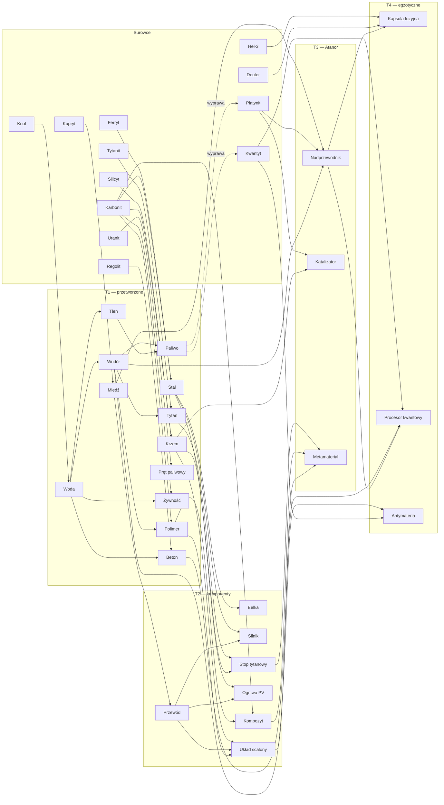

# Ekonomia i ekspansja w układzie słonecznym — projekt

> **Status:** propozycja do dyskusji (Etap 1 stage-gate). Liczby to pierwsza kalibracja do dalszej iteracji, nie ostateczny balans.
> **Data:** 2026-11-07
> **Powiązane:** [`game-mechanics-analysis.md`](game-mechanics-analysis.md) — fakty z PoC i warianty integracji; [`game-design-questions.md`](game-design-questions.md) — otwarte decyzje.
> **Zakres:** surowce i materiały; ekonomia kosztów (energia, czas, składowanie, handel); budynki i pojazdy z poziomami rozbudowy; modele 3D i animacje; logistyka w stylu Factorio; droga do gwiazdolotu i wyboru kolejnej gwiazdy.

## Jak czytać

- **[PoC]** oznacza fakt wynikający z kodu, z odnośnikiem do pliku. Wszystko bez tego oznaczenia to propozycja projektowa.
- Wszystkie tabele z liczbami (wartości materiałów, koszty poziomów, czasy zwrotu, łańcuchy produkcji, transport, gwiazdolot, gwiazdy) **pochodzą z jednego modelu obliczeniowego** o parametrach z Załącznika A. Zmiana parametru spójnie zmienia wszystkie tabele. Żadna z nich nie jest wpisana ręcznie.
- Nowe pytania mają identyfikatory `EXP-…` (rozdz. 12). Odwołania `EKO-…`, `WIZ-…` itd. prowadzą do istniejących pytań w `game-design-questions.md`.

### Założenia przyjęte ze zlecenia

Zlecenie de facto rozstrzyga kilka otwartych pytań. Wszystkie sześć założeń potwierdzono 2026-11-07 (plan prac web-game, pytanie W05); rozstrzygnięcia są wpisane w polach „Decyzja” w `docs/game-design-questions.md`.

| # | Założenie | Skąd | Pytanie |
|---|---|---|---|
| Z1 | Celem gry w układzie jest gwiazdolot i wybór kolejnej gwiazdy na mapie galaktyki | „budowy statku … pozwalającego wybrać następny układ słoneczny” | `WIZ-3` = A, `POC-1` = B + C |
| Z2 | Materiały T3/T4 powstają wyłącznie w Fabryce atanorowej; T1/T2 w zwykłych fabrykach | „późniejsze [poziomy] wymagają materiałów egzotycznych budowanych za pomocą space-atanor” | `WIZ-2` (hybryda A/B) |
| Z3 | Magazyny są lokalne (na ciele niebieskim), a materiały przemieszczają się fizycznie: pasami, rurami i pojazdami | „dostarczanie surowców … za pomocą pasów, rur … oraz pojazdów” | `EKO-3` = B, `EKO-8` |
| Z4 | Energia ogranicza produkcję w czasie: pobór jest ciągły, a deficyt obniża wydajność | „ekonomia oparta na kosztach (w tym mocy)” | `EKO-2` = B |
| Z5 | W obrębie układu gra jest jednoosobowa (kolonia gracza); handel odbywa się przez rynek | „rozbudowa cywilizacji i opanowanie układu” | `WIZ-1` = C, `SOC-1` |
| Z6 | **Skala czasu: jednostka modelu to 1 minuta czasu rzeczywistego.** PoC działa według tych samych reguł ×60 szybciej | uzasadnienie poniżej | `EKO-1`, `EXP-1` |

**Dlaczego Z6.** W PoC kopalnia kosztuje 15 Ferrytu i wydobywa 2 Ferrytu na sekundę [PoC `poc/space-3d-poc/src/app/game/models/structure.model.ts:27`], a panel słoneczny za 10 Silicytu daje 5 mocy. Każda inwestycja zwraca się więc po kilku sekundach. W pierwszej wersji tego modelu, liczonej w tym tempie, cała droga do gwiazdolotu zajmowała poniżej godziny pracy późnej kolonii. Zamiast zmieniać proporcje PoC, zostawiam te same reguły i spowalniam zegar:
- 2 Ferryty na minutę zamiast na sekundę;
- lot planeta → asteroida trwa 4–16 min zamiast zmierzonych w PoC 4–16 s;
- okres orbity planety to 4 h zamiast 240 s.

Geometria, zużycie paliwa i proporcje zostają bez zmian, a PoC może dalej służyć jako tryb testowy ×60.

## Spis treści

1. Streszczenie
2. Punkt wyjścia w PoC
3. Łuk progresji: od lądowania do gwiazdolotu
4. Ekonomia kosztów: materiały, energia, składowanie, załoga, handel
5. Budynki: zasady rozbudowy, katalog, koszty, modele i animacje
6. Pojazdy
7. Logistyka w stylu Factorio
8. Fabryka atanorowa w ekonomii
9. Gwiazdolot i wybór kolejnego układu
10. Modele 3D: zasady i pipeline
11. Ryzyka
12. Otwarte kwestie

Załącznik A — parametry modelu

---

## 1. Streszczenie

- **Progresja.** Sześć er, od E0 „Lądowanie” do E5 „Gwiazdolot”, przechodzonych przez kolejne poziomy Centrum dowodzenia (HQ). Docelowo ok. 4 tygodnie gry asynchronicznej. Kolejne ery wprowadzają nowe ciała: Księżyc, pas asteroid, gorącą planetę Pyros, gazowego olbrzyma Gigas z lodowym księżycem Glacją i kometę Kerys.
- **Materiały.** 37 pozycji w pięciu poziomach:
  - 12 surowców: 5 pospolitych, 6 rzadkich, 1 egzotyczny;
  - 12 materiałów przetworzonych (T1);
  - 7 komponentów (T2);
  - 3 materiały zaawansowane (T3, z Atanora);
  - 3 materiały egzotyczne (T4, z Atanora od L3 i z Akceleratora).
- **Wycena.** Wartość każdego materiału to suma wartości wejść, zużytej energii (MW·min × cena energii) i czasu pracy maszyny. Z tego wynikają ceny referencyjne rynku. Atanor daje marżę: projekt lepszy od referencyjnego oznacza koszt niższy od ceny.
- **Budowle.** 45 budynków w ośmiu kategoriach, do tego segmenty logistyczne i 10 pojazdów. Rozbudowa jak w grach RTS, od 1 do 5 poziomów. Na każdym poziomie koszt rośnie ×2, czas ×1,8, wydajność ×1,6, a pobór mocy ×1,45. L3 wymaga komponentów T2, L4 materiałów T3 z Atanora, L5 materiałów T4.
- **Logistyka.**
  - Na planecie: taśmy (15 / 30 / 60 j./min), rury (120 / 360 u/min), pompy, rozdzielacze i przepusty na kafelkach siatki Goldberga; ciężarówki i konwoje jeżdżą po kafelkach.
  - Między ciałami: promy, frachtowce, tankowce i wyrzutnia masy.
  - Porty Fabryki atanorowej odpowiadają glifom INPUT/OUTPUT z PoC.
- **Gwiazdolot.** Pięć modułów składanych na pięciu poziomach Doku gwiezdnego, napęd Mk I–IV o zasięgu 5–17 ly. W tym zasięgu leży 21 gwiazd z `stars.data.ts`. Odległość decyduje o ilości paliwa fuzyjnego (40 Kapsuł na rok świetlny), a jasność gwiazdy o energetyce nowej kolonii.
- **Modele 3D.** Z 70 modeli KayKit (żaden nie ma animacji) da się złożyć większość budowli mieszkalnych, magazynowych i transportowych na poziomach L1–L3. Przemysł, orbita i statki wymagają nowych modeli w tym samym stylu. Animacje wymagają zmiany pipeline'u, bo PoC spłaszcza każdy model do jednej geometrii.

## 2. Punkt wyjścia w PoC (fakty)

| Element | Stan w PoC | Co z tym robi ten projekt |
|---|---|---|
| Surowce | 3: Ferryt, Kriol, Silicyt [PoC `resource.model.ts:2`] | zostają jako T0; dochodzi 9 nowych surowców |
| Budowle | 8 (koszty, moc, wydobycie 2/s) [PoC `structure.model.ts:26-35`] | stają się poziomem L1 odpowiedników; koszty L1 budowli z ery E0 bez zmian |
| Moc | bilans per ciało, sprawdzany tylko przy budowie [PoC `economy/power.ts`] | pobór ciągły, deficyt obniża wydajność, priorytety odbiorców |
| Magazyn | globalny, bez limitu [PoC `reducer.ts:76-81`] | magazyny lokalne z klasami składowania i pulą ciała |
| Statek | Astraeus-1: paliwo 100, ładownia 50, 150 j./s; paliwo = dystans × 0,02 [PoC `initial-world.ts:78-91`, `game-constants.ts:20-29`] | Astraeus Mk I z tym samym bakiem i ładownią, 150 j./min |
| Rezerwa powrotu | lot odrzucany, jeśli zabraknie paliwa na najgorszy powrót [PoC `command.service.ts:73-79`] | naturalna bramka zasięgu: Gigas wymaga większego baku lub tankowania po drodze |
| Łazik | ścieżka BFS po kafelkach, blokowana przez budowle (poza lądowiskiem) [PoC `rover-system.ts:38-66`] | Łazik konstrukcyjny buduje i rozbudowuje; ta sama ścieżka |
| Siatka | Goldberg GP(n,0): planeta 642 kafelki, Księżyc 92; kafelek ma 5–6 sąsiadów i 6–8 j. szerokości [PoC `CLAUDE.md`] | na kafelkach powstaje warstwa logistyczna; budynki 1-, 3- i 7-kafelkowe |
| Asteroida | 500 Ferrytu, bryła kurczy się wraz z wydobyciem (`depletionScale`) [PoC `CLAUDE.md`] | pas asteroid typów M, C i S |
| Orbity | kołowe, stała prędkość kątowa [PoC `orbit-solver.ts:26-31`] | kometa wymaga orbity eliptycznej (rozszerzenie solvera) |
| Atanor | źródła nieograniczone, 16 slotów osi czasu, glify Bonder/Unbonder/Transmute, koszty ramion 20/+10/+20/+10 i glifów 10/10/20 [PoC `pipeline.ts:256-269`, `simulation.ts:12`, `arm.ts:35-41`, `glyph.ts:66-79`] | źródła i ujścia stają się portami budynku, punkty kosztu materiałami (rozdz. 8) |
| Modele | 70 modeli glTF KayKit (CC0), 0 animacji; ruchome części jako osobne węzły w 10 modelach; dwie tekstury palety (`spacebits_texture.png`, `spacebits_texture_alt.png`) [`poc/space-3d-poc/assets/KayKit_Space_Base_Bits_1.0_EXTRA`] | podstawa dla budowli L1–L3 i pojazdów (rozdz. 5.5, 6, 10) |
| Render | `ModelLibrary` spłaszcza każdy model do jednej geometrii; `StructureView` to jeden `InstancedMesh` na ciało [PoC `CLAUDE.md`] | animacje części wymagają zmiany tego podejścia (rozdz. 10) |
| Galaktyka | 41 gwiazd z klasą widmową, jasnością, liczbą planet i dystansem [PoC `stars.data.ts`] | cele gwiazdolotu i profil kolejnej kolonii (rozdz. 9) |

---

## 3. Łuk progresji: od lądowania do gwiazdolotu

### 3.1 Ery

| Era | Poziom HQ | Cel gracza | Nowe ciała | Kluczowe odblokowania | Wejście do następnej ery | Moc kolonii referencyjnej | Orientacyjny czas |
|---|---|---|---|---|---|---|---|
| **E0 Lądowanie** | L1 (start) | uruchomić wydobycie i energię | Planeta Matka | Kopalnia, Ekstraktor Kriolu, Wieża Silicytu, Panel, Turbina, Habitat, Magazyn, Składowisko, Lądowisko, Łazik konstrukcyjny | ok. 10 pierwszych budowli | ~10 MW | pierwsza sesja (~1 h) |
| **E1 Kolonia** | L1 → L2 | metalurgia, woda, żywność, pierwsze taśmy | — | Huta (Stal, Miedź), Betoniarnia, Topielnik lodu, Farma, Koparka regolitu, Rafineria krzemu, Garaż, Ciężarówka, Zbiornik płynów, Stacja załadunkowa, Taśmociąg L1 | HQ L2 | ~40 MW | dzień 1 |
| **E2 Industrializacja** | L2 → L3 | chemia, elektronika, paliwo, wyjście na orbitę | Księżyc (kolonia), orbita planety | Elektrolizer, Skraplacz paliwa, Zakład chemiczny, Montownia, Fabryka elektroniki, Zakład wzbogacania, Reaktor rozszczepienia, Kriomagazyn, Bunkier, Akumulator, rury i pompy, Konwój, Prom, Stacja orbitalna | HQ L3 + Stacja orbitalna L1 | ~150 MW | dni 2–4 |
| **E3 Orbita i asteroidy** | L3 → L4 | statki, asteroidy, pierwsze materiały atanorowe | pas asteroid, Pyros | Stocznia, Frachtowiec, Tankowiec, Górnik asteroidowy, Sonda, Dron, Fabryka atanorowa L1–L3 (Nadprzewodnik, Katalizator, Metamateriał), Huta L3 (Tytan, Stop), Satelita i Rektenna, Wyrzutnia masy, Separatory He-3 i deuteru, Terminal handlowy | HQ L4 | ~500 MW | dni 5–10 |
| **E4 Układ zewnętrzny** | L4 → L5 | paliwo fuzyjne, materiały egzotyczne | Gigas, Glacja, kometa Kerys | Platforma czerpalna, Reaktor fuzyjny, Pułapka magnetyczna, Akcelerator, Fabryka atanorowa L3–L5 (Kapsuła fuzyjna, Procesor kwantowy), Dok gwiezdny L1 | HQ L5 | ~1500 MW | dni 11–20 |
| **E5 Gwiazdolot** | L5 | zbudować i wysłać gwiazdolot | cel: wybrana gwiazda | Dok L2–L5, moduły, napędy Mk II–IV, sonda międzygwiezdna | start gwiazdolotu | ~3000 MW | dni 21–28+ |

**Tempo kamieni milowych (z modelu).** Koszt kamienia milowego wyrażam jako liczbę godzin pełnej produkcji kolonii referencyjnej z ery, w której jest budowany. Kolonia referencyjna to założona moc kolonii w danej erze, z której 60% idzie na produkcję. Docelowe wartości to: ~2 h w E1, ~6 h w E2, ~12 h w E3, ~24 h w E4 i 2–3 dni w E5, plus czasy budowy.

{{GEN: kamienie milowe}}

### 3.2 Rozszerzony układ słoneczny

PoC ma Słońce, Planetę Matkę, Księżyc i jedną asteroidę [PoC `initial-world.ts:19-76`]. Do opanowania układu potrzeba ciał o różnych profilach. Konfiguracja ciał to dane, więc rozbudowa sprowadza się do dopisania wpisów. Okresy orbit podaję w zegarze modelu (×60).

| Ciało | Typ | Orbita (okres) | Promień / siatka | Start promu z powierzchni | Atmosfera | Nasłonecznienie | Zasoby | Rola |
|---|---|---|---|---|---|---|---|---|
| Słońce | gwiazda | — | 60 | — | — | — | — | źródło energii |
| **Pyros** | gorąca planeta skalista | 450 (2 h) | 30 / GP(6,0) = 362 kafelki | 6 u paliwa | brak | ×4,0 | Kupryt, Tytanit, Uranit; Kriol topnieje | metale, energia (satelity na niskiej orbicie) |
| **Planeta Matka** [PoC] | planeta | 900 (4 h) | 50 / GP(8,0) = 642 | 10 u | jest (wiatr) | ×1,0 | Ferryt, Silicyt, Kriol, Karbonit, Regolit; rzadko Kupryt i Uranit | stolica |
| **Księżyc** [PoC] | księżyc | 160 wokół planety (40 min) | 15 / GP(3,0) = 92 | 2 u | brak | ×1,0 | Silicyt [PoC], Tytanit, Regolit (śladowo He-3), Kriol na biegunach | przemysł orbitalny, wyrzutnia masy |
| **Pas asteroid** [PoC: 1 asteroida] | 6–10 brył typów M, C, S | 1400–1600 (~10 h) | 8–14 / brak siatki | — | brak | ×0,36 | M: Ferryt + Platynit; C: Karbonit + Kriol; S: Silicyt | wyprawy górnicze |
| **Gigas** | gazowy olbrzym | 2600 (25 h) | 110 / brak siatki | — | gęsta | ×0,12 | Hel-3, Deuter (Platforma czerpalna) | paliwo fuzyjne |
| **Glacja** | lodowy księżyc Gigasa | 220 wokół Gigasa (1 h) | 18 / GP(4,0) = 162 | 3 u | brak | ×0,12 | dużo Kriolu, Karbonit | baza zewnętrzna, lokalne paliwo |
| **Kerys** | kometa | eliptyczna 700–3600 (~3 dni) | 5 / brak siatki | — | — | zmienne | Kwantyt, Kriol | materiały egzotyczne; okno dostępu ~12 h w pobliżu peryhelium |

Konsekwencje reguł PoC:
- **Prędkość ciał.** Test `orbit-solver.spec.ts` wymaga, by każde ciało poruszało się wolniej niż połowa prędkości przelotowej (75 j./min) [PoC `CLAUDE.md`]. Nowe ciała spełniają ten warunek: Pyros 23,6 j./min, Glacja razem z Gigasem ok. 34 j./min.
- **Zasięg.** Najgorszy przypadek odległości Planeta ↔ Glacja to ok. 3800 j., więc rezerwa powrotu wynosi ok. 76 u. Astraeus Mk I (bak 100) tam nie poleci. Trzeba Mk II (bak 150) albo tankowania na Glacji. Proponuję, by rezerwę liczyć do najbliższej stacji z Paliwem, a nie zawsze do bazy (→ `EXP-7`).
- **Kometa.** Wymaga orbity eliptycznej. Solver PoC liczy tylko okręgi (`localPosition` używa jednego promienia), mimo że plan PoC przewidywał elipsy (`POC-PLAN.md` §7).

### 3.3 Jak trzy mechaniki prowadzą do celu

```
wydobycie (kafelki, statki) ──► przetwórstwo T1 ──► komponenty T2 ──► Atanor: T3 / T4
     ▲                                                                   │
     │                                                                   ▼
nowe ciała ◄── statki i stacje (T2/T3) ◄── rozbudowa L3–L5 (wymaga T2/T3/T4)
     │
     └──► Gigas + Kerys ──► Kapsuły fuzyjne + Procesory ──► Dok gwiezdny ──► gwiazdolot ──► mapa galaktyki
```

---

## 4. Ekonomia kosztów

### 4.1 Model kosztu

```
V(m) = [ Σ q_wej·V(wej) + P·t·c_E + t·c_T − Σ q_ub·V(ub) ] / q_wyj
E(m) = energia wbudowana w jednostkę materiału   [MW·min/j.]
T(m) = czas maszyn wbudowany w jednostkę          [maszyno-min/j.]
c_E = 0,1 kr / MW·min (rozliczeniowa cena energii)
c_T = 0,1 kr / maszyno-min (amortyzacja zakładu); dla statków 1,0 kr / statko-min
```

- **Koprodukty** (elektroliza, Platforma czerpalna) dzielą koszt według stałych udziałów: Wodór/Tlen po 0,5, Hel-3/Deuter 0,75/0,25. **Produkty uboczne** (np. Tytan daje też Ferryt i Wodę) pomniejszają koszt produktu głównego.
- **Wartość bazowa** jest ceną referencyjną NPC na rynku. Za energię gracz nie płaci kredytami, tylko budową elektrowni i zajętymi kafelkami. Cena c_E służy wycenie i porównaniom, a dzięki niej towary energochłonne są droższe.
- **Receptury Atanora** wycenia się przy rozwiązaniu referencyjnym (rozdz. 8). Projekt gracza lepszy od referencyjnego daje niższy koszt od ceny bazowej, czyli marżę.
- **Energia wbudowana** pozwala porównywać procesy niezależnie od cen. Na przykład koszyk T1–T3 ma ρ ≈ 0,12 kr na MW·min. Z tego wskaźnika korzysta kontrola tempa w 3.1.

### 4.2 Surowce i materiały

| Materiał | Poziom | Źródło | Główne zastosowania |
|---|---|---|---|
| Ferryt [PoC] | T0 | Planeta, asteroidy M | Stal, wczesne budowle |
| Silicyt [PoC] | T0 | Planeta, Księżyc | Krzem, panele |
| Kriol [PoC] | T0 | Planeta, bieguny Księżyca, Glacja, kometa | Woda → Wodór, Tlen, Paliwo |
| Karbonit | T0 | Planeta, asteroidy C, Glacja | Stal, Polimer, Kompozyt, Żywność |
| Regolit | T0 | każdy kafelek bez złoża | Beton regolitowy, He-3 (Księżyc) |
| Kupryt | T0R (rzadki) | Planeta (rzadko), Pyros | Miedź |
| Tytanit | T0R | Księżyc, Pyros | Tytan |
| Uranit | T0R | Planeta (rzadko), Pyros | Pręty paliwowe |
| Platynit | T0R | asteroidy M (wyprawa górnicza) | Nadprzewodnik, Katalizator |
| Hel-3 | T0R | Gigas (czerpak), regolit Księżyca (śladowo) | Kapsuła fuzyjna |
| Deuter | T0R | Gigas (czerpak), woda (śladowo) | Kapsuła fuzyjna |
| Kwantyt | T0X (egzotyczny, fikcyjny) | jądro komety Kerys (wyprawa) | Procesor kwantowy, Antymateria |
| Stal, Miedź, Tytan, Krzem | T1 | Huta, Rafineria krzemu | konstrukcje, przewody, stopy, elektronika |
| Woda, Wodór, Tlen | T1 | Topielnik, Elektrolizer | życie, chemia, paliwo |
| Paliwo | T1 | Skraplacz paliwa | loty statków |
| Beton regolitowy, Polimer | T1 | Betoniarnia, Zakład chemiczny | fundamenty, osłony, izolacja |
| Pręt paliwowy | T1 | Zakład wzbogacania | Reaktor rozszczepienia |
| Żywność | T1 | Farma hydroponiczna | załoga, koloniści |
| Belka, Przewód, Silnik, Układ scalony, Ogniwo PV, Stop tytanowy, Kompozyt | T2 | Montownia, Fabryka elektroniki, Huta L3, Zakład chemiczny L2 | budowle L3, pojazdy, statki |
| Nadprzewodnik, Katalizator, Metamateriał osłonowy | T3 | **Fabryka atanorowa L1–L2** | budowle L4, napędy, fuzja, osłony |
| Kapsuła fuzyjna, Procesor kwantowy | T4 | **Fabryka atanorowa L3–L4** | budowle L5, paliwo i komputer gwiazdolotu |
| Antymateria | T4 | Akcelerator cząstek | napęd Mk IV |

**Procesy i wartości (z modelu):**

{{GEN: materiały}}

{{GEN: alternatywy}}

Alternatywy pokazują, po co ekspansja. Hel-3 z regolitu Księżyca jest tylko ×1,6 droższy, więc umożliwia wczesne próby z fuzją. Deuter z wody kosztuje ×36 więcej niż z czerpaka na Gigasie, więc dopiero gazowy olbrzym czyni paliwo fuzyjne masowym.

**Drzewo receptur:**



### 4.3 Energia

| Źródło | Ciało | L1 → Lmax | Paliwo / warunek | Uwagi |
|---|---|---|---|---|
| Panel słoneczny [PoC: +5] | dowolne z siatką | 5 → 8,5 → 14,5 → 24,6 → 41,8 MW × nasłonecznienie | brak | tani, ale zajmuje kafelki; na Gigasie i Glacji prawie bezużyteczny |
| Turbina wiatrowa [PoC: +10] | tylko z atmosferą (Planeta Matka) | 10 → 16 → 25,6 MW | brak | moc stała |
| Reaktor rozszczepienia | dowolne | 60 → 96 → 154 → 246 MW | 1 Pręt paliwowy / 120 min (×1,6 na poziom), chłodzenie 20 u Wody/min | wymaga Bunkra na pręty |
| Reaktor fuzyjny | dowolne | 400 → 640 → 1024 MW | 1 Kapsuła fuzyjna / 300 min (×1,6 na poziom) | 7 kafelków; energia późnej gry |
| Satelita energetyczny + Rektenna | orbita → dowolne ciało | 30 → 51 → 87 MW × nasłonecznienie orbity × 0,8 | brak | przesył energii między ciałami; satelita przy Pyrosie (×4) zasila zewnętrzne kolonie |
| Akumulator | dowolne | 50 → 90 → 162 → 292 → 525 MW·h; oddawanie 20 → 131 MW | — | wygładza szczyty, osłania priorytety przy awarii |

Nasłonecznienie ciał (z modelu):

{{GEN: nasłonecznienie}}

**Zasady sieci energetycznej:**
- **Sieć per ciało**, jak w PoC. Przesył między ciałami tylko przez satelity i rektenny.
- **Priorytety odbiorców.** P1: życie, kriogenika i pułapki magnetyczne. P2: produkcja. P3: logistyka (taśmy, pompy).
- **Deficyt.** P2 i P3 dostają moc proporcjonalnie: przy 80% zasilania pracują z 80% wydajności. P1 jest chronione, dopóki starcza mocy i akumulatorów; jeśli zabraknie zasilania nawet dla P1, uruchamiają się straty składowania (4.4).
- **Energochłonność.** Paliwo to „energia w zbiorniku”. Łańcuch 3000 u Paliwa/h potrzebuje ok. 740 MW (4.7), więc rozbudowa floty wymusza rozbudowę energetyki.

### 4.4 Składowanie

{{GEN: składowanie}}

\* **Parytet składowania** to czas, po którym energia zużyta na przechowanie jednej jednostki (przy pełnym magazynie) równa się energii jej wytworzenia. Dla większości towarów jest bardzo długi, więc trzymanie zapasów jest tanie, a prawdziwym kosztem jest stały pobór mocy, zajęte kafelki i ryzyko strat przy awarii zasilania. Wyjątki są celowe:
- **Antymateria** osiąga parytet po ok. 41 h, a przy braku zasilania anihiluje i niszczy budynek. Trzeba ją zużywać na bieżąco.
- **Kwantyt** osiąga parytet po ok. godzinie. Nie warto go gromadzić; lepiej od razu przerabiać na Procesory.

**Zasady:**
- **Pula ciała.** Wszystkie magazyny na danym ciele tworzą wspólną pulę dla budowy (materiały dowozi Łazik konstrukcyjny) i dla rynku. Produkcja pobiera materiały wyłącznie fizycznie, z portów połączonych taśmą, rurą lub trasą pojazdu (rozdz. 7).
- **Klasa składowania decyduje o magazynie.** Uranit i Pręty tylko w Bunkrze, Antymateria tylko w Pułapce magnetycznej, materiały kriogeniczne w Kriomagazynie. Wodę i gazy można trzymać w zbiornikach, ale na ciałach bez atmosfery woda zamarza bez ogrzewania.
- **Bufory budynków.** Każdy budynek produkcyjny ma bufor wejścia (2 partie) i wyjścia (5 partii). Pełny bufor wyjścia zatrzymuje produkcję, tak jak w Factorio.
- **Postęp offline.** Produkcja trwa, dopóki są miejsce w magazynach i surowce (zgodnie z rekomendacją `MP-5` = B). Pojemność magazynów wyznacza więc, jak długo kolonia pracuje bez gracza.
- **Rozbudowa magazynów.** Pojemność ×1,8 na poziom, moc ×1,45, więc na wyższym poziomie koszt składowania jednostki spada.

### 4.5 Załoga i potrzeby życiowe

- **Załoga działa jak druga moc:** każdy budynek wymaga jej określonej liczby (kolumna „Załoga L1” w 5.4, ×1,3 na poziom). HQ zapewnia 5 osób, Habitat 10 → 17 → 29 → 49 → 84.
- **Potrzeby na 10 osób na godzinę:** 20 u Wody, 10 u Tlenu, 1 Żywność. Jedna Farma L1 (6 Żywności/h) wyżywi 60 osób, jeden Topielnik L1 (600 u/h) napoi 300. Potrzeby załogi to stałe, umiarkowane ujście surowców.
- **Niedobór** obniża wydajność wszystkich budynków na ciele do 50% i wstrzymuje przyrost.
- **Przyrost:** +1 osoba na 10 min, jeśli w habitatach jest miejsce i potrzeby są pokryte.
- **Koloniści.** Gwiazdolot zabiera 200 osób (rozdz. 9) i trwale zmniejsza załogę układu, dopóki habitaty jej nie odbudują.

### 4.6 Handel

**Ceny:**
- Rynek NPC (Terminal handlowy) kupuje od gracza po 0,8 × V i sprzedaje po 1,25 × V. Opłata terminalu wynosi 5% / 3,5% / 2% zależnie od poziomu Terminalu.
- Cena dynamiczna: `P = V · clamp((popyt/podaż)^0,3; 0,5; 3)`. Nadpodaż obniża cenę najwyżej do połowy wartości bazowej, niedobór podnosi ją najwyżej trzykrotnie.

**Fizyczna dostawa:**
- Towar musi dotrzeć do Terminalu na Stacji orbitalnej: promem, wyrzutnią masy albo frachtowcem.
- Na rynku galaktycznym, czyli z innymi graczami (`SOC-1`), dostawa trwa 1–4 h (kurier NPC).

**Transport między ciałami (z modelu)** — paliwo i czas statku podzielone przez ładownię. Model przyjmuje, że załadowany statek zużywa 1,5 × paliwa:

{{GEN: transport}}

**Wnioski:**
1. Tanich towarów masowych nie opłaca się wozić małym statkiem. Astraeus podnosi koszt Stali dowiezionej z pasa asteroid o 115%, Frachtowiec Mk III tylko o 3,7%. Klasa statku decyduje o tym, co się opłaca przewozić.
2. Materiały T3/T4 można wozić wszędzie, bo narzut to ułamki procenta wartości. Fabryki atanorowe da się więc stawiać tam, gdzie są energia i kafelki, a nie przy złożach.
3. Różnice między ciałami tworzą arbitraż: Kupryt na Pyrosie, Hel-3 na Gigasie, tytan na Księżycu. Wyrzutnia masy na Księżycu wysyła towary na orbitę bez paliwa (koszt w MW), więc Księżyc staje się naturalną bazą przemysłu orbitalnego.

**Kontrakty.** Frakcje NPC (`SOC-3`) zamawiają konkretne materiały z terminem i premią. Dają krótkoterminowe cele i płynność rynku na starcie.

### 4.7 Przykładowe łańcuchy produkcji (z modelu, budynki L1)

{{GEN: łańcuch Stal 600/h}}

{{GEN: łańcuch Paliwo 3000/h}}

{{GEN: łańcuch Nadprzewodnik 20/h}}

**Wnioski:**
- **Stal jest „ziemskim” wąskim gardłem.** 600 Stali na godzinę wymaga 20 Hut L1 (60 kafelków) albo ok. 3 Hut L5. Ponieważ kafelki są ograniczone, rozbudowa staje się koniecznością.
- **Paliwo jest wąskim gardłem energetycznym.** 3000 u/h pochłania ok. 740 MW.
- **Nadprzewodnik wymaga logistyki kosmicznej:** 20 sztuk na godzinę to stale 5 wypraw górniczych po Platynit i 4 Fabryki atanorowe z rozwiązaniem referencyjnym. Dwa razy lepszy projekt gracza zmniejsza tę liczbę do 2.

---

## 5. Budynki

### 5.1 Zasady rozbudowy (klasyczny model RTS)

1. **HQ wyznacza sufit.** Żaden budynek nie może mieć wyższego poziomu niż Centrum dowodzenia. Poziom HQ wyznacza też erę i limit Łazików konstrukcyjnych.
2. **Budowę wykonuje Łazik konstrukcyjny.** Dojeżdża na kafelek (ścieżka BFS jak w PoC), przywozi materiały z puli ciała i buduje przez czas budowy. Liczba łazików oznacza liczbę równoległych budów. Moduły orbitalne montują drony Stacji orbitalnej z materiałów dostarczonych do magazynu stacji.
3. **Rozbudowa odbywa się w miejscu.** W trakcie budynek pracuje z 50% wydajności (magazyny ze 100%). Anulowanie zwraca 75% materiałów, rozbiórka 50%.
4. **Koszt rośnie wykładniczo.** `Koszt(L) = k_era · [ C₁ · 2^(L−1) + Σ_{j=2..L} D_j · 2^(L−j) ]`, gdzie D_j to materiały dochodzące na poziomie j; raz dodane rosną dalej ×2 na poziom. Pozostałe parametry: czas ×1,8, wydajność ×1,6, pobór mocy ×1,45, załoga ×1,3 na poziom. Wydajność na 1 MW rośnie więc o ok. 10% na poziom, a koszt dwukrotnie: rozbudowa opłaca się głównie wtedy, gdy brakuje kafelków lub złóż.
5. **Materiały poziomów:**
   - L1–L2: surowce i T1;
   - L3: komponenty T2;
   - **L4: materiał T3 z Fabryki atanorowej;**
   - **L5: materiał T4** (Procesor kwantowy, Kapsuła fuzyjna, Antymateria).
6. **Mnożnik ery k** koryguje koszt bazowy tak, by budynek produkcyjny L1 zwracał się w docelowym czasie danej ery. Nie jest to „inflacja” rosnąca z erą: budynki z E3 mają z natury drogie receptury, więc ich korekta jest mała.

{{GEN: mnożniki ery}}

**Czas zwrotu budynków produkcyjnych (z modelu).** Zwrot to koszt podzielony przez wartość produkcji brutto. Rozbudowa do L5 zwraca się w ciągu doby lub dwóch:

{{GEN: czas zwrotu}}

### 5.2 Katalog budynków

Sposób wytworzenia, jeśli nie podano inaczej:
- **budowle powierzchniowe** buduje Łazik konstrukcyjny na kafelku (budynki 3- i 7-kafelkowe zajmują kafelek i sąsiadów, rozdz. 7.3);
- **budowle orbitalne** montują drony Stacji orbitalnej.

Koszty są w 5.3, a moc, czas budowy i załoga w 5.4.

#### A. Infrastruktura

| Budynek | Cel / opis | Kafelki | Wymagania | Efekt L1 → Lmax |
|---|---|---|---|---|
| **Centrum dowodzenia (HQ)** | serce kolonii; wyznacza erę i sufit poziomów; magazyn wbudowany; generator własny | 3 | na starcie (L1) | sufit poziomów = poziom HQ; limit Łazików konstrukcyjnych 2 / 3 / 4 / 6 / 8; magazyn wbudowany 2000 j. ×1,8; moc +5 ×1,6; załoga +5 |
| **Lądowisko** [PoC] | punkt dokowania statków na kafelku (w PoC przesuwa punkt dokowania [PoC `world.ts:62-73`]) | 1 | — | statków naraz 1 / 2 / 4; tankowanie 20 / 36 / 65 u/min; od L2 produkcja Promu i Astraeusa |
| **Habitat** [PoC: bez efektu] | mieszkania załogi | 1 | — | załoga 10 → 17 → 29 → 49 → 84 |
| **Farma hydroponiczna** | żywność | 1 | Topielnik lodu | Żywność 6 → 9,6 → 15,4 → 24,6 /h |
| **Garaż pojazdów** | produkcja i serwis pojazdów naziemnych | 1 | HQ L1 | kolejka 1 / 2 / 3; maksymalny Mk pojazdu = poziom Garażu |

#### B. Magazyny

| Budynek | Klasa | Kafelki | Wymagania | Pojemność L1 → Lmax |
|---|---|---|---|---|
| **Magazyn** [PoC: bez efektu] | sztukowe | 1 | — | 5000 → 9000 → 16 200 → 29 160 → 52 488 j. |
| **Składowisko** | sypkie | 1 | — | 20 000 → 36 000 → 64 800 → 116 640 → 209 952 j. |
| **Zbiornik płynów** | płynne | 1 | Topielnik lodu | 10 000 → 18 000 → 32 400 → 58 320 u |
| **Zbiornik ciśnieniowy** | gazowe | 1 | Elektrolizer | 10 000 → 18 000 → 32 400 → 58 320 u |
| **Kriomagazyn** | kriogeniczne | 1 | Skraplacz paliwa | 20 000 → 36 000 → 64 800 → 116 640 u / j. |
| **Bunkier osłonowy** | radioaktywne | 1 | Betoniarnia, HQ L2 | 500 → 900 → 1620 j. |
| **Pułapka magnetyczna** | egzotyczne | 1 | Fabryka atanorowa L1, HQ L4 | 10 → 18 → 32 j. |
| **Akumulator** | energia | 1 | Fabryka elektroniki | 50 → 90 → 162 → 292 → 525 MW·h |

#### C. Energia

Parametry są w tabeli 4.3. Wymagania:
- **Panel słoneczny** [PoC] i **Turbina wiatrowa** [PoC]: brak.
- **Reaktor rozszczepienia** (3 kafelki): Zakład wzbogacania, Bunkier osłonowy.
- **Reaktor fuzyjny** (7 kafelków): Fabryka atanorowa L3, HQ L4.
- **Rektenna** (3 kafelki): Stacja orbitalna, Satelita energetyczny.

#### D. Wydobycie

| Budynek | Cel | Kafelki | Wymagania | Wydobycie L1 → L5 [j./min] |
|---|---|---|---|---|
| **Kopalnia** [PoC] | rudy stałe ze złoża na kafelku (Ferryt, Karbonit, Kupryt, Tytanit, Uranit) | 1 | złoże | Ferryt 2 → 3,2 → 5,1 → 8,2 → 13,1; Karbonit 1,5 → 9,8; Kupryt i Tytanit 1 → 6,6; Uranit 0,25 → 1,6 |
| **Ekstraktor Kriolu** [PoC] | lód ze złoża | 1 | złoże Kriolu | 2 → 3,2 → 5,1 → 8,2 → 13,1 |
| **Wieża Silicytu** [PoC] | kryształy Silicytu | 1 | złoże Silicytu | 2 → 3,2 → 5,1 → 8,2 → 13,1 |
| **Koparka regolitu** | regolit z dowolnego kafelka bez złoża | 1 | HQ L1 | 3 → 4,8 → 7,7 |
| **Separator He-3** | śladowy Hel-3 z regolitu (Księżyc) | 3 | Fabryka elektroniki, Kriomagazyn | 0,1 → 0,16 → 0,26 u/min |

#### E. Przetwórstwo (T1)

Każdy poziom przyspiesza produkcję ×1,6. Receptury są w tabeli 4.2.

| Budynek | Receptury | Kafelki | Wymagania |
|---|---|---|---|
| **Huta** | Stal, Miedź; od L3 Tytan i Stop tytanowy | 3 | HQ L1 |
| **Rafineria krzemu** | Krzem | 3 | Huta |
| **Topielnik lodu** | Woda | 1 | Ekstraktor Kriolu |
| **Elektrolizer** | Wodór + Tlen | 3 | Topielnik, HQ L2 |
| **Skraplacz paliwa** | Paliwo | 3 | Elektrolizer, Zbiornik ciśnieniowy |
| **Betoniarnia** | Beton regolitowy | 1 | Koparka regolitu, Topielnik |
| **Zakład chemiczny** | Polimer; od L2 Kompozyt węglowy | 3 | Elektrolizer |
| **Zakład wzbogacania** | Pręty paliwowe | 3 | Fabryka elektroniki, Bunkier |
| **Separator deuteru** | śladowy Deuter z wody (droga alternatywa przed Gigasem) | 3 | Elektrolizer, HQ L3 |

#### F. Produkcja (T2–T4)

| Budynek | Receptury | Kafelki | Wymagania |
|---|---|---|---|
| **Montownia** | Belka, Przewód, Silnik | 3 | Huta, HQ L2 |
| **Fabryka elektroniki** | Układ scalony, Ogniwo PV | 3 | Rafineria krzemu, Zakład chemiczny |
| **Fabryka atanorowa** | Nadprzewodnik (L1); Katalizator, Metamateriał (L2); Kapsuła fuzyjna (L3); Procesor kwantowy (L4); druga linia produkcyjna (L5) | 7 | Fabryka elektroniki, Stacja orbitalna, HQ L3 |
| **Akcelerator cząstek** | Antymateria | 7 | Fabryka atanorowa L4, Pułapka magnetyczna |

#### G. Logistyka (budynki)

Segmenty logistyczne (taśmy, rury, rozdzielacze, przepusty) opisuje rozdział 7.

| Budynek | Cel | Kafelki | Wymagania | Efekt L1 → Lmax |
|---|---|---|---|---|
| **Pompa** | utrzymuje ciśnienie w sieci rur | 1 | Montownia | zasięg 12 → 20 → 30 kafelków rury |
| **Stacja załadunkowa** | przeładunek między taśmą a pojazdem; przystanek tras cyklicznych | 1 | Garaż | przeładunek 10 → 18 → 32 j./min; stanowiska 1 / 2 / 3 |
| **Wyrzutnia masy** | wystrzeliwuje ładunek na orbitę bez paliwa (tylko ciała o niskiej grawitacji: Księżyc, Glacja) | 7 | Fabryka atanorowa L1, Stacja orbitalna | 2 → 3,6 → 6,5 j./min (salwy po 20 j.) |

#### H. Orbita

| Budowla | Cel | Wymagania | Efekt L1 → Lmax |
|---|---|---|---|
| **Stacja orbitalna** | hub orbitalny ciała: doki, magazyn, tankowanie, przeładunek | Montownia, HQ L2 | doki 2 / 3 / 4 / 6 / 8; magazyn stacji 5000 j. ×1,8; od L2 tankownia, od L3 przeładunek między statkami, od L4 osłony i port dalekiego zasięgu |
| **Stocznia orbitalna** | budowa statków | Stacja orbitalna L2, HQ L3 | L1: Frachtowiec, Górnik, Sonda; L2: Tankowiec i Mk II; L3: Mk III; L4: 2 sloty i sonda międzygwiezdna; tempo budowy ×1,5 na poziom |
| **Terminal handlowy** | moduł stacji; rynek NPC i galaktyczny | Stacja orbitalna L2 | opłata 5% / 3,5% / 2%; aktywne zlecenia 5 / 10 / 20 |
| **Satelita energetyczny** | zbiera energię na orbicie i wysyła ją do rektenny | Fabryka elektroniki, Stocznia | 30 → 51 → 87 MW × nasłonecznienie × 0,8 |
| **Platforma czerpalna** | czerpie Hel-3 i Deuter z atmosfery Gigasa; własne zasilanie z reaktora (na orbicie Gigasa słońce daje ×0,12) | Stocznia L2, HQ L4 | Hel-3 0,2 + Deuter 0,8 u/min → ×1,6 na poziom |
| **Dok gwiezdny** | montaż gwiazdolotu; poziom n odblokowuje moduł n (rozdz. 9) | Stocznia L3, HQ L4 | L1 kadłub; L2 napęd; L3 osłona; L4 komputer nawigacyjny; L5 habitat hibernacyjny i start |

### 5.3 Koszty poziomów (z modelu, z mnożnikiem ery)

{{GEN: budynki — koszty poziomów}}

### 5.4 Wartość poziomu, czas budowy, moc, załoga (z modelu)

Moc ujemna oznacza pobór, dodatnia produkcję. Dla magazynów kriogenicznych, gazowych, radioaktywnych i egzotycznych dochodzi pobór zależny od zapełnienia (4.4).

{{GEN: budynki — wartość, czas, moc}}

### 5.5 Modele 3D i animacje budynków

Oznaczenia: `nazwa` to istniejący model KayKit; **nowy** to model do wykonania w stylu KayKit; *alt* to druga tekstura palety (`spacebits_texture_alt.png`, akcenty niebieskie zamiast pomarańczowych). Proponuję, by *alt* od L4 wyróżniała technologię atanorową. Techniki animacji (węzeł, shader, cząsteczki, klip) opisuje rozdział 10.

| Budynek | L1 | L2 | L3 | L4 | L5 | Animacje |
|---|---|---|---|---|---|---|
| Centrum dowodzenia | `basemodule_C` + `roofmodule_base` | + `basemodule_B` połączony `tunnel_straight_A` | + `dome`, `lights` | *alt* + **nowa** antena | + **nowy** emiter pola | obrót anteny (węzeł); migające światła (shader); pulsowanie pola (shader) |
| Lądowisko | `landingpad_small` [PoC] | `landingpad_large` | + `lights` + **nowy** rękaw tankowania | — | — | sekwencja świateł przy podejściu statku (shader); otwarcie drzwi `dropship` (węzły `dropship_door_left/right`) |
| Habitat | `basemodule_A` [PoC] | + `roofmodule_base` | drugie piętro (`basemodule_A` na wierzchu) | + `dome` *alt* | + `eco_module` | światła okien (shader) |
| Farma hydroponiczna | `space_farm_small` | `space_farm_large` | `space_farm_large_sprinkler` | `eco_module` *alt* | — | obrót zraszacza (węzeł `sprinkler`); rośliny rosnące w cyklu zbioru (skala instancji) |
| Garaż pojazdów | `basemodule_garage` | + `roofmodule_cargo_A` | + **nowy** dźwig serwisowy | — | — | brama przy wyjeździe pojazdu (węzeł `basemodule_garage_door`) |
| Magazyn | `cargodepot_A` [PoC] | `cargodepot_B` | `cargodepot_C` | + `roofmodule_cargo_B` *alt* | + `containers_D` | stos `cargo_A` rośnie z zapełnieniem (instancje); **nowa** suwnica (węzeł) |
| Składowisko | `containers_A` | `containers_B` | `containers_C` | `containers_D` | 2 × `containers_D` + **nowy** lej | hałda `rocks_A` w kolorze surowca, skalowana z zapełnieniem |
| Zbiornik płynów | `water_storage` | 2 × `water_storage` | **nowy** zbiornik wysoki | *alt* | — | wskaźnik poziomu (shader) |
| Zbiornik ciśnieniowy | **nowy** (1 sfera) | 2 sfery | 3 sfery | *alt* | — | puszczanie zaworów (cząsteczki) |
| Kriomagazyn | **nowy** cylinder | wyższy | + izolacja | *alt* + cewki | — | szron i opary (shader + cząsteczki); przy braku mocy szron topnieje |
| Bunkier osłonowy | `structure_low` + **nowa** pokrywa | grubsza pokrywa | panele Metamateriału *alt* | — | — | obrotowe światło ostrzegawcze (węzeł) |
| Pułapka magnetyczna | **nowy** torus z rdzeniem | drugi pierścień | trzeci pierścień | — | — | obrót pierścieni (węzły); blask rdzenia zależny od zapełnienia (shader); alarm przy braku mocy |
| Akumulator | **nowy** blok ogniw | 2 bloki | 3 bloki | *alt* | + cewki | pasek naładowania (shader) |
| Panel słoneczny | `solarpanel` | `roofmodule_solarpanels` [PoC] | **nowa** matryca nadążna | + cewki *alt* | rozbudowana matryca | obrót matrycy za Słońcem (węzeł; kierunek do Słońca znany z solvera orbit) |
| Turbina wiatrowa | `windturbine_low` | `windturbine_tall` [PoC] | `windturbine_tall` *alt* | — | — | obrót śmigła z prędkością zależną od mocy (węzły `windturbine_*_fan`) |
| Reaktor rozszczepienia | **nowy** reaktor + `dome` | + chłodnia kominowa | + druga chłodnia | *alt* | — | para z chłodni (cząsteczki); przepływ w rurach (shader) |
| Reaktor fuzyjny | **nowy** tokamak | + cewki | *alt* + rozbudowa | — | — | wirująca plazma (przewijanie UV); pulsowanie cewek (shader) |
| Rektenna | **nowa** siatka anten | większa | *alt* | — | — | promień od satelity (shader linii) |
| Kopalnia | `drill_structure` [PoC] | + `cargo_A` | + `structure_tall` (głowica podajnika) | **nowe** wiertło laserowe *alt* | rozbudowa | obrót i ruch pionowy wiertła (węzeł `drill_module`); pył (cząsteczki); kurczenie skał złoża |
| Ekstraktor Kriolu | `water_storage` [PoC] | + `roofmodule_base` | + **nowa** wiertnica | *alt* | rozbudowa | para (cząsteczki) |
| Wieża Silicytu | `structure_tall` [PoC] | + `roofmodule_cargo_A` | + **nowy** podajnik | *alt* | rozbudowa | blask kryształów (shader) |
| Koparka regolitu | **nowa** koparka kołowa | większa | podwójna | — | — | obrót koła czerpakowego (węzeł) |
| Separator He-3 | **nowy** zakład | + wirówki | *alt* | — | — | wirujące bębny (węzły) |
| Huta | **nowa** hala z kominem | + piec | + piec próżniowy (Tytan) | *alt* + katalizatory | rozbudowa | żar (pulsujące światło); dym i iskry (cząsteczki) |
| Rafineria krzemu | **nowe** kolumny | +1 kolumna | +2 kolumny | *alt* | rozbudowa | świecący tygiel (shader) |
| Topielnik lodu | **nowy** (zbiornik z grzałką) | większy | podwójny | *alt* | — | para (cząsteczki) |
| Elektrolizer | **nowe** ogniwa i zbiorniczki gazu | + ogniwa | + ogniwa | *alt* | rozbudowa | bąbelki (shader); zawory (cząsteczki) |
| Skraplacz paliwa | **nowe** kolumny kriogeniczne | + kolumna | + kolumna | *alt* | — | szron i opary (shader + cząsteczki) |
| Betoniarnia | **nowa** betoniarka | większa | podwójna | *alt* | — | obrót bębna (węzeł) |
| Zakład chemiczny | **nowe** zbiorniki i rury | + reaktor (Kompozyt) | + reaktor | *alt* | rozbudowa | opary (cząsteczki); przepływ (shader) |
| Zakład wzbogacania | **nowa** hala kaskady | + hala | *alt* | — | — | wirówki widoczne przez szczeliny (węzły); światło ostrzegawcze |
| Separator deuteru | **nowy** | + kolumna | *alt* | — | — | przepływ (shader) |
| Montownia | **nowa** hala z ramieniem robota | + linia | + linia | *alt* | rozbudowa | ruch ramienia (klip) |
| Fabryka elektroniki | **nowa** hala czysta | + moduł | + moduł | *alt* | rozbudowa | migające diody (shader) |
| Fabryka atanorowa | **nowa** heksagonalna hala ze szklanym dachem | większa kopuła | + wieże ramion | *alt* | podwójna hala | wnętrze: plansza i ramiona odtwarzające program gracza (instancje, tylko z bliska); z daleka pulsujący blask |
| Akcelerator cząstek | **nowy** pierścień (7 kafelków) | + detektor | *alt* | — | — | smuga cząstek wzdłuż pierścienia (przewijanie UV) |
| Pompa | **nowa** | większa | *alt* | — | — | wirnik (węzeł) |
| Stacja załadunkowa | **nowa** zatoka z dźwigiem | 2 stanowiska | 3 stanowiska | — | — | dźwig przenosi `cargo_A` między pojazdem a taśmą (węzeł) |
| Wyrzutnia masy | **nowa** rampa z cewkami | dłuższa | *alt* | — | — | błysk cewek; kapsuła po rampie i smuga na orbitę (klip + cząsteczki) |
| Stacja orbitalna | moduły `basemodule_E` + `tunnel_straight_*` w przestrzeni | + skrzydła `solarpanel` | + pierścień | *alt* + osłony | port dalekiego zasięgu | powolny obrót pierścienia (węzeł); światła doków (shader); skrzydła nadążne |
| Stocznia orbitalna | **nowa** kratownica | większa | + dźwigi | *alt* | — | budowany kadłub odsłaniany wraz z postępem (shader); iskry spawania (cząsteczki) |
| Terminal handlowy | `roofmodule_cargo_*` + `containers_*` na stacji | + doki | *alt* | — | — | przewóz kontenerów (węzeł) |
| Satelita energetyczny | **nowy** (skrzydła PV i antena) | większe skrzydła | *alt* | — | — | antena śledzi rektennę (węzeł); promień (shader) |
| Platforma czerpalna | **nowa** z linią czerpaka | + zbiorniki | *alt* | — | — | kołysanie linii; blask wlotu (shader) |
| Dok gwiezdny | **nowa** rama + kadłub | + napęd | + osłona | + komputer *alt* | + habitat | kolejne moduły gwiazdolotu pojawiają się na kolejnych poziomach; drony montażowe (instancje); iskry |

---

## 6. Pojazdy

Wszystkie pojazdy mają trzy wersje (Mk I–III). Koszty modernizacji rosną wykładniczo, według tego samego wzoru co budynki (6.3). Pojazdy naziemne powstają w Garażu (Astraeus i Prom na Lądowisku L2+), statki w Stoczni orbitalnej.

### 6.1 Pojazdy naziemne

| Pojazd | Rola | Mk I → Mk III | Modele | Animacje |
|---|---|---|---|---|
| **Łazik konstrukcyjny** [PoC: łazik R-1, 12 j./s] | budowa i rozbudowa; od Mk III także zwiad złóż (odsłania złoża na kafelkach, `POC-10`) | ładunek 10 / 20 / 40 j.; prędkość 12 / 14 / 18 j./min | `spacetruck` [PoC] → + `cargo_A` → + **nowe** ramię dźwigu i skaner | obrót kół (węzły `spacetruck_wheel_*`); ramię przy budowie (klip); obrót skanera (węzeł) |
| **Ciężarówka** | trasy cykliczne między Stacjami załadunkowymi | 40 / 80 / 120 j. (0 / 1 / 2 przyczepy); 10 / 9 / 8 j./min; wariant cysterna 400 u | `spacetruck_large` + 0–2 × `spacetruck_trailer`; cysterna: `water_storage` na przyczepie | koła (węzły); ładunek `cargo_A_stacked` widoczny proporcjonalnie do zapełnienia |
| **Konwój ciężki** | masowy transport na duże odległości po planecie | 200 / 400 / 600 j.; 6 j./min | `mobile_base_command` + `mobile_base_carriage` + 1–3 × `mobile_base_cargo` na `mobile_base_frame` | 6 kół (węzły `mobile_base_frame_wheel_*`); wagony podążają za ścieżką |
| **Dron logistyczny** | elastyczne dostawy na krótkim dystansie (jak roboty w Factorio) | 2 / 4 j.; 30 j./min; zasięg 8 kafelków od Stacji załadunkowej L3 | **nowy** quadkopter + `cargo_A_packed` | wirniki (węzły) |

### 6.2 Statki

| Statek | Rola | Mk I → Mk III | Modele | Animacje |
|---|---|---|---|---|
| **Prom orbitalny** | powierzchnia ↔ Stacja orbitalna | 30 / 50 / 80 j.; start z powierzchni kosztuje 10 u (Planeta), 6 u (Pyros), 3 u (Glacja), 2 u (Księżyc) | `lander_A` → `lander_B` → `lander_B` *alt*; płyta `lander_base` | płomień silnika (cząsteczki); lot pionowy |
| **Astraeus** [PoC: paliwo 100, ładownia 50] | uniwersalny, mały | ładownia 50 / 80 / 120; bak 100 / 150 / 200; 150 / 165 / 180 j./min | `dropship` [PoC] → `dropship_packed` → *alt* + **nowe** silniki | drzwi przy lądowaniu (węzły `dropship_door_*`); blask silników (shader) |
| **Frachtowiec** | masowy transport między ciałami | 400 / 800 / 1600 j.; bak 250 / 300 / 400; 110 / 120 / 130 j./min | **nowa** kratownica z kontenerami `cargo_A_stacked` (4 / 8 / 16) | dokowanie i odczepianie kontenerów (węzły) |
| **Tankowiec** | płyny, gazy, kriogenika | 2000 / 4000 / 8000 u; od Mk II izolacja kriogeniczna | **nowy** kręgosłup ze zbiornikami sferycznymi (1 / 2 / 4) | szron na zbiornikach z kriogeniką (shader) |
| **Górnik asteroidowy** [PoC: wydobycie 10/s statkiem] | wyprawy na asteroidy M/C/S; Mk III także na kometę | wydobycie 10 / 20 / 40 j./min; ładownia 100 / 200 / 400 | **nowy** kadłub + `drill_module` (z `drill_structure`) | obrót wiertła i odłamki (węzeł + cząsteczki); asteroida kurczy się (`depletionScale` z PoC) |
| **Sonda** | odsłania złoża ciał (Mk I: układ wewnętrzny; Mk II: Gigas i Kerys); Mk III: sonda międzygwiezdna (rozdz. 9.4) | zasięg: wewnętrzny / zewnętrzny / 17 ly | **nowa** mała sonda | rozkładanie skrzydeł PV (klip) |

### 6.3 Koszty i parametry pojazdów (z modelu)

{{GEN: pojazdy — koszty poziomów}}

{{GEN: pojazdy — wartość, czas, moc}}

---

## 7. Logistyka w stylu Factorio

### 7.1 Warstwa transportowa na siatce Goldberga

- **Fakty z PoC.** Kafelek ma 5 lub 6 sąsiadów (12 pięciokątów na każdym ciele) i szerokość 6–8 j. Budowla zajmuje jeden kafelek. Łazik szuka drogi BFS i omija budowle poza lądowiskiem [PoC `CLAUDE.md`, `rover-system.ts:38-66`].
- **Propozycja.** Każdy kafelek ma dwie warstwy: **budowlę** albo **segmenty transportu**. Na jednym kafelku mieści się jeden segment taśmy i jeden segment rury (rura pod taśmą). Budowla wyklucza oba, chyba że w tym miejscu stoi przepust.
- **Taśma** łączy krawędź wejściową z wyjściową. Na sześciokącie są trzy kształty segmentu: prosty (krawędzie naprzeciwległe, 180°), łuk łagodny (120°) i łuk ostry (60°). **Pięciokąty** nie przyjmują taśm ani rur; dopuszczam na nich tylko budowle 1-kafelkowe (→ `EXP-2`).
- **Pojazdy** przejeżdżają przez kafelki z taśmami i rurami, ale nie przez budowle. To rozszerzenie reguły PoC, w której lądowisko nie blokuje łazika.

### 7.2 Elementy logistyczne

| Element | Przepustowość | Koszt na kafelek | Moc na kafelek | Model | Animacja |
|---|---|---|---|---|---|
| Taśmociąg L1 | 15 j./min | 2 Ferryt | 0,05 MW | **nowy**: 3 kształty, pomarańczowy | przewijanie UV taśmy; skrzynki `cargo_A_packed` jako instancje (1 skrzynka = 1 j.) |
| Taśmociąg L2 | 30 j./min | 2 Stal + 1 Przewód | 0,1 MW | **nowy**, biały | jw., szybciej |
| Taśmociąg L3 (magnetyczny) | 60 j./min | 1 Stop tytanowy + 1 Nadprzewodnik | 0,2 MW | **nowy**, *alt* | lewitujące skrzynki, poświata (shader) |
| Rura L1 | 120 u/min | 2 Ferryt | 0 | **nowa**: prosta, łuk, trójnik | pulsowanie przepływu w kolorze płynu (shader) |
| Rura L2 (ciśnieniowa) | 360 u/min | 2 Stal + 1 Polimer | 0 | **nowa** | jw. |
| Rura L3 (kriogeniczna) | 360 u/min | 1 Stop + 1 Kompozyt + 1 Polimer | 0,1 MW | `tunnel_straight_A/B`, `tunnel_diagonal_*` (izolowana rura) | szron (shader) |
| Pompa | sieć rur w zasięgu 12 / 20 / 30 kafelków | zob. 5.3 | 1 MW | **nowa** | wirnik (węzeł) |
| Rozdzielacz / Scalacz | 1 → 2–3 wyjścia po równo / 2–3 → 1 | 4 Stal + 2 Przewód | 0,2 MW | **nowy** | — |
| Filtr | kieruje wybrany materiał na wyjście boczne | rozdzielacz + 1 Układ | 0,2 MW | **nowy** | lampka filtra (shader) |
| Przepust | taśma lub rura przechodzi pod 1–4 kafelkami (pod budowlą albo inną taśmą) | 6 Stal + 4 Beton | 0 | `tunnel_straight_A/B` | — |

Zasady:
- **Sieć rur** przenosi jeden płyn. Mieszanie płynów jest zabronione.
- **Zasięg sieci.** Poza zasięgiem pompy przepustowość spada o połowę.
- **Płyny i gazy** płyną tylko rurami. Taśmy przenoszą materiały sypkie i sztukowe w skrzynkach.

### 7.3 Budynki wielokafelkowe i porty

- **Rozmiary:**
  - **1 kafelek:** budynki małe;
  - **3 kafelki:** trzy kafelki stykające się w jednym wierzchołku;
  - **7 kafelków:** kafelek i sześciu sąsiadów.

  Budynki 3- i 7-kafelkowe nie mogą obejmować pięciokąta.
- **Porty.** Każdy budynek ma porty wejścia i wyjścia na zewnętrznych krawędziach, oznaczone strzałkami. Taśma lub rura dochodząca do portu wejścia podaje materiał; z portu wyjścia odbiera. Budynek obraca się w 6 krokach (ten sam mechanizm co obrót podglądu w Atanorze [PoC `build-toolbar.component.ts:34-39`]).
- **Magazyn jest węzłem sieci.** Ma porty z filtrem materiału, a jego zawartość zasila pulę ciała (4.4).
- **Fabryka atanorowa:** każde źródło (INPUT) na planszy atanora to port wejściowy budynku, a każde ujście (OUTPUT) to port wyjściowy (rozdz. 8).

### 7.4 Przykład: linia Stali i Silników

```
[Kopalnia Fe L3 ×2] ─►─┐                               ┌─►─ [Magazyn] (pula ciała)
                        ├─ taśma L1 (15 j./min) ─►─ [Huta L2] ─►─┤
[Kopalnia C  L3 ×1] ─►─┘                               └─►─ [Montownia L1] ◄─ taśma ◄─ [Huta: Miedź]
                                                                │
                                                                └─►─ Silniki ─► [Stacja załadunkowa] ─► Ciężarówka ─► Lądowisko
```

Bilans:
- 2 Kopalnie Ferrytu L3 dają 10,2 Fe/min, a Kopalnia Karbonitu L3 3,8 C/min.
- Huta L2 zużywa 1,6 Fe i 0,8 C na minutę. Linia może więc obsłużyć ok. 4–6 Hut L2, a taśma L1 (15 j./min) zostaje jeszcze w zapasie.

### 7.5 Który transport kiedy

| Środek | Kiedy | Plusy | Minusy |
|---|---|---|---|
| Taśma | stałe przepływy między sąsiednimi budynkami | największa przepustowość na kafelek, zero obsługi | zajmuje kafelki, sztywna |
| Rura | płyny i gazy | duża przepustowość | jeden płyn na sieć, pompy |
| Ciężarówka / Konwój | odległe skupiska na tym samym ciele, zmienne trasy | elastyczne, nie zajmują kafelków | mała przepustowość, wymagają Stacji załadunkowych |
| Dron | krótkie, rzadkie dostawy (np. części do rozbudowy) | najwygodniejsze | bardzo mała ładowność, pobór mocy |
| Prom / Wyrzutnia masy | powierzchnia ↔ orbita | Wyrzutnia działa bez paliwa | Wyrzutnia: duży pobór mocy, tylko ciała o niskiej grawitacji |
| Frachtowiec / Tankowiec | między ciałami | skala (koszt transportu z 4.6) | czas lotu, paliwo, okna transferowe |

Trasy cykliczne (`EKO-8` = B): pojazd krąży między przystankami (Stacje załadunkowe, Lądowiska, Stacje orbitalne) z warunkami typu „jedź, gdy ładownia pełna” albo „czekaj na okno transferowe tańsze niż X paliwa”.

### 7.6 Jak to policzy serwer i narysuje klient

- **Serwer nie symuluje pojedynczych skrzynek.** Sieć taśm i rur to graf przepływu. Przy każdej zmianie topologii (budowa, rozbudowa, zmiana filtra) serwer liczy ustalone tempa przepływu z ograniczeniami przepustowości i buforów. Między zmianami bufory napełniają się i opróżniają liniowo, więc stan da się liczyć leniwie i zdarzeniowo. To zgodne z modelem zdarzeniowym z `TECH-1` = A.
- **Klient animuje skrzynki** jako instancje (`cargo_A_packed`) z prędkością wynikającą z tempa. Obowiązuje limit widocznych skrzynek (np. 2000), a animacja działa tylko na ciele, na które patrzy kamera.
- **Pojazdy i statki** przekazują plany tras z czasami przyjazdu, wyliczanymi raz przy rozkazie. Wymaga to zmiany modelu transferu z PoC, w którym cel lotu jest korygowany w każdej klatce (`game-mechanics-analysis.md` §3.8).

---

## 8. Fabryka atanorowa w ekonomii

### 8.1 Poziomy budynku = możliwości maszyny

| Poziom | Maks. obszar planszy | Maks. ramion | Dostępne elementy | Takt [min/cykl] | Moc bazowa [MW] | Receptury |
|---|---|---|---|---|---|---|
| L1 | 19 heksów (promień 2) | 3 | ramiona L1–L2, tłok, Bonder, Unbonder | 1,0 | 6,0 | Nadprzewodnik |
| L2 | 37 (promień 3) | 4 | + glif transmutacji | 0,9 | 8,7 | + Katalizator, Metamateriał |
| L3 | 61 (promień 4) | 6 | + szyny, ramię L3 | 0,8 | 12,6 | + Kapsuła fuzyjna |
| L4 | 91 (promień 5) | 8 | + ramiona wieloramienne | 0,7 | 18,3 | + Procesor kwantowy |
| L5 | 127 (promień 6) | 10 | + druga plansza (2 programy równolegle) | 0,6 | 26,5 | wszystkie, dwie linie |

**Pobór mocy maszyny** = moc bazowa + 0,5 MW na każdy heks obszaru + 1 MW na każde ramię. Metryka „obszar” z PoC przekłada się więc wprost na koszt energii.

### 8.2 Koszt maszyny w materiałach

Punkty kosztu z PoC [PoC `arm.ts:35-41`, `glyph.ts:66-79`] zamieniam na materiały. Wychodzi, że 1 punkt ≈ 1 kr.

| Element | Punkty PoC | Materiały |
|---|---|---|
| Ramię L1 | 20 | 4 Stal + 1 Silnik |
| + długość L2 / L3 | +10 / +20 | +2 Stal / +4 Stal + 1 Stop tytanowy |
| + tłok | +10 | +1 Silnik |
| Bonder / Unbonder | 10 / 10 | 2 Przewód + 1 Układ scalony |
| Transmutacja | 20 | 1 Nadprzewodnik + 1 Układ scalony |
| Szyna (na heks) | 0 w PoC | 1 Stal (proponowana zmiana: szyny mają koszt) |

### 8.3 Receptury T3/T4

Atom to porcja materiału z portu wejściowego. Wzorce cząsteczek docelowych to propozycja; rozwiązania referencyjne trzeba dopiero zaprojektować i zweryfikować w edytorze (→ `EXP-6`).

| Produkt | Atomy (porcje wejść) | Cząsteczka docelowa | Rozwiązanie referencyjne: cykle / obszar / ramiona | Poziom |
|---|---|---|---|---|
| Nadprzewodnik | Cu, Cu (Miedź ×2), Pt (Platynit), H (10 u Wodoru) | łańcuch Cu–Pt–Cu z H przy Pt (3 wiązania) | 12 / 9 / 2 | L1 |
| Katalizator | Pt, Si (Krzem) | Pt*–Si; Pt przechodzi w Pt* na glifie transmutacji | 10 / 8 / 2 | L2 |
| Metamateriał osłonowy | Ti (Stop), C (Kompozyt), Be, Be (Beton ×2) | pierścień 4 atomów (4 wiązania) | 16 / 14 / 3 | L2 |
| Kapsuła fuzyjna | He (5 u Helu-3), D, D (po 5 u Deuteru), S (Nadprzewodnik) | gwiazda: S w środku, He, D, D wokół | 18 / 16 / 3 | L3 |
| Procesor kwantowy | Q (Kwantyt), U, U (Układ ×2), S (Nadprzewodnik) | Q* (transmutacja) w środku, U, U, S wokół | 24 / 20 / 4 | L4 |

### 8.4 Przepustowość i marża

- **Przepustowość** wynosi `1 / (cykle na sztukę × takt)`. Nadprzewodnik z rozwiązaniem referencyjnym na L1: 1 sztuka na 12 min, czyli 5/h.
- **Przykład marży.** Gracz zaprojektował maszynę 2× szybszą (6 cykli) i ciaśniejszą (obszar 7). Jej moc to 6 + 3,5 + 2 = 11,5 MW przy 6 min na sztukę. Koszt Nadprzewodnika spada z 45,3 kr (wartość bazowa z modelu) do ok. 36,7 kr, czyli o ok. 19%, a przepustowość rośnie 2×. Lepsza inżynieria to wprost niższy koszt i więcej towaru na sprzedaż.
- **Ranking.** Metryki rozwiązania (cykle, koszt, obszar) trafiają do rankingów receptur (`SOC-4`), a serwer weryfikuje je, odtwarzając powtórkę.

### 8.5 Wymagane zmiany w silniku Atanora (z PoC)

1. **Źródła ze skończonym zapasem.** Atom pojawia się tylko wtedy, gdy bufor portu zawiera porcję materiału. Przy pustym wejściu cała maszyna czeka (tick się nie wykonuje), więc program pozostaje deterministyczny, a przepustowość = min(projekt, dostawy). Dziś źródła są nieograniczone [PoC `pipeline.ts:256-269`].
2. **Nowe typy atomów** (Cu, Pt, H, Si, Ti, C, Be, He, D, S, Q, U) zamiast alchemicznych [PoC `molecule.ts:3`] i transmutacje Pt → Pt*, Q → Q* (`POC-7`).
3. **Metryki** (`POC-5`):
   - cykle na sztukę w stanie ustalonym (dziś UI pokazuje pozycję głowicy osi czasu);
   - koszt szyn;
   - obszar liczony z przebytej drogi.
4. **Kolizje trajektorii** i kolizje ramion (`POC-6`).
5. **Edytor:** glif transmutacji, szyny, ramię L3 i limity zależne od poziomu budynku (dziś pasek budowy ich nie ma [PoC `build-toolbar.component.ts:152-160`]).
6. **Naprawa poziomu L2**, którego domyślne rozwiązanie kończy się kolizją (`POC-4`).

---

## 9. Gwiazdolot i wybór kolejnego układu

### 9.1 Moduły i zestawienie materiałów (z modelu)

{{GEN: gwiazdolot}}

**Wąskie gardła finału** to Nadprzewodnik (5 dni pracy jednej Fabryki atanorowej z rozwiązaniem referencyjnym, ok. 1 doba przy czterech na L3), wyprawy po Kwantyt (12 wypraw po 5 h, czyli kilka Górników Mk III naraz w oknie komety) i Hel-3 (3 dni Platformy L1, ok. 1 doba na L3). Każde z nich wymaga innej mechaniki: projektowania atanora, logistyki kosmicznej i energetyki zewnętrznego układu.

### 9.2 Napęd, zasięg, paliwo

| Napęd | Zasięg | Dodatkowe materiały | Czas podróży (propozycja) |
|---|---|---|---|
| Mk I (fuzyjny) | 5 ly | w rdzeniu | 12 h / ly |
| Mk II | 9 ly | 400 Nadprzewodnik + 400 Stop tytanowy | 9 h / ly |
| Mk III | 12,5 ly | 400 Nadprzewodnik + 24 Procesor kwantowy | 7 h / ly |
| Mk IV (antymateria) | 17 ly | 60 Antymateria + 400 Nadprzewodnik + 24 Procesor kwantowy | 4 h / ly |

Paliwo: **40 Kapsuł fuzyjnych na rok świetlny** (Proxima: 170, Tau Ceti: 477). Wybór dalszej gwiazdy kosztuje więc wprost Hel-3 i Deuter z Gigasa. Antymateria (Mk IV) przechowywana w Pułapce magnetycznej osiąga parytet składowania po ok. 41 h, więc trzeba ją wyprodukować tuż przed startem.

### 9.3 Cele w zasięgu (dane z `stars.data.ts`)

Mnożnik paneli to jasność gwiazdy w L☉, ograniczona do przedziału ×0,05–×8.

{{GEN: gwiazdy}}

**Profil ekonomiczny według typu gwiazdy (propozycja):**

| Typ | Przykłady w zasięgu | Energia słoneczna | Profil złóż | Wyzwanie / atut |
|---|---|---|---|---|
| M (czerwony karzeł) | Proxima, Barnard, Wolf 359, GJ 1061, YZ Ceti | ×0,05 — praktycznie brak | dużo Kriolu i Karbonitu, mało metali; rozbłyski | energię trzeba przywieźć (Pręty lub Kapsuły w ładowni); najtańsze w paliwie (Proxima najbliżej) |
| K (pomarańczowy karzeł) | α Cen B, ε Eri, 61 Cyg A | ×0,09–0,5 | zrównoważony | umiarkowany start |
| G (jak Słońce) | α Cen A, Tau Ceti | ×0,5–1,5 | jak układ macierzysty | najłatwiejszy start; Tau Ceti ma 5 znanych planet |
| A/F (gorące) | Syriusz A, Procyon A, Altair | ×7–8 | dużo metali ciężkich i Platynitu; silne promieniowanie | energia prawie darmowa, ale budowle wymagają osłon z Metamateriału |
| Brązowe karły (L/T/Y) | Luhman 16, WISE 0855 | ×0,05 | bogate w Deuter i Hel-3 | brak światła; wymarzone dla fuzji |
| Biały karzeł | Syriusz B | ×0,06 | rzadki Kwantyt | układ podwójny z Syriuszem A |

Pole „Znane planety” w danych to podpowiedź, nie pełny opis układu. Ciała układu docelowego generuje gra (hybryda z `WIZ-4` = C). Gwiazdy o 0 znanych planet dostają pasy asteroid i małe ciała. Część danych w `stars.data.ts` jest niespójna (`POC-3`), więc przed użyciem dystansów jako czasów lotu warto je zweryfikować z katalogiem.

### 9.4 Sonda międzygwiezdna

Sonda Mk III (Stocznia L4) leci 2 h na rok świetlny, więc do Proximy dotrze w ok. 8,5 h. Odsłania profil układu docelowego: liczbę i typy ciał, profil złóż i obecność komet. Gracz wybiera więc cel na podstawie wiedzy, a nie samych danych katalogowych. Na mapie galaktyki zbadane gwiazdy dostają ikonę i kartę profilu, co rozszerza dialog gwiazdy z PoC [PoC `star-dialog.component.ts`].

### 9.5 Co przechodzi do nowego układu (propozycja)

- **Koloniści:** 200 osób. Nowa kolonia startuje z HQ L2 i Habitatem.
- **Ładownia startowa:** 2000 j. materiałów wybranych przez gracza. To decyzja strategiczna, np. Pręty paliwowe dla układu wokół czerwonego karła.
- **Wiedza:** odblokowane ery (receptury i budowle do poziomu HQ L2) oraz biblioteka projektów atanorów.
- **Układ macierzysty** pozostaje aktywny i może wysyłać kolejne statki. Zakres zarządzania wieloma układami to otwarta decyzja (→ `EXP-8`).

### 9.6 Model i animacja gwiazdolotu

- **Model:** **nowy** model główny (≤ 20 tys. trójkątów z LOD). Sekcje odpowiadają modułom: kręgosłup kadłuba, tarcza osłony z przodu, obracający się pierścień habitatu, silniki fuzyjne, macierz sensorów. Każdy poziom Doku dokłada widoczną sekcję. Napędy Mk II–IV zmieniają sekcję silników (Mk IV: pierścienie pułapki antymaterii).
- **Sekwencja startu (klip):** odcumowanie, zapłon silników (smuga plazmy z przewijaniem UV), przyspieszenie poza układ. Kamera przechodzi płynnie z widoku układu do mapy galaktyki, gdzie lot po linii do wybranej gwiazdy pokazuje postęp podróży.

---

## 10. Modele 3D: zasady i pipeline

**Fakty:**
- Paczka KayKit Space Base Bits 1.0 EXTRA ma 70 modeli glTF i 2 tekstury palety, licencja CC0.
- Żaden model nie zawiera animacji. Ruchome części są osobnymi węzłami w 10 modelach: `basemodule_garage`, `drill_structure`, `dropship`, `mobile_base_frame`, `spacetruck`, `spacetruck_large`, `spacetruck_trailer`, `space_farm_large_sprinkler`, `windturbine_low`, `windturbine_tall`.
- Modele są modelowane na siatce 2 jednostek, oś Y w górę. Rejestr modeli przechowuje wymiary i liczbę trójkątów (88–1198), a test `model-library.spec.ts` sprawdza je względem plików [PoC `engine/model-registry.ts`].
- Do `public/assets/kaykit/` skopiowano dziś 14 modeli. `ModelLibrary` spłaszcza każdy model do jednej geometrii, a `StructureView` to jeden `InstancedMesh` na ciało [PoC `CLAUDE.md`].

**Zasady dla nowych modeli (propozycja):**
1. **Styl KayKit:** low-poly, jedna wspólna tekstura palety (atlas kolorów). Dzięki niej jeden materiał wystarcza dla wielu modeli, co sprzyja instancingowi. Siatka 2 j., oś Y w górę, pivot u podstawy.
2. **Budżety:**
   - budynek 300–2000 trójkątów;
   - pojazd 500–1500;
   - statek 1500–4000;
   - obiekt orbitalny 3000–6000;
   - gwiazdolot do 20 tys. z LOD.

   Scena musi mieścić się w budżecie z `init.md`: 100–150 draw calls i 200–400 tys. trójkątów.
3. **Poziomy przez składanie modułów.** Wyższy poziom to bazowy model plus moduły dodatkowe (dachy, piętra, zbiorniki, cewki), jak w zestawach KayKit. Od L4 używamy tekstury *alt*. To ogranicza liczbę unikatowych modeli.
4. **Każdy model ma wpis w rejestrze i test,** na wzór `model-registry.ts` i `model-library.spec.ts`.
5. **Pipeline:** konwersja do `.glb` z meshopt i KTX2 w buildzie (`TECH-7`).

**Techniki animacji:**

| Technika | Do czego | Koszt i uwagi |
|---|---|---|
| **Węzeł** (ruch osobnej części: obrót lub przesunięcie) | śmigła, wiertła, koła, drzwi, zraszacze, anteny, suwnice | wymaga, by `ModelLibrary` **nie spłaszczała** nazwanych węzłów; każda ruchoma część to osobny `InstancedMesh` z macierzami instancji (+1 draw call na część i ciało) |
| **Shader** (przewijanie UV, emisja, poziom wypełnienia) | taśmy, przepływ w rurach, plazma, światła, wskaźniki, szron | prawie darmowe przy instancingu; stan przez atrybut instancji (np. praca / bezczynność / brak mocy) |
| **Cząsteczki** (instancjonowane sprite'y z pulą) | para, dym, iskry, pył, płomienie silników | budżet 2–5 tys. cząsteczek na scenę |
| **Klip glTF** (`AnimationMixer`) | złożone, rzadkie: ramię montowni, rampa wyrzutni, start gwiazdolotu, sonda | tylko dla kilku obiektów naraz |
| **Stany** | budowa (rusztowanie i efekt rozpuszczania), rozbudowa (rusztowanie i podmiana modelu z efektem skalowania), brak mocy (przygaszone światła, animacje spowolnione proporcjonalnie do zasilania) | wspólne dla wszystkich budynków |

Wydajność: animacje odtwarzamy tylko dla ciała, na które patrzy kamera, i z bliska. Pozostałe ciała pokazują stan statycznie (jak dziś etykiety odświeżane co 100 ms w PoC).

**Szacunek nowych modeli:** ok. 45 budynków i elementów logistycznych oraz 10 statków i pojazdów, w tym ok. 15 modułów dodatkowych dla poziomów. Z paczki KayKit pochodzi całość lub większość modeli L1–L3 dla infrastruktury, magazynów, wydobycia, pojazdów naziemnych, promów i Astraeusa.

---

## 11. Ryzyka

| Ryzyko | Skutek | Mitygacja |
|---|---|---|
| Zakres: 37 materiałów, 45 budynków, 10 pojazdów, nowe ciała | długi czas produkcji treści i balansu | MVP z podzbiorem: E0–E3, ok. 20 budynków, ok. 15 materiałów (Ferryt, Silicyt, Kriol, Karbonit, Regolit, Kupryt, Platynit; Stal, Miedź, Krzem, Woda, Wodór, Paliwo, Beton, Polimer; Belka, Przewód, Układ; Nadprzewodnik), Atanor L1–L2 (zgodnie z `MVP-4` = B) |
| Za mało kafelków na logistykę w stylu Factorio (planeta 642, Księżyc 92) | zatłoczenie, frustracja | rozbudowa zamiast nowych budynków (zaprojektowana); większe n siatki na nowych ciałach (`EXP-5`) |
| Kalibracja oparta na założonych koloniach referencyjnych | tempo w praktyce inne niż w modelu | symulacja headless realnej kolejności budowy na warstwie `game/` z PoC; playtesty |
| Animacje kosztują draw calls | spadek fps przy wielu ruchomych częściach | animacje tylko dla ciała w kadrze i z bliska; shadery zamiast węzłów, gdzie się da |
| Serwer liczy przepływy | błędy w grafie przepływu, trudne przypadki brzegowe | rozwiązanie ustalonych przepływów przy zmianie topologii + testy właściwości |
| Rozwiązania referencyjne atanora nie istnieją | liczby z 8.3 mogą być niewykonalne | zaprojektować je w edytorze przed balansem (`EXP-6`) |
| Długie czasy (dni) a retencja | gracze odpadają przed E5 | krótkie cele pośrednie (kontrakty, sondy, rankingi projektów), wydarzenia (okno komety) |

## 12. Otwarte kwestie

| ID | Pytanie | Rekomendacja | Powiązane |
|---|---|---|---|
| EXP-1 | Czy przyjmujemy skalę czasu „1 jednostka modelu = 1 min” (PoC ×60)? | Tak. Daje tempo dni–tygodni bez zmiany proporcji PoC; PoC zostaje trybem testowym | `EKO-1` |
| EXP-2 | Co z 12 pięciokątami na każdym ciele w logistyce? | Zakaz taśm i rur; tylko budowle 1-kafelkowe. Opcjonalnie: pięciokąty jako miejsca specjalnych złóż | `TECH-8` |
| EXP-3 | Czy załoga jako „pojemność” (jak moc) wystarczy, czy potrzebna jest pełna symulacja populacji? | Pojemność + potrzeby życiowe (4.5); pełna symulacja poza zakresem | `WIZ-7` |
| EXP-4 | Czy pula ciała (wspólna dla budowy) nie odbiera sensu logistyce? | Nie: produkcja pobiera fizycznie, a budowa dowozi przez łazik (czas dojazdu); obserwować w playtestach | `EKO-3` |
| EXP-5 | Czy 642 kafelki planety wystarczą? | Najpierw prototyp linii z 7.4 na obecnej siatce; ewentualnie GP(10,0) = 1002 kafelki przy większym promieniu (test szerokości kafelka 6–8 j.) | `TECH-8` |
| EXP-6 | Kto i kiedy projektuje rozwiązania referencyjne receptur T3/T4? | Projektant ekonomii w edytorze Atanora przed balansem; liczby z 8.3 są tymczasowe | `POC-4`, `POC-5` |
| EXP-7 | Rezerwa paliwa do najbliższej stacji z Paliwem zamiast do bazy? | Tak; bez tego Gigas i kometa wymagają nieproporcjonalnie dużych baków | — |
| EXP-8 | Czy po starcie gwiazdolotu gracz zarządza dwoma układami naraz? | Tak, ale układ macierzysty z automatyzacją tras; to zbliża grę do wariantu A | `WIZ-1`, `MP-2` |
| EXP-9 | Czy akceptujemy zmianę pipeline'u modeli (koniec spłaszczania) na potrzeby animacji? | Tak, dla nazwanych węzłów ruchomych; reszta jak dziś | `TECH-5`, `TECH-7` |
| EXP-10 | Czy gwiazdy-cele mają mieć dane katalogowe zamiast obecnych przybliżeń? | Tak, przed użyciem dystansów jako czasów lotu i ilości paliwa | `POC-3`, `WIZ-4` |

---

## Załącznik A — parametry modelu

Model to deterministyczny skrypt: dane materiałów, receptur, budynków i pojazdów wchodzą, wszystkie tabele z tego dokumentu wychodzą. Parametry:

| Parametr | Wartość | Uwagi |
|---|---|---|
| Jednostka czasu | 1 min | PoC = ×60 |
| Cena energii c_E | 0,1 kr / MW·min | wycena i porównania |
| Koszt czasu maszyny c_T | 0,1 kr / maszyno-min; statki 1,0 | amortyzacja |
| Wzrost na poziom | materiały ×2; czas ×1,8; wydajność ×1,6 (panel ×1,7); pobór mocy ×1,45; załoga ×1,3; pojemność magazynów ×1,8 | rozdz. 5.1 |
| Docelowy zwrot budynku produkcyjnego L1 | E0 8 min; E1 30 min; E2 2 h; E3 4 h; E4 8 h | z tego wynika mnożnik ery k (mediana budynków ery, zaokrąglona) |
| Kolonie referencyjne | E0 10, E1 40, E2 150, E3 500, E4 1500, E5 3000 MW; 60% mocy na produkcję; ρ ≈ 0,12 kr / MW·min | kontrola tempa kamieni milowych |
| Koszty HQ | ustalone wprost (nie wzorem) | HQ jest bramą ery |
| Atanor | takt 1,0 / 0,9 / 0,8 / 0,7 / 0,6 min; moc bazowa 6 × 1,45^(L−1) + 0,5 MW/heks + 1 MW/ramię | rozdz. 8 |
| Transport | paliwo = 2 × dystans × 0,02 × 1,5 (załadowany); średni dystans po fazach orbit | rozdz. 4.6 |
| Gwiazdolot | rdzeń: 5 modułów; paliwo 40 Kapsuł / ly | rozdz. 9 |

Zmiana dowolnego parametru i ponowne uruchomienie modelu aktualizuje spójnie wszystkie tabele. Pierwsza kalibracja: Rafineria krzemu miała zbyt długi zwrot (2,7 h w E1), więc obniżyłem jej koszt L1; koszt paliwa wyprawy po Platynit dopasowałem do średniego lotu na asteroidę zmierzonego w PoC.
